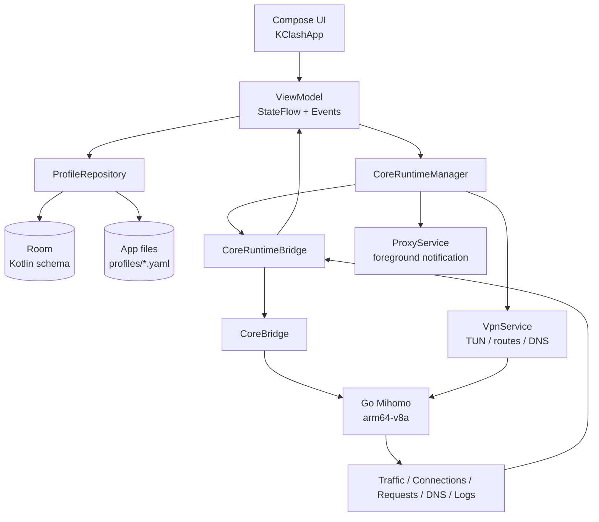
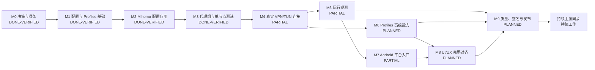

# KClash Kotlin 重写路线图

> 文档类型：产品迁移路线图、功能矩阵、依赖图和验收门槛
>
> 最后核对：2026-10-27（北京时间）
>
> 当前基线：`kotlin` 分支；首页/配置导航、Profiles ViewModel、内存 Room、Compose instrumentation 和 Redmi 真机验收均已完成首轮切片

这份路线图描述 KClash 从 Flutter 参考实现迁移为 Android 原生 Kotlin 应用的完整路径。它同时记录当前实现边界、功能完成度、前置依赖、验收证据和后续工作顺序。

路线图不把“代码存在”“单元测试通过”“真机产品可用”混为一谈。每个功能必须分别经过代码完成、自动化验证和真实设备验收，才能进入已完成状态。

## 1. 固定产品边界

| 项目 | 已确认决策 |
| --- | --- |
| 产品显示名称 | `KClash` |
| Android 包名 | `com.lonnnnnng.flclash` |
| Kotlin 主线 | Git 分支 `kotlin`，长期主分支 |
| Flutter 参考 | `main` / `upstream/main`，只用于行为和视觉参考 |
| 上游仓库 | `chen08209/FlClash` |
| 个人 fork | `lonnnnnng/FlClash` |
| 数据迁移 | 不做 Flutter/Drift 数据迁移；这是全新应用 |
| Android 范围 | Android 手机，首发覆盖竖屏和横屏 |
| 不纳入首发 | Android TV、平板、车机、桌面托盘和桌面 Helper |
| Android 最低版本 | API 24 |
| 编译与目标版本 | compile/target SDK 37，需随工具链和发布要求复核 |
| ABI | 只构建、测试和发布 `arm64-v8a` |
| 验收设备 | Redmi Note 8 Pro，serial 每次操作前重新读取 |
| 当前验收设备 | `wsvwypiz7xwslvl7`，Android 16 / API 36 |
| 真机验收订阅 | 只使用当前工作区根目录 `AGENTS.md` 中列出的两条用户授权测试路径 |
| 发布签名 | 发布阶段创建新的独立 keystore，不复用 Flutter 签名 |
| 核心 | Go Mihomo，Android 应用通过 Kotlin Bridge 使用 |

## 2. 状态定义

| 状态 | 含义 |
| --- | --- |
| `DONE-VERIFIED` | 代码完成，自动化检查通过，并有真机或端到端证据 |
| `DONE-UNIT` | 代码完成，单元测试或构建通过，但真实设备链路尚未覆盖 |
| `PARTIAL` | 已有基础代码或局部行为，尚未达到 Flutter Android 功能闭环 |
| `PLANNED` | 已明确范围和验收方式，尚未开始实现 |
| `BLOCKED` | 存在明确外部阻塞条件；当前没有将普通未实现项标为阻塞 |
| `DEFERRED` | 明确不进入当前 Android 手机首发范围 |

## 3. 当前快照

| 维度 | 当前状态 |
| --- | --- |
| 当前分支 | `kotlin` |
| 远端关系 | `kotlin` 是长期主线，`origin/kotlin` 与当前本地切片保持同步；Flutter 变更继续由 `upstream` 追踪 |
| 当前版本 | `versionName 0.1.0`，`versionCode 1` |
| Gradle 工程 | 根目录 Wrapper + `app` / `core` / `service` / `common` |
| UI 技术 | Jetpack Compose + Material 3 |
| 状态管理 | ViewModel + StateFlow + 单向事件流 |
| 数据 | Room 新 schema + 应用独立文件目录 |
| 依赖注入 | Hilt |
| 核心生命周期 | `CoreRuntimeManager` 已接入启动、停止、配置应用、代理组读取、节点切换和测速 |
| 单元测试 | 124 项通过，失败 0，错误 0，跳过 0 |
| Compose/Room instrumentation | 18 项通过，失败 0，错误 0，跳过 0；Room 3 项，Compose 15 项 |
| Debug 构建 | `./gradlew test :app:assembleDebug --no-daemon` 已通过 |
| Debug APK | `android/app/build/outputs/apk/debug/app-debug.apk` |
| Debug 原生库 | APK 内只包含 `lib/arm64-v8a/libclash.so` |
| 最近真机证据 | 订阅启动、TUN/前台服务、代理组读取、Selector 状态、运行统计卡片、真实请求诊断、诊断会话证据包导出、运行诊断历史详情与导出、核心/网络/DNS 运行事件记录、活动连接/Requests/DNS/日志非空记录、观测详情搜索与日志级别筛选、Deep Link 订阅导入、进程重建恢复及首页 `CORE_RESTARTED` 历史展示、通知栏 STOP、桌面快捷入口、Quick Settings Tile、事件流健康摘要 Compose 断言和停止清理均已在 `wsvwypiz7xwslvl7` 验证 |

## 4. 目标架构图

架构目标是让 `CoreRuntimeManager` 成为唯一的核心生命周期事实来源。页面、`ProxyService` 和 `VpnService` 不各自创建或销毁 Mihomo 实例。当前代理组和测速已经遵循这条边界；VPN/TUN 仍处于基础设施存在但业务链路未完全接入的过渡状态。

## 5. 里程碑总图

## 6. 已完成里程碑

### M0：决策、仓库和原生工程骨架 — `DONE-VERIFIED`

已完成内容：

- 建立 `kotlin` 长期主线，保留 `upstream` 作为 Flutter 追踪来源。
- 确定 KClash 产品名、包名、API 下限、ARM64-only、真机验收边界和独立签名边界。
- 根目录建立 Android Gradle 工程和 Wrapper。
- 建立 `app`、`core`、`service`、`common` 模块。
- 接入 Compose、Material 3、Hilt、Room、StateFlow 和基础 ViewModel。
- gomobile 只生成 `android-arm64` / `arm64-v8a` 核心库。
- 建立 `AGENTS.md`、`.agents/`、`CONTEXT.md`、ADR 和上游同步规则。

完成证据：

- 根目录 `./gradlew` 可用。
- Debug APK 已安装到 Redmi 真机。
- APK 内原生库只包含 `lib/arm64-v8a/libclash.so`。

### M1：Profiles 与本地配置基础 — `DONE-VERIFIED`

已完成内容：

- Room `profiles` 表和应用偏好表。
- 当前配置选择和重启后恢复。
- 远程订阅 URL 导入。
- 订阅响应下载和 `subscription-userinfo` 用量解析。
- 重复订阅检测。
- 本地 YAML 文件导入。
- 自定义配置创建。
- 本地配置删除。
- 配置文件原子替换写入。
- 本地配置内容读取和基础 YAML 编辑器。
- 远程订阅手动同步。
- 核心运行期间阻止配置选择和编辑，避免运行输入与用户编辑内容分裂。

未纳入 M1 完成定义的内容：高级分区编辑、备份恢复和完整自动更新调度；Deep Link 基础导入及本轮冷启动、重复导入和错误反馈回归已完成。二维码图片导入已完成代码、单元测试和当前两条授权路径真机验收。

### M2：Mihomo 配置校验与应用 — `DONE-VERIFIED`

已完成内容：

- `initClash` Bridge。
- 配置文件复制到 Mihomo 独立目录。
- 原子 staging，避免核心读取半写入文件。
- `validateConfig` 独立校验。
- 只有校验成功后才调用 `setupConfig`。
- 核心启动、停止、初始化失败状态。
- 运行状态 `STOPPED / STARTING / RUNNING / STOPPING / FAILED`。
- 启停、配置应用和代理操作共用 `CoreRuntimeManager.transitionLock`。
- 失败时不伪造“核心已运行”。

真机已验证：启动核心、前台通知出现、代理组可读取、核心停止后服务退出。

### M3：代理组、Selector 切换与单节点测速 — `DONE-VERIFIED`

已完成内容：

- `getProxies` Bridge 和类型安全的代理组模型。
- 保留核心返回的代理组顺序。
- 读取 `name`、`type`、`now`、`all`、`hidden`、`testUrl`。
- Selector 节点切换。
- 切换后重新读取核心状态，不以本地点击结果冒充核心确认。
- `asyncTestDelay` Bridge。
- 使用代理组 `testUrl`，未配置时使用 Mihomo 默认测试地址。
- 延迟结果按代理组、节点和测试 URL 隔离。
- 正数延迟、超时、失败、空结果和测速中状态。
- Selector 对话框内逐节点测速按钮。

真机已验证：

- 读取真实 `GLOBAL`、`Atom`、`Auto`。
- `DIRECT` 返回 `160 ms`。
- 不可用节点显示“失败”。
- `DIRECT → FR-1-01` 切换成功。

当前明确未纳入 M3：URLTest/Fallback 完整选择语义、批量测速、搜索过滤、延迟结果持久化、Tab/List 双布局和 Flutter 节点列表完整交互。

## 7. 进行中和未完成的功能矩阵

### 7.1 真实连接链路

状态：`PARTIAL`，代码启动链、TUN 生命周期、后台恢复、系统撤销 VPN、Wi‑Fi 断开恢复、进程重建和两条授权路径的真实请求诊断已打通；Wi‑Fi↔移动网络切换仍需具备蜂窝网络条件后补齐。

当前已有：

- Android `VpnService` 基础实现。
- TUN 地址、路由、DNS、IPv6 和访问控制参数模型。
- `Core.startTun` / `Core.stopTun` 调用。
- 网络观察和 DNS 更新基础设施。
- `NetworkObserver` 已纳入 `ProxyService`/`VpnService` 的模块生命周期；停止服务时注销 Connectivity 回调、清空 DNS/网络缓存并重置 Mihomo 网络连接。
- 前台 `ProxyService` 通知模块。
- `ServiceConfig` 发布 `STOPPED / STARTING / CONNECTED / FAILED` VPN 状态和失败原因。
- `VpnService.onStartCommand()` 已进入真实 `start()`，成功建立 TUN 后才发布 `CONNECTED`。
- `DefaultVpnOptionsProvider` 已提供 Android 手机首阶段默认 TUN 配置，并由 `CoreRuntimeManager` 注入。
- `AndroidProxyServiceController` 已统一启动 ProxyService、VpnService，并等待 VPN 状态或 15 秒超时。
- `MainActivity` 已接入 `VpnService.prepare()` 和 Activity Result 授权回调。
- 启动失败会停止服务、清理监听器，管理器不会把失败报告为 `RUNNING`。
- 停止时向绑定中的 `VpnService` 发送显式 stop action，再停止服务组件，避免系统绑定导致 TUN 残留。
- `RuntimeResumeStore` 将“用户希望核心保持运行”的意图持久化到 Room；启动成功前写入，显式停止、系统撤销和启动失败时清除。
- `KClashApplication` 在进程创建时检查恢复意图和 VPN 授权，授权有效时复用 `CoreRuntimeManager.startProxy()` 自动恢复核心。
- `ProxyService` 与 `VpnService` 对系统重建传入的 `null Intent` 返回 `START_NOT_STICKY`，让 Application 先恢复进程内 `VpnOptions` 后再显式启动，避免 `START_STICKY` 服务抢跑。
- 服务层和管理器新增失败回滚、系统撤销和撤销后重启测试；当前总计 98 项 Kotlin 单元测试通过。

本轮真机验收记录（2026-10-25，设备 `wsvwypiz7xwslvl7`，Android 16 / API 36）：

- 使用当时可用的远程订阅启动成功，UI 显示“核心运行中”；该历史地址已从当前真机验收清单移除，后续只使用当前工作区根目录 `AGENTS.md` 列出的两条授权路径。
- `dumpsys activity services` 观察到 `VpnService` 和 `ProxyService` 均为前台服务。
- `ip route` 观察到 `198.18.0.0/30 dev tun0`，Mihomo 日志出现从 `198.18.0.1` 发出的 TCP/UDP TUN 流量。
- 设备内 `curl -I http://1.1.1.1` 返回 `HTTP/1.1 301 Moved Permanently`，证明启用 TUN 时设备网络请求仍可完成；尚未将该请求与选定代理节点做可归因的端到端关联。
- 点击停止后 UI 显示“核心已停止”，服务记录、`tun0`、`198.18.0.0/30` 路由均消失；`dumpsys connectivity` 未留下 KClash VPN 网络。
- 临时将 `ACTIVATE_VPN` 设为 deny 后重新启动，系统显示 KClash VPN 授权对话框；点击“取消”后 UI 回到“核心已停止”，显示“VPN 权限未授予”，且未留下前台服务、`tun0` 或 VPN 路由；随后已恢复 `ACTIVATE_VPN: allow`。
- 旧本地测试配置曾被核心拒绝，错误为 `proxy DIRECT is the duplicate name`；该失败状态正确回显，未作为成功证据。
- 使用第二条当前授权路径启动后，通过系统“设置 → VPN → KClash → 断开连接”触发真实系统撤销；`VpnService.onRevoke()` 清理 TUN 并通知应用内 `ServiceBroadcastReceiver`，首页回到“核心启动失败”。
- 系统撤销后 `VpnService`、`ProxyService`、`tun0`、`198.18.0.0/30` 路由和 KClash VPN 网络均消失；同一 Profile 再次点击“启动核心”成功恢复运行，随后停止并删除 Profile，设备回到“还没有配置”空态。
- 使用第一条当前授权路径启动后按 Home 进入后台 10 秒，`VpnService`、`ProxyService`、`tun0` 和 `198.18.0.0/30` 路由持续存在；重新打开 KClash 首页仍显示“核心运行中”，DNS 事件继续到达，随后停止并删除 Profile。
- 使用第一条当前授权路径启动后关闭 Wi‑Fi，等待 7 秒确认底层 Wi‑Fi 网络消失；VPN 网络的 `UnderlyingNetworks` 变为空，但 `VpnService`、`ProxyService`、`tun0` 和 `198.18.0.0/30` 路由仍保持，应用进程未退出。重新开启 Wi‑Fi 后，底层接口恢复并绑定新的网络句柄，VPN、服务和路由保持；通过 TUN 发起的 `ping 1.1.1.1` 成功，Mihomo 日志出现 DNS 更新。
- 本轮设备蜂窝数据未注册且不可用，因此没有把 Wi‑Fi↔移动网络切换写成完成证据；测试 Profile 已通过应用内删除，设备回到“还没有配置”空态。
- 进程重建验收：使用第二条当前授权路径启动后，记录旧 PID `16207`；通过 `cmd activity crash com.lonnnnnng.flclash` 触发进程退出，4 秒后出现新 PID `16637`。20 秒后两个前台服务、`tun0` 和 `198.18.0.0/30` 路由均保持，重新打开首页仍显示“核心运行中”；停止后服务和路由清理完成，Profile 通过应用内删除并恢复“还没有配置”空态。

当前缺失：

- `ServiceConfig.vpnOptions` 仍是首阶段默认配置，尚未从 Mihomo 配置/Android 设置真实映射 mixed-port、tun stack 和路由覆盖项。
- 首次安装或清除数据后的 VPN 授权弹窗尚未在本轮干净状态中重测；临时拒绝授权后的失败回滚路径和运行期间系统撤销 VPN 的路径已验证。
- 已完成“当前代理组/节点 → 受控真实请求 → HTTP 状态、代理链、规则、Requests、DNS、Logs 和累计流量”的首轮真机归因闭环；活动连接在第二条授权路径的 7.4 秒请求中捕获到 1 条。
- Wi‑Fi 断开/恢复和进程重建已完成真机验证；尚未覆盖真实 Wi‑Fi↔移动网络切换，当前设备蜂窝网络未注册。

完成门槛：

1. 首次启动能解释并申请 VPN 权限。
2. 用户授权后能建立 TUN，拒绝时保持失败状态并给出可理解原因。
3. 真实网络请求经过 Mihomo，代理组选择对请求生效。
4. 停止后 TUN、前台服务和核心全部释放。
5. 真机重启应用、切换 Wi-Fi/移动网络、切后台再恢复和进程重建均不会产生悬挂隧道；其中后台恢复、Wi‑Fi 断开恢复和进程重建已完成，Wi‑Fi↔移动网络切换仍待验证。

### 7.2 连接、流量和运行观测

状态：`PARTIAL`，流量、连接数、活动连接、Requests、DNS 和核心日志的基础观测与真实请求归因已验证，详情级交互已支持搜索、筛选、自动跟随和脱敏导出，事件流已具备有界背压和健康统计，运行诊断历史已接入 Room、在进程重建后直接展示恢复事件，并支持完整详情查看和独立脱敏导出；稳定故障归因、建议文案、脱敏原始详情和诊断导出元数据已完成，仍需补齐完整页面级端到端覆盖。

当前已有：

- `CoreBridge` 已映射 Mihomo `getTraffic`、`getTotalTraffic` 和 `getConnectionCount`，并对负数计数做边界归一化。
- `CoreRuntimeManager` 只在核心运行状态下读取三类统计，避免停止状态访问已释放的核心。
- `MainViewModel` 只在核心运行且首页 Activity 可见时每秒轮询统计；页面进入后台会取消收集，停止或进入错误时清理/回显状态。
- Compose 首页已提供运行统计卡片，展示上传、下载、连接数和累计流量，并覆盖停止态、加载态和错误态。
- `CoreBridge`、`CoreRuntimeManager` 和 `MainViewModel` 已接入 Mihomo `getConnections`，首页显示活动连接数量、目标、进程、代理链、规则和上下行计数。
- `CoreBridge` 已接入 `updateEventListener()`，解析 Go 核心的 `message.arguments` 批次，并将 `request`、`requestTraffic` 事件转换为 Kotlin 领域事件。
- `CoreBridge` 已将 `dns`、`log` 事件转换为稳定的 Kotlin `CoreDnsQuery` 和 `CoreEvent.Log`，并覆盖 DNS 字段、日志级别和损坏事件丢弃测试。
- `CoreRuntimeManager` 在核心运行期间安装事件监听器和 Mihomo 日志泵，停止或启动失败时成对释放；事件流不经过 Compose 或 gomobile 生成类型。
- `MainViewModel` 已维护最近 2000 条 Requests 历史，并按连接 ID 合并上下行流量更新；首页提供请求空态、最近记录和完整记录对话框。
- `MainViewModel` 已维护最近 1000 条 DNS 查询和核心日志，停止核心时清空运行观测，并提供用户主动清空入口。
- Compose 首页已提供 DNS 查询和核心日志卡片、最近记录和完整记录对话框，覆盖停止态、空态和错误日志颜色提示。
- 核心日志详情和首页卡片提供系统文件导出；导出前遮蔽 URL 查询参数、JSON 凭据字段和常见 token/key/secret/password/url 值。
- `CoreBridge.probe`、`CoreRuntimeManager.probe` 和首页“真实请求诊断”卡片已接入；结果包含 HTTP 状态、耗时、最终 URL、代理链、规则和核心路由版本，且不保留响应正文。

仍需补齐的 Bridge / Repository / UI：

- 完整页面级端到端断言，以及更细的诊断筛选和导出体验。

本轮自动化与真机证据（2026-10-25，设备 `wsvwypiz7xwslvl7`）：

- `./gradlew test :app:assembleDebug --no-daemon` 通过；98 项 Kotlin 单元测试通过，失败 0，错误 0，跳过 0。
- Debug APK 安装成功；启动核心后首页实际收到 DNS 查询（4 条）和核心日志（3 条），卡片出现“查看全部/清空”操作；停止态观测卡片恢复启动核心提示。
- 停止后 `tun0`、`198.18.0.0/30` 路由和 KClash 前台服务均已清理。
- 本轮只使用当前工作区根目录 `AGENTS.md` 列出的两条用户授权路径；第一条诊断返回 HTTP 403 / 1.6 秒，第二条诊断返回 HTTP 200 / 7.4 秒。
- 第一条路径 UI 显示真实代理链和 `Match` 规则，请求记录达到 10 条、累计流量非零；第二条路径 UI 捕获活动连接 1 条、请求记录 17 条、DNS 查询 26 条、核心日志 31 条、累计流量非零。
- 两条路径均在停止后清理 `tun0`、`198.18.0.0/30` 路由和 KClash 前台服务；测试 Profile 均通过应用内删除，设备恢复空配置状态。
- Deep Link 切片真机导入使用当前授权清单中的第一条路径；该次导入成功并显示订阅用量，测试 Profile 已在验收后删除。

本轮观测详情交互切片（2026-10-26，设备 `wsvwypiz7xwslvl7`）：

- Requests 详情对话框支持按目标、进程、代理链和规则大小写不敏感搜索，并显示过滤后数量；DNS 详情对话框支持按域名、上游、答案和错误搜索。
- 核心日志详情对话框支持内容搜索和“全部/错误/警告”级别筛选；筛选无匹配时显示明确空态，不隐藏原始记录总数。
- 三类详情列表共用自动跟随最新事件的滚动行为；用户向上翻阅历史后保持当前位置，改变筛选条件时回到最新匹配项。
- 新增 3 项筛选语义和 1 项日志导出脱敏单元测试；`./gradlew :app:testDebugUnitTest :app:compileDebugKotlin --no-daemon` 通过，工程总计 102 项 Kotlin 单元测试通过。
- 安装 Debug APK 后启动第一条当前授权路径，首页捕获活动连接 1 条、请求 4 条、DNS 查询 13 条和核心日志 8 条；打开三类详情对话框分别看到搜索框，其中日志点击“错误”后显示 `0/8` 和“没有匹配的核心日志”。
- 核心日志详情和首页卡片新增系统文件导出；导出文件使用 UTF‑8 表格文本格式，URL 查询参数、JSON 凭据字段和常见 token/key/secret/password/url 值统一替换为 `[REDACTED_SECRET]`。
- 真机通过 Android `DocumentsUI` 保存 `kclash-logs-*.txt` 到 `Download/kclash-qr`；文件大小 1634 bytes、17 行，前两行为导出标题和列名，设备侧检查到 61 个脱敏标记，未把原始凭据写入导出文件。
- 通过 `adb -s wsvwypiz7xwslvl7 shell am start -a com.lonnnnnng.flclash.action.STOP` 停止核心，确认 `VpnService`、`ProxyService`、`tun0` 和 `198.18.0.0/30` 路由清理；随后应用内删除测试 Profile，首页恢复“还没有配置”，未发现 `FATAL EXCEPTION`。

完成门槛：

- 每个页面都有 loading、空数据、刷新、错误和停止核心状态。
- 观测数据不会阻塞启停和代理切换。
- 真机能看到一条实际请求从连接、请求、DNS 和日志侧的可追踪证据。

### 7.3 Profiles 高级能力

状态：`PARTIAL`，基础能力已完成，完整 Flutter parity 未开始。

已完成本轮切片：

- `clash://install-config`、`clashmeta://install-config`、`flclash://install-config` 和 `kclash://install-config` 的 Android 入口声明。
- Deep Link `url` 参数 URL 解码、HTTP/HTTPS 校验和可选名称解析。
- Deep Link 导入复用 `ProfilesViewModel.addRemote`，不在 Activity 中重复下载或写入 Profile。
- 无效 Scheme、Host、目标协议或缺失参数会通过现有 Snackbar 错误流提示，不能创建半成品 Profile。
- 二维码图片选择、QR 格式识别和配置链接解析已接入添加 Profile 对话框；直接 HTTP(S) 链接和四种 KClash Deep Link 统一复用同一解析器及远程订阅写入链路。
- 核心运行期间阻止 Profile 删除；Compose 入口与 `ProfilesViewModel` 共享运行态守卫，避免当前核心继续持有已删除或被切换的配置文件。

本轮自动化与真机证据（2026-10-25，设备 `wsvwypiz7xwslvl7`）：

- `:app:testDebugUnitTest` 通过，新增 Deep Link 解析用例覆盖编码 URL、四种协议、非法 Host、非 HTTP(S) 目标和缺失参数。
- `:app:assembleDebug` 通过，APK 只包含 `arm64-v8a` 的原生库。
- 通过 `kclash://install-config` 触发当前授权订阅导入，设备 UI 显示远程订阅及用量信息；随后删除该测试 Profile，恢复空配置状态。
- 强制停止应用后再通过 `kclash://install-config` 冷启动导入成功；再次发送同一链接显示“该订阅已经添加”，没有创建重复 Profile。
- 二维码解析分支已通过 JVM 单元测试和 Debug 构建；两条当前授权路径均已通过二维码图片在真机导入，第一条显示订阅用量，第二条显示 `clash-1220f4ac` 远程订阅。
- 第二条路径首次暴露 HTTP 301 跨协议重定向缺口，已限制放行 `clash.tkbond.us` 的明文入口并由订阅客户端手动跟随 HTTP/HTTPS 重定向；新增本地 301→200 回归测试。
- 第二条二维码重复导入显示“该订阅已经添加”；验收结束后两个测试 Profile 均通过应用内删除，设备恢复“还没有配置”空态。

待完成：

- YAML 编辑器语法体验、搜索、定位、错误行提示和大文件性能。
- Rules 分区编辑。
- Proxies 分区编辑。
- Proxy Groups 分区编辑。
- Providers 分区编辑。
- Scripts、Overrides、Dialers 等高级配置。
- 订阅自动更新调度、失败重试和通知。
- Profile 排序 UI。
- 备份和恢复。
- Profile 级别的当前代理组选择、展开状态和其他 Flutter 行为数据。

完成门槛：

- 远程订阅、文件、手工配置、二维码、Deep Link 五种入口的行为一致。
- 编辑内容通过 Mihomo 校验后才能应用。
- 订阅更新失败不会破坏上一份可运行配置。

### 7.4 代理组完整交互

状态：`PARTIAL`。

待完成：

- URLTest/Fallback 的当前节点和自动选择语义。
- `fixed`、`now`、`selectedMap` 等核心状态映射。
- 单组批量测速。
- 按搜索文本筛选节点。
- 超时节点隐藏和失败节点回滚策略。
- Tab/List 两种布局。
- 展开、折叠、滚动定位。
- 延迟结果缓存和按测试 URL 失效。
- 代理组选择状态写回 Profile。

完成门槛：

- Selector、URLTest、Fallback、LoadBalance 都能按照 Flutter Android 行为展示。
- 切换、测速、刷新并发时不会覆盖其他操作的状态。
- 所有失败都保留核心错误，不使用历史成功状态掩盖失败。

### 7.5 Android 平台入口

状态：`PARTIAL`。

已完成：

- 前台通知保留 STOP 操作；通知动作通过受保护的 `QuickActionActivity` 进入 `CoreRuntimeManager.stop()`。
- Android 13+ 首次进入 `MainActivity` 时申请 `POST_NOTIFICATIONS`，避免用户看不到前台服务和停止入口。
- 桌面静态快捷方式提供启动、停止、切换三个入口；三个入口均通过同一个 `QuickActionActivity` 进入 `CoreRuntimeManager`。
- Quick Settings Tile 提供启动/停止切换入口；Tile 状态由 `CoreRuntimeManager.state` 映射，点击通过 `QuickActionActivity` 折叠系统面板并复用 `TOGGLE`。
- 外部 Action 提供 `com.lonnnnnng.flclash.action.START/STOP/TOGGLE`；公开入口只接受固定 action，拒绝 URI 和 extras，再转发到内部 `QuickActionActivity`。
- 首页提供电池优化状态卡片和系统设置引导；状态由 `PowerManager.isIgnoringBatteryOptimizations()` 读取，不能以 UI 点击结果代替系统授权。
- `QuickActionActivity` 使用 `VpnService.prepare()` 处理启动入口的系统授权边界；自身不导出，快捷入口使用显式组件调用。
- AndroidManifest、快捷方式 Intent 和组件导出边界已完成基础安全核对。

本轮验收证据（2026-10-26，设备 `wsvwypiz7xwslvl7`，Android 16 / API 36）：

- `./gradlew test :app:assembleDebug --no-daemon`：通过；工程 Kotlin 单元测试 98 项，失败 0、错误 0、跳过 0；APK 仅包含 `arm64-v8a` 原生库。
- 安装 Debug APK 后，系统 `cmd shortcut get-shortcuts` 返回 `start`、`stop`、`toggle` 三个静态快捷方式；启动器长按 KClash 图标显示“启动 KClash 核心”“停止 KClash 核心”“切换 KClash 核心运行状态”。
- 从启动器点击“启动 KClash 核心”后，`VpnService`、`ProxyService`、`tun0` 和 `198.18.0.0/30` 路由出现；点击“停止 KClash 核心”后服务和路由均清理。
- 从启动器两次点击“切换 KClash 核心运行状态”，分别验证启动和停止；停止后设备恢复无 KClash 服务、无 `tun0` 的状态。
- 通过 `adb -s wsvwypiz7xwslvl7 shell cmd statusbar add-tile com.lonnnnnng.flclash/.KClashTileService` 将 Tile 加入系统快捷设置；点击后启动核心，系统面板无障碍描述为“`KClash：核心运行中`”。再次点击后服务、`tun0` 和路由清理，面板描述变为“`KClash：核心已停止`”。
- 通过 ADB 隐式 Action 验证 `START`、`STOP`、`TOGGLE`：启动/停止服务与 `tun0` 状态均正确切换；携带额外参数的 Action 被公开入口拒绝，未启动服务。
- 首页“后台运行”卡片显示真实未忽略状态；点击“打开电池优化设置”进入系统 `RequestIgnoreBatteryOptimizations` 页面，返回后状态仍由系统值刷新，本轮未替用户点击“允许”。
- 验收 Profile 已通过应用内删除，首页恢复“还没有配置”。

待完成：

- Tasker/MacroDroid 实际应用回归（当前已完成 ADB/Intent 契约验证）。
- 按应用代理的应用选择器。
- Always-on VPN 的完整配置和系统设置兼容。
- Android 组件导出、Intent 和权限的完整自动化审计。

完成门槛：

- 外部入口和页面入口进入同一个 `CoreRuntimeManager`，不产生第二套启停逻辑。
- 被系统拒绝或权限缺失时可见地失败。
- 所有导出的组件都有明确的最小权限边界。

### 7.6 UI/UX 完整对齐

状态：`PARTIAL`。

当前已有：

- Compose + Material 3 基础主题。
- 首页/配置两个手机目的地、核心状态和代理组交互。
- Edge-to-edge 基础设置。

待完成：

- Flutter 页面信息架构和 Android 手机导航结构对齐。
- Dashboard、Profiles、Proxy、Connection、Requests、DNS、Logs 页面。
- Material You 动态颜色、浅色/深色主题。
- Flutter 连续圆角、底部面板、弹层和交互节奏。
- 横屏布局和小屏滚动策略。
- 无障碍语义、内容描述、触控区域和大字体。
- 截图基线和 Compose screenshot regression。

完成门槛：

- 关键用户流程在 Flutter 参考和 KClash Android 上逐屏比对。
- 旋转、恢复、进程重建后状态不丢失。
- UI 不直接调用 Core、gomobile 或数据库。

### 7.7 测试、发布和运维

状态：`PARTIAL`。

当前已有：

- 124 项 Kotlin 单元测试。
- Debug APK 构建和 arm64 产物检查。
- `:app:lintDebug` 已通过；当前仍有 31 条非阻断警告，错误为 0。
- 18 项 instrumentation 测试，其中 Room 3 项、Compose 15 项（诊断卡片 4 项、Profiles 9 项、MainActivity 宿主 2 项）。
- Redmi 真机启动、停止、代理组和测速验证。
- Redmi 真机已验证 DNS/日志观测卡片的停止态和空态展示，以及两条授权路径的真实请求归因。

待完成：

- 完整页面级 Compose/Instrumentation 测试，当前已有事件流摘要、诊断归因和 Room DAO 覆盖。
- VPN 权限、TUN 停止清理、后台恢复、系统撤销 VPN、Wi‑Fi 断开恢复、进程重建和 `dumpsys connectivity` 真机测试已有证据；Wi‑Fi↔移动网络切换仍待完成。
- 连接、请求、DNS、日志端到端测试的自动化脚本和稳定断言。
- R8、Release 构建和 APK 签名检查。
- 新 release keystore。
- GitHub Actions arm64 构建。
- Release 页面、更新日志、SHA-256 和回滚材料。
- 上游变更后的功能矩阵和回归记录。

完成门槛：

- Debug 和 Release 都能从干净环境构建。
- 发布 APK 只有 `arm64-v8a`。
- 签名、版本、包名、产物哈希和远端 Release 资产都能复核。
- 真机验收记录包含设备 serial、步骤、结果和关键日志。

## 8. 推荐推进顺序

### N1：建立真实连接状态和 VPN 权限链

目标：让“启动核心”升级为“启动可用代理连接”。

当前进度：VPN 授权、TUN 生命周期、后台恢复、系统撤销、Wi‑Fi 断开恢复和进程重建已经完成真机闭环；下一项只剩在具备蜂窝网络条件的设备上验证 Wi‑Fi↔移动网络切换。

收尾范围：

1. 在具备已注册蜂窝数据的设备上验证 Wi‑Fi↔移动网络切换。
2. 记录切换期间 `UnderlyingNetworks`、TUN、路由、前台服务和真实请求的连续性。
3. 若切换失败，保留失败 Run，修复网络绑定或服务收口后再复验。

不在 N1 混入：Connections、Requests、DNS 页面和 UI 大改版。

### N2：真实流量和核心观测

目标：用户能确认代理正在工作，并能解释网络行为。

当前进度：Bridge、运行统计、活动连接、Requests、DNS、基础日志和“真实请求诊断”已完成首轮真机闭环；观测详情搜索、日志级别筛选、自动跟随、诊断会话证据包、有界运行诊断事件历史、事件流背压统计、诊断卡片事件流健康摘要、稳定故障归因、异步事件停止边界、页面退出轮询收敛、真实高负载压力验收和事件流摘要 Compose instrumentation 断言已完成代码、自动化测试和 Redmi 真机闭环，下一步集中在完整页面级端到端覆盖。

建议范围：

1. Bridge 流量和连接 API。
2. Dashboard 流量卡片。
3. Connections 页面。
4. Requests 页面。
5. 基础日志流。

### N3：DNS、日志和故障诊断

目标：让真机问题可以在应用内定位，而不是只能依赖 logcat。

当前进度：DNS/日志 Bridge、列表、清空、内容筛选、日志级别筛选、脱敏导出、诊断会话证据包、运行诊断历史详情/导出、诊断卡片事件流健康摘要、稳定故障归因和核心/网络/DNS 运行诊断记录已完成代码、单元测试和 Redmi 真机闭环；Room 持久化、迁移、生命周期锚点、异步网络事件停止边界、页面退出轮询收敛和进程重建后的首页历史展示均已完成自动化与真机验证，下一步集中在完整页面级端到端覆盖。

建议范围：

1. DNS 查询 Bridge 和列表。
2. 日志导出、过滤、清空和更细的故障诊断边界。
3. 统一错误码和用户可见错误文案。
4. 网络切换、DNS 变化和核心重启的诊断记录。

### 2026-10-26：诊断会话证据包切片

- `./gradlew test :app:assembleDebug :app:lintDebug --no-daemon` 通过；工程共 105 项 Kotlin 单元测试，失败 0、错误 0、跳过 0。
- Debug APK 安装到 `wsvwypiz7xwslvl7`（Redmi Note 8 Pro，Android 16/API 36）；APK 内原生库仅包含 `arm64-v8a`。
- 使用当前工作区根目录 `AGENTS.md` 中的第一条授权路径导入远程 Profile；启动后首页显示“核心运行中”，`VpnService`/`ProxyService`、`tun0` 和 `198.18.0.0/30` 路由均存在。
- 点击“测试当前路由”后，首页显示“诊断会话：通过 · 请求 11 · DNS 6 · 日志 12”，断言为“HTTP 状态、代理链和核心归因均有效”，本次 HTTP 状态为 403。
- 通过 Android `DocumentsUI` 导出 `kclash-diagnostic-1.txt`；设备侧确认文件约 3 KB、41 行，包含表头和 `[requests]`/`[dns]`/`[logs]` 分区，存在脱敏标记，未命中测试秘密值。
- 通过外部 STOP Action 停止核心后，前台服务、`tun0` 和 `198.18.0.0/30` 路由均清理；应用内删除测试 Profile 后回到“还没有配置”，未发现 `FATAL EXCEPTION`。

### 2026-10-26：运行诊断事件记录切片

- 新增固定上限 200 条的运行诊断历史，记录核心启动、重启、停止、失败、VPN 撤销、底层网络可用/即将丢失/丢失/切换和 DNS 服务器变化；诊断证据包新增 `[runtime]` 分区。
- 新增 4 项单元测试，覆盖运行历史有界清理、清空、核心启动/停止/重启顺序和会话只在运行期间收集运行事件；全工程共 109 项测试通过。
- Redmi 真机使用第二条当前授权路径成功 probe：HTTP 200，UI 显示“诊断会话：通过 · 运行 3 · 请求 2 · DNS 8 · 日志 2”。
- 在核心保持运行期间关闭 Wi‑Fi 8 秒后重新开启，TUN、前台服务和 `198.18.0.0/30` 路由保持；恢复后再次 probe 成功，UI 显示“诊断会话：通过 · 运行 8 · 请求 2 · DNS 8 · 日志 2”。
- 新导出的诊断文件约 2 KB、33 行，包含 `CORE_STARTED`、`DNS_UPDATED`、`NETWORK_LOST`、`NETWORK_AVAILABLE`、`NETWORK_SWITCHED` 和三个观测分区，未命中测试秘密值。
- 第一条路径在 Wi‑Fi 恢复后的两次 probe 返回 EOF，UI 均标记诊断失败并保留运行事件；该失败没有被历史成功记录覆盖，随后切换到第二条授权路径完成成功复验。
- 停止核心并通过应用内删除两个测试 Profile 后，设备恢复“还没有配置”，服务、TUN、路由均清理，未发现 `FATAL EXCEPTION`。

### 2026-10-26：事件流背压与长期运行治理切片

- `CoreBridge` 将核心事件改为固定 256 条容量、`replay=0` 的有界共享流；回调线程只使用非阻塞 `tryEmit`，缓冲满时丢弃最新事件，不阻塞 Mihomo 回调线程。
- 单个 Go `message.arguments` 批次最多解析 512 条事件，`requestTraffic` 单批最多保留 256 条更新；超出部分不会继续在 Kotlin 堆中累积。
- 新增 `CoreEventFlowStats`，按一次核心运行会话统计解析批次、解析事件、成功投递、丢弃、批次截断和最近事件时间；`CoreRuntimeBridge`/`CoreRuntimeManager` 将健康状态暴露给诊断会话。
- 诊断证据包新增 `[event_flow]` 分区，记录上述统计，能够区分“没有事件”“事件已投递”和“事件因背压丢弃”。
- 新增事件批次上限、无订阅者丢弃、活动订阅者成功投递、背压丢弃和诊断导出统计测试；`./gradlew test :app:assembleDebug :app:lintDebug --no-daemon` 通过，工程总计 113 项 Kotlin 单元测试通过。
- 最终 Debug APK 安装到 `wsvwypiz7xwslvl7`（Redmi Note 8 Pro，Android 16/API 36），仅包含 `arm64-v8a`，SHA-256 为 `a5fa9f91db26b3fd5a7e1c1e930f17774f5da19939b1d6b6db297a4f51870ab4`。
- 使用第二条当前授权路径启动后首次 probe 出现一次真实网络失败；停止并重启核心后重试返回 HTTP 200，UI 显示“诊断会话：通过 · 运行 7 · 请求 2 · DNS 6 · 日志 2”。最终导出证据中的 `[event_flow]` 为 `parsed_batches=14`、`parsed_events=17`、`emitted_events=17`、`dropped_events=0`、`truncated_events=0`。
- 核心持续运行 40 秒后，PID `26899`、两个前台服务、`tun0` 和 `198.18.0.0/30` 路由保持，未发现应用 `FATAL EXCEPTION`。停止核心后服务和路由清理，测试 Profile 已删除并恢复“还没有配置”。
- 本切片已完成有界事件流和证据统计；真实高负载压力、页面退出轮询生命周期和进程重建后的完整诊断历史关联仍列为后续工作。

### 2026-10-26：运行诊断 Room 持久化边界切片

- `KClashDatabase` 升至 version 3，新增 `runtime_diagnostic_events` 表和 `MIGRATION_2_3`；`RoomRuntimeDiagnosticStore` 接入 `RuntimeDiagnosticHistory`，应用进程启动时先恢复有界历史，再决定是否把下一次核心启动标记为 `CORE_RESTARTED`。
- DAO trim 改为按自增 ID 保留最新 200 条，修复原实现插入 201 条时会多保留 1 条的边界错误；核心启动、停止和 VPN 撤销的生命周期锚点在方法返回前等待持久化，失败路径也会等待队列清空。
- 新增 JVM 断言，验证诊断历史与持久化存储的顺序一致，以及恢复历史后下一次自动启动记录为重启；`./gradlew test :app:assembleDebug :app:lintDebug --no-daemon` 通过，115 项 Kotlin 单元测试通过，失败 0、错误 0、跳过 0。
- 新增 Android instrumentation DAO 测试，使用当前连接的 Redmi Note 8 Pro（serial `wsvwypiz7xwslvl7`，Android 16/API 36）内存 Room 数据库插入 201 条并验证只保留最新 200 条、恢复顺序和 version 2→3 迁移表/索引；`:app:connectedDebugAndroidTest` 通过，3 项测试通过。
- Debug APK 构建通过，原生库仍仅包含 `arm64-v8a`，SHA-256 为 `dbcede6b6262d353b049309decc6e076f549980f5c7d9346d6bc13249d52590e`。
- 本切片仍未完成：应用被系统杀死后的端到端 UI 诊断历史关联、长时间/高负载下异步网络事件的最终落盘保证，以及页面退出后的轮询收敛。

### 2026-10-26：进程重建诊断历史 UI 关联切片

- `MainViewModel` 新增独立的 `diagnosticHistory` 状态流；核心停止时只清理本次运行的统计、连接、Requests、DNS、日志和 probe session，不再清空已恢复的运行诊断历史。
- 首页“真实请求诊断”卡片在未执行 probe 的 IDLE 状态也展示最近 3 条运行事件；`CORE_RESTARTED` 使用“核心重启（CORE_RESTARTED）”明确标识，用户打开首页即可判断历史是否已经恢复。
- 新增 JVM 断言覆盖恢复历史按最新事件倒序展示和重启标签；`./gradlew test :app:compileDebugKotlin :app:lintDebug --no-daemon` 通过，116 项 Kotlin 单元测试通过，失败 0、错误 0、跳过 0。
- 真机使用当前授权清单第一条路径导入 Profile 并启动核心；旧 PID `29928` 经 `cmd activity crash` 终止后，新 PID `30201` 恢复，两个前台服务、`tun0` 和 `198.18.0.0/30` 路由保持；重新打开首页直接看到“恢复历史：6 条”和“核心重启（CORE_RESTARTED）”，未再次执行 probe。
- 通过外部 STOP Action 后服务、TUN 和路由清理完成；临时 Profile 已在应用内删除，首页回到“还没有配置”，未发现 `FATAL EXCEPTION`。
- Debug APK 构建并安装到 `wsvwypiz7xwslvl7`，原生库仍仅包含 `arm64-v8a`，SHA-256 为 `ab620d45610151ba7a0a635e2a84125fcd11fc3a25652affac71805fafdfc4c9`。
- 本切片当时遗留：诊断历史在长时间/高负载异步网络事件下的最终落盘保证和页面退出后的轮询收敛；历史详情/导出入口已在后续切片完成。

### 2026-10-26：运行诊断历史详情与导出切片

- 首页诊断卡片在有恢复历史时提供“查看全部”和“导出”入口；详情弹窗按最新事件优先展示完整历史，并同时显示中文标签、原始 `RuntimeDiagnosticKind`、详情和相对时间。
- `MainActivity` 新增独立的运行诊断历史 `CreateDocument` 导出流程；导出前冻结事件快照，文件使用 UTF-8 表格文本，保留时间线、事件计数和原始枚举值，并复用 `[REDACTED_SECRET]` 脱敏规则。
- 新增 JVM 断言覆盖历史导出事件顺序、事件计数、原始枚举值和 URL/密码脱敏；`./gradlew :app:testDebugUnitTest :app:compileDebugKotlin :app:lintDebug --no-daemon` 通过，全工程 117 项 Kotlin 单元测试通过，失败 0、错误 0、跳过 0。
- `./gradlew test :app:assembleDebug :app:lintDebug --no-daemon` 和 `ANDROID_SERIAL=wsvwypiz7xwslvl7 ./gradlew :app:connectedDebugAndroidTest --no-daemon` 均通过；Room instrumentation 3 项测试通过，失败 0、错误 0、跳过 0。
- Debug APK 构建并安装到 `wsvwypiz7xwslvl7`（Redmi Note 8 Pro，Android 16/API 36），APK 内原生库仍仅包含 `arm64-v8a`。
- 使用当前授权清单第一条路径启动核心，首页显示“恢复历史：3 条”；点击“查看全部”打开“运行诊断历史（3）”弹窗，看到 `DNS_UPDATED`、`CORE_STARTED` 和 `NETWORK_AVAILABLE` 详情；点击“导出”后通过 Android `DocumentsUI` 保存运行诊断历史文件，设备侧文件大小 224 bytes，包含 `event_count=3` 和三类事件记录。
- 通过外部 STOP Action 停止核心后，服务和 TUN 路由清理；应用内删除测试 Profile，首页恢复“还没有配置”，未发现 `FATAL EXCEPTION`。
- 本切片已完成；真实高负载异步网络事件最终落盘和页面退出后的轮询收敛仍列为后续工作。

### 2026-10-26：异步网络诊断事件最终落盘切片

- `NetworkObserver` 的网络回调、延迟 DNS 任务和停止动作现在共享生命周期锁；停止时先关闭回调闸门并取消延迟任务，尾部网络事件不会在核心停止后重新进入诊断历史。
- `RuntimeDiagnosticHistory.flush()` 改为等待持久化尾任务，并在尾任务稳定且没有活动写入后才返回；重复 STOP、失败回滚和正常停止都等待诊断尾巴落盘。
- 新增受控挂起存储单元测试，验证异步 append 尚未完成时 `flush()` 不会提前返回；`./gradlew test :app:assembleDebug :app:lintDebug --no-daemon` 通过，工程总计 118 项 Kotlin 单元测试通过，失败 0、错误 0、跳过 0。
- `ANDROID_SERIAL=wsvwypiz7xwslvl7 ./gradlew :app:connectedDebugAndroidTest --no-daemon` 通过，Room instrumentation 3 项测试通过；Debug APK 安装到 `wsvwypiz7xwslvl7`（Redmi Note 8 Pro，Android 16/API 36），原生库仅包含 `arm64-v8a`，APK SHA-256 为 `776ea193dd29817e80b05397c5b3642c271a7f936767c1b0cc2bf8404b5636ef`。
- 使用当前工作区根目录 `AGENTS.md` 第一条授权路径启动核心；执行 Wi‑Fi 关闭 8 秒、恢复后等待 10 秒并立即发送 STOP，期间 TUN、前台服务和 `198.18.0.0/30` 路由保持，首页历史显示 9 条并包含 `NETWORK_LOST`、`NETWORK_AVAILABLE`、`DNS_UPDATED`、`NETWORK_SWITCHED` 和 `CORE_STOPPED`。
- 强制停止并重新打开应用后首页仍显示“恢复历史：9 条”；通过“查看全部”核对事件详情未丢失。测试 Profile 已通过应用内删除，设备恢复“还没有配置”，停止后服务、TUN 和路由均清理，未发现应用 `FATAL EXCEPTION`。
- 本切片已完成；真实高负载压力验收和页面退出后的轮询收敛仍列为后续工作。

### 2026-10-26：页面退出后的轮询收敛切片

- `MainViewModel` 新增页面可见性闸门，统计和活动连接轮询只有在核心为 `RUNNING` 且首页 Activity 处于 `onStart` 到 `onStop` 区间时运行；Activity 进入后台会取消当前 `collectLatest`，回到前台立即恢复轮询。
- `MainActivity` 在 `onStart`/`onStop` 显式通知 ViewModel，避免核心继续后台运行时 UI 轮询持有无意义的 JNI 和生命周期锁。
- 新增状态组合单元测试，覆盖核心运行/停止/失败与页面可见/不可见组合；`./gradlew test :app:assembleDebug :app:lintDebug --no-daemon` 通过，工程总计 119 项 Kotlin 单元测试通过，失败 0、错误 0、跳过 0。
- `ANDROID_SERIAL=wsvwypiz7xwslvl7 ./gradlew :app:connectedDebugAndroidTest --no-daemon` 通过，Room instrumentation 3 项测试通过；Debug APK SHA-256 为 `1aacd5dc99d8a580e3bf0ba8c1c23ad27791e789b64046d50b478abb2e2009ce`，native 库全部位于 `arm64-v8a`。
- Redmi 真机使用当前工作区根目录 `AGENTS.md` 第一条授权路径启动核心；按 Home 键进入后台 7 秒时前台应用切换到系统启动器，但 `VpnService`、`ProxyService`、`tun0` 和 `198.18.0.0/30` 路由保持。重新打开 KClash 后仍显示“核心运行中”，运行统计卡片恢复，未发现 `FATAL EXCEPTION`。
- 验收结束后通过外部 STOP Action 停止核心并在应用内删除测试 Profile，首页恢复“还没有配置”，服务、TUN 和路由均清理。
- 本切片已完成；真实高负载压力验收仍列为后续工作。

### 2026-10-26：真实高负载事件流压力验收

- 真机使用当前工作区根目录 `AGENTS.md` 第一条授权路径导入远程 Profile 并启动核心；为确保压力流量进入 Mihomo 事件管线，设备侧请求通过核心本地 mixed port `127.0.0.1:7890` 发出，未使用未授权真实路径。
- 先执行 1 轮、再追加 3 轮，每轮 64 个并发 HTTP 请求，共 256 个压力请求；首页在首轮后显示 `请求记录（74）` 和 `DNS 查询（133）`，运行累计流量约为 `↑ 198.2 KB · ↓ 4.2 MB`。
- 最新诊断证据包的 `[event_flow]` 记录为 `parsed_batches=79`、`parsed_events=1525`、`emitted_events=1525`、`dropped_events=0`、`truncated_events=0`；事件流在高负载下没有丢弃或截断。
- 压力期间应用进程保持存活，首页仍显示“核心运行中”；`VpnService`、`ProxyService` 均保持前台状态，`tun0` 和 `198.18.0.0/30` 路由持续存在，未发现 KClash `FATAL EXCEPTION`。
- 通过外部 STOP Action 停止核心后，服务、TUN 和路由均清理；测试 Profile 已在应用内删除，首页恢复“还没有配置”。
- 本项已完成；下一步转入观测功能的自动化端到端断言和更细故障诊断交互。

### 2026-10-26：诊断卡片事件流健康摘要切片

- `DiagnosticSessionUiState` 的事件流统计新增页面摘要格式化函数，诊断卡片直接显示解析、投递、丢弃和截断数量；只要存在丢弃或截断，页面会显示“诊断证据可能不完整”的错误提示。
- 新增 JVM 测试覆盖健康计数和丢弃/截断边界；`./gradlew test :app:assembleDebug :app:lintDebug --no-daemon` 通过，工程总计 120 项 Kotlin 单元测试通过，失败 0、错误 0、跳过 0。
- Debug APK 安装到 `wsvwypiz7xwslvl7`（Redmi Note 8 Pro，Android 16/API 36）后，使用当前工作区根目录 `AGENTS.md` 第一条授权路径启动核心并通过本地 mixed port 产生压力请求；首页诊断卡片显示 `事件流：解析 170 · 投递 170 · 丢弃 0 · 截断 0`，未出现不完整提示。
- 压力回归期间 `VpnService`、`ProxyService`、`tun0` 和 `198.18.0.0/30` 路由保持；通过 STOP Action 停止后服务和路由清理，Profile 删除后首页恢复“还没有配置”。
- 本切片已完成；下一步转入观测功能的自动化端到端断言和更细故障诊断交互。

### 2026-10-27：诊断卡片事件流摘要 Compose instrumentation 切片

- `DiagnosticEventFlowSummary` 对外开放给 AndroidTest 源集；新增健康计数和丢弃/截断警告的 Compose UI 断言，分别覆盖 `解析 170 · 投递 170 · 丢弃 0 · 截断 0` 与不完整证据提示。
- 修复 AndroidTest 协程 ServiceLoader 边界：Debug 应用合并 Android/测试协程服务条目，AndroidTest 显式使用 `kotlinx-coroutines-android`，避免测试运行时找不到异常处理器；该测试依赖只进入 Debug，不进入 Release。
- Android 16/API 36 移除了 Espresso 旧版反射使用的 `InputManager.getInstance()`；AndroidTest 固定 `espresso-core:3.7.0`，改用 `Context.getSystemService()` 路径，并将 Compose 测试迁移到 `junit4.v2.createComposeRule`。
- `./gradlew test :app:assembleDebug :app:lintDebug --no-daemon` 通过：120 项 Kotlin 单元测试失败 0、错误 0、跳过 0；Lint 错误 0，保留 31 条 Warning。
- `ANDROID_SERIAL=wsvwypiz7xwslvl7 ./gradlew :app:connectedDebugAndroidTest --no-daemon` 通过：5 项 instrumentation 测试失败 0、错误 0、跳过 0，其中 Room 3 项、Compose 2 项；设备为 `wsvwypiz7xwslvl7`（Redmi Note 8 Pro，Android 16/API 36）。
- Debug APK `android/app/build/outputs/apk/debug/app-debug.apk` SHA-256 为 `b30f2e8bb91605c8a87b2294c4c98e2f741c2ebab65a28dc12aa62b54a90cb44`，仅包含 `arm64-v8a` 原生库。
- 本切片已完成；下一步进入稳定故障归因和更完整的页面级端到端覆盖。

### 2026-10-27：稳定诊断故障归因切片

- `MainViewModel` 新增稳定 `DiagnosticFindingCode`，统一区分 HTTP 响应、核心错误、无结果、无 HTTP 状态、无代理链和事件证据丢失；核心错误优先于 HTTP 状态，HTTP 403/200 在存在代理链时均保留为可归因的 `HTTP_RESPONSE`。
- 首页诊断卡片新增“诊断归因”和“下一步建议”，支持展开脱敏原始详情；诊断导出新增开始/结束时间、归因码、标题、建议和脱敏详情，避免把核心原始错误直接当成用户可执行结论。
- 事件流在“解析为 0 但已有丢弃/截断”时仍显示不完整证据警告，防止空结果掩盖管线丢失。
- 新增 JVM 断言和 2 项 Compose instrumentation 断言；`./gradlew test :app:assembleDebug :app:lintDebug --no-daemon` 通过：121 项 Kotlin 单元测试失败 0、错误 0、跳过 0，Lint 错误 0、Warning 31。
- `ANDROID_SERIAL=wsvwypiz7xwslvl7 ./gradlew :app:connectedDebugAndroidTest --no-daemon` 通过：7 项 instrumentation 测试失败 0、错误 0、跳过 0，其中 Room 3 项、Compose 4 项。
- Redmi Note 8 Pro（Android 16/API 36）真机只使用当前工作区根目录 `AGENTS.md` 中的两条授权路径：第一条真实返回 HTTP 403，UI 归因为 `HTTP_RESPONSE` 并明确说明这是目标服务业务状态；第二条真实返回 HTTP 200，同样归因为 `HTTP_RESPONSE`。两次事件流分别为解析/投递 64/64 和 50/50，丢弃与截断均为 0。
- 真机诊断卡片、原始详情展开、导出字段和停止清理均完成复验；两个测试 Profile 通过应用内删除，设备恢复“还没有配置”，未发现 `FATAL EXCEPTION`。
- Debug APK `android/app/build/outputs/apk/debug/app-debug.apk` SHA-256 为 `c60e7ac24dd9a34d8275998bb6c95486146f95d7bad50774fe389f5d76704561`，仅包含 `arm64-v8a` 原生库。
- 本切片已完成；下一步转入完整页面级端到端断言、N1 蜂窝网络切换补测和 N4 Profiles 高级能力。

### 2026-10-27：运行期间 Profile 变更保护切片

- `ProfilesViewModel.delete` 现在与切换、编辑、保存使用同一运行态边界；核心运行期间拒绝删除 Profile，并通过统一错误事件提示“核心运行中，请先停止核心后再修改配置”。
- Compose Profile 卡片和删除确认按钮在核心运行期间直接禁用，避免用户进入会改变当前核心文件或选择的操作；ViewModel 仍保留守卫，防止其他入口绕过 UI。
- 新增 `isProfileMutationBlocked` 单元测试，覆盖 `STOPPED`、`STARTING`、`RUNNING` 和 `FAILED` 状态；`./gradlew test :app:assembleDebug :app:lintDebug --no-daemon` 通过：122 项 Kotlin 单元测试失败 0、错误 0、跳过 0，Lint 错误 0、Warning 31。
- `ANDROID_SERIAL=wsvwypiz7xwslvl7 ./gradlew :app:connectedDebugAndroidTest --no-daemon` 通过：7 项 instrumentation 测试失败 0、错误 0、跳过 0；设备为 Redmi Note 8 Pro（Android 16/API 36）。
- 本切片完成了代码和自动化验证；运行中删除 Profile 的真实 UI 流程纳入下一条页面级 Compose/Instrumentation E2E 切片，当前未将其标记为真机完成。
- 下一步进入 Profiles 自定义配置创建→列表展示→编辑保存的页面级 E2E 测试隔离，随后继续 N4 高级配置能力。

### 2026-10-27：Profiles 组件级 Compose 回归切片

- 将 `ProfileCard`、`ProfileEditorDialog` 和 `AddProfileDialog` 暴露为 AndroidTest 可验证的内部 Compose 入口，保持业务操作仍由 ViewModel 回调承载。
- 新增 3 项 Compose instrumentation：自定义配置模式切换并触发保存回调、编辑对话框展示配置名称并保存初始 YAML、核心运行期间编辑/删除按钮禁用。
- `./gradlew test :app:assembleDebug :app:lintDebug --no-daemon` 通过：122 项 Kotlin 单元测试失败 0、错误 0、跳过 0，Lint 错误 0、Warning 31。
- `ANDROID_SERIAL=wsvwypiz7xwslvl7 ./gradlew :app:connectedDebugAndroidTest --no-daemon` 通过：10 项 instrumentation 测试失败 0、错误 0、跳过 0，其中 Room 3 项、Compose 7 项。
- Debug APK SHA-256 为 `6c49a2fda426abead03c433e6f3c2d09e3c3bdba5c2bf31de938f497e82ef485`，仅包含 `lib/arm64-v8a/libclash.so`；本切片未使用真实订阅路径。
- 本切片完成了 Profiles 关键组件的稳定 Compose 回归；下一步仍需建立隔离的 Repository/ViewModel 测试宿主，覆盖自定义 Profile 创建→列表→编辑保存的真实状态流，以及删除确认流程。

### 2026-10-27：Profiles Repository/ViewModel 隔离测试边界切片

- 新增 `ProfileStore` 接口，`ProfileRepository` 继续负责 Room、文件和订阅实现；`ProfilesViewModel` 只依赖该稳定数据源边界。
- 新增 `CoreRuntimeStatusProvider`，`ProfilesViewModel` 只订阅核心运行态，不依赖完整 `CoreRuntimeManager`，便于在不启动 Mihomo 的情况下验证配置变更策略。
- Hilt 通过 `AppModule` 将现有 Repository 和 Runtime Manager 绑定到两个接口，生产运行时依旧使用同一实现，不改变核心生命周期所有权。
- 新增 2 项 `ProfilesViewModel` 单元测试：运行中删除只发出阻止错误且不调用 Repository；停止后删除正常委托到 Repository。
- `./gradlew :app:testDebugUnitTest :app:assembleDebug :app:lintDebug --no-daemon` 通过：124 项 Kotlin 单元测试失败 0、错误 0、跳过 0，Lint 错误 0、Warning 31。
- `ANDROID_SERIAL=wsvwypiz7xwslvl7 ./gradlew :app:connectedDebugAndroidTest --no-daemon` 通过：10 项 instrumentation 测试失败 0、错误 0、跳过 0。
- Debug APK SHA-256 为 `f643a0893d3c56cab68ac045e167f3def0422ad71c3a8273ab69742090e354b4`，仅包含 `lib/arm64-v8a/libclash.so`。
- 本切片完成了隔离测试边界；下一步把 fake Store 接入 Profiles 页面宿主，覆盖创建→列表刷新→编辑保存→删除确认的组合状态流。

### 2026-10-27：Profiles 页面宿主组合状态流切片

- 新增 `ProfilesPanel` Compose 宿主，将配置标题、空态、添加配置弹窗、Profile 列表、删除确认和编辑器状态统一收口；文件选择器、二维码选择器和真实 `ProfilesViewModel` 回调仍由 `KClashApp` 持有。
- 新增 `ProfilesPanelInstrumentedTest` 4 项 Compose instrumentation，覆盖自定义配置创建后列表刷新、编辑保存关闭并回传 YAML、删除确认取消/确认，以及核心运行期间编辑和删除入口禁用。
- `./gradlew test :app:assembleDebug :app:lintDebug --no-daemon` 通过：124 项 Kotlin 单元测试失败 0、错误 0、跳过 0；Lint 错误 0、Warning 31。
- `ANDROID_SERIAL=wsvwypiz7xwslvl7 ./gradlew :app:connectedDebugAndroidTest --no-daemon` 通过：14 项 instrumentation 测试失败 0、错误 0、跳过 0，其中 Room 3 项、Compose 11 项；设备为 Redmi Note 8 Pro（Android 16/API 36）。本轮未访问真实订阅路径。
- Debug APK SHA-256 为 `7a06c6032100a848c2aefe79fecaad909ee6744cd1f94fb843b19be42680854a`，仅包含 `lib/arm64-v8a` 原生库。
- 本切片完成页面宿主的组合状态回归，但仍未声称真实 Repository/ViewModel 页面 E2E 已完成；下一步建立 fake Store 驱动的真实 `ProfilesViewModel` 宿主，随后继续 N4 的高级配置编辑、排序、备份恢复和订阅自动更新。

### 2026-10-27：ProfilesViewModel 页面状态流切片

- 新增 `ProfilesViewModelPanelInstrumentedTest`，通过真实 `ProfilesViewModel`、fake `ProfileStore` 和 fake `CoreRuntimeStatusProvider` 驱动 `ProfilesPanel`，不启动 Room、网络订阅或 VPN 核心。
- 真机 Compose 流程已覆盖：创建自定义 Profile → StateFlow 刷新列表 → 异步读取 YAML → 保存编辑内容 → 删除确认并回到空态；fake Store 断言保存内容为 `mixed-port: 7890`，删除后 Profile 和当前选择均为空。
- `./gradlew test :app:assembleDebug :app:lintDebug --no-daemon` 通过：124 项 Kotlin 单元测试失败 0、错误 0、跳过 0；Lint 错误 0、Warning 31。
- `ANDROID_SERIAL=wsvwypiz7xwslvl7 ./gradlew :app:connectedDebugAndroidTest --no-daemon` 通过：15 项 instrumentation 测试失败 0、错误 0、跳过 0，其中 Room 3 项、Compose 12 项；设备为 Redmi Note 8 Pro（Android 16/API 36）。本轮未访问真实订阅路径。
- Debug APK SHA-256 为 `7a06c6032100a848c2aefe79fecaad909ee6744cd1f94fb843b19be42680854a`，仅包含 `lib/arm64-v8a` 原生库。
- 本切片完成真实 ViewModel 状态流的无网络页面回归；仍需后续补真实 `ProfileRepository`/Room 页面 E2E 和 Android 主页面导航覆盖，再进入高级配置分区编辑。

### 2026-10-27：ProfilesRepository/Room 页面状态流切片

- 新增 `ProfilesRepositoryPanelInstrumentedTest`，使用真实 `ProfileRepository`、内存 `KClashDatabase` 和应用文件目录，通过真实 `ProfilesViewModel` 驱动 `ProfilesPanel`；订阅客户端仅提供未调用的失败桩，本轮未访问网络。
- Redmi 真机 Compose 流程已覆盖：创建自定义 Profile 后真实 Room 记录和当前选择出现；编辑器输入 `mixed-port: 7890` 后真实 Profile 文件可读回相同内容；删除确认后 Room 记录、当前选择和 Profile 文件全部清理，页面回到空态。
- `./gradlew test :app:assembleDebug :app:lintDebug --no-daemon` 通过：124 项 Kotlin 单元测试失败 0、错误 0、跳过 0；Lint 错误 0、Warning 31。
- `ANDROID_SERIAL=wsvwypiz7xwslvl7 ./gradlew :app:connectedDebugAndroidTest --no-daemon` 通过：16 项 instrumentation 测试失败 0、错误 0、跳过 0，其中 Room 3 项、Compose 13 项；设备为 Redmi Note 8 Pro（Android 16/API 36）。本轮未访问真实订阅路径。
- Debug APK SHA-256 为 `7a06c6032100a848c2aefe79fecaad909ee6744cd1f94fb843b19be42680854a`，仅包含 `lib/arm64-v8a` 原生库。
- Profiles 的真实 Repository/Room 状态流已具备页面回归证据；下一步补 Android 主页面导航/Activity 宿主覆盖，再进入 N4 高级配置分区编辑。

### 2026-10-27：MainActivity 宿主入口 Compose instrumentation 切片

- 新增 `MainActivityInstrumentedTest`，从真实 `MainActivity` 进入首页，验证 Hilt、ViewModel、Material 主题和 Compose 根页面已经连接到可交互宿主。
- 真机测试授予 `POST_NOTIFICATIONS` 权限后，断言首页显示 `KClash`、`核心状态`、`启动核心` 和 `添加配置` 入口；测试不触发订阅网络、VPN 授权或核心启动。
- `androidTestImplementation` 新增 `androidx.test:rules:1.7.0`，仅用于 AndroidTest 的通知权限授予，不进入发布 APK。
- `./gradlew test :app:assembleDebug :app:lintDebug --no-daemon` 通过：124 项 Kotlin 单元测试失败 0、错误 0、跳过 0；Lint 错误 0、Warning 31。
- `ANDROID_SERIAL=wsvwypiz7xwslvl7 ./gradlew :app:connectedDebugAndroidTest --no-daemon` 通过：17 项 instrumentation 测试失败 0、错误 0、跳过 0，其中 Room 3 项、Compose 14 项；设备为 Redmi Note 8 Pro（Android 16/API 36）。本轮未访问真实订阅路径。
- Debug APK SHA-256 为 `7a06c6032100a848c2aefe79fecaad909ee6744cd1f94fb843b19be42680854a`，仅包含 `lib/arm64-v8a` 原生库。
- 本切片完成真实 Activity 宿主入口回归；下一步进入完整页面导航覆盖和 N4 高级配置分区编辑。

### 2026-10-27：首页与配置页导航切片

- 在现有单 Activity/Compose 结构上增加轻量目的地状态和 Material 3 `NavigationBar`，先建立“首页”和“配置”两个稳定手机入口。
- 首页继续承载运行状态、统计、诊断、连接、请求、DNS、日志和代理组卡片；配置页承载现有 Profiles 宿主，核心生命周期和 ViewModel 数据源不变。
- 悬浮“添加配置”入口会先切换到配置页再打开弹窗，离开配置页时关闭添加弹窗，避免跨页面残留 UI 状态。
- 新增真实 `MainActivity` 导航回归：首页 → 配置 → 首页，并使用页面测试标记断言目的地切换；本轮未访问真实订阅路径、VPN 或核心启动。
- `./gradlew :app:testDebugUnitTest :app:assembleDebug :app:lintDebug --no-daemon` 通过；Kotlin 单元测试 124 项通过，Lint 错误 0、Warning 31。
- `ANDROID_SERIAL=wsvwypiz7xwslvl7 ./gradlew :app:connectedDebugAndroidTest --no-daemon` 通过：18 项 instrumentation 测试失败 0、错误 0、跳过 0，其中 Room 3 项、Compose 15 项；设备为 Redmi Note 8 Pro（Android 16/API 36）。
- Debug APK SHA-256 为 `b63bb174641fd1cc5f4d9bf034090362f58be66db85cdade15f029832d0895ba`，仅包含 `lib/arm64-v8a` 原生库。
- 本切片完成 Dashboard/Profiles 的第一阶段可达导航；下一步扩展 Requests、DNS、Logs、Connections 和 Proxy 的独立页面入口，再进入 N4 高级配置分区编辑。

### N4：Profiles 和代理组 parity

目标：补齐 Flutter Android 用户已经拥有的配置和代理组工作流。

建议范围：

1. 二维码导入回归和体验完善。
2. 高级配置分区编辑。
3. URLTest/Fallback 完整语义。
4. 批量测速、搜索、缓存和结果失效。
5. 订阅自动更新、备份恢复和 Profile 排序。

### N5：平台入口和系统集成

目标：让 KClash 在 Android 系统层面可持续运行。

收尾范围：

1. Tasker/MacroDroid 实际应用回归。
2. 按应用代理的应用选择器。
3. Always-on VPN 的完整配置和系统设置兼容。
4. Android 组件导出、Intent 和权限的完整自动化审计。

### N6：UI/UX 收敛和发布

目标：从“功能骨架”达到可长期使用和发布的 KClash 产品。

建议范围：

1. 完成 Design System 和导航。
2. Flutter 参考截图对齐。
3. UI、Instrumented 和端到端测试。
4. Release 签名、R8、CI、版本和 Release 资产。
5. 以独立 KClash 身份发布第一个 arm64 Android 版本。

## 9. 每个功能切片的统一验收门槛

### 代码层

- Bridge 不向 UI 暴露原始 Mihomo method 字符串。
- ViewModel 只暴露不可变 StateFlow。
- 启停、配置应用、VPN 和代理切换经过 `CoreRuntimeManager`。
- 关键业务逻辑附近有中文注释并标记作者 `long`。
- 不引入 Flutter 数据兼容或迁移逻辑。

### 自动化层

- 相关模块单元测试通过。
- 错误、空数据、取消、超时和重复调用有测试。
- `git diff --check` 通过。
- 受影响模块和 Debug APK 构建通过。
- 需要时增加 Compose UI 或 Instrumented 测试。

### 真机层

- 执行前重新检查 `adb devices -l`、型号、API 和 serial。
- 安装、启动、停止和日志命令显式使用 `adb -s <serial>`。
- 记录成功和失败的关键输出。
- 不能用历史成功记录覆盖本轮失败。
- 停止测试后确认服务、VPN 和核心状态已清理。

### 发布层

- 包名、显示名称、版本号、ABI 和签名一致。
- Release APK 只包含 `arm64-v8a`。
- 私钥、Token、订阅 URL 和真实凭据不进入仓库或日志。
- 发布前重新计算 APK SHA-256，并复核远端资产。

## 10. 上游同步路线

Kotlin 主线不直接合并 Flutter 提交。每次同步按照以下顺序：

1. `git fetch --prune upstream`，记录上游目标 SHA。
2. 阅读上游变更涉及的 Flutter 页面、Provider、Core method 和 Android 行为。
3. 更新本路线图的功能矩阵，标记手机适用、桌面专属、暂缓或需要重新设计。
4. 为 Android 行为建立 Kotlin 领域模型、Bridge、Repository、ViewModel 和 Compose 入口。
5. 先补自动化测试，再用 Redmi 真机完成真实网络/权限/生命周期验收。
6. 更新 `CONTEXT.md`、`.agents/project.md`、`.agents/testing.md` 或新增 ADR。
7. 使用中文提交说明；推送 `origin/kotlin` 前检查分支、差异、产物和凭据边界。

## 11. 当前主要风险

| 风险 | 影响 | 处理顺序 |
| --- | --- | --- |
| Wi‑Fi↔移动网络切换尚未完成 | Wi‑Fi 断开恢复、真实请求归因、后台恢复、进程重建和系统撤销清理已验证，但蜂窝切换仍可能留下悬挂隧道 | N1 真机切片 |
| 平台入口仍有系统级收尾项 | Quick Settings、通知、桌面快捷方式和固定外部 Action 已统一进入 Runtime Manager；Tasker/MacroDroid、按应用代理和 Always-on VPN 仍未完成 | N5 |
| UI 仍是单屏基础骨架 | 与 Flutter 完整体验差距大 | M4 后按页面切片重构 |
| 观测治理仍有后续缺口 | 搜索过滤、详情、自动跟随、脱敏导出、有界背压、事件流健康统计、运行诊断历史详情/导出、稳定故障归因、异步事件停止边界、页面退出轮询收敛和真实高负载压力已验证，但完整页面级端到端断言仍不足 | N2/N3 |
| 高级配置和导入入口缺失 | 用户无法完成完整配置管理 | M6/N4 |
| UI/Instrumented 覆盖仍有限 | 当前已覆盖事件流摘要和 Room，完整导航、配置编辑、代理组和端到端页面回归仍不足 | M9/N6 前继续扩展 |
| 没有 release keystore | 目前只能做 Debug/预发布验证 | 发布前创建，不提前提交秘密 |
| 上游持续变化 | Flutter 行为会继续漂移 | 每次同步更新矩阵和验收记录 |

## 12. 路线图维护规则

- 每次功能状态、验收证据、范围或优先级发生变化，都必须同步更新本文件，并与对应代码或文档在同一轮提交。
- 功能完成必须同时更新状态、证据和验收门槛。
- 只实现了 Bridge 或底层模型时标记 `PARTIAL`，不能标记 `DONE-VERIFIED`。
- 只通过构建而没有真机证据时，最多标记 `DONE-UNIT`。
- 新增上游能力先更新矩阵，再决定是否进入 Android 手机范围。
- 任何改变核心生命周期、数据边界、包名、ABI、签名或发布策略的决定，都要同步到 ADR。
- 本文件记录路线和证据，不替代具体代码注释、测试用例或发布清单。
