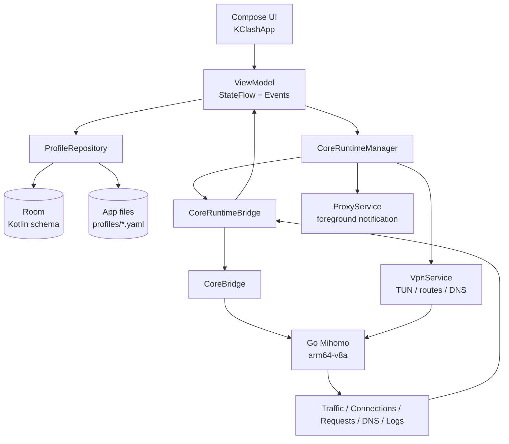
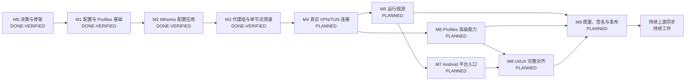

# KClash Kotlin 重写路线图

> 文档类型：产品迁移路线图、功能矩阵、依赖图和验收门槛
>
> 最后核对：2026-10-25（北京时间）
>
> 当前基线：`kotlin` 分支，HEAD `ba9ecefa`

这份路线图描述 KClash 从 Flutter 参考实现迁移为 Android 原生 Kotlin 应用的完整路径。它同时记录当前实现边界、功能完成度、前置依赖、验收证据和后续工作顺序。

路线图不把“代码存在”“单元测试通过”“真机产品可用”混为一谈。每个功能必须分别经过代码完成、自动化验证和真实设备验收，才能进入已完成状态。

## 1. 固定产品边界

| 项目 | 已确认决策 |
| --- | --- |
| 产品显示名称 | `KClash` |
| Android 包名 | `com.lonnnnnng.flclash` |
| Kotlin 主线 | Git 分支 `kotlin`，长期主分支 |
| Flutter 参考 | `main` / `upstream/main`，只用于行为和视觉参考 |
| 上游仓库 | `chen08209/FlClash` |
| 个人 fork | `lonnnnnng/FlClash` |
| 数据迁移 | 不做 Flutter/Drift 数据迁移；这是全新应用 |
| Android 范围 | Android 手机，首发覆盖竖屏和横屏 |
| 不纳入首发 | Android TV、平板、车机、桌面托盘和桌面 Helper |
| Android 最低版本 | API 24 |
| 编译与目标版本 | compile/target SDK 37，需随工具链和发布要求复核 |
| ABI | 只构建、测试和发布 `arm64-v8a` |
| 验收设备 | Redmi Note 8 Pro，serial 每次操作前重新读取 |
| 当前验收设备 | `wsvwypiz7xwslvl7`，Android 16 / API 36 |
| 发布签名 | 发布阶段创建新的独立 keystore，不复用 Flutter 签名 |
| 核心 | Go Mihomo，Android 应用通过 Kotlin Bridge 使用 |

## 2. 状态定义

| 状态 | 含义 |
| --- | --- |
| `DONE-VERIFIED` | 代码完成，自动化检查通过，并有真机或端到端证据 |
| `DONE-UNIT` | 代码完成，单元测试或构建通过，但真实设备链路尚未覆盖 |
| `PARTIAL` | 已有基础代码或局部行为，尚未达到 Flutter Android 功能闭环 |
| `PLANNED` | 已明确范围和验收方式，尚未开始实现 |
| `BLOCKED` | 存在明确外部阻塞条件；当前没有将普通未实现项标为阻塞 |
| `DEFERRED` | 明确不进入当前 Android 手机首发范围 |

## 3. 当前快照

| 维度 | 当前状态 |
| --- | --- |
| 当前分支 | `kotlin` |
| 远端关系 | 本地比 `origin/kotlin` 超前 2 个提交；本轮未推送 |
| 当前版本 | `versionName 0.1.0`，`versionCode 1` |
| Gradle 工程 | 根目录 Wrapper + `app` / `core` / `service` / `common` |
| UI 技术 | Jetpack Compose + Material 3 |
| 状态管理 | ViewModel + StateFlow + 单向事件流 |
| 数据 | Room 新 schema + 应用独立文件目录 |
| 依赖注入 | Hilt |
| 核心生命周期 | `CoreRuntimeManager` 已接入启动、停止、配置应用、代理组读取、节点切换和测速 |
| 单元测试 | 71 项通过，失败 0，错误 0，跳过 0 |
| Debug 构建 | `./gradlew test :app:assembleDebug --no-daemon` 已通过 |
| Debug APK | `android/app/build/outputs/apk/debug/app-debug.apk` |
| Debug 原生库 | APK 内只包含 `lib/arm64-v8a/libclash.so` |
| 最近真机证据 | 代理组读取、`DIRECT` 测速 `160 ms`、Selector 切换成功、核心停止成功 |

## 4. 目标架构图

架构目标是让 `CoreRuntimeManager` 成为唯一的核心生命周期事实来源。页面、`ProxyService` 和 `VpnService` 不各自创建或销毁 Mihomo 实例。当前代理组和测速已经遵循这条边界；VPN/TUN 仍处于基础设施存在但业务链路未完全接入的过渡状态。

## 5. 里程碑总图

## 6. 已完成里程碑

### M0：决策、仓库和原生工程骨架 — `DONE-VERIFIED`

已完成内容：

- 建立 `kotlin` 长期主线，保留 `upstream` 作为 Flutter 追踪来源。
- 确定 KClash 产品名、包名、API 下限、ARM64-only、真机验收边界和独立签名边界。
- 根目录建立 Android Gradle 工程和 Wrapper。
- 建立 `app`、`core`、`service`、`common` 模块。
- 接入 Compose、Material 3、Hilt、Room、StateFlow 和基础 ViewModel。
- gomobile 只生成 `android-arm64` / `arm64-v8a` 核心库。
- 建立 `AGENTS.md`、`.agents/`、`CONTEXT.md`、ADR 和上游同步规则。

完成证据：

- 根目录 `./gradlew` 可用。
- Debug APK 已安装到 Redmi 真机。
- APK 内原生库只包含 `lib/arm64-v8a/libclash.so`。

### M1：Profiles 与本地配置基础 — `DONE-VERIFIED`

已完成内容：

- Room `profiles` 表和应用偏好表。
- 当前配置选择和重启后恢复。
- 远程订阅 URL 导入。
- 订阅响应下载和 `subscription-userinfo` 用量解析。
- 重复订阅检测。
- 本地 YAML 文件导入。
- 自定义配置创建。
- 本地配置删除。
- 配置文件原子替换写入。
- 本地配置内容读取和基础 YAML 编辑器。
- 远程订阅手动同步。
- 核心运行期间阻止配置选择和编辑，避免运行输入与用户编辑内容分裂。

未纳入 M1 完成定义的内容：高级分区编辑、二维码导入、备份恢复、完整自动更新调度、Deep Link 实际导入。

### M2：Mihomo 配置校验与应用 — `DONE-VERIFIED`

已完成内容：

- `initClash` Bridge。
- 配置文件复制到 Mihomo 独立目录。
- 原子 staging，避免核心读取半写入文件。
- `validateConfig` 独立校验。
- 只有校验成功后才调用 `setupConfig`。
- 核心启动、停止、初始化失败状态。
- 运行状态 `STOPPED / STARTING / RUNNING / STOPPING / FAILED`。
- 启停、配置应用和代理操作共用 `CoreRuntimeManager.transitionLock`。
- 失败时不伪造“核心已运行”。

真机已验证：启动核心、前台通知出现、代理组可读取、核心停止后服务退出。

### M3：代理组、Selector 切换与单节点测速 — `DONE-VERIFIED`

已完成内容：

- `getProxies` Bridge 和类型安全的代理组模型。
- 保留核心返回的代理组顺序。
- 读取 `name`、`type`、`now`、`all`、`hidden`、`testUrl`。
- Selector 节点切换。
- 切换后重新读取核心状态，不以本地点击结果冒充核心确认。
- `asyncTestDelay` Bridge。
- 使用代理组 `testUrl`，未配置时使用 Mihomo 默认测试地址。
- 延迟结果按代理组、节点和测试 URL 隔离。
- 正数延迟、超时、失败、空结果和测速中状态。
- Selector 对话框内逐节点测速按钮。

真机已验证：

- 读取真实 `GLOBAL`、`Atom`、`Auto`。
- `DIRECT` 返回 `160 ms`。
- 不可用节点显示“失败”。
- `DIRECT → FR-1-01` 切换成功。

当前明确未纳入 M3：URLTest/Fallback 完整选择语义、批量测速、搜索过滤、延迟结果持久化、Tab/List 双布局和 Flutter 节点列表完整交互。

## 7. 进行中和未完成的功能矩阵

### 7.1 真实连接链路

状态：`PLANNED`，下一优先级最高。

当前已有：

- Android `VpnService` 基础实现。
- TUN 地址、路由、DNS、IPv6 和访问控制参数模型。
- `Core.startTun` / `Core.stopTun` 调用。
- 网络观察和 DNS 更新基础设施。
- 前台 `ProxyService` 通知模块。

当前缺失：

- `VpnService.prepare()` 权限申请和用户拒绝处理。
- `CoreRuntimeManager` 到 `VpnService` 的统一启动链。
- `ServiceConfig.vpnOptions` 的真实来源和配置映射。
- 核心、代理服务、VPN 服务的状态合并。
- TUN 建立成功后的真实流量闭环。
- 停止、重启、进程恢复和系统撤销 VPN 的统一状态处理。

完成门槛：

1. 首次启动能解释并申请 VPN 权限。
2. 用户授权后能建立 TUN，拒绝时保持失败状态并给出可理解原因。
3. 真实网络请求经过 Mihomo，代理组选择对请求生效。
4. 停止后 TUN、前台服务和核心全部释放。
5. 真机重启应用、切换 Wi-Fi/移动网络、切后台再恢复均不会产生悬挂隧道。

### 7.2 连接、流量和运行观测

状态：`PLANNED`，依赖 M4。

需要补齐的 Bridge / Repository / UI：

- 当前下载、上传速度。
- 总流量和连接数。
- 活跃连接列表。
- 请求列表和规则命中信息。
- DNS 查询列表。
- 核心日志流、过滤和清空。
- 轮询或事件订阅的生命周期管理。
- 页面退出后停止不必要的轮询。

完成门槛：

- 每个页面都有 loading、空数据、刷新、错误和停止核心状态。
- 观测数据不会阻塞启停和代理切换。
- 真机能看到一条实际请求从连接、请求、DNS 和日志侧的可追踪证据。

### 7.3 Profiles 高级能力

状态：`PARTIAL`，基础能力已完成，完整 Flutter parity 未开始。

待完成：

- `clash://install-config`、`clashmeta://install-config`、`kclash://install-config` 的实际解析和导入。
- 二维码读取和订阅导入。
- YAML 编辑器语法体验、搜索、定位、错误行提示和大文件性能。
- Rules 分区编辑。
- Proxies 分区编辑。
- Proxy Groups 分区编辑。
- Providers 分区编辑。
- Scripts、Overrides、Dialers 等高级配置。
- 订阅自动更新调度、失败重试和通知。
- Profile 排序 UI。
- 备份和恢复。
- Profile 级别的当前代理组选择、展开状态和其他 Flutter 行为数据。

完成门槛：

- 远程订阅、文件、手工配置、二维码、Deep Link 五种入口的行为一致。
- 编辑内容通过 Mihomo 校验后才能应用。
- 订阅更新失败不会破坏上一份可运行配置。

### 7.4 代理组完整交互

状态：`PARTIAL`。

待完成：

- URLTest/Fallback 的当前节点和自动选择语义。
- `fixed`、`now`、`selectedMap` 等核心状态映射。
- 单组批量测速。
- 按搜索文本筛选节点。
- 超时节点隐藏和失败节点回滚策略。
- Tab/List 两种布局。
- 展开、折叠、滚动定位。
- 延迟结果缓存和按测试 URL 失效。
- 代理组选择状态写回 Profile。

完成门槛：

- Selector、URLTest、Fallback、LoadBalance 都能按照 Flutter Android 行为展示。
- 切换、测速、刷新并发时不会覆盖其他操作的状态。
- 所有失败都保留核心错误，不使用历史成功状态掩盖失败。

### 7.5 Android 平台入口

状态：`PLANNED`。

待完成：

- Quick Settings Tile：启动、停止、切换。
- 通知栏操作与运行状态同步。
- Deep Link 导入。
- Tasker/MacroDroid 等外部 Action。
- 按应用代理的应用选择器。
- 电池优化白名单引导。
- Always-on VPN 和系统撤销回调。
- Android 组件导出、Intent 和权限安全审计。

完成门槛：

- 外部入口和页面入口进入同一个 `CoreRuntimeManager`，不产生第二套启停逻辑。
- 被系统拒绝或权限缺失时可见地失败。
- 所有导出的组件都有明确的最小权限边界。

### 7.6 UI/UX 完整对齐

状态：`PARTIAL`。

当前已有：

- Compose + Material 3 基础主题。
- 单屏配置、核心状态和代理组交互。
- Edge-to-edge 基础设置。

待完成：

- Flutter 页面信息架构和 Android 手机导航结构对齐。
- Dashboard、Profiles、Proxy、Connection、Requests、DNS、Logs 页面。
- Material You 动态颜色、浅色/深色主题。
- Flutter 连续圆角、底部面板、弹层和交互节奏。
- 横屏布局和小屏滚动策略。
- 无障碍语义、内容描述、触控区域和大字体。
- 截图基线和 Compose screenshot regression。

完成门槛：

- 关键用户流程在 Flutter 参考和 KClash Android 上逐屏比对。
- 旋转、恢复、进程重建后状态不丢失。
- UI 不直接调用 Core、gomobile 或数据库。

### 7.7 测试、发布和运维

状态：`PARTIAL`。

当前已有：

- 71 项 Kotlin 单元测试。
- Debug APK 构建和 arm64 产物检查。
- Redmi 真机启动、停止、代理组和测速验证。

待完成：

- Compose UI tests。
- Instrumented tests。
- VPN 权限和 TUN 真机测试。
- 连接、请求、DNS、日志端到端测试。
- `lint`、R8、Release 构建和 APK 签名检查。
- 新 release keystore。
- GitHub Actions arm64 构建。
- Release 页面、更新日志、SHA-256 和回滚材料。
- 上游变更后的功能矩阵和回归记录。

完成门槛：

- Debug 和 Release 都能从干净环境构建。
- 发布 APK 只有 `arm64-v8a`。
- 签名、版本、包名、产物哈希和远端 Release 资产都能复核。
- 真机验收记录包含设备 serial、步骤、结果和关键日志。

## 8. 推荐推进顺序

### N1：建立真实连接状态和 VPN 权限链

目标：让“启动核心”升级为“启动可用代理连接”。

建议范围：

1. 定义连接模式和连接状态模型。
2. 将 `VpnService.prepare()` 接入 Activity 和 ViewModel。
3. 将 `VpnOptions` 从配置/设置映射到 `ServiceConfig`。
4. 由 `CoreRuntimeManager` 统一启动 ProxyService 和 VpnService。
5. 处理授权、拒绝、撤销、重复启动和停止清理。
6. 在真实设备验证 TUN、路由、DNS 和代理请求。

不在 N1 混入：Connections、Requests、DNS 页面和 UI 大改版。

### N2：真实流量和核心观测

目标：用户能确认代理正在工作，并能解释网络行为。

建议范围：

1. Bridge 流量和连接 API。
2. Dashboard 流量卡片。
3. Connections 页面。
4. Requests 页面。
5. 基础日志流。

### N3：DNS、日志和故障诊断

目标：让真机问题可以在应用内定位，而不是只能依赖 logcat。

建议范围：

1. DNS 查询 Bridge 和列表。
2. 日志等级、过滤、清空和导出边界。
3. 统一错误码和用户可见错误文案。
4. 网络切换、DNS 变化和核心重启的诊断记录。

### N4：Profiles 和代理组 parity

目标：补齐 Flutter Android 用户已经拥有的配置和代理组工作流。

建议范围：

1. Deep Link 和二维码导入。
2. 高级配置分区编辑。
3. URLTest/Fallback 完整语义。
4. 批量测速、搜索、缓存和结果失效。
5. 订阅自动更新、备份恢复和 Profile 排序。

### N5：平台入口和系统集成

目标：让 KClash 在 Android 系统层面可持续运行。

建议范围：

1. Quick Settings。
2. 通知栏操作。
3. 外部 Action。
4. 按应用代理。
5. 电池优化和 Always-on VPN。
6. Intent、组件导出和权限审计。

### N6：UI/UX 收敛和发布

目标：从“功能骨架”达到可长期使用和发布的 KClash 产品。

建议范围：

1. 完成 Design System 和导航。
2. Flutter 参考截图对齐。
3. UI、Instrumented 和端到端测试。
4. Release 签名、R8、CI、版本和 Release 资产。
5. 以独立 KClash 身份发布第一个 arm64 Android 版本。

## 9. 每个功能切片的统一验收门槛

### 代码层

- Bridge 不向 UI 暴露原始 Mihomo method 字符串。
- ViewModel 只暴露不可变 StateFlow。
- 启停、配置应用、VPN 和代理切换经过 `CoreRuntimeManager`。
- 关键业务逻辑附近有中文注释并标记作者 `long`。
- 不引入 Flutter 数据兼容或迁移逻辑。

### 自动化层

- 相关模块单元测试通过。
- 错误、空数据、取消、超时和重复调用有测试。
- `git diff --check` 通过。
- 受影响模块和 Debug APK 构建通过。
- 需要时增加 Compose UI 或 Instrumented 测试。

### 真机层

- 执行前重新检查 `adb devices -l`、型号、API 和 serial。
- 安装、启动、停止和日志命令显式使用 `adb -s <serial>`。
- 记录成功和失败的关键输出。
- 不能用历史成功记录覆盖本轮失败。
- 停止测试后确认服务、VPN 和核心状态已清理。

### 发布层

- 包名、显示名称、版本号、ABI 和签名一致。
- Release APK 只包含 `arm64-v8a`。
- 私钥、Token、订阅 URL 和真实凭据不进入仓库或日志。
- 发布前重新计算 APK SHA-256，并复核远端资产。

## 10. 上游同步路线

Kotlin 主线不直接合并 Flutter 提交。每次同步按照以下顺序：

1. `git fetch --prune upstream`，记录上游目标 SHA。
2. 阅读上游变更涉及的 Flutter 页面、Provider、Core method 和 Android 行为。
3. 更新本路线图的功能矩阵，标记手机适用、桌面专属、暂缓或需要重新设计。
4. 为 Android 行为建立 Kotlin 领域模型、Bridge、Repository、ViewModel 和 Compose 入口。
5. 先补自动化测试，再用 Redmi 真机完成真实网络/权限/生命周期验收。
6. 更新 `CONTEXT.md`、`.agents/project.md`、`.agents/testing.md` 或新增 ADR。
7. 使用中文提交说明；推送 `origin/kotlin` 前检查分支、差异、产物和凭据边界。

## 11. 当前主要风险

| 风险 | 影响 | 处理顺序 |
| --- | --- | --- |
| VPN/TUN 尚未接入新生命周期 | 当前只能证明核心和代理组工作，不能证明系统流量被接管 | 立即处理，作为 N1 |
| 旧 service 基础设施与新 Runtime Manager 并存 | 可能出现状态来源分裂或重复启动 | N1 统一服务边界 |
| UI 仍是单屏基础骨架 | 与 Flutter 完整体验差距大 | M4 后按页面切片重构 |
| 观测 API 尚未接入 | 网络故障难以在应用内解释 | M5/N2-N3 |
| 高级配置和导入入口缺失 | 用户无法完成完整配置管理 | M6/N4 |
| 没有 UI/Instrumented 测试 | 回归风险集中在真机阶段 | M9/N6 前建立 |
| 没有 release keystore | 目前只能做 Debug/预发布验证 | 发布前创建，不提前提交秘密 |
| 上游持续变化 | Flutter 行为会继续漂移 | 每次同步更新矩阵和验收记录 |

## 12. 路线图维护规则

- 功能完成必须同时更新状态、证据和验收门槛。
- 只实现了 Bridge 或底层模型时标记 `PARTIAL`，不能标记 `DONE-VERIFIED`。
- 只通过构建而没有真机证据时，最多标记 `DONE-UNIT`。
- 新增上游能力先更新矩阵，再决定是否进入 Android 手机范围。
- 任何改变核心生命周期、数据边界、包名、ABI、签名或发布策略的决定，都要同步到 ADR。
- 本文件记录路线和证据，不替代具体代码注释、测试用例或发布清单。
