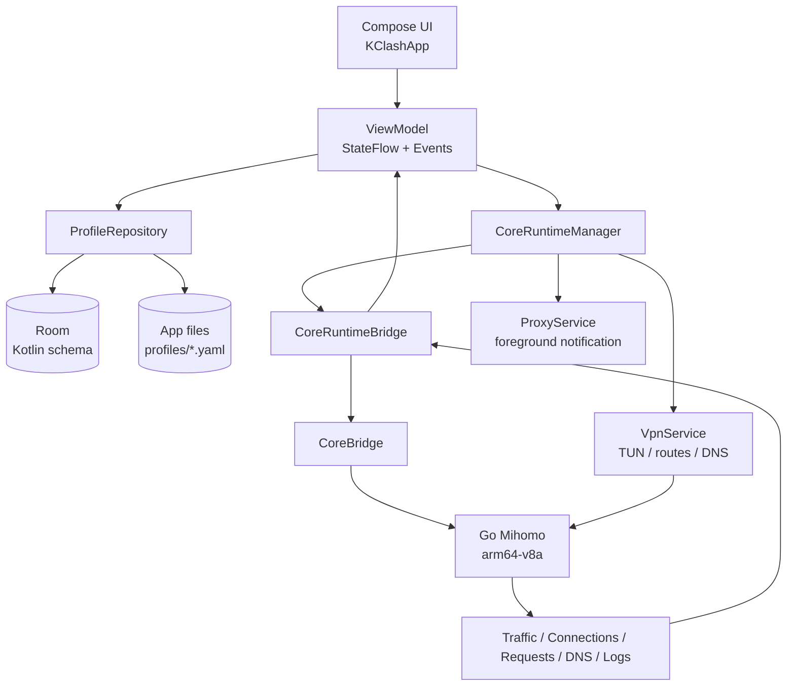
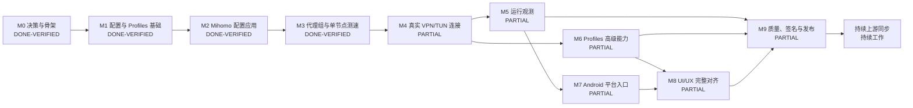

# KClash Kotlin 重写路线图

> 文档类型：产品迁移路线图、功能矩阵、依赖图和验收门槛
>
> 最后核对：2026-11-02（北京时间，优先完成主页 → 配置 → 代理组；观测页面的后续打磨暂停）
>
> 当前基线：`kotlin` 主线。Android 默认首页按 Flutter 收敛为状态 → 网络速度 → 出站模式 → 配置 → 策略组，连接统计、内存信息、服务状态、内网 IP 与 VPN 默认隐藏；无配置时隐藏代理 Tab。按应用代理位于工具设置分组，电池授权位于常规/按需连接的前置条件；系统 Always-on 与订阅请求证据仅从显式 Debug 开发者入口进入。
> 首页编辑使用整卡长按、右上角移除与左侧添加；状态卡参与排序且不可移除。标题为“仪表盘 / 编辑仪表盘 / 可添加”，出站模式保留 Rule → Global → Direct 的 52dp connected buttons。配置快切、详情、单项同步以及策略组选择面板沿用已有正式状态与仓库链路。
> 最新验收：Proxy Groups 已补齐叶子节点真实协议类型、按 Profile/组隔离的 Tab/List 滚动恢复和 List 组内当前节点定位；停止态与运行态均可显示节点、切换和测速。URLTest/Fallback 的 Kotlin 选择解析已统一为有效核心 `now` 优先，核心无结果时回退手动映射与 `fixed`。延迟结果已按 Profile/组/节点/测速 URL 写入 Room，带 45 秒 TTL、失败/超时状态恢复和过期清理；App 269 项、Core 34 项 JVM 测试通过，本轮新增 Room instrumentation 覆盖迁移与 DAO，Redmi 真机已完成代理组整类 8/8、ViewModel 面板和协议滚动回归。真实核心 URLTest/Fallback 回归、真实 age 密文 Android E2E、加密 SAF/全新 Profile SAF 导入、Providers 批量/编辑/侧载、首页出口 route hits、质量来源全覆盖/持久缓存和完整 UI parity 仍待后续。
> 在线验收只允许工作区外层 `AGENTS.md` 当前唯一授权链接；本轮未访问订阅、未创建正式 Profile、未启核心/VPN，真机配置正文仅使用外层 `1.yaml` 原字节和隔离内存 Room/缓存。正式 Room 本轮 inspect 为 0 条；历史两份 Profile 的保留记录不能作为当前非空配置的证明，不推断旧数据去向。
> 完整 Dashboard、Profiles 和 Proxy Groups UI/UX 仍为 `PARTIAL`。运行时间、30 次真实速度采样、可选内存/内网 IP/VPN、服务检测及服务出口 IP/质量首片已具备真实链路；出口 IP 停止态 DIRECT 与运行态实际代理出口已验证。服务长按排序、边缘持续滚动与服务 route hits 逐项核验复用已验收；首页出口 route hits 复用、出口质量来源全覆盖和持久缓存仍待补齐；当前配置详情已补齐四项真实统计、外部 Providers 明细和 HTTP 单项更新，详情窗口已独立于首页列表项；Profiles 本地 YAML 已具备语法预检、元数据预览、确认/取消和仓库写入前复核。Profile 卡片已补订阅链接复制、二维码、缓存 YAML 系统导出和按指定 ID 只读配置预览，运行中也可打开且不改变当前选择；age 已接入链接导入/编辑、缺钥补输、文件导入与手动/自动更新解密，先校验明文再写缓存；FILE 密钥编辑、系统文件替换及失败保护已完成分项验收；Proxy Groups 叶子协议、按组滚动恢复和 List 组内定位已完成，真实密文端到端与新增导入 SAF 闭环仍待补齐，下一步推进 URLTest/Fallback 完整语义、更细代理组视觉和语义锚定。持续边缘拖动滚动已完成独立真机切片。后续只验收 Redmi 竖屏、系统默认字号和 `arm64-v8a`。

这份路线图描述 KClash 从 Flutter 参考实现迁移为 Android 原生 Kotlin 应用的完整路径。它同时记录当前实现边界、功能完成度、前置依赖、验收证据和后续工作顺序。

路线图不把“代码存在”“单元测试通过”“真机产品可用”混为一谈。每个功能必须分别经过代码完成、自动化验证和真实设备验收，才能进入已完成状态。

## 1. 固定产品边界

| 项目 | 已确认决策 |
| --- | --- |
| 产品显示名称 | `KClash` |
| Android 包名 | `com.lonnnnnng.flclash` |
| Kotlin 主线 | Git 分支 `kotlin`，长期主分支 |
| Flutter 参考 | `main` / `upstream/main`，只用于行为和视觉参考 |
| 上游仓库 | `chen08209/FlClash` |
| 个人 fork | `lonnnnnng/FlClash` |
| 数据迁移 | 不做 Flutter/Drift 数据迁移；这是全新应用 |
| Android 范围 | Android 手机，验收限定竖屏和系统默认字号 |
| 不纳入首发 | Android TV、平板、车机、桌面托盘和桌面 Helper |
| Android 最低版本 | API 24 |
| 编译与目标版本 | compile/target SDK 37，需随工具链和发布要求复核 |
| ABI | 只构建、测试和发布 `arm64-v8a` |
| 验收设备 | Redmi Note 8 Pro，serial 每次操作前重新读取 |
| 当前验收设备 | `wsvwypiz7xwslvl7`，Android 16 / API 36 |
| 真机验收订阅 | 只使用当前工作区根目录 `AGENTS.md` 保留的唯一授权路径（原第二条）；已导入配置保留供调试 |
| 发布签名 | 发布阶段创建新的独立 keystore，不复用 Flutter 签名 |
| 核心 | Go Mihomo，Android 应用通过 Kotlin Bridge 使用 |

## 2. 状态定义

| 状态 | 含义 |
| --- | --- |
| `DONE-VERIFIED` | 代码完成，自动化检查通过，并有真机或端到端证据 |
| `DONE-UNIT` | 代码完成，单元测试或构建通过，但真实设备链路尚未覆盖 |
| `PARTIAL` | 已有基础代码或局部行为，尚未达到 Flutter Android 功能闭环 |
| `PLANNED` | 已明确范围和验收方式，尚未开始实现 |
| `BLOCKED` | 存在明确外部阻塞条件；当前没有将普通未实现项标为阻塞 |
| `DEFERRED` | 明确不进入当前 Android 手机首发范围 |

## 3. 当前快照

| 维度 | 当前状态 |
| --- | --- |
| 当前分支 | `kotlin` |
| 远端关系 | `kotlin` 追踪 `origin/kotlin`；当前 `HEAD` 与 `origin/kotlin` 已同步，工作树干净；Flutter 只作为参考 |
| 当前版本 | `versionName 0.1.0`，`versionCode 1` |
| Gradle 工程 | 根目录 Wrapper + `app` / `core` / `service` / `common` |
| UI 技术 | Jetpack Compose + Material 3 |
| 状态管理 | ViewModel + StateFlow + 单向事件流 |
| 数据 | Room 新 schema + 应用独立文件目录 |
| 依赖注入 | Hilt |
| 核心生命周期 | `CoreRuntimeManager` 统一启动、停止、配置热切、停止态节点读取/选择/测速、模式、VPN/纯代理、LAN 热更新、Provider 更新与观测失效；UI 不直接调用 gomobile |
| 单元测试 | 本轮 App 269 项、Core 34 项，失败/错误/跳过 0；Service/Common/Go 未重跑，历史结果不计入本轮 |
| 主流程真机测试 | Redmi 竖屏默认字号：代理组整类 8/8、ViewModel 面板、协议滚动和既有选择器回归通过；真实密文 Android E2E 未验 |
| Debug 构建 | App test、Core test、assembleDebug、assembleDebugAndroidTest、lintDebug 通过；Lint 0 errors、51 warnings、9 hints |
| Debug APK | `android/app/build/outputs/apk/debug/app-debug.apk`；SHA-256 `baa1dc80b4847a2ad589efd55bb1c1ec2c5deed8be03810aa897eac00d46bdab`，与 Redmi 已安装 base.apk 一致 |
| Debug 原生库 | App 仅 arm64-v8a；AndroidTest SHA-256 `65d90b2a323413bc8b2690fdab6db1f9743032dd8a5dd788d12e36f077c82480`，与设备一致且无原生库 |
| Release 构建 | 历史 `:app:assembleRelease :app:lintRelease` 已通过，输出为未签名预发布 APK；本轮未重建 Release，独立 release keystore 仍待发布阶段创建 |
| 最近真机证据 | Redmi API 36、1080×2340、字号 1.0：本地密钥/后台清除/失败保护与真实 DocumentsUI 替换通过；深浅整窗截图实际查看。正式 Room 前后 inspect 0 条、服务为空；未启动真实核心或访问订阅 |

## 4. 目标架构图

架构目标是让 `CoreRuntimeManager` 成为唯一的核心生命周期事实来源。页面、`ProxyService` 和 `VpnService` 不各自创建或销毁 Mihomo 实例。代理组、测速、VPN/TUN、纯代理和配置热切均已进入同一管理器；真实网络/权限/后台/进程恢复已有分项验收，蜂窝网络切换和完整 OEM 行为仍待补齐。

## 5. 里程碑总图

## 6. 已完成里程碑

### M0：决策、仓库和原生工程骨架 — `DONE-VERIFIED`

已完成内容：

- 建立 `kotlin` 长期主线，保留 `upstream` 作为 Flutter 追踪来源。
- 确定 KClash 产品名、包名、API 下限、ARM64-only、真机验收边界和独立签名边界。
- 根目录建立 Android Gradle 工程和 Wrapper。
- 建立 `app`、`core`、`service`、`common` 模块。
- 接入 Compose、Material 3、Hilt、Room、StateFlow 和基础 ViewModel。
- gomobile 只生成 `android-arm64` / `arm64-v8a` 核心库。
- 建立 `AGENTS.md`、`.agents/`、`CONTEXT.md`、ADR 和上游同步规则。

完成证据：

- 根目录 `./gradlew` 可用。
- Debug APK 已安装到 Redmi 真机。
- APK 内原生库只包含 `lib/arm64-v8a/libclash.so`。

### M1：Profiles 与本地配置基础 — `DONE-VERIFIED`

已完成内容：

- Room `profiles` 表和应用偏好表。
- 当前配置选择和重启后恢复。
- 远程订阅 URL 导入。
- 订阅响应下载和 `subscription-userinfo` 用量解析。
- 重复订阅检测。
- 本地 YAML 文件导入。
- 自定义配置创建。
- 本地配置删除。
- 配置文件原子替换写入。
- 本地配置内容读取和基础 YAML 编辑器。
- 远程订阅手动同步。
- 配置选择由 CoreRuntimeManager 串行校验并热应用，停止态也加载节点；运行期间仍保护配置正文编辑。

未纳入 M1 完成定义的内容：高级分区编辑；本地备份/恢复已完成首片，WebDAV 手动备份协议、Keystore 凭据、配置 UI、ZIP 仓库接入、认证失败/离线反馈和本地回环真机回归已完成；外部 WebDAV 服务验收、云端同步和完整页面级 E2E 仍待后续。订阅自动更新已完成代码、自动化验证、调度证据和当前两条授权路径的真实导入/同步回归，但周期任务等待到期后的真实自动下载仍未验证。Deep Link 基础导入及本轮冷启动、重复导入和错误反馈回归已完成。二维码图片导入已完成代码、单元测试和当前两条授权路径真机验收。

### M2：Mihomo 配置校验与应用 — `DONE-VERIFIED`

已完成内容：

- `initClash` Bridge。
- 配置文件复制到 Mihomo 独立目录。
- 原子 staging，避免核心读取半写入文件。
- `validateConfig` 独立校验。
- 只有校验成功后才调用 `setupConfig`。
- 核心启动、停止、初始化失败状态。
- 运行状态 `STOPPED / STARTING / RUNNING / STOPPING / FAILED`。
- 启停、配置应用和代理操作共用 `CoreRuntimeManager.transitionLock`。
- 失败时不伪造“核心已运行”。

真机已验证：启动核心、前台通知出现、代理组可读取、核心停止后服务退出。

### M3：代理组、Selector 切换与单节点测速 — `DONE-VERIFIED`

已完成内容：

- `getProxies` Bridge 和类型安全的代理组模型。
- 保留核心返回的代理组顺序。
- 读取 `name`、`type`、`now`、`all`、`hidden`、`testUrl`。
- Selector 节点切换。
- 切换后重新读取核心状态，不以本地点击结果冒充核心确认。
- `asyncTestDelay` Bridge。
- 使用代理组 `testUrl`，未配置时使用 Mihomo 默认测试地址。
- 延迟结果按代理组、节点和测试 URL 隔离。
- 正数延迟、超时、失败、空结果和测速中状态。
- Selector 对话框内逐节点测速按钮。
- 嵌套代理组按平面列表展示，摘要沿当前选择递归解析到最终叶子节点，并对自循环/环路做保护。

真机已验证：

- 读取真实 `GLOBAL`、`Atom`、`Auto`。
- `DIRECT` 返回 `160 ms`。
- 不可用节点显示“失败”。
- `DIRECT → FR-1-01` 切换成功。

当前明确未纳入 M3：URLTest/Fallback 全部 Flutter 选择语义、按组/测速 URL 超时统计摘要、延迟结果跨进程持久化和 Flutter 节点列表的剩余视觉细节。

## 7. 进行中和未完成的功能矩阵

### 7.1 真实连接链路

状态：`PARTIAL`，代码启动链、TUN 生命周期、后台恢复、系统撤销 VPN、Wi‑Fi 断开恢复、进程重建和两条授权路径的真实请求诊断已打通；Wi‑Fi↔移动网络切换仍需具备蜂窝网络条件后补齐。

当前已有：

- Android `VpnService` 基础实现。
- TUN 地址、路由、DNS、IPv6 和访问控制参数模型。
- `Core.startTun` / `Core.stopTun` 调用。
- 网络观察和 DNS 更新基础设施。
- `NetworkObserver` 已纳入 `ProxyService`/`VpnService` 的模块生命周期；停止服务时注销 Connectivity 回调、清空 DNS/网络缓存并重置 Mihomo 网络连接。
- 前台 `ProxyService` 通知模块。
- `ServiceConfig` 发布 `STOPPED / STARTING / CONNECTED / FAILED` VPN 状态和失败原因。
- `VpnService.onStartCommand()` 已进入真实 `start()`，成功建立 TUN 后才发布 `CONNECTED`。
- `DefaultVpnOptionsProvider` 已提供 Android 手机首阶段默认 TUN 配置，并由 `CoreRuntimeManager` 注入。
- `AndroidProxyServiceController` 先等待 ProxyService 启动确认，启用 VPN 时再启动 VpnService 并等待 VPN 状态或 15 秒超时；关闭 VPN 时仅运行本地代理。
- `MainActivity` 已接入 `VpnService.prepare()` 和 Activity Result 授权回调。
- 启动失败会停止服务、清理监听器，管理器不会把失败报告为 `RUNNING`。
- 停止时向绑定中的 `VpnService` 发送显式 stop action，再停止服务组件，避免系统绑定导致 TUN 残留。
- `RuntimeResumeStore` 将“用户希望核心保持运行”的意图持久化到 Room；启动成功前写入，显式停止、系统撤销和启动失败时清除。
- `KClashApplication` 在进程创建时检查恢复意图和 VPN 选择；纯代理跳过 VPN 授权门禁，启用 VPN 且授权有效时复用 `CoreRuntimeManager.startProxy()` 恢复核心。纯代理实际杀进程恢复尚未单独验收。
- `ProxyService` 与 `VpnService` 对系统重建传入的 `null Intent` 返回 `START_NOT_STICKY`，让 Application 先恢复进程内 `VpnOptions` 后再显式启动，避免 `START_STICKY` 服务抢跑。
- 服务层和管理器新增失败回滚、系统撤销和撤销后重启测试；当前总计 98 项 Kotlin 单元测试通过。

本轮真机验收记录（2026-10-25，设备 `wsvwypiz7xwslvl7`，Android 16 / API 36）：

- 使用当时可用的远程订阅启动成功，UI 显示“核心运行中”；该历史地址已从当前真机验收清单移除，后续只使用当前工作区根目录 `AGENTS.md` 列出的两条授权路径。
- `dumpsys activity services` 观察到 `VpnService` 和 `ProxyService` 均为前台服务。
- `ip route` 观察到 `198.18.0.0/30 dev tun0`，Mihomo 日志出现从 `198.18.0.1` 发出的 TCP/UDP TUN 流量。
- 设备内 `curl -I http://1.1.1.1` 返回 `HTTP/1.1 301 Moved Permanently`，证明启用 TUN 时设备网络请求仍可完成；尚未将该请求与选定代理节点做可归因的端到端关联。
- 点击停止后 UI 显示“核心已停止”，服务记录、`tun0`、`198.18.0.0/30` 路由均消失；`dumpsys connectivity` 未留下 KClash VPN 网络。
- 临时将 `ACTIVATE_VPN` 设为 deny 后重新启动，系统显示 KClash VPN 授权对话框；点击“取消”后 UI 回到“核心已停止”，显示“VPN 权限未授予”，且未留下前台服务、`tun0` 或 VPN 路由；随后已恢复 `ACTIVATE_VPN: allow`。
- 旧本地测试配置曾被核心拒绝，错误为 `proxy DIRECT is the duplicate name`；该失败状态正确回显，未作为成功证据。
- 使用第二条当前授权路径启动后，通过系统“设置 → VPN → KClash → 断开连接”触发真实系统撤销；`VpnService.onRevoke()` 清理 TUN 并通知应用内 `ServiceBroadcastReceiver`，首页回到“核心启动失败”。
- 系统撤销后 `VpnService`、`ProxyService`、`tun0`、`198.18.0.0/30` 路由和 KClash VPN 网络均消失；同一 Profile 再次点击“启动核心”成功恢复运行，随后停止并删除 Profile，设备回到“还没有配置”空态。
- 使用第一条当前授权路径启动后按 Home 进入后台 10 秒，`VpnService`、`ProxyService`、`tun0` 和 `198.18.0.0/30` 路由持续存在；重新打开 KClash 首页仍显示“核心运行中”，DNS 事件继续到达，随后停止并删除 Profile。
- 使用第一条当前授权路径启动后关闭 Wi‑Fi，等待 7 秒确认底层 Wi‑Fi 网络消失；VPN 网络的 `UnderlyingNetworks` 变为空，但 `VpnService`、`ProxyService`、`tun0` 和 `198.18.0.0/30` 路由仍保持，应用进程未退出。重新开启 Wi‑Fi 后，底层接口恢复并绑定新的网络句柄，VPN、服务和路由保持；通过 TUN 发起的 `ping 1.1.1.1` 成功，Mihomo 日志出现 DNS 更新。
- 本轮设备蜂窝数据未注册且不可用，因此没有把 Wi‑Fi↔移动网络切换写成完成证据；测试 Profile 已通过应用内删除，设备回到“还没有配置”空态。
- 进程重建验收：使用第二条当前授权路径启动后，记录旧 PID `16207`；通过 `cmd activity crash com.lonnnnnng.flclash` 触发进程退出，4 秒后出现新 PID `16637`。20 秒后两个前台服务、`tun0` 和 `198.18.0.0/30` 路由均保持，重新打开首页仍显示“核心运行中”；停止后服务和路由清理完成，Profile 通过应用内删除并恢复“还没有配置”空态。

当前缺失：

- `ServiceConfig.vpnOptions` 仍是首阶段默认配置，尚未从 Mihomo 配置/Android 设置真实映射 mixed-port、tun stack 和路由覆盖项。
- 首次安装或清除数据后的 VPN 授权弹窗尚未在本轮干净状态中重测；临时拒绝授权后的失败回滚路径和运行期间系统撤销 VPN 的路径已验证。
- 已完成“当前代理组/节点 → 受控真实请求 → HTTP 状态、代理链、规则、Requests、DNS、Logs 和累计流量”的首轮真机归因闭环；活动连接在第二条授权路径的 7.4 秒请求中捕获到 1 条。
- Wi‑Fi 断开/恢复和进程重建已完成真机验证；尚未覆盖真实 Wi‑Fi↔移动网络切换，当前设备蜂窝网络未注册。

完成门槛：

1. 首次启动能解释并申请 VPN 权限。
2. 用户授权后能建立 TUN，拒绝时保持失败状态并给出可理解原因。
3. 真实网络请求经过 Mihomo，代理组选择对请求生效。
4. 停止后 TUN、前台服务和核心全部释放。
5. 真机重启应用、切换 Wi-Fi/移动网络、切后台再恢复和进程重建均不会产生悬挂隧道；其中后台恢复、Wi‑Fi 断开恢复和进程重建已完成，Wi‑Fi↔移动网络切换仍待验证。

### 7.2 连接、流量和运行观测

状态：`PARTIAL`，流量、连接数、活动连接、Requests、DNS 和核心日志的基础观测与真实请求归因已验证，详情级交互已支持搜索、筛选、自动跟随和脱敏导出，事件流已具备有界背压和健康统计，运行诊断历史已接入 Room、在进程重建后直接展示恢复事件，并支持完整详情查看和独立脱敏导出；稳定故障归因、建议文案、脱敏原始详情和诊断导出元数据已完成，真实 `MainActivity` 的非空 Requests/DNS/Logs 详情入口、搜索、日志级别筛选和关闭回归已完成，仍需补齐跨设备和完整页面级端到端覆盖。

当前已有：

- `CoreBridge` 已映射 Mihomo `getTraffic`、`getTotalTraffic` 和 `getConnectionCount`，并对负数计数做边界归一化。
- `CoreRuntimeManager` 只在核心运行状态下读取三类统计，避免停止状态访问已释放的核心。
- `MainViewModel` 只在核心运行且首页 Activity 可见时每秒轮询统计；页面进入后台会取消收集，停止或进入错误时清理/回显状态。
- Compose 首页已提供运行统计卡片，展示上传、下载、连接数和累计流量，并覆盖停止态、加载态和错误态。
- `CoreBridge`、`CoreRuntimeManager` 和 `MainViewModel` 已接入 Mihomo `getConnections`，首页显示活动连接数量、目标、进程、代理链、规则和上下行计数。
- Connections 摘要行可打开按分组展示已映射字段的详情；点击快照保留至关闭，在连接结束、核心停止和 Activity 重建后仍可读取；摘要及详情的代理链顺序均与 Flutter 反序展示一致。
- 连接轮询与 request 事件统一解析 GeoIP、ASN 和 DNS 模式；底部详情面板展示本地秒级时间、`process(uid)`、目标 GeoIP/ASN 和 DNS 模式，隐藏空值，文本可复制且有成功/失败反馈。Redmi 固定宿主覆盖非空元数据、返回/下滑关闭及重建恢复；真实 MainActivity 已通过授权路径第 2 条的连接识别、主机复制、停止和重建快照闭环。
- `CoreBridge` 已接入 `updateEventListener()`，解析 Go 核心的 `message.arguments` 批次，并将 `request`、`requestTraffic` 事件转换为 Kotlin 领域事件。
- `CoreBridge` 已将 `dns`、`log` 事件转换为稳定的 Kotlin `CoreDnsQuery` 和 `CoreEvent.Log`，并覆盖 DNS 字段、日志级别和损坏事件丢弃测试。
- `CoreRuntimeManager` 在核心运行期间安装事件监听器和 Mihomo 日志泵，停止或启动失败时成对释放；事件流不经过 Compose 或 gomobile 生成类型。
- `MainViewModel` 已维护最近 2000 条 Requests 历史，并按连接 ID 合并上下行流量更新；首页提供请求空态、最近记录和完整记录对话框。
- `MainViewModel` 已维护最近 1000 条 DNS 查询和核心日志，停止核心时清空运行观测，并提供用户主动清空入口。
- Compose 首页已提供 DNS 查询和核心日志卡片、最近记录和完整记录对话框，覆盖停止态、空态和错误日志颜色提示。
- Requests/DNS 完整记录对话框可进入单条详情；Requests 复用连接快照面板，DNS 按基本信息、错误、答案分组并隐藏缺失字段，支持整行复制及成功/失败反馈。点击代理链或 DNS 标签可叠加精确关键词筛选，自由搜索按空白拆词、忽略大小写且所有词同时匹配；关闭单条详情后保留搜索和标签。固定宿主真机流程已验证，DNS 详情的 Activity 重建恢复仍待补齐。
- 核心日志详情和首页卡片提供系统文件导出；导出前遮蔽 URL 查询参数、JSON 凭据字段和常见 token/key/secret/password/url 值。
- `CoreBridge.probe`、`CoreRuntimeManager.probe` 和首页“真实请求诊断”卡片已接入；结果包含 HTTP 状态、耗时、最终 URL、代理链、规则和核心路由版本，且不保留响应正文。

仍需补齐的 Bridge / Repository / UI：

- 跨设备和完整页面级端到端断言，以及更细的诊断筛选和导出体验；当前真实 `MainActivity` 已补齐观测页停止态空态、Requests/DNS/Logs 三页签导航、非空详情入口、无结果搜索、日志级别筛选和关闭回归。

本轮自动化与真机证据（2026-10-25，设备 `wsvwypiz7xwslvl7`）：

- `./gradlew test :app:assembleDebug --no-daemon` 通过；98 项 Kotlin 单元测试通过，失败 0，错误 0，跳过 0。
- Debug APK 安装成功；启动核心后首页实际收到 DNS 查询（4 条）和核心日志（3 条），卡片出现“查看全部/清空”操作；停止态观测卡片恢复启动核心提示。
- 停止后 `tun0`、`198.18.0.0/30` 路由和 KClash 前台服务均已清理。
- 本轮只使用当前工作区根目录 `AGENTS.md` 列出的两条用户授权路径；第一条诊断返回 HTTP 403 / 1.6 秒，第二条诊断返回 HTTP 200 / 7.4 秒。
- 第一条路径 UI 显示真实代理链和 `Match` 规则，请求记录达到 10 条、累计流量非零；第二条路径 UI 捕获活动连接 1 条、请求记录 17 条、DNS 查询 26 条、核心日志 31 条、累计流量非零。
- 两条路径均在停止后清理 `tun0`、`198.18.0.0/30` 路由和 KClash 前台服务；测试 Profile 均通过应用内删除，设备恢复空配置状态。
- Deep Link 切片真机导入使用当前授权清单中的第一条路径；该次导入成功并显示订阅用量，测试 Profile 已在验收后删除。

本轮观测详情交互切片（2026-10-26，设备 `wsvwypiz7xwslvl7`）：

- Requests 详情对话框支持按目标、进程、代理链和规则大小写不敏感搜索，并显示过滤后数量；DNS 详情对话框支持按域名、上游、答案和错误搜索。
- 核心日志详情对话框支持内容搜索和“全部/错误/警告”级别筛选；筛选无匹配时显示明确空态，不隐藏原始记录总数。
- 三类详情列表共用自动跟随最新事件的滚动行为；用户向上翻阅历史后保持当前位置，改变筛选条件时回到最新匹配项。
- 新增 3 项筛选语义和 1 项日志导出脱敏单元测试；`./gradlew :app:testDebugUnitTest :app:compileDebugKotlin --no-daemon` 通过，工程总计 102 项 Kotlin 单元测试通过。
- 安装 Debug APK 后启动第一条当前授权路径，首页捕获活动连接 1 条、请求 4 条、DNS 查询 13 条和核心日志 8 条；打开三类详情对话框分别看到搜索框，其中日志点击“错误”后显示 `0/8` 和“没有匹配的核心日志”。
- 核心日志详情和首页卡片新增系统文件导出；导出文件使用 UTF‑8 表格文本格式，URL 查询参数、JSON 凭据字段和常见 token/key/secret/password/url 值统一替换为 `[REDACTED_SECRET]`。
- 真机通过 Android `DocumentsUI` 保存 `kclash-logs-*.txt` 到 `Download/kclash-qr`；文件大小 1634 bytes、17 行，前两行为导出标题和列名，设备侧检查到 61 个脱敏标记，未把原始凭据写入导出文件。
- 通过 `adb -s wsvwypiz7xwslvl7 shell am start -a com.lonnnnnng.flclash.action.STOP` 停止核心，确认 `VpnService`、`ProxyService`、`tun0` 和 `198.18.0.0/30` 路由清理；随后应用内删除测试 Profile，首页恢复“还没有配置”，未发现 `FATAL EXCEPTION`。

完成门槛：

- 每个页面都有 loading、空数据、刷新、错误和停止核心状态。
- 观测数据不会阻塞启停和代理切换。
- 真机能看到一条实际请求从连接、请求、DNS 和日志侧的可追踪证据。

### 7.3 Profiles 高级能力

状态：`PARTIAL`，基础能力和高级分区首片已完成，完整 Flutter parity 仍在推进。

已完成本轮切片：

- `clash://install-config`、`clashmeta://install-config`、`flclash://install-config` 和 `kclash://install-config` 的 Android 入口声明。
- Deep Link `url` 参数 URL 解码、HTTP/HTTPS 校验和可选名称解析。
- Deep Link 导入复用 `ProfilesViewModel.addRemote`，不在 Activity 中重复下载或写入 Profile。
- 无效 Scheme、Host、目标协议或缺失参数会通过现有 Snackbar 错误流提示，不能创建半成品 Profile。
- 二维码图片选择、QR 格式识别和配置链接解析已接入添加 Profile 对话框；直接 HTTP(S) 链接和四种 KClash Deep Link 统一复用同一解析器及远程订阅写入链路。
- 本地文件选择后先异步校验 YAML 语法并展示文件名、大小与结果；有效文件需用户确认才提交，无效/空文件不可导入且取消不写入。`ProfileRepository.addFileProfile` 在生成 ID、写文件和 Room 插入前再次复核；该预检只证明 YAML 可解析，不等同于 Mihomo 核心语义校验。
- FILE 本地配置编辑提供可选掩码 age 密钥和系统文件替换，原始 YAML 默认折叠；只改密钥保留正文与更新时间。替换按原字节暂存，确认后解密/语法校验，再在同一保存流程更新文件与 Room；异常恢复旧正文/mtime，保存与删除串行，确认前取消零写入。真实 DocumentsUI 以授权 `1.yaml` 完成隔离仓库闭环；真实加密文件尚未验收，CUSTOM 保持原分区编辑器。
- 核心运行期间仍阻止 Profile 删除和正文编辑/同步；当前配置选择无论停止或运行均通过 CoreRuntimeManager 串行校验、热应用，失败回滚原选择/输入，回滚失败停止核心。
- 自定义 Profile 新增 Rules 分区快速编辑入口；编辑器逐行校验规则类型和动作，拒绝 `SUB-RULE`，保存时只替换顶层 `rules` 区块，不改写其他 YAML 字段。
- 自定义 Profile 新增 Proxies 分区快速编辑入口；编辑器按 YAML 列表校验代理名称和类型，拒绝重复名称和非列表结构，保存时只替换顶层 `proxies` 区块，不改写其他 YAML 字段。
- 自定义 Profile 新增 Proxy Groups 分区快速编辑入口；编辑器按 YAML 列表校验代理组名称和 Flutter 支持的类型，拒绝 `relay`、重复名称和非列表结构，保存时只替换顶层 `proxy-groups` 区块并保留边界注释与其他 YAML 字段。
- 自定义 Profile 新增 Providers 分区快速编辑入口；分别编辑顶层 `proxy-providers`/`rule-providers` map，校验嵌套 map、非空字段和唯一名称，保存时局部替换并保留边界注释与其他 YAML 字段。
- 自定义 Profile 的代理 Provider 新增字段化覆盖表单；支持健康检查 URL、间隔、超时、lazy、期望状态、名称前缀/后缀、UDP、跳过证书校验和 IP 版本，并将覆盖按 Provider 名称持久化到 Kotlin 自有 `overridesJson`。
- Provider 覆盖只作用于核心启动时生成的暂存 YAML，原始 Profile 文件保持不变；已有 `health-check`/`override` 子字段会局部合并并保留未覆盖字段，避免编辑覆盖后丢失用户配置。
- 自定义 Profile 新增 DNS Overrides 字段化编辑；支持布尔开关、监听地址、增强模式、Fake-IP 地址段、各类 DNS 列表和 Fake-IP 过滤器，DNS 覆盖与 Provider 覆盖共存于同一份 `overridesJson`。
- DNS Overrides 只作用于核心启动时的暂存 YAML；局部替换顶层 `dns` 区块时保留未知字段、原始 Profile 文件和 URL 中的冒号内容，核心运行期间禁止打开或保存。
- 自定义 Profile 新增 Dialers 编辑入口；以“代理名 -> 出站目标”文本维护映射，保存到 Kotlin 自有 `overridesJson`，支持显式空映射清除原有 `dialer-proxy`。
- Dialers 核心应用只修改启动暂存 YAML：清理旧 `dialer-proxy` 后写入当前映射，校验代理和目标存在性，并拒绝经过代理组或代理链形成的循环依赖；原始 Profile 文件保持不变。
- Provider、DNS 和 Dialers 覆盖保存互相保留，避免编辑一个高级分区时丢失其他分区；自定义 Profile 运行期间仍统一禁止修改。
- Profile 列表新增排序入口；排序弹窗先维护内存草稿，保存后才通过 ViewModel 和 Room 事务写回 `orderIndex`，核心运行期间禁止排序。
- 自定义 Profile 新增脚本库入口；脚本元数据保存到 Room，正文保存到 `filesDir/scripts/<id>.js`，支持新建、读取、编辑、删除和排序，写入采用原子替换。
- Profile 卡片新增脚本绑定入口；绑定和解绑只写入 Kotlin 自有 `profiles.scriptId`，核心运行期间拒绝修改，脚本删除时在同一 Room 事务内清除关联 Profile，避免留下孤立引用。
- 脚本库与编辑器在核心运行期间禁止修改；Profile 绑定脚本会在核心启动的暂存配置阶段执行，失败时阻止配置校验和 Mihomo 启动。
- Profiles 页面视觉首片改为图标顶栏、紧凑配置卡片和菜单式卡片操作；空态展示插画式图形与添加入口，订阅卡显示用量/到期日，存在 URL Profile 时才显示批量同步入口。批量同步仅分发 URL Profile；Repository、Room 和订阅网络行为不因视觉调整改变。
- 自定义 Profile 编辑器首片改为“配置概览 → Rules、Proxies、Proxy Groups、Providers、DNS、Dialers 分区入口 → 原始 YAML 高级编辑”的层级；分区按钮复用已有 ViewModel 编辑器，保存仍由对应 Repository/覆盖模型负责，输入法退出时主动收起以保持手机弹窗标题和操作可见。
- 分区保存成功后同步父级编辑器的 YAML 正文和 Profile 元数据，避免原始 YAML 旧快照覆盖结构化修改；父级仍有未保存 YAML 时，进入分区前要求明确放弃或返回继续编辑。
- 新建配置的未修改空草稿退出时仍删除；Rules、Proxies、Proxy Groups、Providers、DNS 或 Dialers 已持久化修改后退出则保留配置，并提供命名或保留默认名称选项。
- 首页当前配置详情已展示最终输入与核心 Provider 四项统计、外部 Provider 明细和 HTTP 单项更新；文件类型只读，更新不持有启停锁并核对配置/会话，批量更新、编辑/侧载和资源订阅用量仍待补齐。

### 2026-10-27：Profile DNS Overrides 切片

- `ProfileDnsOverrides` 增加 `enable`、`listen`、`ipv6`、`respect-rules`、`prefer-h3`、hosts、增强模式、Fake-IP 和五类 DNS 列表字段；JSON 往返保留 null 的“未覆盖”语义。
- `ProfileDnsOverrideApplier` 只合并暂存 YAML 的顶层 `dns` 区块；缺少区块时追加，已有区块时局部替换，未知 DNS 字段、Provider 覆盖和其他顶层配置均保留。
- DNS 列表按块序列写回，URL 中的 `:` 不会被误加引号或拆成 YAML map；原始 Profile YAML 不会被覆盖。
- 配置页 Profile 卡片新增 DNS 入口和字段化对话框；核心运行期间入口、保存和 ViewModel 写入均受保护。
- 新增 DNS JSON/YAML 合并、ViewModel 运行态保护、Compose 表单回调和真实 Room/Repository 共存测试。
- `./gradlew test :app:assembleDebug :app:lintDebug --no-daemon`：通过；全工程 168 项 JVM 单元测试失败 0、错误 0、跳过 0，Lint 错误 0。
- `ANDROID_SERIAL=wsvwypiz7xwslvl7 ./gradlew :app:connectedDebugAndroidTest --no-daemon`：首次发现 1 项测试未滚动到 LazyColumn 内字段，修复测试定位后重跑通过；最终 40 项 instrumentation 失败 0、错误 0、跳过 0，其中 Room 6 项、Compose 30 项、WebView JavaScript 4 项。
- Debug APK SHA-256：`2ee8c4bdd81fffd2018f1595fe64b95cd7d3022a4f25f9149b5ae901b5bafd9e`；APK 原生库全部位于 `lib/arm64-v8a/`。本轮未访问真实订阅、VPN 或核心启动。

本轮自动化与真机证据（2026-10-25，设备 `wsvwypiz7xwslvl7`）：

- `:app:testDebugUnitTest` 通过，新增 Deep Link 解析用例覆盖编码 URL、四种协议、非法 Host、非 HTTP(S) 目标和缺失参数。
- `:app:assembleDebug` 通过，APK 只包含 `arm64-v8a` 的原生库。
- 通过 `kclash://install-config` 触发当前授权订阅导入，设备 UI 显示远程订阅及用量信息；随后删除该测试 Profile，恢复空配置状态。
- 强制停止应用后再通过 `kclash://install-config` 冷启动导入成功；再次发送同一链接显示“该订阅已经添加”，没有创建重复 Profile。
- 二维码解析分支已通过 JVM 单元测试和 Debug 构建；两条当前授权路径均已通过二维码图片在真机导入，第一条显示订阅用量，第二条显示 `clash-1220f4ac` 远程订阅。
- 第二条路径首次暴露 HTTP 301 跨协议重定向缺口，已限制放行 `clash.tkbond.us` 的明文入口并由订阅客户端手动跟随 HTTP/HTTPS 重定向；新增本地 301→200 回归测试。
- 第二条二维码重复导入显示“该订阅已经添加”；验收结束后两个测试 Profile 均通过应用内删除，设备恢复“还没有配置”空态。

### 2026-10-27：Profile 排序切片

- 配置页新增“排序”入口和排序弹窗；每行提供“上移/下移”，保存前只修改内存草稿，取消或返回不会持久化中间顺序。
- `ProfilesViewModel.reorder` 复用核心运行态修改保护，并将弹窗顺序与最新 Profile 列表合并，避免排序期间新增配置被遗漏。
- `ProfileRepository.reorder` 在 Room 事务内过滤未知/重复 ID、补齐遗漏 Profile 并重新编号 `orderIndex`，当前选中 Profile 只跟随 ID 不因排序改变。
- 新增 2 项 `ProfilesViewModel` JVM 测试、1 项排序 Compose 测试和 1 项真实 Repository/Room 排序持久化测试。
- `./gradlew test :app:assembleDebug :app:lintDebug --no-daemon`：通过；全工程 152 项 Kotlin 单元测试失败 0、错误 0、跳过 0，Lint 错误 0、Warning 32、Hint 2。
- `ANDROID_SERIAL=wsvwypiz7xwslvl7 ./gradlew :app:connectedDebugAndroidTest --no-daemon`：通过；26 项 instrumentation 测试失败 0、错误 0、跳过 0；设备为 Redmi Note 8 Pro（Android 16/API 36）。
- Debug APK `android/app/build/outputs/apk/debug/app-debug.apk` SHA-256 为 `d1f4098ea916501f595988ca9e398397defb4286d409b37fbd98366be160465e`，APK 原生库仅包含 `lib/arm64-v8a/`；本轮未访问当前 `AGENTS.md` 列出的两条真实订阅路径、VPN 或核心启动。

### 2026-10-27：Scripts 本地资源管理基础切片

- 新增 `ScriptEntity`/`Script`、Room `scripts` 表和 `MIGRATION_3_4`；脚本正文独立保存到应用私有 `filesDir/scripts/<id>.js`，不读取或迁移 Flutter/Drift 数据。
- `ScriptRepository` 支持新建、读取、编辑、删除和排序；名称去重、空内容拒绝、文件原子替换、Room 元数据与正文失败回滚均在 Repository 层处理。
- 配置页新增“脚本”入口、脚本库和编辑器；ViewModel 通过不可变 `StateFlow` 暴露列表和编辑状态，核心运行期间拒绝修改并保留错误反馈。
- UI 文案明确当前只完成本地资源管理，Profile 绑定、远程同步和 Mihomo JavaScript 执行留待后续切片，避免用户误以为脚本已生效。
- 新增 3 项 `ScriptsViewModelTest`、2 项 `ScriptsUiInstrumentedTest`、1 项 `ScriptsRepositoryInstrumentedTest`，并新增 Room 3→4 migration 覆盖；全工程测试计数为 155 项 JVM、30 项 instrumentation。
- `./gradlew test :app:assembleDebug :app:lintDebug --no-daemon`：通过；JVM 单元测试 155 项失败 0、错误 0、跳过 0，Lint 错误 0、Warning 32、Hint 2。
- `ANDROID_SERIAL=wsvwypiz7xwslvl7 ./gradlew :app:connectedDebugAndroidTest --no-daemon`：通过；30 项 instrumentation 失败 0、错误 0、跳过 0，其中 Room 5 项、Compose 25 项；设备为 Redmi Note 8 Pro（Android 16/API 36）。
- Debug APK SHA-256 为 `b3f1e148bbe18e7a23db29cb689104678b8bd8ef73bd15cccc715c0fdfd5ff97`，APK 原生库全部位于 `lib/arm64-v8a/`；本轮未访问当前 `AGENTS.md` 列出的两条真实订阅路径、VPN 或核心启动。

### 2026-10-27：Scripts Profile 绑定切片

- `ProfileRepository.updateProfileScript` 校验目标脚本存在后持久化 `profiles.scriptId`；支持绑定和解绑，不读取或迁移 Flutter/Drift 数据。
- 配置页 Profile 卡片新增脚本绑定弹窗，显示当前绑定、解绑入口和脚本库跳转；核心运行期间由 `ProfilesViewModel` 与 Compose 入口共同拒绝变更。
- 删除脚本时在 Room 事务内清除所有 Profile 的 `scriptId`，再删除脚本元数据和应用私有正文文件，避免后续执行链读取失效引用。
- 新增 2 项 `ProfilesViewModel` JVM 测试、1 项脚本绑定 Compose 测试、1 项真实 Repository/Room 持久化测试，并扩展脚本删除测试验证绑定清理。
- `./gradlew :app:testDebugUnitTest --no-daemon --rerun-tasks`：通过；全工程 157 项 Kotlin 单元测试失败 0、错误 0、跳过 0。
- `./gradlew test :app:assembleDebug :app:lintDebug --no-daemon`：通过；Lint 错误 0、Warning 32、Hint 2。
- `ANDROID_SERIAL=wsvwypiz7xwslvl7 ./gradlew :app:connectedDebugAndroidTest --no-daemon`：通过；32 项 instrumentation 失败 0、错误 0、跳过 0，其中 Room 6 项、Compose 26 项；设备为 Redmi Note 8 Pro（Android 16/API 36）。
- Debug APK SHA-256 为 `4dfa7e1632017ec276b4a68df2d7ba878d50f3ee2dd8894bbca1c356f5bb5150`，APK 原生库仅包含 `lib/arm64-v8a/`；本轮未访问当前 `AGENTS.md` 列出的两条真实订阅路径、VPN、核心启动或 JavaScript 执行。

待完成：

- YAML 编辑器语法体验、搜索、定位、错误行提示和大文件性能。
- 完整页面级 E2E；本地 SAF 备份恢复首片和 WebDAV 手动备份（含凭据、UI、仓库、认证/离线反馈和本地回环真机回归）已完成，外部服务回归和云端同步仍待后续。
- 真实在线订阅更新回归；自动更新调度、失败重试、失败摘要和通知已完成代码与自动化验证。
- 其他 Flutter 行为数据（代理组展开状态已由当前代理页切片覆盖）。

完成门槛：

- 远程订阅、文件、手工配置、二维码、Deep Link 五种入口的行为一致。
- 编辑内容通过 Mihomo 校验后才能应用。
- 订阅更新失败不会破坏上一份可运行配置。

### 7.4 代理组完整交互

状态：`PARTIAL`。

已完成首片：

- Tab/List 双布局、横向分组切换、节点网格、搜索、单节点/批量测速、刷新、Profile 当前组记忆和 List 三种图标样式。
- 工具菜单排序、网格密度、卡片尺寸、隐藏超时节点、Tab 当前节点定位及应用级偏好保存；切换失败保留此前的 Profile 映射。
- Dashboard 节点弹层的键盘首排可见性和测速入口已完成切片；有效配置加载后，停止态/运行态均可显示节点、切换和测速。
- Dashboard 代理组摘要与选择弹层：Rule/Direct 过滤 hidden，Global 展示全部；Direct 和停止态仍可管理节点、选择和测速；连续选节点不关闭，复用正式代理页偏好并隔离搜索状态。
- Kotlin Bridge 已保留完整 `proxies` 叶子条目的真实协议类型；Tab/List 节点卡片和嵌套组摘要会按叶子类型显示，不再因只存在于 `proxies` 而显示空白。
- Tab 按 Profile/组隔离滚动状态，List 按 Profile 恢复位置；跨远距离组切换、布局切换、导航返回和 Profile 切换后，当前组滚动位置仍可恢复，List 可定位组内当前节点。

待完成：

- URLTest/Fallback 的核心选择优先级已统一：有效 `now` 表示自动当前节点并优先展示，`now` 缺失时回退有效手动映射和 `fixed`；Selector 仍由手动映射优先。真实核心回归、优选状态持久化与边界行为仍待补齐。
- 更细的卡片与组标题视觉校准，以及排序、搜索、密度变化后的节点语义锚定。
- 按组/测速 URL 的超时统计摘要；不使用缺失模型伪造计数。递归解析仍使用完整组图，保持 Flutter 平面列表，不新增上游没有的子组下钻。
- 延迟结果持久化已完成代码和单元/Room 迁移验证（`DONE-UNIT`）；仍需在 Redmi 真机上杀进程/重建后确认缓存恢复，并在真实核心回归中确认不会展示旧 Profile 或旧测速 URL 的结果。
- 下一步推进排序、搜索、网格密度变化后的节点语义滚动锚定，再补更细的卡片与组标题视觉校准。

完成门槛：

- Selector、URLTest、Fallback、LoadBalance 都能按照 Flutter Android 行为展示。
- 切换、测速、刷新并发时不会覆盖其他操作的状态。
- 所有失败都保留核心错误，不使用历史成功状态掩盖失败。

### 7.5 Android 平台入口

状态：`PARTIAL`。

已完成：

- 前台通知保留 STOP 操作；通知动作通过受保护的 `QuickActionActivity` 进入 `CoreRuntimeManager.stop()`。
- Android 13+ 首次进入 `MainActivity` 时申请 `POST_NOTIFICATIONS`，避免用户看不到前台服务和停止入口。
- 桌面静态快捷方式提供启动、停止、切换三个入口；三个入口均通过同一个 `QuickActionActivity` 进入 `CoreRuntimeManager`。
- Quick Settings Tile 提供启动/停止切换入口；Tile 状态由 `CoreRuntimeManager.state` 映射，点击通过 `QuickActionActivity` 折叠系统面板并复用 `TOGGLE`。
- 外部 Action 提供 `com.lonnnnnng.flclash.action.START/STOP/TOGGLE`；公开入口只接受固定 action，拒绝 URI 和 extras，再转发到内部 `QuickActionActivity`。
- 首页提供电池优化状态卡片和系统设置引导；状态由 `PowerManager.isIgnoringBatteryOptimizations()` 读取，不能以 UI 点击结果代替系统授权。
- `QuickActionActivity` 使用 `VpnService.prepare()` 处理启动入口的系统授权边界；自身不导出，快捷入口使用显式组件调用。
- AndroidManifest、快捷方式 Intent 和组件导出边界已完成基础安全核对。
- 按应用代理首片已接入 Room 全局设置、已安装启动器应用列表、应用名/包名搜索、白名单/黑名单选择、批量选择和核心运行中编辑锁定；启动 VPN 时由 `DefaultVpnOptionsProvider` 读取并清洗包名列表，最终由 `VpnService.Builder.addAllowedApplication/addDisallowedApplication` 应用。
- 按应用代理真实核心流量回归已完成：使用工作区根目录 `1.yaml` 启动真实 Mihomo，在 Redmi 真机上用第二条授权路径发起同一受控请求；黑名单选中 `com.mmbox.xbrowser` 时该 UID 只有 `wlan0` 统计、没有 `tun0` 记录，白名单选中同一包名时出现 `tun0` 统计（UID `10785`，约 15 KB 入站、7.8 KB 出站），对照证明 Android 包过滤边界已实际作用于 TUN。

本轮验收证据（2026-10-26，设备 `wsvwypiz7xwslvl7`，Android 16 / API 36）：

- `./gradlew test :app:assembleDebug --no-daemon`：通过；工程 Kotlin 单元测试 98 项，失败 0、错误 0、跳过 0；APK 仅包含 `arm64-v8a` 原生库。
- 安装 Debug APK 后，系统 `cmd shortcut get-shortcuts` 返回 `start`、`stop`、`toggle` 三个静态快捷方式；启动器长按 KClash 图标显示“启动 KClash 核心”“停止 KClash 核心”“切换 KClash 核心运行状态”。
- 从启动器点击“启动 KClash 核心”后，`VpnService`、`ProxyService`、`tun0` 和 `198.18.0.0/30` 路由出现；点击“停止 KClash 核心”后服务和路由均清理。
- 从启动器两次点击“切换 KClash 核心运行状态”，分别验证启动和停止；停止后设备恢复无 KClash 服务、无 `tun0` 的状态。
- 通过 `adb -s wsvwypiz7xwslvl7 shell cmd statusbar add-tile com.lonnnnnng.flclash/.KClashTileService` 将 Tile 加入系统快捷设置；点击后启动核心，系统面板无障碍描述为“`KClash：核心运行中`”。再次点击后服务、`tun0` 和路由清理，面板描述变为“`KClash：核心已停止`”。
- 通过 ADB 隐式 Action 验证 `START`、`STOP`、`TOGGLE`：启动/停止服务与 `tun0` 状态均正确切换；携带额外参数的 Action 被公开入口拒绝，未启动服务。
- 首页“后台运行”卡片显示真实未忽略状态；点击“打开电池优化设置”进入系统 `RequestIgnoreBatteryOptimizations` 页面，返回后状态仍由系统值刷新，本轮未替用户点击“允许”。
- 验收 Profile 已通过应用内删除，首页恢复“还没有配置”。

待完成：

- Tasker/MacroDroid 实际应用回归（当前已完成 ADB/Intent 契约验证）。
- 完整 Flutter Access 页面 parity（选择器、持久化、服务参数、真实核心流量回归、关闭状态遮罩/一键开启、排序和系统/无网络过滤、智能选择、剪贴板导入/导出首片、Access 卡片顶栏搜索/全选入口、窄屏 FlowRow、横屏重排、1.5/2.0 倍字体可达性、系统字体 1.3/2.0 回归、保存后重建恢复、顶栏脏状态保存/菜单层级、完整搜索态、无结果搜索恢复、当前结果全选/清除与放弃修改真实宿主 E2E、默认卡片截图基线、关闭态/脏状态截图基线、1.3/1.5/1.8/2.0 字体截图矩阵和竖屏/横屏截图矩阵首片已完成；更多系统字体档位、跨设备截图矩阵和全量设备稳定回归仍待补齐）。
- Always-on VPN 的完整配置和系统设置兼容。
- Android 组件导出、Intent 和权限的完整自动化审计。

完成门槛：

- 外部入口和页面入口进入同一个 `CoreRuntimeManager`，不产生第二套启停逻辑。
- 被系统拒绝或权限缺失时可见地失败。
- 所有导出的组件都有明确的最小权限边界。

### 7.6 UI/UX 完整对齐

状态：`PARTIAL`。

当前已有：

- Compose + Material 3 基础主题。
- 仪表盘、代理、配置、工具四个手机主 Tab；无配置时隐藏代理 Tab。连接和观测从工具或可选连接统计卡进入，观测页包含 Requests、DNS、Logs 三个页签。
- Edge-to-edge 基础设置。
- Access 卡片首轮响应式收敛：标题/状态/排序/筛选区域可换行，已完成横屏重排、1.5/2.0 倍字体 Compose 可达性回归、系统字体 1.3/2.0 宿主回归、Redmi 默认卡片 PNG 哈希基线、1.3/1.5/1.8/2.0 字体截图矩阵和竖屏/横屏截图矩阵首片；真实宿主保存后重建可恢复 Room 设置；脏状态下提供标题栏保存、Flutter 风格主菜单/设置/操作层级和标题栏完整搜索态，正文操作入口保留为小屏备用。
- Profiles 页面视觉首片：Debug 固定宿主覆盖空态、选中自定义配置和远程订阅用量三态，并包含正式页面顶栏；基线固定为 Redmi Note 8 Pro、Android 16/API 36、竖屏、系统默认字号和深色主题，记录在 `docs/visual-baselines/profiles-states-redmi-api36.sha256`。旧横屏/字号哈希仅保留为历史证据，不再执行相关用例。
- Proxy 节点卡片视觉首片：两行名称、22dp 当前使用/优选徽标、独立 72×48dp 测速触控区；computed 当前使用优先读取有效核心 `now`，无有效 `now` 时回退保存映射与 `fixed`，优选仍读取保存的 `selectedMap`。代理组主页已支持 Flutter 对应的 Tab/List 布局切换：Tab 保留横向可滚动标签和组内节点网格，List 显示分组标题、组图标样式（填充/简洁/隐藏）、分组批量测速和节点网格；两种模式共用搜索、选择、测速、排序、隐藏超时和 Profile 组记忆。新增代理工具菜单（排序：默认/延迟/名称；网格密度；卡片尺寸；隐藏超时节点；布局；List 图标样式）、应用级偏好持久化和当前节点定位；叶子协议字段、按组滚动恢复和 List 组内定位已完成，竖屏默认字号下新增精确回归和深浅色页面基线已通过。更细卡片与组标题视觉仍待校准。
- List 模式组折叠/展开使用 Profile `unfoldSet` 持久化，空集合初始折叠；标题和展开图标均可切换节点区域，保留批量测速入口。ViewModel、Compose List、Dashboard 代理弹层和真实 Room 持久化均有 Redmi 竖屏默认字号定向回归；完整 List 页面视觉 parity 仍需继续逐项对照 Flutter。
- Connections / Requests / DNS / Logs 记录卡片视觉首片已完成：统一头部时间与类型、24dp 独立记录卡、规则/代理链、DNS 响应和状态标签；记录内容视觉切片已有深浅色基线，Connections/Observation 页面级截图和详情基线复核一致。Redmi 真机 13 项定向交互回归通过。仅使用现有模型真实字段；单连接实时速率、相对时间及完整页面 parity 保留后续。
- Requests/DNS 详情与完整列表首片已完成：记录行进入两档底部面板，DNS 详情分组/空值隐藏/长 IPv6 和错误复制有深浅色八状态基线；详情水平边距已调整为 16dp。全屏列表提供返回、搜索、DNS 清理工具栏和关键词筛选，DNS 详情及列表筛选可在 Activity 重建后恢复；DNS 清理使用 CoreRuntimeManager/CoreBridge，固定宿主覆盖成功/失败反馈。固定宿主证明 KClash 自身渲染稳定，不代表 Flutter 逐像素相同。
- Logs 页面现在复用观测全屏列表壳，提供展开搜索、日志级别关键词、可移除标签、Flutter 风格普通空态/搜索无结果态和顶栏导出；Redmi 竖屏默认字号 9 项固定宿主回归与跨观测页入口单测方法通过，深浅色页基线记录于 `docs/visual-baselines/logs-page-states-redmi-api36.sha256`。日志仍由固定夹具渲染，没有启动核心或访问网络。

验收门槛：

- 首先完成 Dashboard 主页、Profiles 配置和 Proxy Groups 代理组的逐页面、菜单和按钮闭环；三条主流程未收敛前，Requests/DNS/Logs 的进一步视觉打磨暂停。
- 当前主流程切片：主页配置详情和代理组摘要/节点选择 → 自定义配置创建/结构化编辑/草稿退出 → 配置管理菜单与代理组剩余视觉交互。
- 固定 Debug 宿主覆盖普通/长/缺字段连接、DNS 缓存/NXDOMAIN/超时和日志不同级别，深浅主题各有截图基线。
- 真实 Connections、Requests、DNS、Logs 页面分别验证停止/运行空态、非空态、详情/筛选，以及清空与导出；点击和导航状态不破坏现有记录语义。
- 只呈现 Bridge 已提供的真实字段。单条连接没有速率数据时不显示伪造的 `/s`；日志正文仍为原始文本，不假设未提供的结构化字段。
- Redmi Note 8 Pro 竖屏、系统默认字号真机验证；横屏及大字号用例不运行。
- Dashboard 默认态字号基线文件仅保留既有历史证据；按当前验收范围不再运行横屏或大字号测试。
- Dashboard 页面视觉还原首片：用同一主题壳层覆盖正式 MainActivity 和固定视觉宿主；核心卡使用 34dp 圆角、Flutter 手机内边距和 88dp 开关，流量统计采用上传/下载双块和 22dp 内层形状，当前配置作为首屏入口；四 Tab Dock 改为浮动圆角条和 Material 矢量图标，配置添加 FAB 仅在配置页出现。Dashboard 横向内容宽度上限 560dp，系统导航安全区由 Dock 留白，按应用代理已移入工具设置分组，电池授权已移入常规/按需连接；系统 Always-on 和订阅请求诊断仅从显式 Debug 验收入口进入。
- Dashboard 固定宿主在 Redmi Note 8 Pro（Android 16/API 36、1080×2340，serial `wsvwypiz7xwslvl7`）验证停止/运行和深色/浅色竖屏截图；测试首次采集哈希与旧版不同，已人工检查主卡、流量块、配置卡和 Dock 的布局及按钮裁切，并写入 `docs/visual-baselines/dashboard-states-redmi-api36.sha256`。历史横屏/大字号 PNG 与哈希仅保留为既有记录，不再作为后续回归门槛。截图只证明 KClash 自身回归稳定，不声称 Flutter 引擎逐像素一致；宿主使用固定夹具，不读取 Room、系统设置、已安装应用、网络、VPN、Mihomo 核心或 `1.yaml`。
- Dashboard 视觉边界：Flutter 当前配置入口和浮动 Dock 已还原静态层级；面板动态形变/拖拽动画暂缓；出口 IP、质量与国家代码已有正式 Bridge/Repository/ViewModel 状态；停止态 DIRECT 与运行态实际代理出口已验，质量来源全覆盖仍待验证；运行时间与真实速度历史已有正式链路，曲线滚动动效及精确视觉 parity 继续保留。浅色目前使用项目 Material 3 色板，不等同 Flutter Material You 动态取色。
- Connections 连接详情：以安全布局实际高度实现 `9/16`、`0.9` 两档，宽度超过 600dp 时使用右侧栏，宽为窗口的 40% 并限制在 360–560dp；拖柄支持点击、拖动和无障碍展开/收起，返回/下滑/遮罩/顶栏均可关闭。正文中部起手下滑回顶时，位移与剩余惯性都不收起面板。保留本地时间、`process(uid)`、元数据、空字段隐藏、复制、反序代理链和点击快照恢复。深色默认及真实系统字体 2.0x 横竖屏四份内容基线已更新；新增浅色横竖屏与 360×640dp 实际窗口顶部/底部六份基线（`docs/visual-baselines/connections-detail-light-redmi-api36.sha256`），整屏安全区已人工检查。进出场与遮罩联动已使用可测试的临界弹簧；横屏侧栏按 Flutter 的 300ms/200ms 标准减速曲线运行，关闭中旋转不会重新入场或丢失关闭回调。19 项固定宿主回归和另 1 项真实 MainActivity 核心详情 E2E 已通过。
- Connections 运行态摘要字号矩阵：固定单条活动连接在页面注入的 1.3x/2.0x 下验证摘要换行与截断；完整长主机名、长规则及元数据的滚动另由真实系统字体 2.0x 详情测试覆盖。详情已移除 Flutter 参考没有的独立进程路径/UID 行，模型仍保留原始字段。摘要基线记录在 `docs/visual-baselines/connections-font-scale-redmi-api36.sha256`，固定宿主不读取 Room、网络、VPN、Mihomo 核心或 `1.yaml`。
- Observation 运行态大字号视觉首片：固定 Requests、DNS、Logs 各一条记录，在 1.3x/2.0x 下保持页签切换、字段换行和滚动可达，六个基线记录在 `docs/visual-baselines/observation-page-font-scale-redmi-api36.sha256`，不读取 Room、网络、VPN、Mihomo 核心或 `1.yaml`。
- Observation 页面组件交互首片：在固定运行态宿主中验证 DNS 与日志分别清空、日志导出回调以及 Requests 数据保持不受影响；真实 `MainActivity` 的运行数据清空与文件导出已在 Redmi 真机完成，跨设备和完整页面级端到端覆盖仍待补齐。

待完成：

- Flutter 页面信息架构和 Android 手机导航结构对齐。
- 主流程优先：Dashboard 当前配置详情、快切/同步和 Rule/Global/Direct 模式入口已有固定宿主、状态层与真实核心方法验证；历史 Redmi 证据曾用根目录 `1.yaml` 完成文件导入、运行态三模式切换和停止/重启后模式恢复，本轮未重复访问。Profiles 远程编辑、添加来源选择、批量链接重复反馈、自定义配置结构化保存和草稿退出命名均已有首片验证；本轮补齐本地 YAML 语法预检、元数据预览及确认后写入，但真实 SAF 文件选择端到端仍待验。代理组 Tab/List、列表图标、分组标题、页内节点网格、搜索、选择、测速、工具菜单、排序/过滤、叶子协议显示、按组滚动恢复和 List 组内当前节点定位均已验收。Dashboard 已补齐真实状态、配置统计/运行配置预览、运行态热切以及 Providers 明细/单项更新切片；Profile 卡片已接入原订阅链接复制、二维码、缓存 YAML 系统导出与非当前 Profile 配置预览；age 链接/订阅表单和 FILE 密钥编辑/文件替换已完成分项验收；下一步补 URLTest/Fallback 完整语义、更细卡片/分组视觉和排序/搜索/密度变化后的语义锚定，真实加密端到端与新增导入 SAF 另列待验。主流程完成前不恢复 Requests/DNS/Logs 的次要视觉细节。
- Dashboard 出口 IP 已完成停止态 DIRECT 与运行态实际代理出口验证；质量有正式链路与固定宿主，待补质量来源全覆盖、Room 持久缓存、route hits 复用与更细内容 parity；运行时间和最近 30 次真实速度采样已通过正式 MainActivity/核心验收，停止/运行两态和深浅色竖屏截图已有单设备基线。
- 可选服务状态真实检测及出口 IP/质量首片已验收：13 目标、10 种核心状态、单项/全部检测、启用及按钮排序、至少一项、偏好重建；前台可见自动检测前两项，详情按代理链首节点共享出口查询与质量入口，路由稳定等待与旧结果保护。整行长按排序、松手保存、边缘滚动及后台取消已验收；服务 route hits 逐项核验复用已有真实 GitHub 证据，无关选择变化保留检测时间，改变出口或网络通知强制重测。服务完整 parity 继续保留 PARTIAL，不把 Google/GitHub 真机结果推广为 13 项外部服务全部验收。
- Profiles、Proxy、Connection、Observations 页面及其 Requests、DNS、Logs 页签的完整视觉与交互对齐；Dashboard Dock 的 Flutter 拖拽/液态动效也尚未实现。
- 暂停项：Requests/DNS 完整页面、搜索筛选视觉校准及 DNS 真实核心清理端到端验收暂不排期；先完成首页、配置和代理组主流程后再恢复。
- Material You 动态颜色；Dashboard 已有浅色/深色静态主题截图，但全应用主题覆盖尚未完成。
- Flutter 连续圆角、底部面板、弹层和交互节奏。
- Connections 两档高度、横屏侧栏、浅色和小窗口首片已验证；底部面板超椭圆为四次曲线采样近似，入场/退场和遮罩联动已完成，横屏侧栏已对齐 Flutter 的 300ms/200ms 标准减速曲线；仍需补齐 Flutter 的快速拖甩速度延续、越界回弹、精确曲率逐像素对照、短内容 `fitsContent` 和键盘联动（当前连接详情无输入框）。跨设备和完整页面视觉 parity 继续保留，后续验收固定为竖屏和系统默认字号。
- 小屏滚动策略、无障碍语义、内容描述和触控区域的全页面覆盖；按当前验收范围，后续不执行横屏与大字号测试。
- 无障碍语义、内容描述和触控区域的全页面覆盖；Dashboard 开关已提供动作语义和 48dp 以上触控区域，Dock/其他页面仍需完整审计。
- 截图基线和 Compose screenshot regression；当前已完成 Redmi 单设备观测页 Requests/DNS/Logs 六状态组件基线、Proxy Groups 当前页内节点网格深浅色两状态基线、Dashboard 停止/运行/系统就绪深色基线及浅色默认/运行竖屏基线、Connections 停止态/运行态两状态基线、Profiles 空态/选中自定义配置/远程订阅用量三状态基线；其他页面仍待补齐。历史字号/方向矩阵仅存档，不作为后续执行门槛。Connections 详情独立截图矩阵与真实 MainActivity 观测清空/导出证据保持原有状态。

完成门槛：

- 关键用户流程在 Flutter 参考和 KClash Android 上逐屏比对。
- 页面恢复、进程重建后状态不丢失；后续回归固定为竖屏和系统默认字号。
- UI 不直接调用 Core、gomobile 或数据库。

### 2026-11-01：代理组主页节点直选主流程首片

- 代理目的地改为占满 Scaffold 可用高度的独立页面，横向组标签控制分页；当前组节点在页面内使用虚拟化网格展示，点节点即可切换，不再要求先开选择弹窗。单节点测速仍使用卡片内独立触控区，避免测速点击触发节点切换。
- 搜索、刷新、当前组批量测速和 computed 组当前/优选状态保留在主页面；切组稳定后将组名写回当前 Profile，Room 更新由 Repository 承担，已增加真实 Repository 持久化用例。
- Redmi Note 8 Pro（`wsvwypiz7xwslvl7`，Android 16/API 36，`arm64-v8a`）竖屏、系统字号 `1.0`：`ProxyGroupsActivityInstrumentedTest` `OK (6 tests)`，覆盖节点直选/自动恢复、横向分组切换、搜索、单节点测速隔离、忙态禁用及深浅色页面截图；`ProfilesRepositoryPanelInstrumentedTest#repositoryPersistsCurrentProxyGroupForPageRestore` `OK (1 test)`。深色页面哈希 `c591ad6f15217ac76146fbe35a458f1fcb43ad85e2954de1804e1c10036b2d5c`，浅色 `6b01f6da5f8e736b853b0862ff1d3d93fb9031d0fa247f9799b6efbbd52b02dc`，记录在 `docs/visual-baselines/proxy-groups-states-redmi-api36.sha256`。
- `:app:compileDebugKotlin :app:compileDebugAndroidTestKotlin`、`./gradlew test :app:lintDebug --no-daemon -Ptarget-platform=android-arm64` 均通过；全工程 JVM 235 项通过，Lint 为 0 error、38 warnings、3 hints。Debug APK SHA-256 `aa2b7f728b617a0656346490b48c27cb68285669e6e9ae6f39053a8d91891676`，AndroidTest APK SHA-256 `a74d2231a439b7a841e872c3ef288574883a358ec0a462026bfb31807cdbfd70`，主 APK 原生库仅含 `arm64-v8a`。
- 本轮只使用固定代理页宿主和内存 Room；未访问在线白名单、未读取或修改 `1.yaml`、未启动 VPN/Mihomo，也未运行横屏/大字号用例。代理组主流程首片已验证，工具菜单、自动定位、递归组和滚动恢复仍待补齐；下一步回到 Profiles 添加、选择、编辑和同步主路径。整体 UI/UX 仍为 `PARTIAL`。

### 7.7 测试、发布和运维

状态：`PARTIAL`。

当前已有：

- 提交前四模块 JVM 单元测试 394 项：App 219、Service 112、Core 32、Common 31，失败/错误/跳过均为 0；此前按前三模块汇总为 363 项。
- 2026-11-01 Requests/DNS 详情与筛选：Redmi 竖屏默认字号精确筛选 9 项全部通过，DNS 深浅色八状态新增基线，记录卡片、观测页面和连接详情既有基线一致；未运行横屏/大字号用例，未启动网络/VPN/核心。
- 2026-10-31 连接详情面板收敛：Connections 13 项 + Observation 4 项真机回归全部通过；另 1 项显式真实核心详情 E2E 通过。覆盖非空/空元数据、复制、快照恢复、两档几何与拖动、正文中部起手保护、遮罩/返回/下滑关闭、真实系统字体 2.0x 横竖屏、浅色/小窗口和禁用系统动画，共十份详情内容截图；真实请求只识别代理连接，不读取 HTTP 响应状态/正文。
- Debug APK 构建和 arm64 产物检查。
- `:app:lintDebug` 提交前核对通过，0 errors、46 warnings、7 hints；数量包括当前累计改动，不将无错误等同于无警告。
- 既有 87 项 instrumentation 稳定基线；本轮 Profiles 定向回归 29 项通过：三状态截图 1 项、ProfilesPanel 10 项、ProfileUi 11 项、MainActivity 创建/编辑/删除及 Rules/Proxies/Proxy Groups/Providers/DNS Overrides/Dialers 7 项。横屏/大字号矩阵是历史测试记录，后续不再运行；真实 MainActivity 观测页清空/导出端到端已由 Redmi 真机操作补齐。随后 MainActivity 类级复验受 `com.duanju.player` 抢占前台和测试收集不完整影响，出现既有宿主失败；停用干扰应用后的复跑 XML 为 `tests=0`，未形成有效类级证据，因此不替换稳定基线。
- Redmi 真机启动、停止、代理组和测速验证。
- Redmi 真机已验证 DNS/日志观测卡片的停止态和空态展示，以及两条授权路径的真实请求归因。

待完成：

- 完整页面级 Compose/Instrumentation 测试仍需按 Android 手机日常使用流程补齐；已完成的覆盖包括 Access 真实宿主选择/保存/恢复、观测页停止态空态和详情交互、Proxy/Dashboard/Connections 页面状态、Profiles 三状态竖屏默认字号截图、Profiles 卡片操作菜单回归及远程批量同步仅分发 URL Profile 的断言。横屏和大字号历史用例不再列入执行计划。停用前台干扰应用后已有 87 项稳定全量基线，跨设备截图仍需继续补齐。
- VPN 权限、TUN 停止清理、后台恢复、系统撤销 VPN、Wi‑Fi 断开恢复、进程重建和 `dumpsys connectivity` 真机测试已有证据；Wi‑Fi↔移动网络切换仍待完成。
- 连接、请求、DNS、日志端到端测试的自动化脚本和稳定断言。
- 当前累计变更的 Release/R8、正式签名和安装验证；未签名 Release/R8 仅有历史本地通过记录，本次未重跑。
- 新 release keystore。
- 独立 Kotlin GitHub Actions arm64 workflow 已实现，分支推送触发验证、Tag/手动输入支持未签名预发布；远端运行结果仍需独立观察。
- Release 页面、更新日志、SHA-256 和回滚材料。
- 上游变更后的功能矩阵和回归记录。

完成门槛：

- Debug 和 Release 都能从干净环境构建。
- 发布 APK 只有 `arm64-v8a`。
- 签名、版本、包名、产物哈希和远端 Release 资产都能复核。
- 真机验收记录包含设备 serial、步骤、结果和关键日志。

## 8. 推荐推进顺序

### N1：建立真实连接状态和 VPN 权限链

目标：让“启动核心”升级为“启动可用代理连接”。

当前进度：VPN 授权、TUN 生命周期、后台恢复、系统撤销、Wi‑Fi 断开恢复和进程重建已经完成真机闭环；下一项只剩在具备蜂窝网络条件的设备上验证 Wi‑Fi↔移动网络切换。

收尾范围：

1. 在具备已注册蜂窝数据的设备上验证 Wi‑Fi↔移动网络切换。
2. 记录切换期间 `UnderlyingNetworks`、TUN、路由、前台服务和真实请求的连续性。
3. 若切换失败，保留失败 Run，修复网络绑定或服务收口后再复验。

不在 N1 混入：Connections、Requests、DNS 页面和 UI 大改版。

### N2：真实流量和核心观测

目标：用户能确认代理正在工作，并能解释网络行为。

当前进度：Bridge、运行统计、活动连接、Requests、DNS、基础日志和“真实请求诊断”已完成首轮真机闭环；观测详情入口、非空记录、搜索、日志级别筛选、关闭、自动跟随、DNS/日志清空与日志导出组件边界、真实 MainActivity DNS/日志清空与日志文件导出、诊断会话证据包、有界运行诊断事件历史、事件流背压统计、诊断卡片事件流健康摘要、稳定故障归因、异步事件停止边界、页面退出轮询收敛、真实高负载压力验收、观测目的地页签导航和事件流摘要 Compose instrumentation 断言已完成代码、自动化测试和 Redmi 真机闭环，仍需补齐跨设备和完整页面级交互覆盖。

建议范围：

1. Bridge 流量和连接 API。
2. Dashboard 流量卡片。
3. Connections 页面。
4. Requests 页面。
5. 基础日志流。

当前页面级视觉首片已覆盖 Dashboard、Proxy、Connections、Profiles 和 Observation 的固定状态；Profiles 覆盖竖屏系统默认字号下的空态、选中自定义配置和订阅用量三态，横屏/大字号不再作为后续测试范围。Dashboard、Connections 和 Observation 的大字号矩阵属于历史验证记录，不继续执行。Dashboard 运行态已补齐统计/诊断交互断言；首页三态控件已在 Redmi 真机根目录 `1.yaml` 配置下完成真实核心切换和停止/重启恢复，不作为外网流量分流测试证据。Connections 已补齐详情快照恢复、元数据/格式/复制、Flutter 两档高度、浅色、小窗口、底部弹簧进出场、侧栏减速进出场、关闭中重建和真实核心详情 E2E。当前主流程已覆盖 Profiles 添加/导入首片、文件 YAML 预检和确认弹窗固定宿主、Proxy Groups 递归选择、叶子协议显示、按组滚动恢复、List 组内定位与工具菜单，以及首页真实状态、统计和 Provider 更新；Profile 卡片分享三项与指定 ID 只读预览已实现；age 表单和 FILE 密钥/文件替换已完成分项验收；下一步推进 URLTest/Fallback 完整语义、更细代理组视觉和语义锚定，真实加密端到端与新增导入 SAF 另列待验；Connections/Requests/DNS/Logs 的细节暂不推进。当前切片不代表任一完整页面 parity。

### N3：DNS、日志和故障诊断

目标：让真机问题可以在应用内定位，而不是只能依赖 logcat。

当前进度：DNS/日志 Bridge、列表、清空、内容筛选、日志级别筛选、脱敏导出、真实 MainActivity DNS/日志清空与日志文件导出、诊断会话证据包、运行诊断历史详情/导出、诊断卡片事件流健康摘要、稳定故障归因和核心/网络/DNS 运行诊断记录已完成代码、单元测试和 Redmi 真机闭环；观测页的 Requests、DNS、Logs 三个页签已接入主导航，非空详情入口、无结果搜索、日志级别筛选和关闭已完成真实 `MainActivity` 验证，Room 持久化、迁移、生命周期锚点、异步网络事件停止边界、页面退出轮询收敛和进程重建后的首页历史展示均已完成自动化与真机验证，仍需补齐跨设备和完整页面级交互端到端覆盖。

建议范围：

1. DNS 查询 Bridge 和列表。
2. 日志导出、过滤、清空和更细的故障诊断边界。
3. 统一错误码和用户可见错误文案。
4. 网络切换、DNS 变化和核心重启的诊断记录。

### 2026-10-26：诊断会话证据包切片

- `./gradlew test :app:assembleDebug :app:lintDebug --no-daemon` 通过；工程共 105 项 Kotlin 单元测试，失败 0、错误 0、跳过 0。
- Debug APK 安装到 `wsvwypiz7xwslvl7`（Redmi Note 8 Pro，Android 16/API 36）；APK 内原生库仅包含 `arm64-v8a`。
- 使用当前工作区根目录 `AGENTS.md` 中的第一条授权路径导入远程 Profile；启动后首页显示“核心运行中”，`VpnService`/`ProxyService`、`tun0` 和 `198.18.0.0/30` 路由均存在。
- 点击“测试当前路由”后，首页显示“诊断会话：通过 · 请求 11 · DNS 6 · 日志 12”，断言为“HTTP 状态、代理链和核心归因均有效”，本次 HTTP 状态为 403。
- 通过 Android `DocumentsUI` 导出 `kclash-diagnostic-1.txt`；设备侧确认文件约 3 KB、41 行，包含表头和 `[requests]`/`[dns]`/`[logs]` 分区，存在脱敏标记，未命中测试秘密值。
- 通过外部 STOP Action 停止核心后，前台服务、`tun0` 和 `198.18.0.0/30` 路由均清理；应用内删除测试 Profile 后回到“还没有配置”，未发现 `FATAL EXCEPTION`。

### 2026-10-26：运行诊断事件记录切片

- 新增固定上限 200 条的运行诊断历史，记录核心启动、重启、停止、失败、VPN 撤销、底层网络可用/即将丢失/丢失/切换和 DNS 服务器变化；诊断证据包新增 `[runtime]` 分区。
- 新增 4 项单元测试，覆盖运行历史有界清理、清空、核心启动/停止/重启顺序和会话只在运行期间收集运行事件；全工程共 109 项测试通过。
- Redmi 真机使用第二条当前授权路径成功 probe：HTTP 200，UI 显示“诊断会话：通过 · 运行 3 · 请求 2 · DNS 8 · 日志 2”。
- 在核心保持运行期间关闭 Wi‑Fi 8 秒后重新开启，TUN、前台服务和 `198.18.0.0/30` 路由保持；恢复后再次 probe 成功，UI 显示“诊断会话：通过 · 运行 8 · 请求 2 · DNS 8 · 日志 2”。
- 新导出的诊断文件约 2 KB、33 行，包含 `CORE_STARTED`、`DNS_UPDATED`、`NETWORK_LOST`、`NETWORK_AVAILABLE`、`NETWORK_SWITCHED` 和三个观测分区，未命中测试秘密值。
- 第一条路径在 Wi‑Fi 恢复后的两次 probe 返回 EOF，UI 均标记诊断失败并保留运行事件；该失败没有被历史成功记录覆盖，随后切换到第二条授权路径完成成功复验。
- 停止核心并通过应用内删除两个测试 Profile 后，设备恢复“还没有配置”，服务、TUN、路由均清理，未发现 `FATAL EXCEPTION`。

### 2026-10-26：事件流背压与长期运行治理切片

- `CoreBridge` 将核心事件改为固定 256 条容量、`replay=0` 的有界共享流；回调线程只使用非阻塞 `tryEmit`，缓冲满时丢弃最新事件，不阻塞 Mihomo 回调线程。
- 单个 Go `message.arguments` 批次最多解析 512 条事件，`requestTraffic` 单批最多保留 256 条更新；超出部分不会继续在 Kotlin 堆中累积。
- 新增 `CoreEventFlowStats`，按一次核心运行会话统计解析批次、解析事件、成功投递、丢弃、批次截断和最近事件时间；`CoreRuntimeBridge`/`CoreRuntimeManager` 将健康状态暴露给诊断会话。
- 诊断证据包新增 `[event_flow]` 分区，记录上述统计，能够区分“没有事件”“事件已投递”和“事件因背压丢弃”。
- 新增事件批次上限、无订阅者丢弃、活动订阅者成功投递、背压丢弃和诊断导出统计测试；`./gradlew test :app:assembleDebug :app:lintDebug --no-daemon` 通过，工程总计 113 项 Kotlin 单元测试通过。
- 最终 Debug APK 安装到 `wsvwypiz7xwslvl7`（Redmi Note 8 Pro，Android 16/API 36），仅包含 `arm64-v8a`，SHA-256 为 `a5fa9f91db26b3fd5a7e1c1e930f17774f5da19939b1d6b6db297a4f51870ab4`。
- 使用第二条当前授权路径启动后首次 probe 出现一次真实网络失败；停止并重启核心后重试返回 HTTP 200，UI 显示“诊断会话：通过 · 运行 7 · 请求 2 · DNS 6 · 日志 2”。最终导出证据中的 `[event_flow]` 为 `parsed_batches=14`、`parsed_events=17`、`emitted_events=17`、`dropped_events=0`、`truncated_events=0`。
- 核心持续运行 40 秒后，PID `26899`、两个前台服务、`tun0` 和 `198.18.0.0/30` 路由保持，未发现应用 `FATAL EXCEPTION`。停止核心后服务和路由清理，测试 Profile 已删除并恢复“还没有配置”。
- 本切片已完成有界事件流和证据统计；真实高负载压力、页面退出轮询生命周期和进程重建后的完整诊断历史关联仍列为后续工作。

### 2026-10-26：运行诊断 Room 持久化边界切片

- `KClashDatabase` 升至 version 3，新增 `runtime_diagnostic_events` 表和 `MIGRATION_2_3`；`RoomRuntimeDiagnosticStore` 接入 `RuntimeDiagnosticHistory`，应用进程启动时先恢复有界历史，再决定是否把下一次核心启动标记为 `CORE_RESTARTED`。
- DAO trim 改为按自增 ID 保留最新 200 条，修复原实现插入 201 条时会多保留 1 条的边界错误；核心启动、停止和 VPN 撤销的生命周期锚点在方法返回前等待持久化，失败路径也会等待队列清空。
- 新增 JVM 断言，验证诊断历史与持久化存储的顺序一致，以及恢复历史后下一次自动启动记录为重启；`./gradlew test :app:assembleDebug :app:lintDebug --no-daemon` 通过，115 项 Kotlin 单元测试通过，失败 0、错误 0、跳过 0。
- 新增 Android instrumentation DAO 测试，使用当前连接的 Redmi Note 8 Pro（serial `wsvwypiz7xwslvl7`，Android 16/API 36）内存 Room 数据库插入 201 条并验证只保留最新 200 条、恢复顺序和 version 2→3 迁移表/索引；`:app:connectedDebugAndroidTest` 通过，3 项测试通过。
- Debug APK 构建通过，原生库仍仅包含 `arm64-v8a`，SHA-256 为 `dbcede6b6262d353b049309decc6e076f549980f5c7d9346d6bc13249d52590e`。
- 本切片仍未完成：应用被系统杀死后的端到端 UI 诊断历史关联、长时间/高负载下异步网络事件的最终落盘保证，以及页面退出后的轮询收敛。

### 2026-10-26：进程重建诊断历史 UI 关联切片

- `MainViewModel` 新增独立的 `diagnosticHistory` 状态流；核心停止时只清理本次运行的统计、连接、Requests、DNS、日志和 probe session，不再清空已恢复的运行诊断历史。
- 首页“真实请求诊断”卡片在未执行 probe 的 IDLE 状态也展示最近 3 条运行事件；`CORE_RESTARTED` 使用“核心重启（CORE_RESTARTED）”明确标识，用户打开首页即可判断历史是否已经恢复。
- 新增 JVM 断言覆盖恢复历史按最新事件倒序展示和重启标签；`./gradlew test :app:compileDebugKotlin :app:lintDebug --no-daemon` 通过，116 项 Kotlin 单元测试通过，失败 0、错误 0、跳过 0。
- 真机使用当前授权清单第一条路径导入 Profile 并启动核心；旧 PID `29928` 经 `cmd activity crash` 终止后，新 PID `30201` 恢复，两个前台服务、`tun0` 和 `198.18.0.0/30` 路由保持；重新打开首页直接看到“恢复历史：6 条”和“核心重启（CORE_RESTARTED）”，未再次执行 probe。
- 通过外部 STOP Action 后服务、TUN 和路由清理完成；临时 Profile 已在应用内删除，首页回到“还没有配置”，未发现 `FATAL EXCEPTION`。
- Debug APK 构建并安装到 `wsvwypiz7xwslvl7`，原生库仍仅包含 `arm64-v8a`，SHA-256 为 `ab620d45610151ba7a0a635e2a84125fcd11fc3a25652affac71805fafdfc4c9`。
- 本切片当时遗留：诊断历史在长时间/高负载异步网络事件下的最终落盘保证和页面退出后的轮询收敛；历史详情/导出入口已在后续切片完成。

### 2026-10-26：运行诊断历史详情与导出切片

- 首页诊断卡片在有恢复历史时提供“查看全部”和“导出”入口；详情弹窗按最新事件优先展示完整历史，并同时显示中文标签、原始 `RuntimeDiagnosticKind`、详情和相对时间。
- `MainActivity` 新增独立的运行诊断历史 `CreateDocument` 导出流程；导出前冻结事件快照，文件使用 UTF-8 表格文本，保留时间线、事件计数和原始枚举值，并复用 `[REDACTED_SECRET]` 脱敏规则。
- 新增 JVM 断言覆盖历史导出事件顺序、事件计数、原始枚举值和 URL/密码脱敏；`./gradlew :app:testDebugUnitTest :app:compileDebugKotlin :app:lintDebug --no-daemon` 通过，全工程 117 项 Kotlin 单元测试通过，失败 0、错误 0、跳过 0。
- `./gradlew test :app:assembleDebug :app:lintDebug --no-daemon` 和 `ANDROID_SERIAL=wsvwypiz7xwslvl7 ./gradlew :app:connectedDebugAndroidTest --no-daemon` 均通过；Room instrumentation 3 项测试通过，失败 0、错误 0、跳过 0。
- Debug APK 构建并安装到 `wsvwypiz7xwslvl7`（Redmi Note 8 Pro，Android 16/API 36），APK 内原生库仍仅包含 `arm64-v8a`。
- 使用当前授权清单第一条路径启动核心，首页显示“恢复历史：3 条”；点击“查看全部”打开“运行诊断历史（3）”弹窗，看到 `DNS_UPDATED`、`CORE_STARTED` 和 `NETWORK_AVAILABLE` 详情；点击“导出”后通过 Android `DocumentsUI` 保存运行诊断历史文件，设备侧文件大小 224 bytes，包含 `event_count=3` 和三类事件记录。
- 通过外部 STOP Action 停止核心后，服务和 TUN 路由清理；应用内删除测试 Profile，首页恢复“还没有配置”，未发现 `FATAL EXCEPTION`。
- 本切片已完成；真实高负载异步网络事件最终落盘和页面退出后的轮询收敛仍列为后续工作。

### 2026-10-26：异步网络诊断事件最终落盘切片

- `NetworkObserver` 的网络回调、延迟 DNS 任务和停止动作现在共享生命周期锁；停止时先关闭回调闸门并取消延迟任务，尾部网络事件不会在核心停止后重新进入诊断历史。
- `RuntimeDiagnosticHistory.flush()` 改为等待持久化尾任务，并在尾任务稳定且没有活动写入后才返回；重复 STOP、失败回滚和正常停止都等待诊断尾巴落盘。
- 新增受控挂起存储单元测试，验证异步 append 尚未完成时 `flush()` 不会提前返回；`./gradlew test :app:assembleDebug :app:lintDebug --no-daemon` 通过，工程总计 118 项 Kotlin 单元测试通过，失败 0、错误 0、跳过 0。
- `ANDROID_SERIAL=wsvwypiz7xwslvl7 ./gradlew :app:connectedDebugAndroidTest --no-daemon` 通过，Room instrumentation 3 项测试通过；Debug APK 安装到 `wsvwypiz7xwslvl7`（Redmi Note 8 Pro，Android 16/API 36），原生库仅包含 `arm64-v8a`，APK SHA-256 为 `776ea193dd29817e80b05397c5b3642c271a7f936767c1b0cc2bf8404b5636ef`。
- 使用当前工作区根目录 `AGENTS.md` 第一条授权路径启动核心；执行 Wi‑Fi 关闭 8 秒、恢复后等待 10 秒并立即发送 STOP，期间 TUN、前台服务和 `198.18.0.0/30` 路由保持，首页历史显示 9 条并包含 `NETWORK_LOST`、`NETWORK_AVAILABLE`、`DNS_UPDATED`、`NETWORK_SWITCHED` 和 `CORE_STOPPED`。
- 强制停止并重新打开应用后首页仍显示“恢复历史：9 条”；通过“查看全部”核对事件详情未丢失。测试 Profile 已通过应用内删除，设备恢复“还没有配置”，停止后服务、TUN 和路由均清理，未发现应用 `FATAL EXCEPTION`。
- 本切片已完成；真实高负载压力验收和页面退出后的轮询收敛仍列为后续工作。

### 2026-10-26：页面退出后的轮询收敛切片

- `MainViewModel` 新增页面可见性闸门，统计和活动连接轮询只有在核心为 `RUNNING` 且首页 Activity 处于 `onStart` 到 `onStop` 区间时运行；Activity 进入后台会取消当前 `collectLatest`，回到前台立即恢复轮询。
- `MainActivity` 在 `onStart`/`onStop` 显式通知 ViewModel，避免核心继续后台运行时 UI 轮询持有无意义的 JNI 和生命周期锁。
- 新增状态组合单元测试，覆盖核心运行/停止/失败与页面可见/不可见组合；`./gradlew test :app:assembleDebug :app:lintDebug --no-daemon` 通过，工程总计 119 项 Kotlin 单元测试通过，失败 0、错误 0、跳过 0。
- `ANDROID_SERIAL=wsvwypiz7xwslvl7 ./gradlew :app:connectedDebugAndroidTest --no-daemon` 通过，Room instrumentation 3 项测试通过；Debug APK SHA-256 为 `1aacd5dc99d8a580e3bf0ba8c1c23ad27791e789b64046d50b478abb2e2009ce`，native 库全部位于 `arm64-v8a`。
- Redmi 真机使用当前工作区根目录 `AGENTS.md` 第一条授权路径启动核心；按 Home 键进入后台 7 秒时前台应用切换到系统启动器，但 `VpnService`、`ProxyService`、`tun0` 和 `198.18.0.0/30` 路由保持。重新打开 KClash 后仍显示“核心运行中”，运行统计卡片恢复，未发现 `FATAL EXCEPTION`。
- 验收结束后通过外部 STOP Action 停止核心并在应用内删除测试 Profile，首页恢复“还没有配置”，服务、TUN 和路由均清理。
- 本切片已完成；真实高负载压力验收仍列为后续工作。

### 2026-10-26：真实高负载事件流压力验收

- 真机使用当前工作区根目录 `AGENTS.md` 第一条授权路径导入远程 Profile 并启动核心；为确保压力流量进入 Mihomo 事件管线，设备侧请求通过核心本地 mixed port `127.0.0.1:7890` 发出，未使用未授权真实路径。
- 先执行 1 轮、再追加 3 轮，每轮 64 个并发 HTTP 请求，共 256 个压力请求；首页在首轮后显示 `请求记录（74）` 和 `DNS 查询（133）`，运行累计流量约为 `↑ 198.2 KB · ↓ 4.2 MB`。
- 最新诊断证据包的 `[event_flow]` 记录为 `parsed_batches=79`、`parsed_events=1525`、`emitted_events=1525`、`dropped_events=0`、`truncated_events=0`；事件流在高负载下没有丢弃或截断。
- 压力期间应用进程保持存活，首页仍显示“核心运行中”；`VpnService`、`ProxyService` 均保持前台状态，`tun0` 和 `198.18.0.0/30` 路由持续存在，未发现 KClash `FATAL EXCEPTION`。
- 通过外部 STOP Action 停止核心后，服务、TUN 和路由均清理；测试 Profile 已在应用内删除，首页恢复“还没有配置”。
- 本项已完成；下一步转入观测功能的自动化端到端断言和更细故障诊断交互。

### 2026-10-26：诊断卡片事件流健康摘要切片

- `DiagnosticSessionUiState` 的事件流统计新增页面摘要格式化函数，诊断卡片直接显示解析、投递、丢弃和截断数量；只要存在丢弃或截断，页面会显示“诊断证据可能不完整”的错误提示。
- 新增 JVM 测试覆盖健康计数和丢弃/截断边界；`./gradlew test :app:assembleDebug :app:lintDebug --no-daemon` 通过，工程总计 120 项 Kotlin 单元测试通过，失败 0、错误 0、跳过 0。
- Debug APK 安装到 `wsvwypiz7xwslvl7`（Redmi Note 8 Pro，Android 16/API 36）后，使用当前工作区根目录 `AGENTS.md` 第一条授权路径启动核心并通过本地 mixed port 产生压力请求；首页诊断卡片显示 `事件流：解析 170 · 投递 170 · 丢弃 0 · 截断 0`，未出现不完整提示。
- 压力回归期间 `VpnService`、`ProxyService`、`tun0` 和 `198.18.0.0/30` 路由保持；通过 STOP Action 停止后服务和路由清理，Profile 删除后首页恢复“还没有配置”。
- 本切片已完成；下一步转入观测功能的自动化端到端断言和更细故障诊断交互。

### 2026-10-27：诊断卡片事件流摘要 Compose instrumentation 切片

- `DiagnosticEventFlowSummary` 对外开放给 AndroidTest 源集；新增健康计数和丢弃/截断警告的 Compose UI 断言，分别覆盖 `解析 170 · 投递 170 · 丢弃 0 · 截断 0` 与不完整证据提示。
- 修复 AndroidTest 协程 ServiceLoader 边界：Debug 应用合并 Android/测试协程服务条目，AndroidTest 显式使用 `kotlinx-coroutines-android`，避免测试运行时找不到异常处理器；该测试依赖只进入 Debug，不进入 Release。
- Android 16/API 36 移除了 Espresso 旧版反射使用的 `InputManager.getInstance()`；AndroidTest 固定 `espresso-core:3.7.0`，改用 `Context.getSystemService()` 路径，并将 Compose 测试迁移到 `junit4.v2.createComposeRule`。
- `./gradlew test :app:assembleDebug :app:lintDebug --no-daemon` 通过：120 项 Kotlin 单元测试失败 0、错误 0、跳过 0；Lint 错误 0，保留 31 条 Warning。
- `ANDROID_SERIAL=wsvwypiz7xwslvl7 ./gradlew :app:connectedDebugAndroidTest --no-daemon` 通过：5 项 instrumentation 测试失败 0、错误 0、跳过 0，其中 Room 3 项、Compose 2 项；设备为 `wsvwypiz7xwslvl7`（Redmi Note 8 Pro，Android 16/API 36）。
- Debug APK `android/app/build/outputs/apk/debug/app-debug.apk` SHA-256 为 `b30f2e8bb91605c8a87b2294c4c98e2f741c2ebab65a28dc12aa62b54a90cb44`，仅包含 `arm64-v8a` 原生库。
- 本切片已完成；下一步进入稳定故障归因和更完整的页面级端到端覆盖。

### 2026-10-27：稳定诊断故障归因切片

- `MainViewModel` 新增稳定 `DiagnosticFindingCode`，统一区分 HTTP 响应、核心错误、无结果、无 HTTP 状态、无代理链和事件证据丢失；核心错误优先于 HTTP 状态，HTTP 403/200 在存在代理链时均保留为可归因的 `HTTP_RESPONSE`。
- 首页诊断卡片新增“诊断归因”和“下一步建议”，支持展开脱敏原始详情；诊断导出新增开始/结束时间、归因码、标题、建议和脱敏详情，避免把核心原始错误直接当成用户可执行结论。
- 事件流在“解析为 0 但已有丢弃/截断”时仍显示不完整证据警告，防止空结果掩盖管线丢失。
- 新增 JVM 断言和 2 项 Compose instrumentation 断言；`./gradlew test :app:assembleDebug :app:lintDebug --no-daemon` 通过：121 项 Kotlin 单元测试失败 0、错误 0、跳过 0，Lint 错误 0、Warning 31。
- `ANDROID_SERIAL=wsvwypiz7xwslvl7 ./gradlew :app:connectedDebugAndroidTest --no-daemon` 通过：7 项 instrumentation 测试失败 0、错误 0、跳过 0，其中 Room 3 项、Compose 4 项。
- Redmi Note 8 Pro（Android 16/API 36）真机只使用当前工作区根目录 `AGENTS.md` 中的两条授权路径：第一条真实返回 HTTP 403，UI 归因为 `HTTP_RESPONSE` 并明确说明这是目标服务业务状态；第二条真实返回 HTTP 200，同样归因为 `HTTP_RESPONSE`。两次事件流分别为解析/投递 64/64 和 50/50，丢弃与截断均为 0。
- 真机诊断卡片、原始详情展开、导出字段和停止清理均完成复验；两个测试 Profile 通过应用内删除，设备恢复“还没有配置”，未发现 `FATAL EXCEPTION`。
- Debug APK `android/app/build/outputs/apk/debug/app-debug.apk` SHA-256 为 `c60e7ac24dd9a34d8275998bb6c95486146f95d7bad50774fe389f5d76704561`，仅包含 `arm64-v8a` 原生库。
- 本切片已完成；下一步转入完整页面级端到端断言、N1 蜂窝网络切换补测和 N4 Profiles 高级能力。

### 2026-10-27：运行期间 Profile 变更保护切片

- `ProfilesViewModel.delete` 现在与切换、编辑、保存使用同一运行态边界；核心运行期间拒绝删除 Profile，并通过统一错误事件提示“核心运行中，请先停止核心后再修改配置”。
- Compose Profile 卡片和删除确认按钮在核心运行期间直接禁用，避免用户进入会改变当前核心文件或选择的操作；ViewModel 仍保留守卫，防止其他入口绕过 UI。
- 新增 `isProfileMutationBlocked` 单元测试，覆盖 `STOPPED`、`STARTING`、`RUNNING` 和 `FAILED` 状态；`./gradlew test :app:assembleDebug :app:lintDebug --no-daemon` 通过：122 项 Kotlin 单元测试失败 0、错误 0、跳过 0，Lint 错误 0、Warning 31。
- `ANDROID_SERIAL=wsvwypiz7xwslvl7 ./gradlew :app:connectedDebugAndroidTest --no-daemon` 通过：7 项 instrumentation 测试失败 0、错误 0、跳过 0；设备为 Redmi Note 8 Pro（Android 16/API 36）。
- 本切片完成了代码和自动化验证；运行中删除 Profile 的真实 UI 流程纳入下一条页面级 Compose/Instrumentation E2E 切片，当前未将其标记为真机完成。
- 下一步进入 Profiles 自定义配置创建→列表展示→编辑保存的页面级 E2E 测试隔离，随后继续 N4 高级配置能力。

### 2026-10-27：Profiles 组件级 Compose 回归切片

- 将 `ProfileCard`、`ProfileEditorDialog` 和 `AddProfileDialog` 暴露为 AndroidTest 可验证的内部 Compose 入口，保持业务操作仍由 ViewModel 回调承载。
- 新增 3 项 Compose instrumentation：自定义配置模式切换并触发保存回调、编辑对话框展示配置名称并保存初始 YAML、核心运行期间编辑/删除按钮禁用。
- `./gradlew test :app:assembleDebug :app:lintDebug --no-daemon` 通过：122 项 Kotlin 单元测试失败 0、错误 0、跳过 0，Lint 错误 0、Warning 31。
- `ANDROID_SERIAL=wsvwypiz7xwslvl7 ./gradlew :app:connectedDebugAndroidTest --no-daemon` 通过：10 项 instrumentation 测试失败 0、错误 0、跳过 0，其中 Room 3 项、Compose 7 项。
- Debug APK SHA-256 为 `6c49a2fda426abead03c433e6f3c2d09e3c3bdba5c2bf31de938f497e82ef485`，仅包含 `lib/arm64-v8a/libclash.so`；本切片未使用真实订阅路径。
- 本切片完成了 Profiles 关键组件的稳定 Compose 回归；下一步仍需建立隔离的 Repository/ViewModel 测试宿主，覆盖自定义 Profile 创建→列表→编辑保存的真实状态流，以及删除确认流程。

### 2026-10-27：Profiles Repository/ViewModel 隔离测试边界切片

- 新增 `ProfileStore` 接口，`ProfileRepository` 继续负责 Room、文件和订阅实现；`ProfilesViewModel` 只依赖该稳定数据源边界。
- 新增 `CoreRuntimeStatusProvider`，`ProfilesViewModel` 只订阅核心运行态，不依赖完整 `CoreRuntimeManager`，便于在不启动 Mihomo 的情况下验证配置变更策略。
- Hilt 通过 `AppModule` 将现有 Repository 和 Runtime Manager 绑定到两个接口，生产运行时依旧使用同一实现，不改变核心生命周期所有权。
- 新增 2 项 `ProfilesViewModel` 单元测试：运行中删除只发出阻止错误且不调用 Repository；停止后删除正常委托到 Repository。
- `./gradlew :app:testDebugUnitTest :app:assembleDebug :app:lintDebug --no-daemon` 通过：124 项 Kotlin 单元测试失败 0、错误 0、跳过 0，Lint 错误 0、Warning 31。
- `ANDROID_SERIAL=wsvwypiz7xwslvl7 ./gradlew :app:connectedDebugAndroidTest --no-daemon` 通过：10 项 instrumentation 测试失败 0、错误 0、跳过 0。
- Debug APK SHA-256 为 `f643a0893d3c56cab68ac045e167f3def0422ad71c3a8273ab69742090e354b4`，仅包含 `lib/arm64-v8a/libclash.so`。
- 本切片完成了隔离测试边界；下一步把 fake Store 接入 Profiles 页面宿主，覆盖创建→列表刷新→编辑保存→删除确认的组合状态流。

### 2026-10-27：Profiles 页面宿主组合状态流切片

- 新增 `ProfilesPanel` Compose 宿主，将配置标题、空态、添加配置弹窗、Profile 列表、删除确认和编辑器状态统一收口；文件选择器、二维码选择器和真实 `ProfilesViewModel` 回调仍由 `KClashApp` 持有。
- 新增 `ProfilesPanelInstrumentedTest` 4 项 Compose instrumentation，覆盖自定义配置创建后列表刷新、编辑保存关闭并回传 YAML、删除确认取消/确认，以及核心运行期间编辑和删除入口禁用。
- `./gradlew test :app:assembleDebug :app:lintDebug --no-daemon` 通过：124 项 Kotlin 单元测试失败 0、错误 0、跳过 0；Lint 错误 0、Warning 31。
- `ANDROID_SERIAL=wsvwypiz7xwslvl7 ./gradlew :app:connectedDebugAndroidTest --no-daemon` 通过：14 项 instrumentation 测试失败 0、错误 0、跳过 0，其中 Room 3 项、Compose 11 项；设备为 Redmi Note 8 Pro（Android 16/API 36）。本轮未访问真实订阅路径。
- Debug APK SHA-256 为 `7a06c6032100a848c2aefe79fecaad909ee6744cd1f94fb843b19be42680854a`，仅包含 `lib/arm64-v8a` 原生库。
- 本切片完成页面宿主的组合状态回归，但仍未声称真实 Repository/ViewModel 页面 E2E 已完成；下一步建立 fake Store 驱动的真实 `ProfilesViewModel` 宿主，随后继续 N4 的高级配置编辑、排序、备份恢复和订阅自动更新。

### 2026-10-27：ProfilesViewModel 页面状态流切片

- 新增 `ProfilesViewModelPanelInstrumentedTest`，通过真实 `ProfilesViewModel`、fake `ProfileStore` 和 fake `CoreRuntimeStatusProvider` 驱动 `ProfilesPanel`，不启动 Room、网络订阅或 VPN 核心。
- 真机 Compose 流程已覆盖：创建自定义 Profile → StateFlow 刷新列表 → 异步读取 YAML → 保存编辑内容 → 删除确认并回到空态；fake Store 断言保存内容为 `mixed-port: 7890`，删除后 Profile 和当前选择均为空。
- `./gradlew test :app:assembleDebug :app:lintDebug --no-daemon` 通过：124 项 Kotlin 单元测试失败 0、错误 0、跳过 0；Lint 错误 0、Warning 31。
- `ANDROID_SERIAL=wsvwypiz7xwslvl7 ./gradlew :app:connectedDebugAndroidTest --no-daemon` 通过：15 项 instrumentation 测试失败 0、错误 0、跳过 0，其中 Room 3 项、Compose 12 项；设备为 Redmi Note 8 Pro（Android 16/API 36）。本轮未访问真实订阅路径。
- Debug APK SHA-256 为 `7a06c6032100a848c2aefe79fecaad909ee6744cd1f94fb843b19be42680854a`，仅包含 `lib/arm64-v8a` 原生库。
- 本切片完成真实 ViewModel 状态流的无网络页面回归；仍需后续补真实 `ProfileRepository`/Room 页面 E2E 和 Android 主页面导航覆盖，再进入高级配置分区编辑。

### 2026-10-27：ProfilesRepository/Room 页面状态流切片

- 新增 `ProfilesRepositoryPanelInstrumentedTest`，使用真实 `ProfileRepository`、内存 `KClashDatabase` 和应用文件目录，通过真实 `ProfilesViewModel` 驱动 `ProfilesPanel`；订阅客户端仅提供未调用的失败桩，本轮未访问网络。
- Redmi 真机 Compose 流程已覆盖：创建自定义 Profile 后真实 Room 记录和当前选择出现；编辑器输入 `mixed-port: 7890` 后真实 Profile 文件可读回相同内容；删除确认后 Room 记录、当前选择和 Profile 文件全部清理，页面回到空态。
- `./gradlew test :app:assembleDebug :app:lintDebug --no-daemon` 通过：124 项 Kotlin 单元测试失败 0、错误 0、跳过 0；Lint 错误 0、Warning 31。
- `ANDROID_SERIAL=wsvwypiz7xwslvl7 ./gradlew :app:connectedDebugAndroidTest --no-daemon` 通过：16 项 instrumentation 测试失败 0、错误 0、跳过 0，其中 Room 3 项、Compose 13 项；设备为 Redmi Note 8 Pro（Android 16/API 36）。本轮未访问真实订阅路径。
- Debug APK SHA-256 为 `7a06c6032100a848c2aefe79fecaad909ee6744cd1f94fb843b19be42680854a`，仅包含 `lib/arm64-v8a` 原生库。
- Profiles 的真实 Repository/Room 状态流已具备页面回归证据；下一步补 Android 主页面导航/Activity 宿主覆盖，再进入 N4 高级配置分区编辑。

### 2026-10-27：MainActivity 宿主入口 Compose instrumentation 切片

- 新增 `MainActivityInstrumentedTest`，从真实 `MainActivity` 进入首页，验证 Hilt、ViewModel、Material 主题和 Compose 根页面已经连接到可交互宿主。
- 真机测试授予 `POST_NOTIFICATIONS` 权限后，断言首页显示 `KClash`、`核心状态`、`启动核心` 和 `添加配置` 入口；测试不触发订阅网络、VPN 授权或核心启动。
- `androidTestImplementation` 新增 `androidx.test:rules:1.7.0`，仅用于 AndroidTest 的通知权限授予，不进入发布 APK。
- `./gradlew test :app:assembleDebug :app:lintDebug --no-daemon` 通过：124 项 Kotlin 单元测试失败 0、错误 0、跳过 0；Lint 错误 0、Warning 31。
- `ANDROID_SERIAL=wsvwypiz7xwslvl7 ./gradlew :app:connectedDebugAndroidTest --no-daemon` 通过：17 项 instrumentation 测试失败 0、错误 0、跳过 0，其中 Room 3 项、Compose 14 项；设备为 Redmi Note 8 Pro（Android 16/API 36）。本轮未访问真实订阅路径。
- Debug APK SHA-256 为 `7a06c6032100a848c2aefe79fecaad909ee6744cd1f94fb843b19be42680854a`，仅包含 `lib/arm64-v8a` 原生库。
- 本切片完成真实 Activity 宿主入口回归；下一步进入完整页面导航覆盖和 N4 高级配置分区编辑。

### 2026-10-27：首页与配置页导航切片

- 在现有单 Activity/Compose 结构上增加轻量目的地状态和 Material 3 `NavigationBar`，先建立“首页”和“配置”两个稳定手机入口。
- 首页承载运行状态、统计和诊断卡片；配置页承载现有 Profiles 宿主；代理、连接和观测分别承载代理组、活动连接以及 Requests/DNS/Logs 页签，核心生命周期和 ViewModel 数据源不变。
- 悬浮“添加配置”入口会先切换到配置页再打开弹窗，离开配置页时关闭添加弹窗，避免跨页面残留 UI 状态。
- 新增真实 `MainActivity` 导航回归：首页 → 配置 → 首页，并使用页面测试标记断言目的地切换；本轮未访问真实订阅路径、VPN 或核心启动。
- `./gradlew :app:testDebugUnitTest :app:assembleDebug :app:lintDebug --no-daemon` 通过；Kotlin 单元测试 124 项通过，Lint 错误 0、Warning 31。
- `ANDROID_SERIAL=wsvwypiz7xwslvl7 ./gradlew :app:connectedDebugAndroidTest --no-daemon` 通过：18 项 instrumentation 测试失败 0、错误 0、跳过 0，其中 Room 3 项、Compose 15 项；设备为 Redmi Note 8 Pro（Android 16/API 36）。
- Debug APK SHA-256 为 `b63bb174641fd1cc5f4d9bf034090362f58be66db85cdade15f029832d0895ba`，仅包含 `lib/arm64-v8a` 原生库。
- 本切片完成 Dashboard/Profiles 的第一阶段可达导航；下一步扩展 Requests、DNS、Logs、Connections 和 Proxy 的独立页面入口，再进入 N4 高级配置分区编辑。

### 2026-10-27：代理与连接独立页面导航切片

- 扩展 `MainDestination`，新增“代理”和“连接”两个手机目的地；代理组卡片只在代理页展示，活动连接卡片只在连接页展示。
- 本切片完成时首页仍保留运行状态、统计、诊断、请求、DNS 和日志卡片，未改变 `MainViewModel`、`ProxyGroupsViewModel` 或 `CoreRuntimeManager` 的状态边界；后续观测切片将三类观测内容收口到独立页签。
- `MainActivityInstrumentedTest` 增加真实宿主断言：首页 → 配置 → 首页 → 代理 → 连接 → 首页，并验证代理组与活动连接页面内容可见；本轮未访问真实订阅路径、VPN 或核心启动。
- `./gradlew :app:testDebugUnitTest :app:assembleDebug :app:lintDebug --no-daemon` 通过；Kotlin 单元测试 124 项通过，Lint 错误 0、Warning 31。
- `ANDROID_SERIAL=wsvwypiz7xwslvl7 ./gradlew :app:connectedDebugAndroidTest --no-daemon` 通过：18 项 instrumentation 测试失败 0、错误 0、跳过 0，其中 Room 3 项、Compose 15 项；设备为 Redmi Note 8 Pro（Android 16/API 36）。
- Debug APK SHA-256 为 `ea2d5d51753a1ca78b2bed38da70e892491d6703dcbae7b0e7f5e62d51444b6c`，仅包含 `lib/arm64-v8a` 原生库。
- 本切片完成代理与连接两个独立页面入口；下一步拆分 Requests、DNS、Logs 观测页面，再进入 N4 高级配置分区编辑。

### 2026-10-27：观测目的地与 Requests/DNS/Logs 页签导航切片

- 新增 `MainDestination.OBSERVATIONS`“观测”顶层手机目的地，使用 Material 3 `PrimaryTabRow` 提供“请求”“DNS”“日志”三个页签；首页移除重复的 Requests、DNS、Logs 卡片，避免底部导航与首页内容重复。
- 观测页继续复用 `MainViewModel` 已有的 Requests、DNS、Logs `StateFlow`、筛选详情对话框、清空和日志导出回调；本切片不改变 `CoreRuntimeManager`、Bridge 或数据边界。
- `MainActivityInstrumentedTest` 更名为 `mainActivityNavigatesAcrossPrimaryAndObservationDestinations`，真实宿主覆盖首页 → 配置 → 首页 → 代理 → 连接 → 首页 → 观测 → DNS → 日志 → 首页，并断言观测页及三个页签内容可见。
- `./gradlew :app:testDebugUnitTest :app:assembleDebug :app:lintDebug --no-daemon`：通过；124 项 Kotlin 单元测试失败 0、错误 0、跳过 0，Lint 错误 0、Warning 32（另有 2 条 Hint）。
- `ANDROID_SERIAL=wsvwypiz7xwslvl7 ./gradlew :app:connectedDebugAndroidTest --no-daemon`：通过；18 项 instrumentation 测试失败 0、错误 0、跳过 0，其中 Room 3 项、Compose 15 项；设备为 Redmi Note 8 Pro（Android 16/API 36），报告 `tests=18 failures=0 errors=0 skipped=0`。
- Debug APK SHA-256 为 `831e4a42211ac80d58195a1cc85461ef2147b554d7530a54ae114bda87e27247`，仅包含 `lib/arm64-v8a/libclash.so`。
- 本轮只验证本地导航和现有状态渲染，未访问当前 `AGENTS.md` 授权订阅路径、VPN 或核心启动；下一步进入 N4 Profiles 高级配置分区编辑，同时继续补齐观测页交互 E2E。

### 2026-10-27：自定义 Profile Rules 分区编辑切片

- 新增 `ProfileRulesEditor` 纯 Kotlin 规则分区处理器：从自定义 Profile 原始 YAML 提取顶层 `rules`，保存时只替换该区块；没有 `rules` 时追加区块，其他端口、DNS 和代理字段保持原文。
- 自定义 Profile 卡片新增“高级”入口和规则编辑对话框；每行编辑一条 Clash 规则，校验匹配类型与动作，拒绝 `SUB-RULE`，远程订阅 Profile 不开放该入口。
- `ProfilesViewModel` 新增规则编辑 `StateFlow`、打开/关闭/保存事件；核心运行期间与整份 YAML 编辑使用同一运行态保护，非法规则保存失败时保留编辑内容和对话框。
- 新增 3 项 `ProfileRulesEditor` 单元测试、2 项 `ProfilesViewModel` 单元测试和 1 项 Compose 规则编辑测试；真实 Repository/Room Compose 流程覆盖规则写回文件。
- `./gradlew test :app:assembleDebug :app:lintDebug --no-daemon`：通过；全工程 129 项 Kotlin 单元测试失败 0、错误 0、跳过 0，Lint 错误 0、Warning 32、Hint 2。
- `ANDROID_SERIAL=wsvwypiz7xwslvl7 ./gradlew :app:connectedDebugAndroidTest --no-daemon`：通过；19 项 instrumentation 测试失败 0、错误 0、跳过 0，其中 Room 3 项、Compose 16 项；设备为 Redmi Note 8 Pro（Android 16/API 36）。
- Debug APK SHA-256 为 `f7398958c0e01e6a6e3d1ee736cdc2e0928c77e85b6b5303dd2de328a0ae628c`，仅包含 `lib/arm64-v8a/libclash.so`。
- 本轮未访问当前 `AGENTS.md` 授权订阅路径、VPN 或核心启动；下一步继续实现 Proxy Groups/Proxies 分区，随后补 Providers、Scripts、Overrides 和完整页面级 E2E。

### 2026-10-27：自定义 Profile Proxies 分区编辑切片

- 新增 `ProfileProxiesEditor` 纯 Kotlin 代理分区处理器：从自定义 Profile 原始 YAML 提取顶层 `proxies` 列表，保存时只替换该区块；没有区块时追加，空编辑内容写为 `proxies: []`，其他端口、规则和 DNS 字段保持原文。
- 自定义 Profile 卡片新增“代理”入口和代理 YAML 编辑对话框；支持粘贴带 `proxies:` 包装的列表，校验每个条目的非空 `name`、`type`，拒绝重复名称和非列表结构，远程订阅 Profile 不开放该入口。
- `ProfilesViewModel` 新增代理编辑 `StateFlow`、打开/关闭/保存事件；核心运行期间与整份 YAML、Rules 编辑使用同一运行态保护，非法代理保存失败时保留编辑内容和对话框。
- 新增 3 项 `ProfileProxiesEditor` 单元测试、2 项 `ProfilesViewModel` 单元测试和 1 项 Compose 代理编辑测试；真实 Repository/Room Compose 流程覆盖 Rules 与 Proxies 连续写回文件。
- `./gradlew test :app:assembleDebug :app:lintDebug --no-daemon`：通过；全工程 134 项 Kotlin 单元测试失败 0、错误 0、跳过 0，Lint 错误 0、Warning 32、Hint 2。
- `ANDROID_SERIAL=wsvwypiz7xwslvl7 ./gradlew :app:connectedDebugAndroidTest --no-daemon`：通过；20 项 instrumentation 测试失败 0、错误 0、跳过 0，其中 Room 3 项、Compose 17 项；设备为 Redmi Note 8 Pro（Android 16/API 36）。
- Debug APK SHA-256 为 `194a18d914f28ba340a3feb3a37dbfcc970ad34a06c63279c406173f0e7a8f74`，仅包含 `lib/arm64-v8a/libclash.so`。
- 本轮未访问当前 `AGENTS.md` 授权订阅路径、VPN 或核心启动；下一步补 Providers、Scripts、Dialers 和完整页面级 E2E。

### 2026-10-27：自定义 Profile Proxy Groups 分区编辑切片

- 新增 `ProfileProxyGroupsEditor` 纯 Kotlin 代理组分区处理器：从自定义 Profile 原始 YAML 提取顶层 `proxy-groups` 列表，保存时只替换该区块；没有区块时追加，空编辑内容写为 `proxy-groups: []`，其他端口、代理、规则和 DNS 字段保持原文。
- 自定义 Profile 卡片新增“代理组”入口和代理组 YAML 编辑对话框；与 Flutter schema 对齐支持 `select`、`url-test`、`fallback`、`load-balance`，拒绝核心不支持的 `relay`，支持带 `proxy-groups:` 包装的粘贴内容。
- 代理组名称和类型校验支持引号与行尾注释；区块替换保留下一个顶层字段前的空白和注释，避免局部编辑吞掉原始 YAML 边界内容。
- `ProfilesViewModel` 新增代理组编辑 `StateFlow`、打开/关闭/保存事件；核心运行期间与整份 YAML、Rules、Proxies 编辑使用同一运行态保护，非法代理组保存失败时保留编辑内容和对话框。
- 新增 4 项 `ProfileProxyGroupsEditor` 单元测试、2 项 `ProfilesViewModel` 单元测试和 1 项 Compose 代理组编辑测试；覆盖提取/替换、追加/包装、空列表、重复名称、非法类型、引号/行尾注释和边界注释保留。
- `./gradlew test :app:assembleDebug :app:lintDebug --no-daemon`：通过；全工程 140 项 Kotlin 单元测试失败 0、错误 0、跳过 0，Lint 错误 0、Warning 32、Hint 2。
- `ANDROID_SERIAL=wsvwypiz7xwslvl7 ./gradlew :app:connectedDebugAndroidTest --no-daemon`：通过；21 项 instrumentation 测试失败 0、错误 0、跳过 0，其中 Room 3 项、Compose 18 项；设备为 Redmi Note 8 Pro（Android 16/API 36）。
- Debug APK SHA-256 为 `0117572215f4a96342cd70c0c962eb67897b8f2756409de5378ffa5fcb241e41`，仅包含 `lib/arm64-v8a` 原生库。
- 本轮未访问当前 `AGENTS.md` 列出的两条真实订阅路径、VPN 或核心启动；7.4 的 URLTest/Fallback 运行时语义、批量测速、搜索和缓存仍未完成。下一步进入 Dialers 分区，并继续补 Profile 排序、备份恢复、订阅自动更新和完整页面级 E2E。

### 2026-10-27：自定义 Profile Providers 分区编辑切片

- 新增 `ProfileProvidersEditor` 纯 Kotlin Provider map 处理器：分别提取和替换顶层 `proxy-providers`、`rule-providers`，没有区块时追加，空编辑内容写为 `{}`，其他端口、代理组、规则和 DNS 字段保持原文。
- 自定义 Profile 卡片新增“Provider”入口和双 map YAML 编辑对话框；支持带 `proxy-providers:`/`rule-providers:` 包装的粘贴内容，校验嵌套 map、非空配置、重复名称和错误的 scalar 条目，远程订阅 Profile 不开放该入口。
- `ProfilesViewModel` 新增 Provider 编辑 `StateFlow`、打开/关闭/保存事件；核心运行期间与其他高级分区编辑使用同一运行态保护，非法 Provider 保存失败时保留编辑内容和对话框。
- 新增 4 项 `ProfileProvidersEditor` 单元测试、2 项 `ProfilesViewModel` 单元测试和 1 项 Compose Provider 编辑测试；覆盖双 map 提取/替换、包装粘贴、空 map、边界注释和非法结构。
- `./gradlew test :app:assembleDebug :app:lintDebug --no-daemon`：通过；全工程 146 项 Kotlin 单元测试失败 0、错误 0、跳过 0，Lint 错误 0、Warning 32、Hint 2。
- `ANDROID_SERIAL=wsvwypiz7xwslvl7 ./gradlew :app:connectedDebugAndroidTest --no-daemon`：通过；22 项 instrumentation 测试失败 0、错误 0、跳过 0，其中 Room 3 项、Compose 19 项；设备为 Redmi Note 8 Pro（Android 16/API 36）。
- Debug APK SHA-256 为 `bb581765f3e47ca991d4187ef5da79501ef8a2c36bf2bdd5d302e6360f32f4a5`，仅包含 `lib/arm64-v8a` 原生库。
- 本轮未访问当前 `AGENTS.md` 列出的两条真实订阅路径、VPN 或核心启动；本切片之后仍需推进 Dialers 和页面级 E2E。

### 2026-10-27：Provider 字段化覆盖与核心应用切片

- 新增 `ProxyProviderOverride` 和 `ProfileProviderOverrides` 类型，覆盖健康检查 URL、interval、timeout、lazy、expected-status、additional-prefix/suffix、UDP、skip-cert-verify 和 ip-version；使用 Gson JSON 保存在 Profile 自有 `overridesJson`，不读取或迁移 Flutter 数据。
- 自定义 Provider 编辑器在 YAML map 下方展示字段化代理 Provider 列表；每个 Provider 使用独立对话框编辑上述字段，布尔项保留“未设置/显式 true 或 false”，IP 版本支持未设置、IPv4、IPv6 和双栈。
- `ProfileRepository.activeProfile()` 将覆盖 JSON 传给 `CoreRuntimeManager`；核心启动前在暂存 `config.yaml` 合并匹配 Provider 的 `health-check` 和 `override` 子区块，原始 Profile 文件不被覆盖。
- 新增 3 项服务层单元测试、1 项 ViewModel 单元测试、1 项 Compose instrumentation 测试和 1 项 Room instrumentation 测试；覆盖 JSON 往返、局部 YAML 合并、未知字段保留、启动暂存配置、字段表单保存和数据库持久化。
- `./gradlew test :app:assembleDebug :app:lintDebug --no-daemon`：通过；全工程 150 项 Kotlin 单元测试失败 0、错误 0、跳过 0，Lint 错误 0、Warning 32、Hint 2。
- `ANDROID_SERIAL=wsvwypiz7xwslvl7 ./gradlew :app:connectedDebugAndroidTest --no-daemon`：通过；24 项 instrumentation 测试失败 0、错误 0、跳过 0，其中 Room 4 项、Compose 20 项；设备为 Redmi Note 8 Pro（Android 16/API 36）。
- Debug APK SHA-256 为 `d7204a8f51af8eddb376d7152a0bfed0dcafb65c2497d4ecea8c4fee4fffb0fd`，仅包含 `lib/arm64-v8a` 原生库；本轮未访问当前 `AGENTS.md` 列出的两条真实订阅路径、VPN 或核心启动。
- 本切片完成 Providers 字段化 override 的持久化、UI 和核心应用闭环；下一步进入 Dialers，再补备份恢复和订阅自动更新，并继续补完整页面级 E2E。

### 2026-10-27：Scripts 远程导入与手动同步切片

- 脚本库新增远程脚本导入对话框和远程脚本“同步”入口；Repository 只接受 HTTP/HTTPS，限制重定向次数和 2 MiB 正文大小，下载后保存到应用私有脚本目录。
- 远程导入支持从 `Content-Disposition` 或 URL 推导名称，URL 与名称去重；手动同步先下载并原子替换正文，再更新 Room 的 `lastUpdateAt`，下载失败时保留上一份可读正文。
- `ScriptClient` 通过 Hilt 注入，UI 仍只通过 `ScriptsViewModel` 事件进入 Repository；本切片只完成远程资源管理，不执行 JavaScript，也不把任何真实订阅路径写入代码或测试。
- 新增 `ScriptsViewModelTest` 远程导入/同步委托、`ScriptsRepositoryInstrumentedTest` 原子导入/同步和 `ScriptsUiInstrumentedTest` 远程对话框回调覆盖；测试清理等待 Room StateFlow 收敛，避免关闭内存库时 collector 仍访问连接池。
- `./gradlew test :app:assembleDebug :app:lintDebug --no-daemon`：通过；全工程 158 项 Kotlin 单元测试失败 0、错误 0、跳过 0，Lint 错误 0、Warning 32、Hint 2。
- `ANDROID_SERIAL=wsvwypiz7xwslvl7 ./gradlew :app:connectedDebugAndroidTest --no-daemon`：首次运行发现新增 Repository 测试的 Room 清理竞态，修复后完整重跑通过；34 项 instrumentation 测试失败 0、错误 0、跳过 0，其中 Room 6 项、Compose 28 项；设备为 Redmi Note 8 Pro（Android 16/API 36）。
- Debug APK SHA-256 为 `5410232c37fd920234021ca3eb98fdcf6ea96cb9c75a0ecd39cb1141a338a385`，APK 仅包含 `lib/arm64-v8a/libclash.so`。
- 本轮未访问当前工作区 `AGENTS.md` 列出的两条真实订阅路径、VPN 或核心启动；下一步推进 Dialers 高级配置，并继续备份恢复、订阅自动更新和完整页面级 E2E。

### 2026-10-27：Scripts JavaScript 执行边界切片

- 服务层新增 `ProfileScriptEvaluator` 契约和 `ProfileScriptApplier`；绑定脚本在核心启动时读取应用私有正文，将 YAML 安全解析为 JSON，执行 `main(config)`，再把返回对象序列化回暂存 YAML。
- Android App 使用系统 WebView/V8 执行现代 JavaScript；每次执行创建独立 WebView，关闭网络、文件和内容访问，支持顶层 `const main`、对象展开、可选链、`Map`/`Set` 和 Promise。
- 执行边界与 Flutter 契约对齐：`undefined`/`null` 回退原配置，缺少 `main`、语法/运行时异常、非对象返回、未收敛 Promise 和超时均失败闭环；脚本正文限制 2 MiB，配置转换限制 8 MiB。
- `ProfileRepository.activeProfile()` 将绑定脚本正文路径传给服务层；脚本文件缺失不会静默跳过，`CoreRuntimeManager` 在 `validateConfig` 和 `setupConfig` 前阻止启动，原始 Profile YAML 不被改写。
- 新增 `ProfileScriptTest`、CoreRuntimeManager 脚本成功/失败测试，以及真机 WebView instrumentation，覆盖现代语法、Promise rejection、缺少入口和 10 秒未收敛边界。
- `./gradlew test :app:assembleDebug :app:lintDebug --no-daemon`：通过；全工程 164 项 Kotlin 单元测试失败 0、错误 0、跳过 0，Lint 错误 0、Warning 保持原有非阻断级别。
- `ANDROID_SERIAL=wsvwypiz7xwslvl7 ./gradlew :app:connectedDebugAndroidTest --no-daemon`：通过；38 项 instrumentation 失败 0、错误 0、跳过 0，其中 Room 6 项、Compose 28 项、WebView JavaScript 4 项；设备为 Redmi Note 8 Pro（Android 16/API 36）。
- Debug APK SHA-256：`701e61753fedc0978697adccf28812e11f2496bfb84f3f0476e070ee549e95e6`；APK 原生库仅包含 `arm64-v8a`，未访问真实订阅路径、VPN 或核心启动。

### 2026-10-27：自定义 Profile Dialers 配置切片

- 新增 `ProfileDialerEditor`，支持 `代理名 -> 目标名` 和 `代理名 = 目标名` 两种输入，忽略整行/行尾注释，读取原始 YAML 中已有的 `dialer-proxy` 映射，并拒绝空值、重复代理和格式错误。
- `ProfileProviderOverrides` 新增可区分“未设置”和“明确清空”的 Dialers map；与 Provider/DNS 覆盖共用 Kotlin 自有 `overridesJson`，保存任一高级分区时保留其他分区。
- `ProfileDialerOverrideApplier` 在核心启动暂存阶段移除旧 `dialer-proxy` 并写入当前映射，校验代理、代理组目标和循环依赖；缺少 `proxies` 时只允许空覆盖，原始 Profile YAML 不被改写。
- 配置页 Profile 卡片新增 Dialers 对话框；核心运行中入口和保存均受现有运行态保护，保存失败会保留编辑内容和错误反馈。
- 新增 Dialers 解析/提取/错误测试、服务层 YAML 应用测试、核心暂存配置测试、ProfilesViewModel 保存/错误/覆盖共存测试、Compose 对话框回调测试和真实 Room 持久化测试。
- `./gradlew test :app:assembleDebug :app:lintDebug --no-daemon`：通过；全工程 179 项 JVM 单元测试失败 0、错误 0、跳过 0，Lint 错误 0、Warning 34、Hint 2。
- `ANDROID_SERIAL=wsvwypiz7xwslvl7 ./gradlew :app:connectedDebugAndroidTest --no-daemon`：通过；42 项 instrumentation 失败 0、错误 0、跳过 0，其中 Room 7 项、Compose 31 项、WebView JavaScript 4 项；设备为 Redmi Note 8 Pro（Android 16/API 36）。
- 增补带引号 inline `proxy-groups.proxies` 的循环依赖测试，确认 `ProfileDialerOverrideApplier` 在 `proxies: ["node-b"]` 语法下仍能识别循环并拒绝启动配置。
- Debug APK SHA-256 为 `32d4c5a4c982d7d164998b873f2ea0b533d9f5ebc68621ee41e6b91bf74e910d`，APK 内原生库全部位于 `lib/arm64-v8a/`；本切片只使用自定义 Profile 和本地 Room 流程，未访问当前 `AGENTS.md` 列出的两条真实订阅路径。
- 本切片完成 Dialers 的配置编辑、持久化、核心暂存应用和 ARM64 真机页面/Room 验证；7.4 的 URLTest/Fallback 运行时语义、批量测速、搜索缓存、订阅自动更新和备份恢复仍未完成。

### 2026-10-27：URLTest/Fallback computed 组交互与自动测速事件切片

- `ProxyGroupInfo` 新增 `isComputed`/`isSelectable`，将 `URLTest` 和 `Fallback` 与手动 `Selector` 区分；computed 组可以打开选择对话框，点击当前节点会向 Mihomo 发送空目标以恢复自动选择。
- `CoreBridge` 解析 Mihomo `delay` 事件为 `CoreEvent.Delay`；`ProxyGroupsViewModel` 按代理组、叶子节点和测试 URL 隔离延迟结果，并在代理组刷新后清理已经失效的结果。
- computed 组 UI 使用“选择”文案，显示“点击当前节点可恢复自动选择”，单节点延迟结果继续沿用当前测试入口；未把自动测速结果错误地当成 Selector 的手动切换状态。
- 新增 Core Bridge `delay` 事件解析、computed 选择目标、延迟结果隔离和 Compose computed 组交互测试。
- `./gradlew test :app:assembleDebug :app:lintDebug --no-daemon`：通过；全工程 183 项 JVM 测试失败 0、错误 0、跳过 0，Lint 通过。
- `ANDROID_SERIAL=wsvwypiz7xwslvl7 ./gradlew :app:connectedDebugAndroidTest --no-daemon`：通过；43 项 instrumentation 测试失败 0、错误 0、跳过 0，设备为 Redmi Note 8 Pro（Android 16/API 36）。
- Debug APK SHA-256 为 `df54e264fc42c3a1071871fddb4eae20b7ea8acbc2b408a38ec8812768ac2b83`，APK 仅包含 `lib/arm64-v8a/` 原生库。
- 已按真机约束把工作区 `1.yaml` 送入设备文件选择器并确认文件可见，但设备在交互期间被无关前台应用反复抢占，未形成可信的 KClash 核心启动、代理页 computed 组展示、自动测速结果或 VPN/TUN 清理证据；本轮未访问两条授权真实在线路径。
- 当前切片只完成 computed 组基础交互和事件映射；完整递归选择、组级批量测速、搜索过滤、结果缓存失效、订阅自动更新和备份恢复仍未完成。

### 2026-10-27：代理组搜索与延迟结果缓存失效切片

- 代理组选择对话框新增大小写不敏感的节点搜索；搜索只过滤当前组成员，不改变组顺序，空结果显示明确空态。
- 延迟结果增加 45 秒 TTL；读取和代理组刷新时清理过期或已失效的结果，按组名、节点名和测试 URL 继续隔离，避免旧测速结果覆盖新状态。
- 新增 2 项 `ProxyGroupsViewModel` JVM 测试和 1 项 Compose instrumentation 测试，覆盖搜索过滤、空白搜索、TTL 边界和 computed 组搜索展示。
- `./gradlew :app:testDebugUnitTest :app:connectedDebugAndroidTest --no-daemon`：通过；185 项 JVM 单元测试失败 0、错误 0、跳过 0；43 项 instrumentation 测试失败 0、错误 0、跳过 0，设备为 Redmi Note 8 Pro（Android 16/API 36）。
- `./gradlew :app:lintDebug --no-daemon`：通过；Lint 错误 0、Warning 34、Hint 2，均为既有非阻断问题。
- Debug APK SHA-256 为 `e96bbeb58bcd272646e1c82dc2fe9bdd7d4c35192a6335736c12fd46abbe4f4d`，APK 内原生库仅位于 `lib/arm64-v8a/`。
- 本轮未访问当前 `AGENTS.md` 列出的两条真实订阅路径、VPN 或核心启动；单组批量测速、完整递归选择、跨进程缓存持久化、订阅自动更新和备份恢复仍未完成。

### 2026-10-28：代理组批量测速代码切片

- `CoreRuntimeManager.testDelayBatch()` 在核心生命周期锁内执行受控并发测速，默认并发上限为 32；单个节点的成功、异常失败、超时结果和 Mihomo 空结果分别保留，不因单节点失败中断整批请求。
- `ProxyGroupsViewModel` 新增代理组批量测速状态、嵌套代理组递归展开、循环依赖保护、节点与测试 URL 去重，以及批量期间的切换/刷新互斥；代理组卡片新增“批量测速”入口。
- 批量测速的协程取消异常会继续向上传播，停止核心或 ViewModel 生命周期结束时不会把取消误记为节点失败；新增 JVM 回归测试覆盖逐项失败和取消传播。
- `./gradlew test --no-daemon`：通过；App 77 项、Service 64 项、Core 16 项、Common 30 项，共 187 项 JVM 测试失败 0、错误 0、跳过 0。
- `./gradlew :app:lintDebug --no-daemon`：通过，Lint 错误 0。
- `ANDROID_SERIAL=wsvwypiz7xwslvl7 ./gradlew :app:connectedDebugAndroidTest --no-daemon`：通过；43 项 instrumentation 测试失败 0、错误 0、跳过 0，设备为 Redmi Note 8 Pro（Android 16/API 36）。
- Debug APK SHA-256 为 `b45853f58175a89a089e886bca3a51dbc301ee51d8b7c5bd07bdf193c8354d37`，APK 原生库仅包含 `lib/arm64-v8a/`。
- 按当前真机约束导入工作区 `1.yaml` 并选中 Profile；首次启动已通过 VPN 授权，但等待约 1 分钟后 UI 进入“核心启动失败”，运行诊断记录为 `CoreBridgeException`。本轮没有观察到 `VpnService`、`ProxyService`、`tun0` 或 `198.18.0.0/30` 路由，因此没有形成代理页批量测速结果或停止清理证据；两条授权真实在线路径均未访问。
- 当前状态：批量测速代码和自动化验证为 `DONE-UNIT`，真机验收为 `BLOCKED`。下一步先定位 `1.yaml` 在设备上的 Mihomo 配置应用失败原始错误，再复验核心启动、代理组展示、批量测速和停止清理；完整递归选择、跨进程缓存持久化、订阅自动更新和备份恢复继续保持未完成。

### 2026-10-28：Geo 数据离线资源修复与真机批量测速收口

- 根因已确认：`1.yaml` 启用 `geodata-mode`/`geo-auto-update`，首次启动时 Mihomo 尝试下载 GeoIP 数据；在 Android VPN 尚未建立网络前下载超时，导致配置应用失败。运行诊断现在保留脱敏后的 Mihomo 错误码和原文。
- APK 已内置 `ASN.mmdb`、`GEOIP.dat`、`GEOIP.metadb` 和 `GEOSITE.dat`，核心初始化前原子复制到应用私有 `files/mihomo` 目录；后续启动复用完整资源。
- `./gradlew :core:testDebugUnitTest --no-daemon`、`./gradlew :service:testDebugUnitTest :app:testDebugUnitTest :app:assembleDebug --no-daemon`：通过；Debug APK 已确认仅包含 `arm64-v8a` 原生库。
- 收口验证 `./gradlew test :app:lintDebug :app:assembleDebug --no-daemon`：通过；`ANDROID_SERIAL=wsvwypiz7xwslvl7 ./gradlew :app:connectedDebugAndroidTest --no-daemon`：通过，43 项 instrumentation 测试失败 0、错误 0、跳过 0；最终 Debug APK SHA-256 为 `ac8c1c856ac7b0cfcfd5a750ab48152dd3112eeb2f7ed88edfc932a9a01e01dc`。
- 真机 `wsvwypiz7xwslvl7`（Redmi Note 8 Pro，Android 16/API 36）使用工作区 `1.yaml` 启动后，代理页显示 `GLOBAL`、`节点选择`、`URLTest` 等代理组；在 `GLOBAL` 执行“批量测速”后，选择弹窗显示多个成功毫秒值（如 254–359 ms），同时保留未完成节点的“测速”状态。
- 随后点击“停止核心”，UI 显示“核心已停止”；`VpnService`、`ProxyService`、`tun0` 以及 `198.18.0.0/30` 路由均已清理。
- 本轮没有访问两条授权真实在线路径；真机只使用工作区根目录 `1.yaml`。
- 当前批量测速切片状态：`DONE-VERIFIED`。剩余工作转入完整递归选择、订阅自动更新、备份恢复及 N1/N5/N6 平台与发布收尾。

### 2026-10-28：代理组递归选择语义切片

- `ProxyGroupInfo`/Bridge 现在保留 Mihomo URLTest/Fallback 返回的 `fixed` 字段；computed 组 UI 选择状态按“用户固定值 → fixed → 核心自动 now”解析，避免把自动测速结果误当成用户固定选择。
- 新增带 `visited` 环路保护的递归选择解析器，支持三层嵌套代理组、叶子节点解析、自循环和多组环路终止；当前递归只负责选择语义，批量测速仍使用既有独立解析器。
- computed 组点击语义与 Flutter 对齐：没有用户固定值时点击当前自动节点会固定该节点；再次点击已固定节点发送空目标恢复自动选择；Selector 仍按当前选择拒绝无意义的重复切换。
- 代理页卡片和选择对话框改为显示有效选择，补充 `fixed` 解析、三层递归、环路保护、computed pin/auto toggle 和失效选择回退的 JVM 测试。
- `./gradlew :core:testDebugUnitTest :app:testDebugUnitTest :app:assembleDebug --no-daemon --rerun-tasks`：通过；Core/App JVM 测试失败 0、错误 0。
- 当前切片状态：`DONE-UNIT`。递归选择语义已完成；嵌套代理组 UI 导航/展开、Tab/List 布局和跨进程延迟缓存仍未完成，下一步继续补订阅自动更新。

### 2026-10-28：代理组选择持久化闭环切片

- Profile 新增稳定的 `selectedMapJson` 编解码边界：只保留“代理组名 → 节点名”非空映射，损坏 JSON 回退空映射，写入时按键排序保证结果稳定。
- `ProfileStore`/`ProfileRepository` 新增选择映射更新接口；`activeProfile()` 将解析后的 `selectedMap` 传入服务层，Room 重建后仍能恢复当前 Profile 的代理组选择。
- `ActiveProfile`、`CoreRuntimeManager` 和 `CoreRuntimeBridge` 贯通选择映射；核心启动在校验配置后调用 `setupConfig(selectedMap)`，Mihomo 可在启动阶段恢复用户固定选择。
- `ProxyGroupsViewModel` 读取当前 Profile 的持久化映射；代理切换成功后写回 Room，核心切换失败时不修改旧映射；通过 `ProxyGroupsRuntime` 契约隔离 ViewModel，便于验证成功/失败状态收敛。
- 新增选择映射 JSON 单元测试、Runtime 启动参数测试、ViewModel 成功写回/失败保留测试，以及真实 Room/Repository `activeProfile()` 恢复测试。
- `./gradlew test --no-daemon`：通过；App 84 项、Service 68 项、Core 18 项、Common 30 项，共 200 项 JVM 测试失败 0、错误 0、跳过 0。
- `./gradlew :app:assembleDebug :app:lintDebug --no-daemon`：通过；Lint 错误 0，Debug APK SHA-256 为 `cc424209df0cf562d30a7746bde2596a74eb5b4352d940f85ed2ef81f3aa8dce`，原生库仅包含 `lib/arm64-v8a/`。
- `ANDROID_SERIAL=wsvwypiz7xwslvl7 ./gradlew connectedDebugAndroidTest --no-daemon`：通过；Redmi Note 8 Pro（Android 16/API 36）44 项 instrumentation 测试失败 0、错误 0、跳过 0，其中包含真实 Room 选择映射和 `activeProfile()` 恢复流程。
- 本轮未访问两条授权真实在线路径，未进行真实核心代理组点击和进程重建后的页面级选择回归，因此切片状态保持 `DONE-UNIT`；下一步推进订阅自动更新，再补代理选择真机 E2E、嵌套代理组 UI 导航和备份恢复。

### 2026-10-28：订阅自动更新闭环切片

- 接入 WorkManager 2.10.1，应用启动时注册唯一周期任务 `kclash-subscription-auto-update`；任务每 20 分钟检查一次，使用网络和非低电量约束，并采用初始 30 分钟的指数退避。
- `RemoteProfileUpdater` 按 Profile 的 `autoUpdate` 和 `autoUpdateIntervalMillis` 筛选到期远程 Profile，默认最小间隔为 15 分钟；单次最多重试 3 次，取消异常继续向上传播，不把任务取消误记为失败。
- 订阅下载完成后先通过 `YamlProfileConfigValidator` 和安全 YAML 编解码校验，校验成功后才原子替换 Profile 文件；失败时保留旧 YAML，并把最多 240 字符的失败摘要写入 `lastUpdateError`。
- Room schema 升级到 v5，新增 `profiles.lastUpdateError` 和 `MIGRATION_4_5`；自动更新成功会清除失败摘要。
- 配置页远程 Profile 新增“自动更新”开关和最近一次自动更新失败原因，`ProfilesViewModel.setAutoUpdate()` 已接入，Worker 通过 Hilt EntryPoint 获取更新器。
- 新增自动更新调度、到期筛选、YAML 校验、旧文件保留、失败摘要和取消传播测试；`./gradlew test --no-daemon` 通过，全工程 204 项 JVM 单元测试失败 0、错误 0、跳过 0。
- `./gradlew :app:assembleDebug :app:lintDebug --no-daemon` 通过，Lint 错误 0；Debug APK SHA-256 为 `89a4f6641ac608406b989bfe9337e597e484beda24260dacd0ad26312c6ca56f`，APK 内原生库仅位于 `lib/arm64-v8a/`。
- `ANDROID_SERIAL=wsvwypiz7xwslvl7 ./gradlew connectedDebugAndroidTest --no-daemon` 通过；Redmi Note 8 Pro（Android 16/API 36）48 项 instrumentation 失败 0、错误 0、跳过 0，包含远程 Profile 自动更新开关页面回归。
- 设备 `dumpsys jobscheduler` 已确认唯一 WorkManager 任务存在，包含网络、`BATTERY_NOT_LOW` 和 30 分钟指数退避约束。
- 真机真实在线回归已完成：第二条授权路径完成 Deep Link 导入、HTTP→HTTPS 重定向和手动同步；第一条授权路径完成 Deep Link 导入、订阅用量展示和手动同步；两个远程 Profile 的自动更新开关均完成 `on → off → on` 回归。验收期间未记录 URL、Token 或订阅正文，结束后两个测试 Profile 均已删除，设备恢复空配置状态。
- 由于新导入 Profile 的更新时间尚未达到 24 小时自动更新间隔，本轮验证的是真实下载链路、手动同步、开关持久化和 WorkManager 调度，未等待周期任务自动下载。当前切片状态：`DONE-VERIFIED`；下一步进入本地备份/恢复。

### 2026-10-28：本地备份/恢复首片

- 新增本地 SAF ZIP 导出/导入；归档包含 `manifest.json`、Profile/脚本 Room 元数据、当前 Profile 选择，以及 `profiles/<id>.yaml`、`scripts/<id>.js` 正文文件。
- 恢复支持“仅恢复配置文件 / 恢复全部数据”和“兼容 / 覆盖”两种维度；仅恢复配置文件时清除脚本绑定，避免归档不含脚本却留下悬挂引用；覆盖恢复会清理归档未包含的旧文件。
- Repository 在写入前执行版本、未知条目、重复条目、路径穿越、条目大小、行记录和文件完整性校验，并通过 staging、快照和回滚保护 Room 与应用私有文件的一致性。
- 不备份 `runtime_should_resume`、运行诊断历史、Mihomo 临时目录、缓存和 Geo 数据；本切片只支持 Android 本地 SAF，不接 WebDAV 或云端同步。
- 新增 `BackupRepositoryInstrumentedTest` 3 项，覆盖全部数据往返、兼容恢复、配置文件恢复清除脚本绑定、非法路径和未知版本拒绝；Profiles Compose 测试覆盖备份/恢复入口与选项对话框。
- `./gradlew test :app:assembleDebug :app:lintDebug --no-daemon`：通过；App 88 项、Service 68 项、Core 18 项、Common 30 项，共 204 项 JVM 单元测试失败 0、错误 0、跳过 0；Lint 错误 0。
- `ANDROID_SERIAL=wsvwypiz7xwslvl7 ./gradlew connectedDebugAndroidTest --no-daemon`：通过；Redmi Note 8 Pro（Android 16/API 36）52 项 instrumentation 失败 0、错误 0、跳过 0。
- 真机已创建自定义 Profile，通过 DocumentsUI 将 ZIP 导出到 Download；随后使用“恢复全部数据 + 兼容”和“恢复全部数据 + 覆盖”分别导入，均显示“备份恢复完成”，Profile 仍可见；最后删除测试 Profile，配置页恢复“还没有配置”。
- Debug APK SHA-256 为 `06fb04e98b7d21fecb4bc2aa2511138b16b11a12944ee07fb93ee9953d17eac4`，APK 内原生库仍仅位于 `lib/arm64-v8a/`；当前切片状态：`DONE-VERIFIED`。

### 2026-10-28：代理选择 ViewModel 页面状态流真机切片

- `ProxyGroupsCard` 为代理组卡片、搜索框、选择节点、单节点测速、批量测速和关闭入口补充稳定 Compose `testTag`；节点 tag 只挂在可点击的 `RadioButton`，避免父 Row 与子控件产生重复匹配。
- 新增 `ProxyGroupsViewModelPanelInstrumentedTest`，使用真实 `ProxyGroupsViewModel`、fake `ProfileStore` 和 fake `ProxyGroupsRuntime`，覆盖 computed 组固定节点、点击当前节点恢复自动选择、成功后持久化选择映射，以及切换失败保留旧映射。
- 定向真机测试通过；全量 `ANDROID_SERIAL=wsvwypiz7xwslvl7 ./gradlew :app:connectedDebugAndroidTest --no-daemon` 通过，54 项 instrumentation 失败 0、错误 0、跳过 0。
- `./gradlew test :app:assembleDebug :app:lintDebug --no-daemon` 通过；Debug APK SHA-256 为 `e9650d902f59269a39dfd388056ab6867251f2480871444d436895b7b536197a`，原生库仅包含 `arm64-v8a`。
- 本轮未访问真实订阅路径、未启动真实核心；当前切片状态：`DONE-VERIFIED`（真实设备 Compose 状态流）。完整主 Activity + 真实 Mihomo 代理切换、嵌套代理组的平面 parity 和跨进程选择回归仍待后续切片。

### 2026-10-28：嵌套代理组交互范围校准

- 对照 Flutter `ProxyGroupView` 和 `_ProxyDesc` 行为后确认：嵌套代理组沿用平面分组列表，不进入子组、不建立返回栈；组成员为子组时只展示递归解析后的当前叶子节点。
- Kotlin 已具备三层递归、选择优先级和环路保护；后续只补平面列表中的有效叶子展示与真实 Mihomo 选择回归，不新增与 Flutter 不一致的 drill-down 导航。

### 2026-10-28：真实核心代理选择与重启保持回归

- 使用工作区根目录 `1.yaml` 通过 Android 文件选择器导入本地 Profile；未访问真实在线订阅路径。
- Redmi Note 8 Pro（`wsvwypiz7xwslvl7`，Android 16/API 36）启动 KClash 后，`VpnService`、`ProxyService`、`tun0` 和 `198.18.0.0/30` 路由均出现，代理页读取到真实 `GLOBAL`、Selector、URLTest 等代理组。
- 在真实“节点选择”组中将当前节点从自动选择切换为 `DIRECT`；UI 显示 `Selector · 当前：DIRECT`，重新读取核心后仍保持 `DIRECT`。
- 停止核心并再次启动后，代理页继续显示 `Selector · 当前：DIRECT`，证明选择映射在核心停止/启动之间保持；本轮未进行应用进程被杀后的页面恢复断言。
- 最终停止核心，确认前台服务、`tun0` 和 `198.18.0.0/30` 路由清理；删除测试 Profile 后配置页恢复“还没有配置”，未发现 KClash `FATAL EXCEPTION`。
- 当前切片状态：`DONE-VERIFIED`；剩余工作为嵌套组平面有效叶子展示和更完整的 Activity 端到端覆盖。

### 2026-10-28：进程重建后的代理选择 UI 恢复

- 使用工作区根目录 `1.yaml` 导入 Profile，启动真实 Mihomo 后将“节点选择”组固定为 `DIRECT`。
- 记录旧应用 PID 后执行 `adb -s wsvwypiz7xwslvl7 shell cmd activity crash com.lonnnnnng.flclash`；设备出现新 PID，`VpnService`、`ProxyService`、`tun0` 和 `198.18.0.0/30` 路由持续存在。
- 重新打开 KClash 的代理页后，`GLOBAL` 和“节点选择”均显示 `Selector · 当前：DIRECT`；未发现 KClash `FATAL EXCEPTION`。
- 最终停止核心、确认服务和路由清理，并删除测试 Profile，配置页恢复“还没有配置”；当前切片状态：`DONE-VERIFIED`。

### 2026-10-28：嵌套代理组平面叶子展示回归

- `ProxyGroupsCard` 的代理组摘要现在复用 `resolveSelectedProxy()`，沿三层嵌套组递归解析当前选择并展示最终叶子节点；解析失败时回退到当前组可用名称。
- `ProxyGroupsViewModelPanelInstrumentedTest` 新增三层 `Outer → Middle → Leaf → node-c` Compose 断言，确认平面列表显示 `URLTest · 当前：node-c`；测试继续使用真实 `ProxyGroupsViewModel`、fake `ProfileStore` 和 fake `ProxyGroupsRuntime`。
- `./gradlew test :app:assembleDebug :app:lintDebug --no-daemon`：通过；App 88 项、Service 68 项、Core 18 项、Common 30 项，共 204 项 JVM 单元测试失败 0、错误 0、跳过 0，Lint 错误 0。
- 定向 `ProxyGroupsViewModelPanelInstrumentedTest` 通过；全量 `ANDROID_SERIAL=wsvwypiz7xwslvl7 ./gradlew :app:connectedDebugAndroidTest --no-daemon` 通过，55 项 instrumentation 失败 0、错误 0、跳过 0。
- Debug APK SHA-256 为 `5261eb708a63d992a4fac1680221705a2ae58d49aba637461bfb2eaf23c814e9`，原生库仅包含 `lib/arm64-v8a/`；本轮未访问真实在线路径，也未启动真实 Mihomo 核心。
- 当前切片状态：`DONE-VERIFIED`；嵌套组平面叶子展示已完成，后续转入完整主 Activity 页面级 E2E、WebDAV/云端备份评估和发布收尾。

### 2026-10-28：主 Activity 配置生命周期 E2E 首片

- `MainActivityInstrumentedTest` 新增真实 Activity 流程：从配置页创建自定义 Profile，编辑 YAML 写入 `mixed-port: 7890`，打开删除确认并删除 Profile，最后返回首页。
- 测试使用真实 Hilt、Room、`ProfilesViewModel` 和应用私有文件目录，不访问在线订阅、VPN 或 Mihomo 核心；测试结束后设备恢复“还没有配置”空态。
- 定向 `MainActivityInstrumentedTest` 通过；全量 `ANDROID_SERIAL=wsvwypiz7xwslvl7 ./gradlew :app:connectedDebugAndroidTest --no-daemon` 通过，56 项 instrumentation 失败 0、错误 0、跳过 0。
- `./gradlew test :app:assembleDebug :app:lintDebug --no-daemon`：通过；App 88 项、Service 68 项、Core 18 项、Common 30 项，共 204 项 JVM 单元测试失败 0、错误 0、跳过 0，Lint 错误 0。
- Debug APK SHA-256 仍为 `5261eb708a63d992a4fac1680221705a2ae58d49aba637461bfb2eaf23c814e9`，原生库仅包含 `lib/arm64-v8a/`。
- 当前切片状态：`DONE-VERIFIED`；这是主 Activity 配置入口的首个真实状态流闭环，后续继续补代理选择、Requests/DNS/Logs 详情和完整页面级导航交互。

### 2026-10-28：观测详情页签交互回归

- `ObservationDetailsInstrumentedTest` 通过真实 `ObservationPage` 宿主打开 Requests、DNS、Logs 三个详情对话框，分别验证网络字段搜索、DNS 字段搜索、日志级别筛选和关闭回调。
- `ObservationPage`、`RequestsDialog`、`DnsDialog`、`LogsDialog` 收敛为模块内可测试入口，生产 UI 行为和状态来源不变；测试使用固定内存状态，不访问在线路径、VPN 或 Mihomo 核心。
- 定向观测详情测试通过；全量 `ANDROID_SERIAL=wsvwypiz7xwslvl7 ./gradlew :app:connectedDebugAndroidTest --no-daemon` 通过，57 项 instrumentation 失败 0、错误 0、跳过 0。
- `./gradlew test :app:assembleDebug :app:lintDebug --no-daemon`：通过；App 88 项、Service 68 项、Core 18 项、Common 30 项，共 204 项 JVM 单元测试失败 0、错误 0、跳过 0，Lint 错误 0。
- Debug APK SHA-256 为 `37087d7cd5016bf952439d8ea07f55c7fd6e4e653767c70a9eac2349f7e5bb71`，原生库仅包含 `lib/arm64-v8a/`。
- 当前切片状态：`DONE-VERIFIED`；Requests/DNS/Logs 详情筛选已具备页面宿主回归，后续继续补代理选择 Activity E2E 和完整页面导航状态保持。

### 2026-10-28：代理选择 Activity E2E 首片

- 新增 Debug-only `ProxyGroupsTestActivity` 宿主，将真实 `ProxyGroupsViewModel`、`ProxyGroupsCard`、`ProfileStore` 和 `ProxyGroupsRuntime` 状态流放入 Activity 生命周期；Release 构建不包含该测试入口。
- 新增 `ProxyGroupsActivityInstrumentedTest`，覆盖代理组页面加载、搜索节点、选择 `node-b` 后的核心切换目标与 Profile 选择映射持久化，以及再次点击当前节点恢复 computed 组自动选择。
- 定向 `ProxyGroupsActivityInstrumentedTest` 真机测试通过 1 项；全量 `ANDROID_SERIAL=wsvwypiz7xwslvl7 ./gradlew :app:connectedDebugAndroidTest --no-daemon` 通过，58 项 instrumentation 失败 0、错误 0、跳过 0。
- `./gradlew test :app:assembleDebug :app:lintDebug --no-daemon` 通过；工程共 204 项 JVM 单元测试失败 0、错误 0、跳过 0，Lint 错误 0。
- 设备为 Redmi Note 8 Pro（Android 16/API 36，serial `wsvwypiz7xwslvl7`）；本轮使用 Debug fake 核心状态，不访问两条真实订阅路径、不启动真实 Mihomo 或 VPN。
- Debug APK SHA-256 为 `cef37ba37eede00c9c0581a0da9d98ea224900dc3c01d51a1cf93c270dd60871`，APK 内原生库仅包含 `lib/arm64-v8a/`。
- 当前切片状态：`DONE-VERIFIED`；代理选择已具备 Activity 生命周期状态流证据，下一步补完整页面导航状态保持，再处理 WebDAV/云端备份评估和发布收尾。

### 2026-10-28：主 Activity 页面导航状态保持

- 将观测页当前页签从 `ObservationPage` 内部状态提升到 `KClashApp` 的 `rememberSaveable`，确保从观测页切换到其他顶层页面后返回仍保持 Requests、DNS 或 Logs 页签。
- 新增 `MainActivityInstrumentedTest.mainActivityRetainsObservationTabAcrossPrimaryNavigationAndRecreation`，真实 `MainActivity` 覆盖切换到 DNS、离开到代理页、返回观测以及 Activity 重建后的页签恢复。
- 定向 `MainActivityInstrumentedTest` 通过 4 项；全量 `ANDROID_SERIAL=wsvwypiz7xwslvl7 ./gradlew :app:connectedDebugAndroidTest --no-daemon` 通过，59 项 instrumentation 失败 0、错误 0、跳过 0。
- `./gradlew test :app:assembleDebug :app:lintDebug --no-daemon` 通过；工程共 204 项 JVM 单元测试失败 0、错误 0、跳过 0，Lint 错误 0。
- 设备为 Redmi Note 8 Pro（Android 16/API 36，serial `wsvwypiz7xwslvl7`）；本轮未访问两条真实订阅路径、未启动真实 Mihomo 或 VPN。
- Debug APK SHA-256 为 `f4a7d7b22471313b10464c99d2665226967f7c4741544c041505d7df8345e747`，APK 内原生库仅包含 `lib/arm64-v8a/`。
- 当前切片状态：`DONE-VERIFIED`；主 Activity 的顶层导航与观测页签状态保持已有真实 Activity 证据，下一步进入 WebDAV/云端备份评估或发布收尾。

### 2026-10-28：Release R8 与签名边界收紧

- `release` 构建在没有独立签名身份时不再回退到 debug 签名，改为生成未签名 APK；这样预发布构建可以验证 R8、资源收缩、Manifest、版本和 ABI，同时不会把 debug 信任链误当正式发布身份。
- R8 首次暴露 SnakeYAML 对 Android 不提供的 `java.beans.*` 类型引用；新增仅针对该不可达 JavaBean introspector 路径的 `-dontwarn java.beans.**`，KClash 运行时仍使用 `SafeConstructor`。
- `./gradlew :app:assembleRelease :app:lintRelease --no-daemon` 通过；`apkanalyzer` 核对 applicationId 为 `com.lonnnnnng.flclash`、versionCode `1`、versionName `0.1.0`。
- Release APK 为 `android/app/build/outputs/apk/release/app-release-unsigned.apk`，SHA-256 为 `bf48e0d631f56ff9a8392ff7b00db2636bd14c030ee267b24eb1908911efc57c`，APK 内原生库仅包含 `lib/arm64-v8a/`；`apksigner verify` 按预期拒绝未签名包。
- 本轮未创建或保存 keystore，未安装未签名 Release APK 到真机；正式发布仍需独立签名、CI Kotlin Release 产物和签名后真机验收。
- 当前切片状态：`DONE-UNIT`；R8/Release 预发布构建已验证，签名和远端发布流程仍保持未完成。

### 2026-10-28：Kotlin 主线 Android CI 验证入口

- 新增 `.github/workflows/kotlin-android.yml`，仅对 `kotlin` 分支的 push、Pull Request 和手动触发执行，不改变 Flutter 参考分支的既有发布 workflow。
- CI 使用仓库根目录 Gradle Wrapper、Java 17、Go 1.27.1、Android API 37、Build Tools 36.0.0 和 NDK 28.2.13676358，执行 JVM 测试、Debug/Release 构建、R8、Debug/Release Lint，并固定 `-Ptarget-platform=android-arm64`。
- CI 对未签名 Release APK 检查包存在、原生库 ABI 只有 `arm64-v8a`，并上传 APK 与 SHA-256 文件；没有签名 Secret 时不会伪造正式发布资产。
- 本地 `actionlint .github/workflows/kotlin-android.yml` 通过；本轮未触发远端 GitHub Actions，远端 runner 的 SDK/NDK 下载和构建结果待 push 后观察。
- 当前切片状态：`DONE-UNIT`；Kotlin 主线已有独立可审计的 Android CI 入口，正式签名、Release 页面和远端发布资产仍待发布阶段。

### N4：Profiles 和代理组 parity

目标：补齐 Flutter Android 用户已经拥有的配置和代理组工作流。

建议范围：

1. 二维码导入回归和体验完善。
2. 高级配置分区编辑。
3. URLTest/Fallback 完整语义。
4. 批量测速、搜索、缓存和结果失效。
5. 订阅自动更新和本地 SAF 备份恢复（已完成；WebDAV 手动备份的协议、凭据存储、配置 UI、ZIP 仓库接入、认证/离线反馈和本地回环真机回归已完成，外部授权服务回归仅在具备授权条件时执行，自动云端同步明确延期且不进入首发范围）。

本轮已完成 Profile 排序、Profile 名称重命名、Scripts 本地资源管理、远程导入/手动同步、Profile 绑定、JavaScript 执行边界、DNS Overrides、Dialers、URLTest/Fallback computed 组基础交互和自动测速事件映射、代理组搜索和延迟结果基础失效、组级批量测速真机闭环、递归选择语义、嵌套组平面叶子展示、叶子节点协议类型、按 Profile/组隔离的 Tab/List 滚动恢复、List 组内定位、选择映射的 Room/Runtime/ViewModel 持久化闭环、代理选择 ViewModel 页面状态流真机回归、真实 Mihomo 代理选择与核心重启保持、进程重建后的选择 UI 恢复、代理选择 Activity E2E 首片、主 Activity 配置生命周期 E2E 首片、顶层导航与观测页签状态保持、Requests/DNS/Logs 详情交互回归、订阅自动更新代码/设备调度/两条授权路径真实导入同步回归、本地 SAF 备份恢复首片、WebDAV 手动备份协议层以及 WebDAV Keystore 凭据、配置 UI、ZIP 仓库接入、认证/离线反馈和本地回环真机回归、Kotlin arm64 Tag/手动未签名预发布构建入口；外部授权 WebDAV 服务回归仅在具备授权条件时执行，自动云端同步明确延期。Profiles 卡片分享/预览、age 表单及 FILE 密钥/文件替换已有分项验收，真实密文和新增导入 SAF 仍待验；当前下一步补 URLTest/Fallback 完整语义、更细代理组视觉和排序/搜索/密度变化后的语义锚定；Providers 批量、资源编辑/侧载与订阅用量仍未完成，完整主流程未收敛前不进入正式发布。

### N5：平台入口和系统集成

目标：让 KClash 在 Android 系统层面可持续运行。

收尾范围：

1. Tasker/MacroDroid 实际应用回归。
2. 完整 Flutter Access 页面 parity（选择器、持久化、服务参数、真实核心流量回归、关闭状态遮罩/一键开启、排序和系统/无网络过滤、智能选择、剪贴板导入/导出首片、安装应用空状态、返回未保存确认、Access 卡片顶栏搜索/全选入口、无结果搜索恢复、当前结果全选/清除和放弃修改真实宿主 E2E 首片已完成；完整视觉交互仍待补齐）。
3. Always-on VPN 系统设置引导首片已完成；由于普通应用无法通过当前公开 Android SDK 稳定回读 OEM 的 Always-on/lockdown 勾选状态，完整状态识别、兼容性矩阵和系统行为回归仍待补齐。
4. Android 组件导出、Intent 和权限的完整自动化审计（已完成；仍需保留 Tasker/MacroDroid 真实第三方应用回归作为独立收尾项）。

### N6：UI/UX 收敛和发布

目标：从“功能骨架”达到可长期使用和发布的 KClash 产品。

建议范围：

1. 完成 Design System 和导航。
2. Flutter 参考截图对齐。
3. UI、Instrumented 和端到端测试。
4. Release 签名、R8、CI、版本和 Release 资产。
5. 以独立 KClash 身份发布第一个 arm64 Android 版本。

## 9. 每个功能切片的统一验收门槛

### 代码层

- Bridge 不向 UI 暴露原始 Mihomo method 字符串。
- ViewModel 只暴露不可变 StateFlow。
- 启停、配置应用、VPN 和代理切换经过 `CoreRuntimeManager`。
- 关键业务逻辑附近有中文注释并标记作者 `long`。
- 不引入 Flutter 数据兼容或迁移逻辑。

### 自动化层

- 相关模块单元测试通过。
- 错误、空数据、取消、超时和重复调用有测试。
- `git diff --check` 通过。
- 受影响模块和 Debug APK 构建通过。
- 需要时增加 Compose UI 或 Instrumented 测试。

### 真机层

- 执行前重新检查 `adb devices -l`、型号、API 和 serial。
- 安装、启动、停止和日志命令显式使用 `adb -s <serial>`。
- 记录成功和失败的关键输出。
- 不能用历史成功记录覆盖本轮失败。
- 停止测试后确认服务、VPN 和核心状态已清理。

### 发布层

- 包名、显示名称、版本号、ABI 和签名一致。
- Release APK 只包含 `arm64-v8a`。
- 私钥、Token、订阅 URL 和真实凭据不进入仓库或日志。
- 发布前重新计算 APK SHA-256，并复核远端资产。

## 10. 上游同步路线

Kotlin 主线不直接合并 Flutter 提交。每次同步按照以下顺序：

1. `git fetch --prune upstream`，记录上游目标 SHA。
2. 阅读上游变更涉及的 Flutter 页面、Provider、Core method 和 Android 行为。
3. 更新本路线图的功能矩阵，标记手机适用、桌面专属、暂缓或需要重新设计。
4. 为 Android 行为建立 Kotlin 领域模型、Bridge、Repository、ViewModel 和 Compose 入口。
5. 先补自动化测试，再用 Redmi 真机完成真实网络/权限/生命周期验收。
6. 更新 `CONTEXT.md`、`.agents/project.md`、`.agents/testing.md` 或新增 ADR。
7. 使用中文提交说明；推送 `origin/kotlin` 前检查分支、差异、产物和凭据边界。

## 11. 当前主要风险

| 风险 | 影响 | 处理顺序 |
| --- | --- | --- |
| Wi‑Fi↔移动网络切换尚未完成 | Wi‑Fi 断开恢复、真实请求归因、后台恢复、进程重建和系统撤销清理已验证，但蜂窝切换仍可能留下悬挂隧道 | N1 真机切片 |
| 平台入口仍有系统级收尾项 | Quick Settings、通知、桌面快捷方式和固定外部 Action 已统一进入 Runtime Manager；Tasker/MacroDroid 真实第三方回归、完整 Flutter Access 页面 parity 的视觉收敛/E2E 和 Always-on VPN 状态回读/兼容性仍未完成 | N5 |
| UI 已具备多个手机目的地，但仍是基础骨架 | 与 Flutter 完整体验差距大 | M4 后按页面和组件继续收敛 |
| 观测治理仍有后续缺口 | 搜索过滤、详情、自动跟随、脱敏导出、有界背压、事件流健康统计、运行诊断历史详情/导出、稳定故障归因、异步事件停止边界、页面退出轮询收敛和真实高负载压力已验证，但完整页面级端到端断言仍不足 | N2/N3 |
| 高级配置仍未形成完整闭环 | Scripts、Provider Overrides、DNS Overrides 和 Dialers 已完成首轮切片；WebDAV 协议、Keystore 凭据、手动配置 UI、ZIP 仓库接入、覆盖/恢复策略、认证/离线反馈和本地回环真机回归已完成，外部授权服务回归受授权条件约束；自动云端同步已明确延期 | M6/N4 |
| UI/Instrumented 覆盖仍有限 | 当前已覆盖主导航、观测页签、事件流摘要和 Room，但完整页面交互、配置编辑、代理组和端到端回归仍不足 | M9/N6 前继续扩展 |
| 没有 release keystore | 已可做未签名 R8/Release 预发布验证，但不能安装或发布正式包 | 发布前创建，不提前提交秘密 |
| CI 仍以 Flutter 发布流水线为主 | Kotlin 主线已有独立验证 workflow，并已接入 `kclash-v*` Tag/手动未签名 arm64 构建；现有 Flutter Tag 流程仍不会产出 Kotlin 正式签名 APK | 发布前接入签名、Release 页面和资产上传流程 |
| 上游持续变化 | Flutter 行为会继续漂移 | 每次同步更新矩阵和验收记录 |

### 2026-10-28：真机验收路径约束更新

- 真实在线验收范围收敛为工作区根目录 `AGENTS.md` 中维护的两条用户授权路径；旧的第 2、3 条路径已移除，不再用于真机回归。
- 本地配置验收固定使用工作区根目录 `1.yaml`，禁止随机生成或替换测试 YAML。
- 路线图不重复记录真实订阅 URL 或 Token；执行验收前以根目录 `AGENTS.md` 的当前内容为唯一准入清单。

### 2026-10-28：WebDAV 手动备份协议层首片

- 新增 `WebDavEndpoint`、`WebDavClient` 和 `HttpWebDavClient`，覆盖 OPTIONS 探测、MKCOL 目录创建/已存在容错、PUT 上传和 GET 下载。
- 使用 OkHttp 发送真实 WebDAV 方法；客户端关闭自动重定向并手动限制最多 5 次同源重定向，跨 scheme、host 或 port 的重定向直接失败，避免把 Basic 凭据转发到第三方。
- 协议层拒绝 URL 内嵌账号、查询参数和片段；文件名只允许字母、数字、点、下划线和短横线；上传和下载均限制 64 MiB；Basic Auth 通过 OkHttp `Credentials.basic` 生成，兼容 minSdk 24。
- 新增 4 项 `WebDavClientTest`，使用本地 `HttpServer` 验证 Basic Auth 上传/下载、同源重定向、跨站重定向拦截和非法文件名拒绝；未访问真实 WebDAV 服务，也未访问两条真实订阅路径。
- `./gradlew test :app:assembleDebug :app:lintDebug --no-daemon` 通过；全工程 208 项 JVM 单元测试失败 0、错误 0、跳过 0，Lint 错误 0。
- Debug APK SHA-256 为 `71fcfc556f77c82eb12a7287ef13998828fdb8ddc833c3eef9a53fc032bbef85`，APK 内原生库仅包含 `lib/arm64-v8a/`。
- 当前切片状态：`DONE-UNIT`。后续必须接入安全凭据存储、WebDAV 配置 UI、现有 ZIP 备份/恢复仓库、认证失败/冲突/离线状态反馈，并用本地或授权 WebDAV 服务完成真机回归；暂不实现自动云端同步。

### 2026-10-28：WebDAV 凭据、配置 UI 与备份仓库接入首片

- 新增 `AndroidWebDavCredentialStore`：使用 Android Keystore 生成 AES-GCM 密钥，凭据密文独立写入偏好文件；`toString()`、日志和备份归档均不包含密码明文。
- 新增 `WebDavBackupRepository`，复用现有 `BackupRepository` 生成和恢复 ZIP；上传通过同名 PUT 明确覆盖远程文件，下载先完整获取归档再按现有“兼容/覆盖”策略恢复，网络或归档失败不会自动改写本地数据。
- 配置页新增 WebDAV 手动入口、地址/账号/密码/文件名表单、连接测试、上传覆盖确认、下载恢复策略和清除凭据操作；核心运行时禁止上传和恢复，避免修改正在使用的配置数据。
- 新增 `WebDavCredentialStoreInstrumentedTest`、`WebDavBackupRepositoryInstrumentedTest` 和 `WebDavUiInstrumentedTest`；真机覆盖 Keystore 密文落盘、Room/文件 ZIP 往返、上传覆盖确认和下载恢复策略。
- `./gradlew test :app:assembleDebug :app:lintDebug --no-daemon`：通过；`ANDROID_SERIAL=wsvwypiz7xwslvl7 ./gradlew :app:connectedDebugAndroidTest --no-daemon`：通过，Redmi Note 8 Pro（Android 16/API 36）63 项 instrumentation 失败 0、错误 0、跳过 0。
- Debug APK SHA-256：`eec8512c7e5a81f2373bb7d76401256738d416285f53ca454aeff5c708d0e3a9`，APK 内原生库仅包含 `lib/arm64-v8a/`。
- 本轮未使用真实 WebDAV 账号或外部 WebDAV 服务；已有 JVM `WebDavClientTest` 继续覆盖本地 HTTP 服务的 Basic Auth、同源重定向和跨站拦截。当前切片状态：`DONE-UNIT`；下一步补授权/本地 WebDAV 服务的真实设备回归、认证失败/离线反馈，再评估是否需要云端同步。

### 2026-10-28：WebDAV 认证、离线反馈与真机回环回归

- `HttpWebDavClient` 新增 `WebDavFailureKind`/`WebDavException`，将 401、403、404、服务端错误、连接拒绝/未知主机和 socket 超时转换为可执行的中文提示；提示不包含账号、密码或底层地址细节，原始异常只保留在 cause 中。
- `MainActivity` 的 WebDAV 探测、上传和下载恢复均在网络操作及本地恢复成功后才写入 Keystore；认证失败、远端归档损坏或离线时保留原有可用凭据。
- `WebDavClientTest` 扩展为 6 项，覆盖 401/403、连接拒绝和超时映射；新增 Debug-only `localhost` 明文网络安全配置，Release 仍使用生产网络安全边界。
- 新增 `WebDavNetworkInstrumentedTest`，在 Redmi 真机测试进程内启动临时 WebDAV 服务，真实完成 `OPTIONS → MKCOL → PUT → GET` 往返、错误密码认证失败和关闭服务后的离线反馈；未访问外部 WebDAV 或真实订阅路径。
- `./gradlew test :app:assembleDebug :app:lintDebug --no-daemon`：通过；全工程 210 项 JVM 测试失败 0、错误 0、跳过 0，Lint 错误 0。
- `ANDROID_SERIAL=wsvwypiz7xwslvl7 ./gradlew :app:connectedDebugAndroidTest --no-daemon`：通过；Redmi Note 8 Pro（Android 16/API 36）64 项 instrumentation 失败 0、错误 0、跳过 0；定向 WebDAV 回环测试 1 项通过。
- Debug APK SHA-256：`9fb9fd03ab640f0b06b2a65a3aa0a22d25af9add7c90759e401bc826bb097bc0`；Release 未签名 APK SHA-256：`56b8004fdd2ddc9723ba149d95a76a03c30c97598757c38ce238a9322e9bb836`；APK 原生库均仅包含 `lib/arm64-v8a/`。
- 当前切片状态：`DONE-VERIFIED`。本地 WebDAV 服务、认证失败和离线反馈已具备真机证据；外部授权 WebDAV 服务回归和云端同步仍待后续评估，暂不实现自动云端同步。

### 2026-10-28：Kotlin arm64 Tag/手动预发布构建入口

- `.github/workflows/kotlin-android.yml` 新增 `kclash-v*` Tag 触发和手动 `version_name`/`version_code` 输入；旧 Flutter `v*` Tag 流程不被该入口接管，避免把 Kotlin 未签名 APK 混入 Flutter 发布资产。
- Tag 使用 `kclash-vMAJOR.MINOR.PATCH`；工作流把 Tag 版本名注入 Gradle，并按 `major * 1000000 + minor * 1000 + patch` 生成默认 `versionCode`，手动构建可显式覆盖两个版本字段。
- Release 构建继续保持无签名身份时只产出未签名 APK；工作流核对包名 `com.lonnnnnng.flclash`、版本字段和 `lib/arm64-v8a/` 唯一 ABI，再上传带版本名的 APK/SHA-256 artifact。
- `actionlint .github/workflows/kotlin-android.yml` 通过；本地 `./gradlew test :app:assembleDebug :app:assembleRelease :app:lintDebug :app:lintRelease --no-daemon -Ptarget-platform=android-arm64 -PkclashVersionName=0.1.0 -PkclashVersionCode=1000` 通过。
- 本地未签名 Release APK 为 `android/app/build/outputs/apk/release/app-release-unsigned.apk`，`apkanalyzer` 核对版本名 `0.1.0`、版本号 `1000`，SHA-256 为 `a186c2bff429696a562c97ebe17f47867630328a4e7fd2fbe873954d1b389c61`；本轮未创建签名身份、未安装未签名 Release、未访问外部 WebDAV 或真实订阅路径，远端 GitHub Actions 尚未触发观察。
- 当前切片状态：`DONE-UNIT`。下一步是正式发布收尾：创建独立 release keystore、接入加密 CI Secret、签名后真机验收，并复核 GitHub Release 资产；自动云端同步保持 `DEFERRED`。

### 2026-10-28：Profile 名称重命名闭环

- `ProfileRepository.updateProfileLabel` 对名称执行裁剪、非空和 64 字符上限校验，只更新 Room 元数据，不改写 YAML；`ProfilesViewModel.rename` 在核心运行期间拒绝改名，并复用统一错误提示。
- 配置卡片新增“重命名”入口和 Compose 对话框；保存后通过 Repository 的 `StateFlow` 刷新卡片标题，运行中的 Profile 禁用入口。
- `./gradlew :app:testDebugUnitTest :app:assembleDebug :app:lintDebug --no-daemon -Ptarget-platform=android-arm64`：通过；当前 JVM 单元测试 212 项，失败 0、错误 0，Lint 错误 0。
- `ANDROID_SERIAL=wsvwypiz7xwslvl7 ./gradlew :app:connectedDebugAndroidTest --no-daemon -Pandroid.testInstrumentationRunnerArguments.class=com.lonnnnnng.flclash.ui.ProfilesPanelInstrumentedTest`：通过，9 项 instrumentation 失败 0；`ProfilesRepositoryPanelInstrumentedTest`：通过，10 项失败 0，覆盖 Compose 页面回写和真实 Room 持久化。
- Redmi Note 8 Pro（Android 16/API 36，serial `wsvwypiz7xwslvl7`）仅用于本地页面和 Room 验收；本轮未访问外部 WebDAV、真实订阅路径、VPN 或 Mihomo 核心。Debug APK SHA-256：`81c32daebc44d7ef888acbe60b71114e00d2cb481c8da209743b782d513281f4`，原生库仅包含 `lib/arm64-v8a/`。
- 当前切片状态：`DONE-VERIFIED`；Profile 名称已经形成 Repository、ViewModel、Compose 和真机 Room/页面证据闭环，下一步继续补完整页面级 E2E 或进入正式签名收尾。

### 2026-10-28：外部 Action 契约和组件导出自动化审计

- 新增 `ExternalActionContract` 纯协议校验，只接受 `START`、`STOP`、`TOGGLE` 三个固定 Action，并拒绝 URI、Extras、空 Action 和未知 Action；`ExternalActionActivity` 继续只把合法调用转交给 `CoreRuntimeManager`。
- 新增 `ComponentContractInstrumentedTest`，通过打包后的 `PackageManager` 审计 `ExternalActionActivity`、`QuickActionActivity` 和 `KClashTileService` 的 `exported` 边界、Quick Settings 绑定权限、三个外部 Action filter 以及 MainActivity shortcuts metadata。
- `EnumsTest` 新增合法/非法 Action 协议测试；本轮不访问真实订阅路径、不启动 VPN、不启动 Mihomo 核心，也不执行 Tasker/MacroDroid 实际应用回归。
- `./gradlew :common:testDebugUnitTest :app:testDebugUnitTest :app:assembleDebug :app:lintDebug --no-daemon -Ptarget-platform=android-arm64`：通过；Debug APK SHA-256 为 `0c1061785b952493cc7919e4cfaa389ce77361aaf284e87cd7f6b6d3ae0a7f10`，原生库仅包含 `lib/arm64-v8a/`。
- `ANDROID_SERIAL=wsvwypiz7xwslvl7 ./gradlew :app:connectedDebugAndroidTest --no-daemon -Pandroid.testInstrumentationRunnerArguments.class=com.lonnnnnng.flclash.ComponentContractInstrumentedTest`：通过，1 项 instrumentation 失败 0；设备为 Redmi Note 8 Pro（Android 16/API 36）。
- 真机真实在线验收仍严格只允许工作区根目录 `AGENTS.md` 中维护的两条用户授权路径；本切片未访问任何真实在线路径。当前切片状态：`DONE-VERIFIED`；Tasker/MacroDroid 实际第三方应用回归、按应用代理和 Always-on VPN 仍列为 N5 后续工作。

### 2026-10-28：按应用代理选择器和包名过滤首片

- 新增 `RoomAccessControlSettingsStore`，把按应用代理设置独立保存到 `app_preferences`，不改写 Profile YAML；`DefaultVpnOptionsProvider` 启动时读取并清洗包名列表，`VpnService` 继续使用 Android 原生允许/拒绝包名 API 建立 TUN 过滤边界。
- 首页新增按应用代理卡片：可启用/停用、切换白名单/黑名单、按应用名或包名搜索、全选/清除当前结果、勾选应用并保存；核心运行中禁止修改，避免已建立 TUN 的包过滤边界发生漂移。
- 新增 `AccessControlPanelInstrumentedTest` 2 项 Compose 测试、`AccessControlSettingsStoreInstrumentedTest` 1 项 Room 真机测试和 `DefaultVpnOptionsProviderTest` 1 项 JVM 测试；Manifest 仅声明启动器应用查询，不申请 `QUERY_ALL_PACKAGES`。
- `./gradlew :service:testDebugUnitTest :app:testDebugUnitTest :app:assembleDebug :app:lintDebug --no-daemon -Ptarget-platform=android-arm64`：通过；Debug APK 原生库仅包含 `lib/arm64-v8a/`。
- `ANDROID_SERIAL=wsvwypiz7xwslvl7 ./gradlew :app:connectedDebugAndroidTest --no-daemon -Ptarget-platform=android-arm64 -Pandroid.testInstrumentationRunnerArguments.class=com.lonnnnnng.flclash.ui.AccessControlPanelInstrumentedTest`：通过，2 项 instrumentation 失败 0。
- `ANDROID_SERIAL=wsvwypiz7xwslvl7 ./gradlew :app:connectedDebugAndroidTest --no-daemon -Ptarget-platform=android-arm64 -Pandroid.testInstrumentationRunnerArguments.class=com.lonnnnnng.flclash.data.AccessControlSettingsStoreInstrumentedTest`：通过，1 项 instrumentation 失败 0。
- Redmi Note 8 Pro（Android 16/API 36，serial `wsvwypiz7xwslvl7`）页面验收实际启用黑名单并选择一个已安装应用，点击保存后强制重启 KClash，首页仍显示“代理除选中应用外的其他应用 · 已选 1 个”；本轮未启动 VPN、未访问真实订阅路径，也未把真实应用流量归因到过滤结果。
- 当前切片状态：`DONE-VERIFIED`（选择器、持久化和服务参数首片）；完整 Flutter Access 页面 parity、Tasker/MacroDroid 和 Always-on VPN 仍保持 N5 后续工作。

### 2026-10-28：按应用代理真实核心流量过滤回归

- 使用工作区根目录 `1.yaml` 导入并启动真实 Mihomo；真机为 Redmi Note 8 Pro（Android 16/API 36，serial `wsvwypiz7xwslvl7`，ABI `arm64-v8a`），本轮只使用第二条用户授权路径发起受控请求。
- 停止核心后启用按应用代理黑名单，选择 `com.mmbox.xbrowser`，保存并启动 VPN；受控请求完成后，Android `dumpsys netstats --uid 10785` 只有 `wlan0` 的该 UID 记录，没有该 UID 的 `tun0` 记录。
- 停止核心后切换为白名单并重新选择 `com.mmbox.xbrowser`，再次启动 VPN 发起同一受控请求；`dumpsys netstats --uid 10785` 出现 `tun0` 记录（约 15 KB 入站、7.8 KB 出站），证明白名单应用真实进入 TUN。
- 两次运行均观察到 `VpnService`、`ProxyService`、`tun0` 和 `198.18.0.0/30`；通过外部 STOP Action 停止后服务、TUN 和路由均清理。验收结束已把按应用代理恢复为停用状态。
- Debug APK SHA-256 为 `6ef4a706396aed8272f69afea2cbf2d28c1497c2c1591c43188e3dbf7531a387`，原生库仅包含 `lib/arm64-v8a/`。
- 当前切片状态：`DONE-VERIFIED`（真实核心流量过滤首片）；完整 Flutter Access 页面 parity、Tasker/MacroDroid 实际第三方回归和 Always-on VPN 仍保持 N5 后续工作。

### 2026-10-28：Access 页面关闭状态与一键开启 parity 首片

- `AccessControlCard` 对齐 Flutter Access 页面的关闭状态：显示“应用访问控制已关闭”状态栏，并提供“开启”按钮；开启后显示白名单/黑名单语义说明和已选数量。
- 按应用代理关闭时保留已有选择内容，应用列表区域增加视觉遮罩，模式切换、搜索、全选/清除、应用勾选和保存均禁用；核心运行中的既有锁定规则继续优先于一键开启。
- `AccessControlPanelInstrumentedTest` 新增关闭→一键开启回归，断言关闭状态控件禁用、开启按钮可用以及开启后编辑入口恢复；定向测试 4 项通过。
- `ANDROID_SERIAL=wsvwypiz7xwslvl7 ./gradlew :app:connectedDebugAndroidTest --no-daemon -Ptarget-platform=android-arm64`：通过；Redmi Note 8 Pro（Android 16/API 36）全量 instrumentation 71 项，失败 0、错误 0、跳过 0。
- `./gradlew test :app:assembleDebug :app:lintDebug --no-daemon -Ptarget-platform=android-arm64`：通过；JVM 测试失败 0、错误 0，Lint 错误 0；本轮未访问真实订阅路径、未启动 VPN 或 Mihomo 核心。
- 当前切片状态：`DONE-VERIFIED`（Access 关闭状态交互首片）；完整 Flutter Access 页面 parity 仍需智能选择、剪贴板导入导出、完整视觉收敛和页面级 E2E。

### 2026-10-28：Access 应用排序与来源过滤 parity 首片

- `AccessControlProps` 新增 `sort`、`isFilterSystemApp` 和 `isFilterNonInternetApp`，通过 Room JSON 持久化；旧版四字段 JSON 在读取时补齐默认排序和过滤值，不影响已有包名选择。
- `InstalledAppInfo` 增加系统应用标记、`INTERNET` 权限标记和 `lastUpdateTime`；应用清单仍限定为 Launcher 可见应用，不申请 `QUERY_ALL_PACKAGES`。
- Access 列表按 Flutter 语义先应用来源过滤，再按“已选置顶 + 默认/名称/更新时间”排序；新增排序按钮和系统/无网络过滤开关，关闭按应用代理或核心运行时继续锁定这些控件。
- 新增 `AccessControlViewModelTest` 2 项列表过滤/排序单元测试；`AccessControlPanelInstrumentedTest` 覆盖新增控件的关闭状态禁用；`AccessControlSettingsStoreInstrumentedTest` 覆盖旧 JSON 默认值兼容。
- `./gradlew :common:testDebugUnitTest :service:testDebugUnitTest :app:testDebugUnitTest :app:assembleDebug :app:lintDebug --no-daemon -Ptarget-platform=android-arm64`：通过；JVM 测试 216 项失败 0、错误 0，Lint 错误 0。
- `ANDROID_SERIAL=wsvwypiz7xwslvl7 ./gradlew :app:connectedDebugAndroidTest --no-daemon -Ptarget-platform=android-arm64`：通过；Redmi Note 8 Pro（Android 16/API 36）72 项 instrumentation 失败 0、错误 0、跳过 0。
- Debug APK SHA-256 为 `b97a47829c3e13ba6d956d14d6595e963eb379d0bd9457e3636c705b854c6caa`，原生库仅包含 `lib/arm64-v8a/`；本轮未访问真实在线路径、未使用 `1.yaml`、未启动 VPN 或 Mihomo 核心。
- 当前切片状态：`DONE-VERIFIED`（Access 排序和来源过滤首片）；仍待智能选择、剪贴板导入导出、完整 Flutter 视觉交互和页面级 E2E。

### 2026-10-28：Always-on VPN 系统设置引导首片

- 新增 `AlwaysOnVpn` 平台边界封装和首页“系统 Always-on VPN”卡片；卡片展示当前可确认边界，并通过 `Settings.ACTION_VPN_SETTINGS` 引导用户进入系统 VPN 设置。
- 当前 Android SDK 对普通应用没有稳定公开的 OEM Always-on/lockdown 状态回读能力，`AlwaysOnVpn.state()` 保守返回 `UNKNOWN`；不把 KClash 进程存活、VPN 已连接或 TUN 存在误报成 Always-on 已开启。
- `MainActivityInstrumentedTest` 增加 Always-on 卡片存在断言；定向主 Activity 测试通过，4 项失败 0、错误 0、跳过 0。
- `./gradlew :app:testDebugUnitTest :app:assembleDebug :app:lintDebug --no-daemon -Ptarget-platform=android-arm64`：通过；JVM 单元测试 216 项失败 0、错误 0，Lint 错误 0。
- `ANDROID_SERIAL=wsvwypiz7xwslvl7 ./gradlew :app:connectedDebugAndroidTest --no-daemon -Ptarget-platform=android-arm64 -Pandroid.testInstrumentationRunnerArguments.class=com.lonnnnnng.flclash.MainActivityInstrumentedTest`：通过；全量 `connectedDebugAndroidTest` 同样通过，72 项失败 0、错误 0、跳过 0。
- 设备为 Redmi Note 8 Pro（Android 16/API 36，serial `wsvwypiz7xwslvl7`，ABI `arm64-v8a`）；本轮未访问两条真实在线路径、未使用工作区 `1.yaml`、未启动 VPN 或 Mihomo 核心。
- Debug APK SHA-256 为 `3d03f836f80e752c0cb3c13fb5a6f388be4c84e4bf5eb078c27c05d1d37a7fec`，APK 内原生库仅包含 `lib/arm64-v8a/`。
- 当前切片状态：`DONE-VERIFIED`（系统设置引导首片）；Always-on 状态识别、OEM 兼容性和完整系统行为回归仍列为 N5 后续工作。

### 2026-10-28：Access 智能选择首片

- 新增 `ChinaPackageMatcher`，沿用 Flutter 的国内应用/SDK 包名前缀和排除列表；当前 Kotlin 只对已加载的启动器应用执行分类，不申请 `QUERY_ALL_PACKAGES`，不扫描用户不可见的安装包。
- Access 卡片新增“智能选择”入口；执行期间放到 `Dispatchers.Default`，锁定其他编辑入口并显示进度，完成后同时生成国内应用黑名单和其余应用白名单，保留 Flutter 的双列表语义。
- `AccessControlViewModelTest` 新增国内包识别、排除包和白/黑名单拆分断言；`AccessControlPanelInstrumentedTest` 验证按钮在启用状态可用、关闭状态禁用。
- `./gradlew :app:testDebugUnitTest :app:assembleDebug :app:lintDebug --no-daemon -Ptarget-platform=android-arm64`：通过；JVM 单元测试 216 项失败 0、错误 0，Lint 错误 0。
- `ANDROID_SERIAL=wsvwypiz7xwslvl7 ./gradlew :app:connectedDebugAndroidTest --no-daemon -Ptarget-platform=android-arm64 -Pandroid.testInstrumentationRunnerArguments.class=com.lonnnnnng.flclash.ui.AccessControlPanelInstrumentedTest`：通过，3 项失败 0、错误 0；全量 `connectedDebugAndroidTest` 同样通过，72 项失败 0、错误 0、跳过 0。
- Redmi Note 8 Pro（Android 16/API 36，serial `wsvwypiz7xwslvl7`，ABI `arm64-v8a`）完成页面和控件验收；本轮未访问两条真实在线路径、未使用工作区 `1.yaml`、未启动 VPN 或 Mihomo 核心。
- Debug APK SHA-256 为 `a872797f40816bab48c78d2f49de7c65d88faa0e8dba96f8864a2244f86c3ea0`，APK 内原生库仅包含 `lib/arm64-v8a/`。
- 当前切片状态：`DONE-VERIFIED`（Access 智能选择首片）；剪贴板导入/导出、完整 Flutter 视觉交互和页面级 E2E 仍待后续。

### 2026-10-28：Access 剪贴板导入/导出首片

- 新增 `ClipboardGateway` 和 Android 系统剪贴板适配器；不申请额外权限，ViewModel 不直接持有 `ClipboardManager`，便于 JVM fake 和页面测试隔离平台依赖。
- 导出严格沿用 Flutter 语义：只导出当前白名单/黑名单列表，以换行连接为纯文本；导入读取 `text/plain`，按换行拆分并按首次出现顺序去重，只替换当前模式，另一模式保持不变，空剪贴板不修改状态。
- 导入结果只写入页面内的 StateFlow，用户仍需点击“保存按应用代理”才会持久化；操作菜单在 Access 关闭时仍可用，核心运行、读取中、保存中或智能选择期间锁定，失败通过现有错误/ Snackbar 通道反馈。
- `AccessControlViewModelTest` 新增当前模式序列化、换行解析、重复项去重和另一模式保留断言；`AccessControlPanelInstrumentedTest` 新增 Compose 菜单导入/导出回调和关闭状态入口断言。
- `./gradlew test --no-daemon -Ptarget-platform=android-arm64`：通过；工程 JVM 测试 219 项失败 0、错误 0、跳过 0。
- `./gradlew :app:testDebugUnitTest :app:assembleDebug :app:lintDebug --no-daemon -Ptarget-platform=android-arm64`：通过；Lint 错误 0。
- `ANDROID_SERIAL=wsvwypiz7xwslvl7 ./gradlew :app:connectedDebugAndroidTest --no-daemon -Ptarget-platform=android-arm64 -Pandroid.testInstrumentationRunnerArguments.class=com.lonnnnnng.flclash.ui.AccessControlPanelInstrumentedTest`：通过，定向 4 项失败 0、错误 0；随后全量 instrumentation 73 项失败 0、错误 0、跳过 0。
- Redmi Note 8 Pro（Android 16/API 36，serial `wsvwypiz7xwslvl7`，ABI `arm64-v8a`）完成剪贴板菜单页面验收；本轮未访问两条真实在线路径、未使用工作区 `1.yaml`、未启动 VPN 或 Mihomo 核心。
- Debug APK SHA-256 为 `a27e7c52a5727b7bea79c4a48b3f8a5502e96eb3d36bbba8e28d79b5f25530f9`，APK 内原生库仅包含 `lib/arm64-v8a/`。
- 当前切片状态：`DONE-VERIFIED`（Access 剪贴板导入/导出首片）；完整 Flutter 视觉交互和页面级 E2E 仍待后续。

### 2026-10-28：Access 安装应用空状态首片

- `AccessControlCard` 现在区分“设备没有可识别启动器应用”和“当前排序、来源过滤或搜索没有匹配结果”，分别展示可行动的空状态文案或无匹配提示，不再渲染无解释的空 `LazyColumn`。
- 无应用或无匹配结果时，`全选当前结果`、`清除当前结果` 和 `智能选择` 均禁用；剪贴板菜单和保存入口仍遵循原有状态边界，避免空状态阻断用户恢复已有配置。
- 新增 `AccessControlPanelInstrumentedTest.emptyInstalledAppListShowsActionableStatusAndDisablesBatchSelection`，断言空状态文案、批量入口禁用和列表节点不存在。
- `./gradlew :app:compileDebugKotlin :app:compileDebugAndroidTestKotlin :app:testDebugUnitTest --no-daemon -Ptarget-platform=android-arm64`：通过；JVM 测试 219 项失败 0、错误 0、跳过 0。
- `ANDROID_SERIAL=wsvwypiz7xwslvl7 ./gradlew :app:connectedDebugAndroidTest --no-daemon -Ptarget-platform=android-arm64`：通过；Redmi Note 8 Pro（Android 16/API 36）75 项 instrumentation 失败 0、错误 0、跳过 0。
- `./gradlew :app:assembleDebug :app:lintDebug --no-daemon -Ptarget-platform=android-arm64`：通过；Debug APK SHA-256 为 `e63b5a3637f53dcef5fb5bf59f01d942e679c06a1de31ade4082db0a28f8f4d8`，APK 内原生库仅包含 `lib/arm64-v8a/`。
- 本轮未访问两条真实在线路径、未使用工作区 `1.yaml`、未启动 VPN 或 Mihomo 核心；当前切片状态：`DONE-VERIFIED`。下一步补 Access 顶栏搜索/全选入口和整体视觉收敛。

### 2026-10-28：Access 返回未保存变更确认首片

- `AccessControlUiState` 新增已保存设置基线和 `hasUnsavedChanges`；搜索文本不计入脏状态，设置修改、剪贴板导入和智能选择均会触发脏状态，保存成功或放弃更改后回到基线。
- `KClashApp` 在 Access 脏状态下拦截系统返回和首页底部导航离开，弹出“取消 / 放弃更改 / 保存并退出”；取消保留当前编辑，放弃恢复已保存设置，保存成功后继续原本的导航或结束 Activity。
- `AccessControlPanelInstrumentedTest` 验证三按钮对话框的取消和放弃状态闭环；`MainActivityInstrumentedTest` 从真实 MainActivity 滚动到 Access 卡片，实际切换设置后验证底部导航离开和系统返回均被拦截，并恢复原状态。
- `./gradlew test :app:assembleDebug :app:lintDebug --no-daemon -Ptarget-platform=android-arm64`：通过；JVM 单元测试 220 项失败 0、错误 0、跳过 0，Lint 错误 0。
- `ANDROID_SERIAL=wsvwypiz7xwslvl7 ./gradlew :app:connectedDebugAndroidTest --no-daemon -Ptarget-platform=android-arm64`：通过；Redmi Note 8 Pro（Android 16/API 36）77 项 instrumentation 失败 0、错误 0、跳过 0。
- Debug APK SHA-256 为 `738a2bbdb9e717d85a0106397ea6742bd65777da472758fd0d2b7bad39790395`，APK 内原生库仅包含 `lib/arm64-v8a/`。
- 本轮未访问两条真实在线路径、未使用工作区 `1.yaml`、未启动 VPN 或 Mihomo 核心；当前切片状态：`DONE-VERIFIED`。下一步补 Access 顶栏搜索/全选入口和整体视觉收敛。

### 2026-10-29：Access 卡片顶栏搜索与全选入口

- Access 卡片标题栏新增搜索入口和“全选当前结果 / 取消全选当前结果”入口；全选只作用于当前排序、来源过滤和搜索后的可见应用，保持 Flutter 的页面顶栏语义。
- 搜索入口展开后显示应用名/包名输入框；关闭按应用代理时仍允许搜索和查看已保留选择，模式、筛选、应用勾选、批量操作和保存继续由关闭状态遮罩锁定。
- `AccessControlUiState` 新增 `allVisibleAppsSelected`，`AccessControlViewModel.toggleVisibleApps()` 复用当前可见列表执行全选/取消全选；旧的正文批量按钮仍保留，作为无障碍和小屏备用入口。
- `AccessControlPanelInstrumentedTest` 新增顶栏全选/取消全选闭环，并覆盖关闭状态下搜索入口可用、展开后搜索框可编辑；现有搜索、剪贴板、空态和未保存确认测试同步到入口展开语义。
- `./gradlew :app:testDebugUnitTest :app:compileDebugAndroidTestKotlin :app:assembleDebug :app:lintDebug --no-daemon -Ptarget-platform=android-arm64`：通过；JVM 单元测试 220 项失败 0、错误 0、跳过 0，Lint 错误 0。
- `adb devices -l` 与设备属性确认 Redmi Note 8 Pro（Android 16/API 36，serial `wsvwypiz7xwslvl7`，设备 ABI 列表包含 `arm64-v8a`）；`ANDROID_SERIAL=wsvwypiz7xwslvl7 ./gradlew :app:connectedDebugAndroidTest --no-daemon -Ptarget-platform=android-arm64`：通过，78 项失败 0、错误 0、跳过 0。
- Debug APK SHA-256 为 `f29442a76b6e4fee0e96a29374bbc6a135ffd1aadc11db3f45100b8554efa125`，APK 内原生库仅包含 `lib/arm64-v8a/`。
- 本轮未访问两条真实在线路径、未使用工作区根目录 `1.yaml`、未启动 VPN 或 Mihomo 核心；当前切片状态：`DONE-VERIFIED`。下一步进入 Access 完整视觉收敛和页面级 E2E，或转入 N1 蜂窝网络条件具备后的切换补测。

### 2026-10-29：Access 顶栏图标和无障碍视觉收敛

- 搜索、全选/取消全选和关闭搜索改用 Material 3 矢量图标，移除 Unicode 字符作为结构性图标；图标按钮保持 Android 至少 48dp 触控区域，并通过 `contentDescription`、`stateDescription` 和 Button role 暴露当前动作与选中状态。
- 搜索框使用 `AnimatedVisibility` 展开/收起，保持页面空间连续；正文批量按钮继续保留，作为小屏和无障碍备用入口。
- UI/UX 依据：图标控制必须有明确可访问名称，移动端触控目标至少 48dp，邻近控件保留 8dp 间距；本轮未改变业务状态边界。
- `AccessControlPanelInstrumentedTest` 新增搜索关闭、全选/取消全选的可访问描述断言；定向 Access 测试和全量 instrumentation 均通过。
- `./gradlew :app:testDebugUnitTest :app:compileDebugAndroidTestKotlin :app:assembleDebug :app:lintDebug --no-daemon -Ptarget-platform=android-arm64`：通过；JVM 单元测试 220 项失败 0、错误 0、跳过 0，Lint 错误 0。
- `adb devices -l` 确认 Redmi Note 8 Pro（Android 16/API 36，serial `wsvwypiz7xwslvl7`）；定向 `AccessControlPanelInstrumentedTest` 通过；全量 `ANDROID_SERIAL=wsvwypiz7xwslvl7 ./gradlew :app:connectedDebugAndroidTest --no-daemon -Ptarget-platform=android-arm64`：通过，78 项失败 0、错误 0、跳过 0。
- Debug APK SHA-256 为 `0b2f79ab4046962228463336411a050a52c14fab8900d9666367faf0b2a62c0c`，APK 内原生库仅包含 `lib/arm64-v8a/`。
- 本轮未访问两条真实在线路径、未使用工作区根目录 `1.yaml`、未启动 VPN 或 Mihomo 核心；当前切片状态：`DONE-VERIFIED`。Access 完整页面视觉交互、动态字体/横竖屏专项验收和页面级 E2E 仍待后续切片。

### 2026-10-29：Access 操作区窄屏响应式收敛

- Access 标题栏将搜索、全选和开关控件放入带 8dp 间距的稳定操作组；正文“智能选择 / 更多操作 / 全选当前结果 / 清除当前结果”改用 `FlowRow`，窄屏或大字号时允许按行换行，不再依赖单行横向空间。
- 该调整只改变布局，不改变按应用代理状态、核心运行锁定、关闭状态遮罩或批量操作语义；小屏仍保留正文文字入口，避免只依赖图标操作。
- `./gradlew :app:testDebugUnitTest :app:compileDebugAndroidTestKotlin :app:assembleDebug :app:lintDebug --no-daemon -Ptarget-platform=android-arm64`：通过；JVM 单元测试 220 项失败 0、错误 0、跳过 0，Lint 错误 0。
- `adb devices -l` 确认 Redmi Note 8 Pro（Android 16/API 36，serial `wsvwypiz7xwslvl7`）；全量 `ANDROID_SERIAL=wsvwypiz7xwslvl7 ./gradlew :app:connectedDebugAndroidTest --no-daemon -Ptarget-platform=android-arm64`：通过，78 项失败 0、错误 0、跳过 0。Gradle 结束时 logcat reader 报告 stream closed，但 XML 结果仍为成功且无失败/错误。
- Debug APK SHA-256 为 `037ee1ee15296c6de91c8255e40cd1dec0f3ec69af789777cd68f255b3691904`，APK 内原生库仅包含 `lib/arm64-v8a/`。
- 本轮未访问两条真实在线路径、未使用工作区根目录 `1.yaml`、未启动 VPN 或 Mihomo 核心；当前切片状态：`DONE-VERIFIED`。下一步补动态字体/横竖屏专项验收和 Access 页面级 E2E。

### 2026-10-29：Access 动态字体、横屏与真实宿主重建验收

- Access 标题、状态说明、排序和系统/无网络筛选行改为可换行布局；状态说明限制为两行并使用省略号，避免大字号把选中数量或开启入口挤出卡片。
- `AccessControlPanelInstrumentedTest.largeFontScaleKeepsAccessControlActionsReachable` 在 `LocalDensity(fontScale = 1.5f)` 下确认搜索、更多操作、批量入口、保存和应用选择节点仍存在。
- `MainActivityInstrumentedTest.mainActivityPersistsDirectAccessSelectionAcrossRecreation` 从真实 MainActivity 选择设备上的非系统网络应用，保存后重建 Activity，重新读取 Room 设置并断言选择状态保持；测试结束恢复原始剪贴板和按应用代理状态。
- `MainActivityInstrumentedTest.mainActivityReflowsAccessCardAfterRotation` 在 Redmi 真机切换横屏并恢复竖屏，确认 Access 卡片、搜索入口和开关仍可见；Manifest 的 `configChanges` 保持同一 Activity 生命周期。
- 设备系统字体临时设置为 `1.3` 后运行 `MainActivityInstrumentedTest`：8 项失败 0、错误 0、跳过 0；验收结束已恢复系统字体 `1.0`，未留下设备设置副作用。
- `./gradlew :app:testDebugUnitTest :app:compileDebugAndroidTestKotlin :app:assembleDebug :app:lintDebug --no-daemon -Ptarget-platform=android-arm64`：通过；JVM 单元测试 220 项失败 0、错误 0，Lint 错误 0。
- `ANDROID_SERIAL=wsvwypiz7xwslvl7 ./gradlew :app:connectedDebugAndroidTest --no-daemon -Ptarget-platform=android-arm64`：通过；Redmi Note 8 Pro（Android 16/API 36）81 项失败 0、错误 0、跳过 0。XML 结果文件为 `android/app/build/outputs/androidTest-results/connected/debug/TEST-Redmi Note 8 Pro - 16.xml`。
- Debug APK SHA-256 为 `fd85cf82d0447e5c92ccd02d59a54441938339c97025a28ccb1c8572741c9142`；APK 原生库仅包含 `lib/arm64-v8a/`。
- 本轮未访问两条真实在线路径、未使用工作区根目录 `1.yaml`、未启动 VPN 或 Mihomo 核心；当前切片状态：`DONE-VERIFIED`。下一步收敛 Flutter 顶栏保存/菜单层级、更多系统字体档位和截图级视觉回归。

### 2026-10-29：Access Flutter 顶栏菜单层级首片

- 顶栏“更多操作”按 Flutter 结构拆为主菜单、设置层和操作层：主菜单提供开启/关闭、设置和操作；设置层提供白名单/黑名单、默认/名称/更新时间排序及系统/无网络应用显示开关；操作层提供智能选择、剪贴板导入和导出。
- 正文“更多操作”保留为直接进入操作层的文字入口，保证小屏和无障碍路径不依赖顶栏图标；所有菜单项沿用核心运行、读取中、保存中和智能选择中的既有锁定边界。
- `AccessControlPanelInstrumentedTest.topBarMenuMatchesFlutterAccessControlHierarchy` 覆盖主菜单进入设置/操作层、模式切换、排序、来源显示开关、智能选择和关闭入口；定向 Access 类 10 项失败 0、错误 0、跳过 0。
- `./gradlew :app:testDebugUnitTest :app:compileDebugAndroidTestKotlin --no-daemon -Ptarget-platform=android-arm64`：通过；JVM 单元测试 220 项失败 0、错误 0。
- `./gradlew :app:assembleDebug :app:lintDebug --no-daemon -Ptarget-platform=android-arm64`：通过；Lint 错误 0。
- `adb devices -l` 确认 Redmi Note 8 Pro（Android 16/API 36，serial `wsvwypiz7xwslvl7`，ABI `arm64-v8a`）；定向 `connectedDebugAndroidTest` 复跑通过，10 项失败 0、错误 0、跳过 0。
- 全量 instrumentation 两次重跑均未通过：83 项中分别出现 2 项和 4 项 `No compose hierarchies found in the app`；logcat 显示设备测试期间前台被外部应用 `com.duanju.player` 抢占，导致 Activity 被暂停/销毁。该结果按设备前台干扰记录，不作为本轮代码失败证据；全量回归需在设备前台稳定后重跑。
- Debug APK SHA-256 为 `acaf5a9dee122262c41e901976e50608cbcfe4fb71a471072f766bc9d2b249a2`；APK 原生库仅包含 `lib/arm64-v8a/`。
- 本轮未访问两条真实在线路径、未使用工作区 `1.yaml`、未启动 VPN 或 Mihomo 核心；当前切片状态：`DONE-VERIFIED`（定向真机证据），全量回归待设备稳定后补验。下一步进入更多系统字体档位和截图级视觉回归。

### 2026-10-29：Access Flutter `searchInBar` 完整搜索态首片

- 搜索框从正文排序区域移到 Access 卡片标题栏，进入搜索后占据标题区域并保留全选、保存、更多操作和开关入口；关闭搜索时清空查询，遵循 Flutter `searchInBar` 的返回语义。
- 搜索框仍使用应用名/包名过滤 `visibleApps`，关闭按应用代理时可搜索和查看已保留选择，模式、筛选、勾选和保存锁定边界不变。
- `AccessControlPanelInstrumentedTest.searchAndSelectPackageUpdatesBlacklist` 增加标题栏搜索框存在、输入、关闭后移除并清空查询的回归断言；定向 Access 类 10 项失败 0、错误 0、跳过 0。
- `./gradlew :app:testDebugUnitTest :app:compileDebugAndroidTestKotlin :app:assembleDebug :app:lintDebug --no-daemon -Ptarget-platform=android-arm64`：通过；JVM 单元测试 220 项失败 0、错误 0，Lint 错误 0。
- `adb devices -l` 确认 Redmi Note 8 Pro（Android 16/API 36，serial `wsvwypiz7xwslvl7`，ABI `arm64-v8a`）；定向 `connectedDebugAndroidTest` 通过，10 项失败 0、错误 0、跳过 0。
- Debug APK SHA-256 为 `da60abdeff1d1fe4ab5c5911ef85f06e41a7dc44e4c81aeec0bfacd998a4d537`；APK 原生库仅包含 `lib/arm64-v8a/`。
- 本轮未访问两条真实在线路径、未使用工作区 `1.yaml`、未启动 VPN 或 Mihomo 核心；当前切片状态：`DONE-VERIFIED`（定向真机证据）。下一步进入更多系统字体档位和截图级视觉回归。

### 2026-10-29：Access 2.0 字体档位可达性与宿主回归

- 新增 `AccessControlPanelInstrumentedTest.extraLargeFontScaleKeepsAccessControlActionsReachable`，在 `LocalDensity(fontScale = 2.0f)` 下确认标题栏搜索、更多操作、批量入口、保存和应用选择节点仍可达；与既有 1.5 倍 Compose 档位形成双档位回归。
- Redmi Note 8 Pro 真机临时设置系统 `font_scale=2.0`，运行 `MainActivityInstrumentedTest.mainActivityReflowsAccessCardAfterRotation`，确认横屏重排宿主通过；验收结束恢复系统 `font_scale=1.0`。
- 2.0 字体真机测试期间临时停用自动抢占前台的 `com.duanju.player`，测试完成后已恢复启用；该包导致的全量回归干扰不计为 KClash 代码失败。
- `./gradlew :app:testDebugUnitTest :app:assembleDebug :app:lintDebug --no-daemon -Ptarget-platform=android-arm64`：通过；App JVM 单元测试 102 项失败 0、错误 0，Lint 错误 0。
- `ANDROID_SERIAL=wsvwypiz7xwslvl7 ./gradlew :app:connectedDebugAndroidTest --no-daemon -Ptarget-platform=android-arm64 -Pandroid.testInstrumentationRunnerArguments.class=com.lonnnnnng.flclash.ui.AccessControlPanelInstrumentedTest#extraLargeFontScaleKeepsAccessControlActionsReachable`：通过，1 项失败 0、错误 0；系统字体 2.0 的 MainActivity 定向测试通过，Gradle 仅报告 logcat reader `Stream closed` 警告。
- 本轮两次全量 83 项仍因 `com.duanju.player` 自动抢占前台而未形成稳定全量基线；logcat 明确记录 KClash Activity `PAUSED/DESTROYED` 后出现 `No compose hierarchies found`。该边界保持记录，待设备前台稳定后重跑。
- Debug APK SHA-256 仍为 `da60abdeff1d1fe4ab5c5911ef85f06e41a7dc44e4c81aeec0bfacd998a4d537`，APK 原生库仅包含 `lib/arm64-v8a/`；本轮未访问两条真实在线路径、未使用 `1.yaml`、未启动 VPN 或 Mihomo 核心。当前切片状态：`DONE-VERIFIED`（定向和系统字体真机证据）。下一步进入更多系统字体档位与截图级视觉回归。

### 2026-10-29：Access 默认卡片截图基线首片

- `AccessControlPanelInstrumentedTest.defaultAccessControlCardMatchesScreenshotBaseline` 使用 Compose `captureToImage()` 捕获固定默认状态的 Access 卡片 PNG，并对 PNG 字节计算 SHA-256；布局、主题或默认文案发生像素变化时测试会直接失败。
- Redmi Note 8 Pro（Android 16/API 36，serial `wsvwypiz7xwslvl7`，系统字体 `1.0`）基线哈希为 `74d0dc07b35597f6e6f19905ae4047108290ae8bb6c8a5275c7976237e8236e3`，记录在 `docs/visual-baselines/access-control-card-default-redmi-api36.sha256`。
- `ANDROID_SERIAL=wsvwypiz7xwslvl7 ./gradlew :app:connectedDebugAndroidTest --no-daemon -Ptarget-platform=android-arm64 -Pandroid.testInstrumentationRunnerArguments.class=com.lonnnnnng.flclash.ui.AccessControlPanelInstrumentedTest#defaultAccessControlCardMatchesScreenshotBaseline`：通过，1 项失败 0、错误 0；为保证前台稳定，测试期间临时停用 `com.duanju.player`，完成后已恢复启用。
- `./gradlew :app:compileDebugAndroidTestKotlin --no-daemon -Ptarget-platform=android-arm64`：通过；未访问真实在线路径、未使用 `1.yaml`、未启动 VPN 或 Mihomo 核心。
- 当前切片状态：`DONE-VERIFIED`（单设备截图基线首片）。下一步补齐更多字体档位和横竖屏截图矩阵，再处理跨设备差异。

### 2026-10-29：Access 1.5/2.0 字体截图矩阵首片

- `AccessControlPanelInstrumentedTest.accessControlCardFontScaleScreenshotMatrixMatchesBaseline` 在同一 Compose 内容树内切换 `LocalDensity.fontScale`，覆盖 `1.5` 和 `2.0` 两个档位，避免重复 `setContent` 破坏测试宿主。
- Redmi Note 8 Pro（Android 16/API 36，serial `wsvwypiz7xwslvl7`，系统字体 `1.0`）PNG SHA-256：`fontScale=1.5` 为 `8f13a4b9e236f2ea6997f4828486d06d532766f4dfcd751cf791866adf85b0c8`，`fontScale=2.0` 为 `e4ab4b4d3136c0dd017f4e47030a1b8aef8448c71e8df92953373329a5a3b0f5`；基线记录在 `docs/visual-baselines/access-control-card-font-scale-redmi-api36.sha256`。
- `./gradlew :app:testDebugUnitTest :app:assembleDebug :app:lintDebug --no-daemon -Ptarget-platform=android-arm64`：通过；JVM 单元测试失败 0、错误 0，Lint 错误 0。
- `adb devices -l` 确认目标真机；`ANDROID_SERIAL=wsvwypiz7xwslvl7 ./gradlew :app:connectedDebugAndroidTest --no-daemon -Ptarget-platform=android-arm64 -Pandroid.testInstrumentationRunnerArguments.class=com.lonnnnnng.flclash.ui.AccessControlPanelInstrumentedTest#accessControlCardFontScaleScreenshotMatrixMatchesBaseline`：通过，1 项失败 0、错误 0、跳过 0。
- Debug APK SHA-256：`da60abdeff1d1fe4ab5c5911ef85f06e41a7dc44e4c81aeec0bfacd998a4d537`；APK 原生库仅包含 `lib/arm64-v8a/`。验收后系统字体为 `1.0`，`com.duanju.player` 为 `enabled=1`。
- 本轮未访问两条真实在线路径、未使用工作区根目录 `1.yaml`、未启动 VPN 或 Mihomo 核心；当前切片状态：`DONE-VERIFIED`（单设备 1.5/2.0 字体截图矩阵首片）。下一步补齐横竖屏截图矩阵、更多系统字体档位和跨设备差异。

### 2026-10-29：Access 竖屏/横屏截图矩阵首片

- 新增 Debug 专用 `AccessControlTestActivity`，固定 Access 初始状态和示例应用清单；横竖屏测试不读取 Room、系统安装包、网络、VPN 或 Mihomo 核心，避免设备状态污染截图基线。
- 新增 `AccessControlOrientationInstrumentedTest.accessControlCardOrientationScreenshotMatrixMatchesBaseline`，在同一 Activity 中切换 `SCREEN_ORIENTATION_PORTRAIT` 与 `SCREEN_ORIENTATION_LANDSCAPE`，等待真实 `Configuration` 方向后捕获 `access_control_card` PNG。
- Redmi Note 8 Pro（Android 16/API 36，serial `wsvwypiz7xwslvl7`，系统字体 `1.0`）PNG SHA-256：竖屏 `74d0dc07b35597f6e6f19905ae4047108290ae8bb6c8a5275c7976237e8236e3`，横屏 `72e489740b2ed9e114257b0adbd9732a83acbff0348a801fe7dc8147a52c8318`；基线记录在 `docs/visual-baselines/access-control-card-orientation-redmi-api36.sha256`。
- `./gradlew :app:compileDebugAndroidTestKotlin --no-daemon -Ptarget-platform=android-arm64`：通过；占位哈希首次运行按预期失败并输出实际两档哈希，替换基线后定向测试通过。
- `./gradlew :app:testDebugUnitTest :app:assembleDebug :app:lintDebug --no-daemon -Ptarget-platform=android-arm64`：通过；JVM 单元测试失败 0、错误 0，Lint 错误 0。
- `ANDROID_SERIAL=wsvwypiz7xwslvl7 ./gradlew :app:connectedDebugAndroidTest --no-daemon -Ptarget-platform=android-arm64 -Pandroid.testInstrumentationRunnerArguments.class=com.lonnnnnng.flclash.ui.AccessControlOrientationInstrumentedTest#accessControlCardOrientationScreenshotMatrixMatchesBaseline`：通过，1 项失败 0、错误 0、跳过 0。
- Debug APK SHA-256：`0607455c385ab0cd173863786c9fb95f5543e625c5271952e5f8a7f9411b0b39`；验收后系统字体为 `1.0`、设备恢复竖屏、`com.duanju.player` 为 `enabled=1`。
- 本轮未访问两条真实在线路径、未使用工作区根目录 `1.yaml`、未启动 VPN 或 Mihomo 核心；当前切片状态：`DONE-VERIFIED`（单设备竖屏/横屏截图矩阵首片）。下一步补齐更多系统字体档位和跨设备截图差异。

### 2026-10-29：Access 1.3/1.8 字体截图档位扩展

- 扩展 `AccessControlPanelInstrumentedTest.accessControlCardFontScaleScreenshotMatrixMatchesBaseline`，在同一 Compose 内容树中覆盖 `1.3`、`1.5`、`1.8`、`2.0` 四个 `LocalDensity.fontScale` 档位；既有 `1.5/2.0` 基线继续保持不变。
- Redmi Note 8 Pro（Android 16/API 36，serial `wsvwypiz7xwslvl7`，系统字体 `1.0`）新增 PNG SHA-256：`fontScale=1.3` 为 `7e230a41dc0e03e5220a47c5df55a90d8668fed02fbd0359e55a308849b2fc71`，`fontScale=1.8` 为 `3e18033ee22e687cf7cf39a2f945f4fb7bb97c9fbb54745fe1590a574cfa15d7`；基线已追加到 `docs/visual-baselines/access-control-card-font-scale-redmi-api36.sha256`。
- `./gradlew :app:testDebugUnitTest :app:assembleDebug :app:lintDebug --no-daemon -Ptarget-platform=android-arm64`：通过；JVM 单元测试失败 0、错误 0，Lint 错误 0。
- `ANDROID_SERIAL=wsvwypiz7xwslvl7 ./gradlew :app:connectedDebugAndroidTest --no-daemon -Ptarget-platform=android-arm64 -Pandroid.testInstrumentationRunnerArguments.class=com.lonnnnnng.flclash.ui.AccessControlPanelInstrumentedTest#accessControlCardFontScaleScreenshotMatrixMatchesBaseline`：通过，1 项失败 0、错误 0、跳过 0。
- Debug APK SHA-256：`0607455c385ab0cd173863786c9fb95f5543e625c5271952e5f8a7f9411b0b39`；验收后系统字体为 `1.0`，设备保持竖屏，`com.duanju.player` 为 `enabled=1`。
- 本轮未访问两条真实在线路径、未使用工作区根目录 `1.yaml`、未启动 VPN 或 Mihomo 核心；当前切片状态：`DONE-VERIFIED`（单设备四档字体截图矩阵）。下一步补齐跨设备截图差异和完整页面级视觉回归。

### 2026-10-29：全量 instrumentation 稳定复验

- 为排除已知前台抢占干扰，测试前临时停用 `com.duanju.player`；`ANDROID_SERIAL=wsvwypiz7xwslvl7 ./gradlew :app:connectedDebugAndroidTest --no-daemon -Ptarget-platform=android-arm64` 全量通过，87 项失败 0、错误 0、跳过 0。
- XML 结果文件为 `android/app/build/outputs/androidTest-results/connected/debug/TEST-Redmi Note 8 Pro - 16.xml`；设备为 Redmi Note 8 Pro（Android 16/API 36，serial `wsvwypiz7xwslvl7`）。
- Debug APK SHA-256：`0607455c385ab0cd173863786c9fb95f5543e625c5271952e5f8a7f9411b0b39`；验收后系统字体为 `1.0`、设备保持竖屏，`com.duanju.player` 已恢复 `enabled=1`。
- 本轮未访问两条真实在线路径、未使用工作区根目录 `1.yaml`、未启动 VPN 或 Mihomo 核心；当前切片状态：`DONE-VERIFIED`（全量真机 instrumentation 稳定基线）。

### 2026-10-29：Access 真实宿主无结果搜索恢复 E2E

- `MainActivityInstrumentedTest.mainActivityRestoresAccessListAfterSearchNoResults` 从真实 `MainActivity` 进入按应用代理卡片，输入不存在的搜索词 `__flclash_no_match__`，断言显示 `access_control_no_results`、应用列表消失且“全选当前结果/清除当前结果”不可用；关闭标题栏搜索后断言查询清空、空结果提示消失、应用列表恢复。
- 该流程只改变页面内搜索状态，不写入 Room、不启动 VPN、不访问订阅或 Mihomo 核心，结束时没有留下按应用代理设置污染。
- `./gradlew :app:compileDebugAndroidTestKotlin --no-daemon -Ptarget-platform=android-arm64`：通过。
- `ANDROID_SERIAL=wsvwypiz7xwslvl7 ./gradlew :app:connectedDebugAndroidTest --no-daemon -Ptarget-platform=android-arm64 -Pandroid.testInstrumentationRunnerArguments.class=com.lonnnnnng.flclash.MainActivityInstrumentedTest#mainActivityRestoresAccessListAfterSearchNoResults`：通过，1 项失败 0、错误 0、跳过 0。
- `./gradlew test :app:assembleDebug :app:lintDebug --no-daemon -Ptarget-platform=android-arm64`：通过；JVM 单元测试 220 项失败 0、错误 0，Lint 错误 0；Debug APK SHA-256 为 `0607455c385ab0cd173863786c9fb95f5543e625c5271952e5f8a7f9411b0b39`，原生库仅包含 `lib/arm64-v8a/`。
- 随后尝试全量 instrumentation 时，设备报告 45 项中 2 项既有用例失败：`runningCoreLocksAccessControlEdits` 出现 `No compose hierarchies found in the app`，`findingSummaryShowsHttp403GuidanceAndRedactedDetails` 产生空 failure 节点；两项单独定向复跑均通过，未把这次不完整运行计入全量基线。此前稳定全量基线仍为 87 项通过；`com.duanju.player` 已恢复启用。
- 当前切片状态：`DONE-VERIFIED`（真实 MainActivity 无结果搜索恢复）；下一步补真实宿主的顶栏全选/清除边界和保存/放弃组合流程，再处理跨设备截图差异。

### 2026-10-29：Access 真实宿主当前结果批量操作 E2E

- 新增 `MainActivityInstrumentedTest.mainActivityTogglesOnlyVisibleAccessResultsAndDiscardsChanges`；测试从真实 `MainActivity` 搜索设备上的可选网络应用，验证顶栏“全选当前结果”切换为“取消全选当前结果”，正文“清除当前结果”和“全选当前结果”只改变当前搜索结果，并再次验证顶栏取消分支。
- 测试随后关闭搜索，导航到观测页触发真实“按应用代理有未保存的修改”对话框，点击“放弃更改”，返回首页重新搜索同一应用，确认 `enable` 状态和应用勾选状态恢复到进入测试前的持久化基线；流程不写入 Room、不启动 VPN、不访问订阅或 Mihomo 核心。
- `./gradlew :app:compileDebugAndroidTestKotlin --no-daemon -Ptarget-platform=android-arm64`：通过。
- `ANDROID_SERIAL=wsvwypiz7xwslvl7 ./gradlew :app:connectedDebugAndroidTest --no-daemon -Ptarget-platform=android-arm64 -Pandroid.testInstrumentationRunnerArguments.class=com.lonnnnnng.flclash.MainActivityInstrumentedTest#mainActivityTogglesOnlyVisibleAccessResultsAndDiscardsChanges`：通过，1 项失败 0、错误 0、跳过 0。
- 同一设备上完整 `MainActivityInstrumentedTest` 类复跑通过；标准 `./gradlew test :app:assembleDebug :app:lintDebug --no-daemon -Ptarget-platform=android-arm64` 通过，JVM 单元测试 220 项失败 0、错误 0，Lint 错误 0；Debug APK SHA-256 仍为 `0607455c385ab0cd173863786c9fb95f5543e625c5271952e5f8a7f9411b0b39`，原生库仅包含 `lib/arm64-v8a/`。
- 真机为 Redmi Note 8 Pro（Android 16/API 36，serial `wsvwypiz7xwslvl7`）；测试期间临时停用 `com.duanju.player`，完成后已恢复启用。未访问两条真实在线路径、未使用工作区根目录 `1.yaml`、未启动 VPN 或 Mihomo 核心。
- 当前切片状态：`DONE-VERIFIED`（真实宿主当前结果批量操作与放弃修改）；下一步补跨设备截图差异和完整页面级视觉回归，再处理剩余 Access 交互缺口。

### 2026-10-29：Access 关闭态与脏状态截图基线

- `AccessControlPanelInstrumentedTest.accessControlCardStateScreenshotMatrixMatchesBaseline` 在同一 Compose 内容树中捕获 Access 关闭态和脏状态的 PNG，并锁定 SHA-256；关闭态覆盖“应用访问控制已关闭”和一键开启入口，脏状态覆盖选中数量、顶栏保存入口和未保存视觉状态。
- 新增基线文件 `docs/visual-baselines/access-control-card-states-redmi-api36.sha256`：关闭态 `697332c4f518d575e67b342a1535b1a74be9ff6fffdbb0b99a072fce859ae90c`，脏状态 `303caf72a6bfb85694a64981e0246f324a14f0637fb063b424a4f29f6aa88193`。
- `./gradlew :app:compileDebugAndroidTestKotlin --no-daemon -Ptarget-platform=android-arm64`：通过；首轮按预期输出实际哈希，写入基线后复跑通过。
- `ANDROID_SERIAL=wsvwypiz7xwslvl7 ./gradlew :app:connectedDebugAndroidTest --no-daemon -Ptarget-platform=android-arm64 -Pandroid.testInstrumentationRunnerArguments.class=com.lonnnnnng.flclash.ui.AccessControlPanelInstrumentedTest#accessControlCardStateScreenshotMatrixMatchesBaseline`：通过，1 项失败 0、错误 0、跳过 0。
- 同一设备完整 `AccessControlPanelInstrumentedTest` 通过，14 项失败 0、错误 0、跳过 0；标准 `./gradlew test :app:assembleDebug :app:lintDebug --no-daemon -Ptarget-platform=android-arm64` 通过，JVM 单元测试 220 项失败 0、错误 0，Lint 错误 0；Debug APK SHA-256 仍为 `0607455c385ab0cd173863786c9fb95f5543e625c5271952e5f8a7f9411b0b39`，原生库仅包含 `lib/arm64-v8a/`。
- 真机为 Redmi Note 8 Pro（Android 16/API 36，serial `wsvwypiz7xwslvl7`）；测试期间临时停用 `com.duanju.player`，完成后已恢复启用。截图测试不读取 Room、系统安装包、网络、VPN 或 Mihomo 核心。
- 当前切片状态：`DONE-VERIFIED`（Access 关键交互状态视觉基线）；下一步继续补跨设备条件可用时的截图差异，并扩展 Dashboard/Profiles/观测页面的真实宿主视觉与交互回归。

### 2026-10-29：MainActivity 观测页停止态空态与页签回归

- 新增 `MainActivityInstrumentedTest.mainActivityRendersObservationEmptyStatesFromEachTab`，从真实 `MainActivity` 进入“观测”，依次切换 Requests、DNS、Logs 三个页签，断言页面标签、停止态空态文案和返回首页导航均可用。
- 该用例只验证本地 Compose 导航和停止态渲染，不启动核心、VPN 或网络，不访问两条授权在线路径，也不读取或替换工作区根目录 `1.yaml`。
- `./gradlew :app:compileDebugAndroidTestKotlin --no-daemon -Ptarget-platform=android-arm64`：通过。
- `adb devices -l` 确认 Redmi Note 8 Pro（Android 16/API 36，serial `wsvwypiz7xwslvl7`）；定向执行：
  `ANDROID_SERIAL=wsvwypiz7xwslvl7 ./gradlew :app:connectedDebugAndroidTest --no-daemon -Ptarget-platform=android-arm64 -Pandroid.testInstrumentationRunnerArguments.class=com.lonnnnnng.flclash.MainActivityInstrumentedTest#mainActivityRendersObservationEmptyStatesFromEachTab`，1 项失败 0、错误 0、跳过 0。
- 本轮 `./gradlew test :app:assembleDebug :app:lintDebug --no-daemon -Ptarget-platform=android-arm64`：通过；JVM 单元测试失败 0、错误 0，Lint 错误 0；Debug APK SHA-256 为 `0607455c385ab0cd173863786c9fb95f5543e625c5271952e5f8a7f9411b0b39`，原生库仅包含 `lib/arm64-v8a/`。
- MainActivity 类级复验期间 `com.duanju.player` 自动抢占前台，造成既有用例失败；临时停用干扰应用后的 Gradle 结果 XML 为 `tests=0`，没有形成有效类级通过证据，稳定的 87 项全量基线保持不变。测试结束已恢复 `com.duanju.player` 为 `enabled=1` 并停止其进程，未改变核心、VPN 或订阅状态。
- 当前切片状态：`DONE-VERIFIED`（观测页停止态和三页签真实宿主定向证据）；下一步补 Requests/DNS/Logs 非空详情在真实 `MainActivity` 中的入口、筛选和关闭回归，再继续 Profiles 高级编辑页面级 E2E。

### 2026-10-29：MainActivity Profiles Rules 高级编辑 E2E

- 新增 `MainActivityInstrumentedTest.mainActivityPersistsCustomProfileRulesThroughRealViewModels`，从真实 `MainActivity` 创建自定义 Profile，先保存基础 YAML，再打开“高级”Rules 编辑器输入 `DOMAIN-SUFFIX,example.com,DIRECT`，保存后重新打开确认规则内容已回读，最后删除测试 Profile 清理 Room 和本地文件。
- 该流程覆盖真实 Hilt、`ProfilesViewModel`、`ProfileRepository`、Room 和 Profile 文件写回；不访问订阅路径，不启动 VPN 或 Mihomo 核心，不使用或替换工作区根目录 `1.yaml`。
- `./gradlew :app:compileDebugAndroidTestKotlin --no-daemon -Ptarget-platform=android-arm64`：通过。
- `adb devices -l` 确认 Redmi Note 8 Pro（Android 16/API 36，serial `wsvwypiz7xwslvl7`）；定向执行：
  `ANDROID_SERIAL=wsvwypiz7xwslvl7 ./gradlew :app:connectedDebugAndroidTest --no-daemon -Ptarget-platform=android-arm64 -Pandroid.testInstrumentationRunnerArguments.class=com.lonnnnnng.flclash.MainActivityInstrumentedTest#mainActivityPersistsCustomProfileRulesThroughRealViewModels`，1 项失败 0、错误 0、跳过 0。
- 测试期间临时停用 `com.duanju.player` 以避免前台抢占，结束后恢复 `enabled=1`；未改变核心、VPN 或订阅状态。
- 本轮 `./gradlew test :app:assembleDebug :app:lintDebug --no-daemon -Ptarget-platform=android-arm64`：通过；JVM 单元测试失败 0、错误 0，Lint 错误 0；Debug APK SHA-256 为 `0607455c385ab0cd173863786c9fb95f5543e625c5271952e5f8a7f9411b0b39`，原生库仅包含 `lib/arm64-v8a/`。
- 当前切片状态：`DONE-VERIFIED`（Rules 高级编辑真实宿主和持久化回读）；下一步补 Proxies/Proxy Groups/Providers/DNS/Dialers 的真实 `MainActivity` 高级编辑回归，再处理观测非空详情入口和筛选关闭流程。

### 2026-10-29：MainActivity Profiles Proxies 高级编辑 E2E

- 新增 `MainActivityInstrumentedTest.mainActivityPersistsCustomProfileProxiesThroughRealViewModels`，从真实 `MainActivity` 创建自定义 Profile，先保存基础 YAML，再打开“代理”编辑器输入 `DIRECT-TEST` 最小代理条目，保存后重新打开确认代理片段已从真实 Profile 文件回读，最后删除测试 Profile 清理 Room 和本地文件。
- 测试显式选择配置卡片内的“代理”按钮，避免它与底部导航同名造成宿主语义歧义；该流程覆盖真实 Hilt、`ProfilesViewModel`、`ProfileRepository`、Room 和 Profile 文件写回。
- `./gradlew :app:compileDebugAndroidTestKotlin --no-daemon -Ptarget-platform=android-arm64`：通过。
- `adb devices -l` 确认 Redmi Note 8 Pro（Android 16/API 36，serial `wsvwypiz7xwslvl7`）；定向执行：
  `ANDROID_SERIAL=wsvwypiz7xwslvl7 ./gradlew :app:connectedDebugAndroidTest --no-daemon -Ptarget-platform=android-arm64 -Pandroid.testInstrumentationRunnerArguments.class=com.lonnnnnng.flclash.MainActivityInstrumentedTest#mainActivityPersistsCustomProfileProxiesThroughRealViewModels`，1 项失败 0、错误 0、跳过 0。
- `./gradlew test :app:assembleDebug :app:lintDebug --no-daemon -Ptarget-platform=android-arm64`：通过；四个 Kotlin 模块合计 220 项 JVM 单元测试失败 0、错误 0、跳过 0；Lint 0 errors、36 warnings、2 hints；Debug APK SHA-256 为 `0607455c385ab0cd173863786c9fb95f5543e625c5271952e5f8a7f9411b0b39`，原生库仅包含 `lib/arm64-v8a/`。
- 本轮未访问两条真实在线路径、未使用工作区根目录 `1.yaml`、未启动 VPN 或 Mihomo 核心；测试结束后设备没有留下测试 Profile 或本地文件。
- 当前切片状态：`DONE-VERIFIED`（Proxies 高级编辑真实宿主和持久化回读）；下一步补 Proxy Groups/Providers/DNS/Dialers 的真实 `MainActivity` 高级编辑回归，再处理观测非空详情入口和筛选关闭流程。

### 2026-10-29：MainActivity Profiles Proxy Groups 高级编辑 E2E

- 新增 `MainActivityInstrumentedTest.mainActivityPersistsCustomProfileProxyGroupsThroughRealViewModels`，从真实 `MainActivity` 创建自定义 Profile，先保存基础 YAML，再打开“代理组”编辑器输入 `AUTO-TEST` 的 select 组和节点列表，保存后重新打开确认代理组片段已从真实 Profile 文件回读，最后删除测试 Profile 清理 Room 和本地文件。
- 该流程覆盖真实 Hilt、`ProfilesViewModel`、`ProfileRepository`、Room 和 Profile 文件写回；未启动核心，因此不会把代理组 YAML 写回误当成 Mihomo 运行时选择证据。
- `./gradlew :app:compileDebugAndroidTestKotlin --no-daemon -Ptarget-platform=android-arm64`：通过。
- `adb devices -l` 确认 Redmi Note 8 Pro（Android 16/API 36，serial `wsvwypiz7xwslvl7`）；定向执行：
  `ANDROID_SERIAL=wsvwypiz7xwslvl7 ./gradlew :app:connectedDebugAndroidTest --no-daemon -Ptarget-platform=android-arm64 -Pandroid.testInstrumentationRunnerArguments.class=com.lonnnnnng.flclash.MainActivityInstrumentedTest#mainActivityPersistsCustomProfileProxyGroupsThroughRealViewModels`，1 项失败 0、错误 0、跳过 0。
- `./gradlew test :app:assembleDebug :app:lintDebug --no-daemon -Ptarget-platform=android-arm64`：通过；四个 Kotlin 模块合计 220 项 JVM 单元测试失败 0、错误 0、跳过 0；Lint 0 errors、36 warnings、2 hints；Debug APK SHA-256 为 `0607455c385ab0cd173863786c9fb95f5543e625c5271952e5f8a7f9411b0b39`，原生库仅包含 `lib/arm64-v8a/`。
- 本轮未访问两条真实在线路径、未使用工作区根目录 `1.yaml`、未启动 VPN 或 Mihomo 核心；测试结束后设备没有留下测试 Profile 或本地文件。
- 当前切片状态：`DONE-VERIFIED`（Proxy Groups 高级编辑真实宿主和持久化回读）；下一步补 Providers/DNS/Dialers 的真实 `MainActivity` 高级编辑回归，再处理观测非空详情入口和筛选关闭流程。

### 2026-10-29：MainActivity Profiles Providers 高级编辑 E2E

- 新增 `MainActivityInstrumentedTest.mainActivityPersistsCustomProfileProvidersThroughRealViewModels`，从真实 `MainActivity` 创建自定义 Profile，先保存基础 YAML，再打开“Provider”编辑器输入本地 `file` Provider，保存后重新打开确认 `proxy-providers` 片段已从真实 Profile 文件回读，最后删除测试 Profile 清理 Room 和本地文件。
- 测试使用 `test: type: file` 和应用私有相对路径，不访问在线订阅、不引入真实 URL；该流程覆盖真实 Hilt、`ProfilesViewModel`、`ProfileRepository`、Room 和 Profile 文件写回。
- `./gradlew :app:compileDebugAndroidTestKotlin --no-daemon -Ptarget-platform=android-arm64`：通过。
- `adb devices -l` 确认 Redmi Note 8 Pro（Android 16/API 36，serial `wsvwypiz7xwslvl7`）；定向执行：
  `ANDROID_SERIAL=wsvwypiz7xwslvl7 ./gradlew :app:connectedDebugAndroidTest --no-daemon -Ptarget-platform=android-arm64 -Pandroid.testInstrumentationRunnerArguments.class=com.lonnnnnng.flclash.MainActivityInstrumentedTest#mainActivityPersistsCustomProfileProvidersThroughRealViewModels`，1 项失败 0、错误 0、跳过 0。
- `./gradlew test :app:assembleDebug :app:lintDebug --no-daemon -Ptarget-platform=android-arm64`：通过；四个 Kotlin 模块合计 220 项 JVM 单元测试失败 0、错误 0、跳过 0；Lint 0 errors、36 warnings、2 hints；Debug APK SHA-256 为 `0607455c385ab0cd173863786c9fb95f5543e625c5271952e5f8a7f9411b0b39`，原生库仅包含 `lib/arm64-v8a/`。
- 本轮未访问两条真实在线路径、未使用工作区根目录 `1.yaml`、未启动 VPN 或 Mihomo 核心；测试结束后设备没有留下测试 Profile 或本地文件。
- 当前切片状态：`DONE-VERIFIED`（Providers 高级编辑真实宿主和持久化回读）；下一步补 DNS/Dialers 的真实 `MainActivity` 高级编辑回归，再处理观测非空详情入口和筛选关闭流程。

### 2026-10-29：MainActivity Profiles DNS 覆盖高级编辑 E2E

- 新增 `MainActivityInstrumentedTest.mainActivityPersistsCustomProfileDnsOverridesThroughRealViewModels`，从真实 `MainActivity` 创建自定义 Profile，打开“DNS”覆盖表单，滚动到 Nameserver 字段写入保留地址 `198.18.0.2`，保存后重新打开确认覆盖值从真实 Room 元数据回读，最后删除测试 Profile 清理 Room 和本地文件。
- DNS 覆盖属于 Profile 元数据，不改写原始 YAML；该流程验证真实 Hilt、`ProfilesViewModel`、`ProfileRepository`、Room、可滚动 Compose 表单和保存/回读边界，不启动核心或网络。
- `./gradlew :app:compileDebugAndroidTestKotlin --no-daemon -Ptarget-platform=android-arm64`：通过。
- `adb devices -l` 确认 Redmi Note 8 Pro（Android 16/API 36，serial `wsvwypiz7xwslvl7`）；定向执行：
  `ANDROID_SERIAL=wsvwypiz7xwslvl7 ./gradlew :app:connectedDebugAndroidTest --no-daemon -Ptarget-platform=android-arm64 -Pandroid.testInstrumentationRunnerArguments.class=com.lonnnnnng.flclash.MainActivityInstrumentedTest#mainActivityPersistsCustomProfileDnsOverridesThroughRealViewModels`，1 项失败 0、错误 0、跳过 0。
- `./gradlew test :app:assembleDebug :app:lintDebug --no-daemon -Ptarget-platform=android-arm64`：通过；四个 Kotlin 模块合计 220 项 JVM 单元测试失败 0、错误 0、跳过 0；Lint 0 errors、36 warnings、2 hints；Debug APK SHA-256 为 `0607455c385ab0cd173863786c9fb95f5543e625c5271952e5f8a7f9411b0b39`，原生库仅包含 `lib/arm64-v8a/`。
- 本轮未访问两条真实在线路径、未使用工作区根目录 `1.yaml`、未启动 VPN 或 Mihomo 核心；测试结束后设备没有留下测试 Profile 或本地文件。
- 当前切片状态：`DONE-VERIFIED`（DNS 覆盖高级编辑真实宿主和 Room 持久化回读）；下一步补 Dialers 的真实 `MainActivity` 高级编辑回归，再处理观测非空详情入口和筛选关闭流程。

### 2026-10-29：MainActivity Profiles Dialers 高级编辑 E2E

- 新增 `MainActivityInstrumentedTest.mainActivityPersistsCustomProfileDialersThroughRealViewModels`，从真实 `MainActivity` 创建自定义 Profile，打开“Dialers”编辑器输入 `DIRECT-TEST -> AUTO-TEST` 映射，保存后重新打开确认映射从真实 Room 元数据回读，最后删除测试 Profile 清理 Room 和本地文件。
- Dialers 映射属于 Profile 覆盖元数据，核心启动时才注入暂存 YAML；本轮只验证真实 Hilt、`ProfilesViewModel`、`ProfileRepository`、Room 和 Compose 编辑/回读，不启动核心或网络。
- `./gradlew :app:compileDebugAndroidTestKotlin --no-daemon -Ptarget-platform=android-arm64`：通过。
- `adb devices -l` 确认 Redmi Note 8 Pro（Android 16/API 36，serial `wsvwypiz7xwslvl7`）；定向执行：
  `ANDROID_SERIAL=wsvwypiz7xwslvl7 ./gradlew :app:connectedDebugAndroidTest --no-daemon -Ptarget-platform=android-arm64 -Pandroid.testInstrumentationRunnerArguments.class=com.lonnnnnng.flclash.MainActivityInstrumentedTest#mainActivityPersistsCustomProfileDialersThroughRealViewModels`，1 项失败 0、错误 0、跳过 0。
- `./gradlew test :app:assembleDebug :app:lintDebug --no-daemon -Ptarget-platform=android-arm64`：通过；四个 Kotlin 模块合计 220 项 JVM 单元测试失败 0、错误 0、跳过 0；Lint 0 errors、36 warnings、2 hints；Debug APK SHA-256 为 `0607455c385ab0cd173863786c9fb95f5543e625c5271952e5f8a7f9411b0b39`，原生库仅包含 `lib/arm64-v8a/`。
- 本轮未访问两条真实在线路径、未使用工作区根目录 `1.yaml`、未启动 VPN 或 Mihomo 核心；测试结束后设备没有留下测试 Profile 或本地文件。
- 当前切片状态：`DONE-VERIFIED`（Dialers 高级编辑真实宿主和 Room 持久化回读）；下一步转入观测非空详情入口、筛选和关闭的真实 `MainActivity` 回归，再补跨设备截图差异。

### 2026-10-29：MainActivity 观测非空详情入口与筛选关闭回归

- 使用工作区根目录 `1.yaml` 在 Redmi Note 8 Pro（`wsvwypiz7xwslvl7`，Android 16/API 36）启动真实 Mihomo；首页随后累计显示 Requests `269`、DNS `454`、核心日志 `274` 条非空记录。
- 从真实 `MainActivity` 进入“观测”页，Requests、DNS、Logs 三个页签的“查看全部”入口均成功打开详情对话框。
- Requests 详情搜索随机哨兵文本后显示 `0/269` 和“没有匹配的请求记录”；DNS 详情搜索同一哨兵文本后显示 `0/454` 和“没有匹配的 DNS 查询”。
- Logs 详情从“全部”切换到“错误”后显示 `0/274` 和“没有匹配的核心日志”，确认日志级别筛选状态实际生效，即使当前运行批次没有 ERROR 级别记录也不会伪造结果。
- 三个详情对话框均通过真实关闭入口退出；随后停止核心并删除测试 Profile，首页/配置页恢复“还没有配置”，未留下 KClash 前台服务或测试 Profile。
- 本轮只读取已授权的工作区 `1.yaml`，未把配置正文、令牌、密码、UUID 或订阅链接写入路线图；未新增在线地址。
- 当前切片状态：`DONE-VERIFIED`（真实 MainActivity 非空观测详情入口、搜索、日志级别筛选和关闭回归）；下一步转入跨设备/完整页面级覆盖和 UI 截图差异收敛。

### 2026-10-29：观测页 Requests/DNS/Logs 六状态截图基线首片

- `ObservationDetailsInstrumentedTest.observationPageScreenshotMatrixMatchesBaseline` 固定观测页三页签的停止态空卡片和运行态单条记录，捕获包含页签栏与卡片的 `observation_page` PNG，并对六个状态分别计算 SHA-256。
- 为避免相对时间文案随测试运行时钟漂移，运行态日志使用固定历史时间戳 `0L`；该视觉测试不读取 Room、系统安装包、网络、VPN、Mihomo 核心或工作区 `1.yaml`。
- Redmi Note 8 Pro（Android 16/API 36，serial `wsvwypiz7xwslvl7`，系统字体 `1.0`、深色模式）六个基线记录在 `docs/visual-baselines/observation-page-states-redmi-api36.sha256`：Requests 停止态 `2c301cde81cb2132e7460d041ed0ec81df0d28812fe0b418ebc99eafc9bbef41`、Requests 运行态 `51acd93dd9bca5e9a3998ba377acbfc017d8a0ccc3b2750c8e083a96bba23540`、DNS 停止态 `f181db667a12f9db0c1cf764816b7c56b139d96792d08d80695ee5b158fdf7e4`、DNS 运行态 `3a544d24ed1a6924f9c902f1cbb85be8fa7415bee5610b990951ffff40abce44`、Logs 停止态 `8ef07b0b6abd266258b74000eafa2b252426a5b999af49a5cf704866ea1624d3`、Logs 运行态 `c5094b6641af25dcf7aac38c1c4d6461321ea7d2a0dbe568daab5fb06f87f495`。
- `ObservationPage` 新增稳定页面级 `testTag("observation_page")`；组件截图定向命令：
  `ANDROID_SERIAL=wsvwypiz7xwslvl7 ./gradlew :app:connectedDebugAndroidTest --no-daemon -Ptarget-platform=android-arm64 -Pandroid.testInstrumentationRunnerArguments.class=com.lonnnnnng.flclash.ui.ObservationDetailsInstrumentedTest#observationPageScreenshotMatrixMatchesBaseline`，通过，1 项失败 0、错误 0、跳过 0。
- 本轮只建立单设备组件视觉证据，不能替代完整 `MainActivity` 页面级截图或跨设备差异回归；当前切片状态：`DONE-VERIFIED`（Redmi 单设备观测页六状态截图基线首片）。下一步扩展 Dashboard、Profiles、Proxy、Connections 的页面级截图/交互矩阵，再处理跨设备基线策略。

### 2026-10-29：Proxy 代理组截图基线首片

- `ProxyGroupsActivityInstrumentedTest.proxyGroupsScreenshotMatrixMatchesBaseline` 复用 Debug 专用 `ProxyGroupsTestActivity` 的固定 `Auto` 代理组，捕获默认代理组卡片和初始选择对话框内容两种稳定状态；节点搜索、`node-b` 切换和 computed 组恢复自动选择继续由既有行为测试覆盖。
- `ProxyGroupsCard` 根卡片新增 `proxy_groups_card` 标签，选择器内容新增 `proxy_group_dialog_content_Auto` 标签；截图测试不读取 Room、网络、VPN、Mihomo 核心或工作区 `1.yaml`。
- Redmi Note 8 Pro（Android 16/API 36，serial `wsvwypiz7xwslvl7`，系统字体 `1.0`、深色模式）基线记录在 `docs/visual-baselines/proxy-groups-states-redmi-api36.sha256`：默认卡片 `d2dd27e3d2b89b7f2aa41a3e05f27b1a837dd5c042c7e934017c7d35fab7f4ff`，初始选择对话框 `bb9ce7f5ed33e3145023546eb8bc12c3b329cee56d520c5dcfe47e70688dcf0b`。
- 定向截图测试连续运行两次均通过；完整 `ProxyGroupsActivityInstrumentedTest`（代理组加载、节点搜索、选择持久化、恢复自动选择和截图基线）通过，失败 0、错误 0、跳过 0。
- 视觉矩阵主动排除了输入光标和点击涟漪等瞬态像素，避免把动画时序误写成基线；当前切片状态：`DONE-VERIFIED`（Redmi 单设备 Proxy 两状态截图基线首片）。下一步扩展 Dashboard、Profiles、Connections 页面级截图/交互矩阵。

### 2026-10-29：Dashboard 固定状态截图基线首片

- 新增 Debug 专用 `DashboardTestActivity`，复用正式 Dashboard 的 Runtime、运行统计、电池优化、Always-on VPN、按应用代理和真实请求诊断卡片；宿主固定停止核心状态，不读取 Room、系统设置、已安装应用、网络、VPN、Mihomo 核心或工作区 `1.yaml`。
- 新增 `DashboardInstrumentedTest.dashboardScreenshotMatrixMatchesBaseline`，覆盖默认停止态，以及电池优化已忽略、KClash 已启用 Always-on VPN、按应用代理关闭的系统就绪态；根节点使用 `dashboard_page` 标签捕获整组可滚动 Dashboard 内容。
- Runtime、运行统计、电池优化、诊断卡片新增稳定测试标签，正式 MainActivity 行为不变；测试只验证固定数据渲染，真实启动/停止核心和系统设置引导继续由现有宿主 E2E 负责。
- Redmi Note 8 Pro（Android 16/API 36，serial `wsvwypiz7xwslvl7`，系统字体 `1.0`、深色模式）基线记录在 `docs/visual-baselines/dashboard-states-redmi-api36.sha256`：默认态 `557961817f608d1eb34033928b354f515f24cc546320acbc4b2771d9640e724e`，系统就绪态 `08dad777abcfe55e86aba952ef355a01a0f757feb45802942f0c3c255fd58607`。
- 定向 Dashboard 截图测试连续运行两次均通过；当前切片状态：`DONE-VERIFIED`（Redmi 单设备 Dashboard 两场景截图基线首片）。Connections 已随后完成固定状态截图首片，下一步转入 Profiles 页面级截图/交互矩阵，再处理跨设备基线策略。

### 2026-10-29：Connections 固定状态截图基线首片

- `ConnectionsCard` 提升为可复用的内部页面组件，增加 `connections_card` 和逐行 `connections_row_<index>` 稳定测试标签；正式 MainActivity 的连接数据源和核心生命周期不变。
- 新增 Debug 专用 `ConnectionsTestActivity`，固定停止态空连接和运行态单条活动连接；宿主不读取 Room、网络、VPN、Mihomo 核心或工作区 `1.yaml`。
- 新增 `ConnectionsInstrumentedTest.connectionsScreenshotMatrixMatchesBaseline`，捕获包含卡片和滚动容器的 `connections_page` PNG，并锁定两种状态的 SHA-256。
- Redmi Note 8 Pro（Android 16/API 36，serial `wsvwypiz7xwslvl7`，系统字体 `1.0`、深色模式）基线记录在 `docs/visual-baselines/connections-states-redmi-api36.sha256`：停止态空连接 `07736d6f23751a9f8f9b5caf292562aba4b273eb73e0d78c10beaef487e4087f`，运行态单条连接 `52ec482ca5537a64a2091d563f4fb95ed9fea2d61562cca86d4499e0a88e2920`。
- Connections 定向截图测试连续运行两次均通过；本轮未访问两条真实在线路径、未使用 `1.yaml`、未启动 VPN 或 Mihomo 核心。当前切片状态：`DONE-VERIFIED`（Redmi 单设备 Connections 两状态截图基线首片）。下一步转入 Profiles 固定状态页面级截图/交互矩阵，再处理跨设备基线策略。

### 2026-10-29：Profiles 固定状态截图基线首片

- `ProfilesPanel` 增加稳定的 `profiles_page` 页面标签，`ProfileCard` 增加 `profile_card_<id>` 标签；正式 Profiles ViewModel、Room 和文件写回逻辑不变。
- 新增 Debug 专用 `ProfilesTestActivity`，固定“还没有配置”和“选中自定义配置”两种页面状态；自定义 Profile 的更新时间固定为空，避免相对时间进入截图哈希。
- 新增 `ProfilesVisualInstrumentedTest.profilesScreenshotMatrixMatchesBaseline`，捕获包含配置标题、操作入口和 Profile 卡片的 `profiles_page` PNG，并锁定两种状态的 SHA-256。
- Redmi Note 8 Pro（Android 16/API 36，serial `wsvwypiz7xwslvl7`，系统字体 `1.0`、深色模式）基线记录在 `docs/visual-baselines/profiles-states-redmi-api36.sha256`：空态 `7be078c77904b1b361743899e9618d75429d9a9650a205667e77e59b640af0d6`，选中自定义配置态 `793a665b414afa6898783a8298ea631da41a79350a34a707880a8ed3355ba55c`。
- Profiles 定向截图测试连续运行两次均通过；本轮未访问两条真实在线路径、未使用 `1.yaml`、未启动 VPN 或 Mihomo 核心。当前切片状态：`DONE-VERIFIED`（Redmi 单设备 Profiles 两状态截图基线首片）。Profiles 创建、编辑、删除组合流程已有真实 MainActivity 证据，下一步转入跨设备条件可用时的截图差异和完整页面交互收敛。

### 2026-10-29：MainActivity Profiles 生命周期组合流程复验

- 使用当前 `kotlin` 分支重新执行 `MainActivityInstrumentedTest.mainActivityCompletesCustomProfileLifecycleThroughRealViewModels`，真实页面完成创建自定义 Profile、编辑 YAML 写入 `mixed-port: 7890`、打开删除确认、删除 Profile 并返回首页。
- 本次验证覆盖真实 Hilt、Room、`ProfilesViewModel`、应用私有 Profile 文件和 Compose 页面状态；测试结束后设备恢复“还没有配置”空态，未留下测试 Profile 或本地文件。
- 定向命令 `ANDROID_SERIAL=wsvwypiz7xwslvl7 ./gradlew :app:connectedDebugAndroidTest --no-daemon -Ptarget-platform=android-arm64 -Pandroid.testInstrumentationRunnerArguments.class=com.lonnnnnng.flclash.MainActivityInstrumentedTest#mainActivityCompletesCustomProfileLifecycleThroughRealViewModels` 通过，1 项失败 0、错误 0、跳过 0。
- 本轮未访问两条真实在线路径、未使用工作区根目录 `1.yaml`、未启动 VPN 或 Mihomo 核心；当前切片状态保持 `DONE-VERIFIED`。下一步继续处理跨设备截图差异和 Profiles 其他页面级交互边界。

### 2026-10-29：Profiles 选中配置横竖屏视觉矩阵

- `ProfilesVisualInstrumentedTest.profilesSelectedStateOrientationMatrixMatchesBaseline` 使用 Debug 固定宿主把选中自定义 Profile 分别渲染在竖屏和横屏，覆盖 Activity 方向变化后的页面重建和卡片布局。
- 测试在方向切换后重新注入固定状态，避免 Activity 重建把测试数据误当成持久化证据；最终由 `finally` 将设备恢复为竖屏。
- Redmi Note 8 Pro（Android 16/API 36，serial `wsvwypiz7xwslvl7`，系统字体 `1.0`、深色模式）基线记录在 `docs/visual-baselines/profiles-orientation-redmi-api36.sha256`：竖屏 `793a665b414afa6898783a8298ea631da41a79350a34a707880a8ed3355ba55c`，横屏 `df2c3e85c4568f0bbca23a968ed5b4f26986209f63d4bf1bc41213bc31a424f6`。
- Profiles 视觉类完整两项测试通过，横竖屏定向测试连续运行两次通过；标准 `test :app:assembleDebug :app:lintDebug` 通过，JVM 220 项通过，Lint 0 errors。本轮未访问两条真实在线路径、未使用 `1.yaml`、未启动 VPN 或 Mihomo 核心。当前切片状态：`DONE-VERIFIED`；下一步继续补 Profiles 大字号和其他页面级交互边界，再处理跨设备基线策略。

### 2026-10-29：Profiles 选中配置大字号视觉矩阵

- `ProfilesTestActivity` 在固定选中自定义配置宿主内通过 `CompositionLocalProvider(LocalDensity)` 切换 1.3x 和 2.0x 字体缩放；仅改变文字缩放，不改变设备密度，避免把设备分辨率差异混入可达性基线。
- 新增 `ProfilesVisualInstrumentedTest.profilesSelectedStateFontScaleMatrixMatchesBaseline`，覆盖 1.3x/2.0x 两个大字号档位；基线写入 `docs/visual-baselines/profiles-font-scale-redmi-api36.sha256`：1.3x `9bf8f24e721f0535eab0a5f8ed153c37967520659a707541868faae4f94e4e5e`，2.0x `33bd90c4ac325d87f7ddd207bfb210972ab16e00b5fe68af608d1511f6fa4f8e`。
- Redmi Note 8 Pro（Android 16/API 36，serial `wsvwypiz7xwslvl7`，系统字体 1.0、深色模式）大字号定向测试连续两次通过；Profiles 视觉类三项测试（空态/选中态、横竖屏、大字号）最终通过，测试结果为 3 项失败 0、错误 0、跳过 0。
- `./gradlew :app:compileDebugKotlin :app:compileDebugAndroidTestKotlin --no-daemon -Ptarget-platform=android-arm64`：通过；`./gradlew test :app:assembleDebug :app:lintDebug --no-daemon -Ptarget-platform=android-arm64`：通过，JVM 单元测试 220 项失败 0、错误 0，Lint 0 errors；Debug APK SHA-256 为 `b02f587502716f9fba0b18438381058f3ab99e4ef7d6225e7db2feab01211878`，原生库仅包含 `lib/arm64-v8a/`。
- 本轮未访问两条真实在线路径、未使用工作区根目录 `1.yaml`、未启动 VPN 或 Mihomo 核心；当前切片状态：`DONE-VERIFIED`。下一步补跨设备截图矩阵和 Profiles 其他页面级交互边界，再推进 Dashboard/Connections/Observation 的完整页面级视觉收敛。

### 2026-10-29：Dashboard 默认态大字号视觉矩阵

- `DashboardTestActivity` 在固定停止态 Dashboard 宿主内通过 `CompositionLocalProvider(LocalDensity)` 切换 1.3x 和 2.0x 字体缩放；只改变文字缩放，不改变设备密度，保持 Runtime、运行统计、电池优化、Always-on VPN、Access 和诊断卡片的数据固定。
- 新增 `DashboardInstrumentedTest.dashboardDefaultStateFontScaleMatrixMatchesBaseline`，覆盖 1.3x/2.0x 两个大字号档位；基线写入 `docs/visual-baselines/dashboard-font-scale-redmi-api36.sha256`：1.3x `d5ab1377baf43e6fb32e85712e70e45421fc66451ffaadbf20067f59fd2e0ab5`，2.0x `6c826a5ab6f325b3b089664815746980ef2ba30062f29ca9e3e5f067bf128018`。
- Redmi Note 8 Pro（Android 16/API 36，serial `wsvwypiz7xwslvl7`，系统字体 1.0、深色模式）大字号定向测试连续两次通过；Dashboard 视觉类两项测试（默认/系统就绪基线、大字号矩阵）最终通过，测试结果为 2 项失败 0、错误 0、跳过 0。
- `./gradlew :app:compileDebugKotlin :app:compileDebugAndroidTestKotlin --no-daemon -Ptarget-platform=android-arm64`：通过；`./gradlew test :app:assembleDebug :app:lintDebug --no-daemon -Ptarget-platform=android-arm64`：通过，JVM 单元测试 220 项失败 0、错误 0，Lint 0 errors；Debug APK SHA-256 为 `14c2936bab4a0c80d6b0959cb17481775e4ddcb7ac84ad50e9545a3a79a04f80`，原生库仅包含 `lib/arm64-v8a/`。
- 本轮未访问两条真实在线路径、未使用工作区根目录 `1.yaml`、未启动 VPN 或 Mihomo 核心；当前切片状态：`DONE-VERIFIED`。下一步补跨设备截图矩阵和 Dashboard/Profiles 其他页面级交互边界，再推进 Connections/Observation 的完整页面级视觉收敛。

### 2026-10-29：Connections 运行态大字号视觉矩阵

- `ConnectionsTestActivity` 在固定单条活动连接宿主内通过 `CompositionLocalProvider(LocalDensity)` 切换 1.3x 和 2.0x 字体缩放；连接主机名、进程路径、地址和规则数据保持固定，只验证可达性档位下的换行与滚动。
- 新增 `ConnectionsInstrumentedTest.connectionsRunningStateFontScaleMatrixMatchesBaseline`，覆盖 1.3x/2.0x 两个大字号档位；基线写入 `docs/visual-baselines/connections-font-scale-redmi-api36.sha256`：1.3x `978584c42dd91dcf17266075137c0f759630207c1faeae1e4776da8f01379c66`，2.0x `74f7977c07aa092c18e1a61db68232bdc0b9934f1d6b9b5486e147da5ac0659e`。
- Redmi Note 8 Pro（Android 16/API 36，serial `wsvwypiz7xwslvl7`，系统字体 1.0、深色模式）大字号定向测试连续两次通过；Connections 视觉类两项测试（停止态/运行态基线、大字号矩阵）最终通过，测试结果为 2 项失败 0、错误 0、跳过 0。
- `./gradlew :app:compileDebugKotlin :app:compileDebugAndroidTestKotlin --no-daemon -Ptarget-platform=android-arm64`：通过；`./gradlew test :app:assembleDebug :app:lintDebug --no-daemon -Ptarget-platform=android-arm64`：通过，JVM 单元测试 220 项失败 0、错误 0，Lint 0 errors；Debug APK SHA-256 为 `af040928921d03541b2a92ee4ab4a973feeb1f3d0dac80c45c2386d1245e3233`，原生库仅包含 `lib/arm64-v8a/`。
- 本轮未访问两条真实在线路径、未使用工作区根目录 `1.yaml`、未启动 VPN 或 Mihomo 核心；当前切片状态：`DONE-VERIFIED`。下一步补跨设备截图矩阵和 Dashboard/Profiles/Connections 其他页面级交互边界，再推进 Observation 的完整页面级视觉收敛。

### 2026-10-29：Observation Requests/DNS/Logs 运行态大字号视觉矩阵

- `ObservationDetailsInstrumentedTest` 新增 `observationRunningStatesFontScaleMatrixMatchesBaseline`，固定运行态 Requests、DNS、Logs 各一条记录，在同一 Compose 宿主内切换 1.3x 和 2.0x 字体缩放；只改变字体缩放，不改变设备密度、Room、网络、VPN、Mihomo 核心或工作区 `1.yaml`。
- 六个 PNG 基线写入 `docs/visual-baselines/observation-page-font-scale-redmi-api36.sha256`：1.3x Requests `ded6474b0ca13e5af4d2b81f59434dd5f1425382ebbafd4dfaf2fe8de82ab373`、DNS `cabbe76d6f3400a7b48f11c4d2503b60e87599ffb777a1c6870c9eabf8ae81e0`、Logs `a1c76e593d770e2e98d1ed313fb3e37c0c48c11fe5a8877037d0d82348feba39`；2.0x Requests `d2c796b148a00180ccb35f19b752387e8c2b28096d4de2961ae8204f9eed576b`、DNS `6da0e5f4c9cb5add1227b90f3373f5dde5b57b7417a8f1743589fce58855e25f`、Logs `503bf138c393346bccf59833a1a2905a59f1605f651c83426d0133b9d025d692`。
- Redmi Note 8 Pro（Android 16/API 36，serial `wsvwypiz7xwslvl7`，系统字体 1.0、深色模式）定向测试通过；命令为 `ANDROID_SERIAL=wsvwypiz7xwslvl7 ./gradlew :app:connectedDebugAndroidTest --no-daemon -Ptarget-platform=android-arm64 -Pandroid.testInstrumentationRunnerArguments.class=com.lonnnnnng.flclash.ui.ObservationDetailsInstrumentedTest#observationRunningStatesFontScaleMatrixMatchesBaseline`，结果为 1 项失败 0、错误 0、跳过 0。
- `./gradlew :app:compileDebugAndroidTestKotlin --no-daemon -Ptarget-platform=android-arm64` 通过；标准 `./gradlew test :app:assembleDebug :app:lintDebug --no-daemon -Ptarget-platform=android-arm64` 通过，220 项 JVM 单元测试失败 0、错误 0、跳过 0，Lint 0 errors、36 warnings、5 hints；Debug APK SHA-256 为 `af040928921d03541b2a92ee4ab4a973feeb1f3d0dac80c45c2386d1245e3233`，APK 原生库仅包含 `lib/arm64-v8a/`。
- 本轮未访问两条真实在线路径、未使用工作区根目录 `1.yaml`、未启动 VPN 或 Mihomo 核心；当前切片状态：`DONE-VERIFIED`。下一步补跨设备截图矩阵，再扩展 Observation 其他页面级交互边界和完整页面级端到端覆盖。

### 2026-10-29：Observation 页面清空与导出组件交互回归

- `ObservationDetailsInstrumentedTest.observationPageClearsDnsAndLogsIndependentlyAndExportsLogs` 固定运行态 Requests、DNS、Logs 数据，验证 DNS 清空只清除 DNS、日志清空只清除日志、日志导出回调收到原始日志列表，Requests 记录在两次清理后仍保持可见。
- 定向真机命令 `ANDROID_SERIAL=wsvwypiz7xwslvl7 ./gradlew :app:connectedDebugAndroidTest --no-daemon -Ptarget-platform=android-arm64 -Pandroid.testInstrumentationRunnerArguments.class=com.lonnnnnng.flclash.ui.ObservationDetailsInstrumentedTest#observationPageClearsDnsAndLogsIndependentlyAndExportsLogs` 通过，1 项失败 0、错误 0、跳过 0；完整 `ObservationDetailsInstrumentedTest` 通过，4 项失败 0、错误 0、跳过 0。
- `./gradlew :app:compileDebugAndroidTestKotlin --no-daemon -Ptarget-platform=android-arm64` 和标准 `./gradlew test :app:assembleDebug :app:lintDebug --no-daemon -Ptarget-platform=android-arm64` 均通过；220 项 JVM 单元测试失败 0、错误 0，Lint 0 errors、36 warnings、5 hints；Debug APK SHA-256 为 `af040928921d03541b2a92ee4ab4a973feeb1f3d0dac80c45c2386d1245e3233`，原生库仅包含 `lib/arm64-v8a/`。
- 本轮未访问两条真实在线路径、未使用工作区根目录 `1.yaml`、未启动 VPN 或 Mihomo 核心；该切片状态为 `DONE-VERIFIED`（Observation 页面组件交互边界）。真实 `MainActivity` 清空/导出端到端已在后续真机切片补齐，当前转入跨设备截图矩阵和其他页面级交互。

### 2026-10-29：MainActivity 观测页清空与日志导出真机验收

- 设备为 Redmi Note 8 Pro（Android 16/API 36，serial `wsvwypiz7xwslvl7`）；仅使用工作区根目录 `/Users/long/Documents/CodexProjects/clash-kotlin/1.yaml` 作为本地 Profile 导入，设备文件哈希与主机一致（`bd5cb67dc9332cf144f4ccb2f9ef597aa3299c9d207e8cc7cc4e3cda67480898`）。
- 真实 `MainActivity` 启动本地 Profile 后，观测页 Requests/DNS/Logs 分别出现 266、232、271 条记录；本轮受控请求只使用当前 `AGENTS.md` 允许的两条路径，两个请求均在 25 秒超时并返回 HTTP `000`，未把订阅正文写入路线图或导出审计。
- 在真实观测页点击 DNS“清空”后显示 `DNS 查询（0）`；点击日志“导出”后通过 Android `DocumentsUI` 保存 `kclash-logs-1793232270104.txt`，设备文件大小 30891 bytes、273 行；随后点击日志“清空”显示 `核心日志（0）`，切回 Requests 仍显示 `请求记录（266）`。
- 导出文件设备侧审计未命中授权路径 token、`token`/`password`/`secret`/`authorization`/`uuid` 关键字或原始查询参数；导出文件仅保留脱敏后的日志表格内容。
- 通过应用内停止核心后，`ProxyService`、`VpnService`、`tun0` 和 `198.18.0.0/30` 路由均清理；随后删除测试 Profile，首页恢复“还没有配置”，导出文件未包含授权 token。
- 本轮没有改动生产代码或测试代码，只更新路线图证据；当前切片状态：`DONE-VERIFIED`（真实 MainActivity 观测清空/导出端到端）。下一步补跨设备截图矩阵和其他页面级交互覆盖；本地设备验收仍只使用 `1.yaml`，在线验收仍只允许当前 `AGENTS.md` 的两条路径。

### 2026-10-29：Dashboard 运行态视觉与交互首片

- `DashboardTestActivity` 新增确定性的 `RUNNING` 场景，固定上传/下载速率、累计流量、连接数、HTTP 200 探测结果、代理链、规则、延迟以及 Requests/DNS/Logs 各一条诊断记录，并复用正式 Dashboard 卡片组合。
- `DashboardInstrumentedTest` 新增运行态统计与诊断证据断言、运行态整页截图基线和运行态 1.3x/2.0x 大字号矩阵；完整类测试共 5 项，失败 0、错误 0、跳过 0。
- Redmi Note 8 Pro（Android 16/API 36，serial `wsvwypiz7xwslvl7`，系统字体 `1.0`、深色模式）运行态整页基线为 `0d27198ca05862b09b06a5d698eccf73b08f4adfb8de85a7907da165d8ada664`；1.3x 为 `4c72f9ae7da4d2743f38bf8b20e4076d339903a8ce17e278534ab3b972ff23e7`，2.0x 为 `c2b7d4d998ea9f79eda98aae598c8ed10f55a98e4de3b4bd37ce9b3cb6933d63`。
- 已通过 `ANDROID_SERIAL=wsvwypiz7xwslvl7 ./gradlew :app:connectedDebugAndroidTest --no-daemon -Ptarget-platform=android-arm64 -Pandroid.testInstrumentationRunnerArguments.class=com.lonnnnnng.flclash.ui.DashboardInstrumentedTest`，以及标准 `./gradlew test :app:assembleDebug :app:lintDebug --no-daemon -Ptarget-platform=android-arm64`；JVM 单元测试 220 项通过、Lint 0 errors，Debug APK SHA-256 为 `c2b8e4eb3341f8e0ad6bccaa1aa89d392b3678956f539c0d442d949fdf943355`，原生库仅包含 `lib/arm64-v8a/`。
- 本轮固定宿主不访问两条真实在线路径、工作区根目录 `1.yaml`、Room、系统设置、已安装应用、网络、VPN 或 Mihomo 核心；当前切片状态：`DONE-VERIFIED`（Redmi 单设备 Dashboard 运行态统计/诊断交互与视觉首片）。下一步补跨设备截图矩阵和 Dashboard/Profiles/Connections/Observation 其他页面级交互边界。

### 2026-10-29：Connections 连接行详情交互首片

- `ConnectionsCard` 的运行态连接摘要行新增点击语义；点击后打开 Material 3 `ConnectionDetailDialog`，按“基本信息 / 地址 / 代理”展示创建时间、网络类型、进程、规则、上传/下载、主机、来源/目标、远端目标、进程路径、UID、代理链和特殊代理字段。
- 详情只由 `ConnectionsCard` 内部选择状态驱动；关闭对话框后连接列表、`活动连接（1）` 计数和摘要行仍保持可见。`RequestsCard` 继续以只读方式复用摘要渲染，不新增连接操作或核心 API。
- `ConnectionsInstrumentedTest.connectionsRowOpensDetailsAndClosesWithoutChangingList` 覆盖 Redmi 真机点击连接行、部分详情字段可见、关闭和列表恢复；完整类 3 项通过，失败 0、错误 0、跳过 0。原测试对代理链和规则仅检查语义节点存在，不能作为滚动可达性证据，2026-10-31 切片补齐。设备为 Redmi Note 8 Pro（Android 16/API 36，serial `wsvwypiz7xwslvl7`）。
- `./gradlew test :app:assembleDebug :app:lintDebug --no-daemon -Ptarget-platform=android-arm64` 通过，JVM 单元测试 220 项、Lint 0 errors；Debug APK SHA-256 为 `39d51b818f5ece83ffce0cb8ee822cf62652b5ef3c980be7bb749dfc576400f3`，原生库仅包含 `lib/arm64-v8a/`。
- 本轮未访问两条真实在线路径、未使用工作区根目录 `1.yaml`、未启动 VPN 或 Mihomo 核心；当前切片状态：`DONE-VERIFIED`（Redmi 单设备 Connections 连接行详情页面级交互）。下一步补连接详情独立截图基线、跨设备截图矩阵及其他页面级交互边界。

### 2026-10-31：Connections 详情快照恢复与可达性收敛

- 连接详情改用显式 `Bundle` Saver 保存单条点击快照；连接从轮询列表消失、核心停止后保留阅读内容，Activity 重建也无需重新向核心查找已结束连接。
- 摘要与详情代理链改为反序展示，与 Flutter 的 `chains.reversed` 一致；共享摘要使 Requests 的三份运行态截图也需要复核。
- 新增长主机、长进程路径、2.0x 字号横竖屏、连接消失/核心停止/Activity 重建和关闭后重建的回归；字段断言限定详情子树，逐项滚动后验证可见。
- 最终在 Redmi Note 8 Pro（serial `wsvwypiz7xwslvl7`，Android 16/API 36）运行完整 `ConnectionsInstrumentedTest` 6 项和 `ObservationDetailsInstrumentedTest` 4 项，输出 `OK (10 tests)`，失败 0、错误 0、跳过 0；真实系统字体 2.0x 横竖屏测试结束后已恢复字号到原值 `1.0`。四份详情截图和六份受影响摘要截图均已人工复核。
- 复现：先构建并用显式 serial 安装 Debug 和 AndroidTest APK，再执行 `adb -s wsvwypiz7xwslvl7 shell am instrument -w -r -e class com.lonnnnnng.flclash.ui.ConnectionsInstrumentedTest,com.lonnnnnng.flclash.ui.ObservationDetailsInstrumentedTest com.lonnnnnng.flclash.test/androidx.test.runner.AndroidJUnitRunner`；需要采集实际 PNG 时在 runner 名称前加入 `-e kclashCapturePng true`，图片通过 `kclash_png_name` / `kclash_png_base64` 状态传回。最终原始日志：`/tmp/kclash-connections-final-20261031.log`，采集记录：`/tmp/kclash-connections-png-channel-20261031.log`、`/tmp/kclash-connections-system-font-20261031.log`（本机临时证据，不进入仓库）。
- 验收修正：最初只注入页面 `LocalDensity` 的测试不能证明独立 Dialog 窗口字号，已改为真实系统字体并在 `finally` 恢复；`run-as` 的 SELinux 拒绝和外部目录 `ENOENT` 也已保留在本机日志，最终使用可选 instrumentation 图片通道，不依赖文件导出权限。首次截图差异经看图确认后仅更新受代理链反序影响的六份摘要基线，DNS/Logs 基线保持一致。
- 标准 `./gradlew test :app:assembleDebug :app:lintDebug --no-daemon -Ptarget-platform=android-arm64` 通过，JVM 220 项通过；最终 AndroidTest 构建和 Lint 再次通过（0 Error、36 Warning、5 Hint）。Debug APK SHA-256：`90116692e1ab704c1f20a04bf7fe1eb62f9892940d0d227c7582173fe2ecb260`，原生库仅 `lib/arm64-v8a/`。
- 当前切片状态：`DONE-VERIFIED`（Redmi 单设备详情交互、点击快照恢复和详情截图矩阵）；未访问两条真实在线路径、未读取 `1.yaml`、未启动 VPN/Mihomo。系统字号是本轮唯一调整后恢复的全局设备设置。
- 边界：仅固定宿主组件验收，不替代真实连接详情 E2E；时间本地化、进程/UID 格式、GeoIP/ASN/DNS 元数据、Flutter 底部面板外形、浅色主题和跨设备验收仍待补齐。

### 2026-10-31：Connections 元数据、格式和底部面板对齐

- 连接轮询与 request 事件共用元数据解析，新增源/目标 GeoIP、源/目标 ASN 和 DNS 模式，并加入单条详情快照保存恢复。
- 详情改为 Material 3 底部面板，支持顶栏关闭、返回/下滑关闭；文本行提供复制回调及面板内成功/失败反馈，代理链以不可复制标签反序展示。
- 创建时间按设备本地时区显示到秒，兼容 Mihomo 的 RFC3339Nano；进程改为 `process(uid)`，UID=0 不额外显示；空元数据隐藏。字段顺序按 Flutter 分组，移除参考详情没有的独立进程路径和 UID 行。
- 标准 `./gradlew test :app:assembleDebug :app:assembleDebugAndroidTest :app:lintDebug --no-daemon -Ptarget-platform=android-arm64` 通过，226 项 JVM 测试失败 0、错误 0、跳过 0；最后的验收代码修正又通过 AndroidTest 构建与 Lint，Lint 0 Error、37 Warning、5 Hint。Debug APK SHA-256 为 `284f33e9ff536a4175fd516ae48bffff976f177ca5fa23676e2725e5123cc173`，原生库仅 `lib/arm64-v8a/`。
- Redmi Note 8 Pro（serial `wsvwypiz7xwslvl7`，Android 16/API 36，深色模式）完整 Connections 8 项 + Observation 4 项结果为 `OK (12 tests)`，失败 0、错误 0、跳过 0。四份展开态详情内容 PNG 人工复核后更新哈希基线，同时采集整屏图检查底部安全区；摘要及 Observation 基线保持一致。系统字体测试结束恢复 `1.0` 和竖屏。最终日志 `/tmp/kclash-sheet-final-device-20261031.log`，截图采集 `/tmp/kclash-sheet-fifth-20261031.log` 和 `/tmp/kclash-sheet-fifth-visual-20261031/`（本机临时证据）。
- 新增显式验收脚本 `tool/android_connection_acceptance.py`，固定读取外层 `AGENTS.md` 两条清单及原始 `1.yaml`，必须提供 serial 并核对设备与已安装双 APK 哈希；测试默认跳过，只有脚本准备临时输入且显式启用时才联网。真实输入不进入命令参数或仓库，日志遮蔽授权链接标识。
- 真实核心命令：先显式 serial 安装本轮双 APK，再运行 `python3 tool/android_connection_acceptance.py --serial wsvwypiz7xwslvl7 --target-index 2 --log /tmp/kclash-live-connection-fourth-20261031.log`。结果 `OK (1 test)` 及 `real-core-detail-copy-recreate-stop-passed`：原始配置 SHA-256 `bd5cb67dc9332cf144f4ccb2f9ef597aa3299c9d207e8cc7cc4e3cda67480898`，使用其中声明的 `7897` mixed-port，通过主机/源端口/目标端口识别本次真实 SOCKS 连接；真实 MainActivity 打开详情、复制主机、停止核心、重建后主机及 DNS 模式仍可读，关闭后详情消失。
- 真实元数据为 DNS `normal`、GeoIP 数量 `0`、ASN 空；非空字段显示与保存恢复由固定夹具及解析测试验证，不能据此声称真实 GeoIP/ASN 非空或 HTTP 请求成功。本轮不读取响应状态/正文，不跟随重定向；VPN 已授权，未新增 VPN 授权。
- 清理按独立步骤执行，只有全部成功后才发通过标记：删除本次唯一 ID 的 Profile、恢复原选择/剪贴板和原核心暂存配置。结束后服务为空、`tun0` 不存在、VPN 路由消失、Connectivity 无 TUN 记录，固定设备临时输入也已删除。通知权限若由脚本临时授予则在结束后撤销；成功 Run 保持既有通知权限。
- 失败留痕：首轮真实验收在通知权限前置检查失败；第二轮发现验收代码写死 `7890`，原配置及核心实际监听 `7897`；第三轮“连接”文本同时匹配统计项和导航项导致选择器失败。均保留日志，分别修正前置权限恢复、从原配置解析端口和限定可点击导航语义，第四轮通过。`ip link show tun0` 被系统拒绝后，改用 `/sys/class/net/tun0`、路由与 Connectivity 交叉核验，没有将权限拒绝当作清理成功。
- 当前切片状态：`DONE-VERIFIED`（Redmi 单设备元数据、格式、复制、面板基础交互和真实核心详情 E2E）；完整 UI/UX 阶段继续 `PARTIAL`。Material 默认半展开点与 Flutter `9/16`、`0.9` 两档仍有差异，浅色/跨设备/缩减动画及全页面 parity 尚未完成。

### 2026-10-31：Connections 面板进出场与侧栏动效对齐

- `ConnectionModalSheet` 的非拖拽入场和退出保持 Dialog 挂载，底部面板、遮罩和面板位移共用同一临界弹簧进度；退出完成后才移除快照，返回、遮罩、无障碍 dismiss、顶栏关闭统一走同一关闭请求。关闭决定用 `rememberSaveable` 保留，退出中旋转或 Activity 重建不会重新入场、丢失回调或恢复已关闭详情。
- 横屏侧栏按 Flutter `side_sheet.dart` 的标准减速曲线实现 300ms 入场、200ms 退场；新增受控 Compose 时钟用例断言底部面板中间帧的真实位移/遮罩变化、侧栏进出方向、重复关闭和退出中旋转。
- `ConnectionModalSheet` 使用四次超椭圆 20 段采样近似 Flutter `ClipRSuperellipse`；形状基线写入 `docs/visual-baselines/connections-sheet-shape-redmi-api36.sha256`，当前仅证明 KClash 自身稳定渲染，不宣称与 Flutter 引擎逐像素相同。
- 标准命令 `./gradlew test :app:assembleDebug :app:assembleDebugAndroidTest :app:lintDebug --no-daemon -Ptarget-platform=android-arm64` 通过；工程 231 项 JVM 单元测试失败 0、错误 0、跳过 0，Lint 0 Error。Debug APK SHA-256 `cfd7a2790ea35662ca8e5481b95d8e31b62b6c829158257fedfd1cfe35d6bca2`，AndroidTest APK SHA-256 `7cb13db082156ea64ba0b223120328b37e24cfa49ed1f7d2d1db0f223cd22da6`，APK 内原生库仅 `lib/arm64-v8a/`。
- Redmi Note 8 Pro（serial `wsvwypiz7xwslvl7`，Android 16/API 36）安装最新双 APK 后，`ConnectionsInstrumentedTest` 15 项 + `ObservationDetailsInstrumentedTest` 4 项输出 `OK (19 tests)`；日志 `/tmp/kclash-ui-motion-final-device-sixth-20261031.log`。最终设备设置为竖屏、系统字号 `1.0`、动画倍率 `1.0`、物理尺寸 `1080x2340`；KClash 前台服务、`tun0` 和 `198.18.0.0/30` 路由均无残留。
- 本轮未访问两条真实在线路径、未读取或修改工作区根目录 `1.yaml`，未启动 Mihomo 核心；形状和动效只使用固定 Debug 宿主。当前切片状态：`DONE-VERIFIED`（Redmi 单设备面板进出场、侧栏动效、退出重建安全和截图基线）；完整 UI/UX 阶段继续 `PARTIAL`。快速拖甩的初始速度/轻微过冲、越界回弹、超椭圆精确曲率、短内容 fitsContent、键盘联动、跨设备和全页面 parity 仍待后续。

### 2026-10-31：Connections 双停靠点、横屏侧栏与浅色验收

- `ConnectionModalSheet` 使用实际 Dialog 顶部/左右安全区后的窗口高度计算 `9/16`、`0.9` 两档，底部导航区计入面板高度并由内容避让；宽度超过 600dp 使用右侧栏，宽为 40% 并限制在 360–560dp。上游参考为 `main` 的 `7fd417fb9a9a277c6a9339a8ac87f907df7c25f7`，对应 `lib/ui/snap_sheet.dart` 和手机/侧栏分支；高度不再依赖 `screenHeightDp`。
- 拖柄提供 48dp 点击区域、拖动和无障碍展开/收起，支持遮罩、返回和顶栏关闭；按 99ms 松手速度投影选最近档位，展开态可跨 Activity 重建保留。正文从中部起手下滑回顶时，同次手势的剩余位移和惯性都不会收起面板，下一次从顶部起手仍能收起。原点击快照和 `CoreRuntimeManager` 生命周期保持不变。
- 新增三项几何/窗口变化/速度投影 JVM 测试、五项真机用例（两档/手势/遮罩、正文中部起手、浅色横竖屏、小窗口、禁用动画）。`ConnectionsInstrumentedTest` 13 项 + `ObservationDetailsInstrumentedTest` 4 项输出 `OK (17 tests)`，失败 0、错误 0、跳过 0。完整日志 `/tmp/kclash-detents-final-device-20261031.log`；十份详情内容 PNG 和整屏图已人工核对，深色四份更新至原详情基线，浅色六份新增至 `docs/visual-baselines/connections-detail-light-redmi-api36.sha256`，摘要与 Observation 基线保持一致。
- 小窗口使用同一 Redmi 的实际 `wm size 990x1760`（density 440，即 360×640dp）；这是同设备窗口适配证据，不代表第二台设备。浅色通过 Debug 宿主注入，不修改全局主题；系统字号、窗口尺寸、动画倍率均在 `finally` 恢复。结束核对为字体 `1.0`、动画倍率 `1.0`、原始 `1080x2340`、竖屏；浅色可读性为可视核验，没有宣称量化对比度或 TalkBack 真机验收。
- 标准命令 `./gradlew test :app:assembleDebug :app:assembleDebugAndroidTest :app:lintDebug --no-daemon -Ptarget-platform=android-arm64` 通过，229 项 JVM 失败 0、错误 0、跳过 0，Lint 0 Error、36 Warning、5 Hint；日志 `/tmp/kclash-detents-final-checks-20261031.log`。Debug APK SHA-256 `c5a10b21b7270ae0bdf5ba556123e9ad73ac9df0d34e72700090fec30aeee5de`，原生库仅 `lib/arm64-v8a/`。
- 真实核心复验：安装同一对最新 APK 后执行 `python3 tool/android_connection_acceptance.py --serial wsvwypiz7xwslvl7 --target-index 2 --log /tmp/kclash-detents-live-final-20261031.log`，结果 `OK (1 test)` 和 `real-core-detail-copy-recreate-stop-passed`。仅使用外层原始 `1.yaml` 与白名单第 2 条路径；双 APK 哈希已核对，原始配置 SHA-256 保持 `bd5cb67dc9332cf144f4ccb2f9ef597aa3299c9d207e8cc7cc4e3cda67480898`。真实 DNS `normal`、GeoIP 数量 0、ASN 空，没有新增 VPN 授权，没有验证 HTTP 响应状态/正文。结束后 KClash 服务为空、`tun0` 不存在、VPN 路由和 Connectivity TUN 记录消失、临时输入已删除；测试 Profile、原选择、剪贴板及核心暂存配置由验收用例恢复。
- 失败留痕：首轮 12 项中四项为待复核截图差异，另两项拖动归档未结束；延长到条件等待仍超时，排除了单纯读取过早。临时诊断确认 Foundation 保留初始 fling 对象，旧几何目标 `2119px` 与当前隐藏锚点 `2262px` 不一致；最终松手读取当前锚点，并通过当前 `ScrollScope` 逐帧归档，规避嵌套拖动锁。四项定向交互复验 `OK (4 tests)` 后，完整 17 项和真实核心 1 项均通过。失败/诊断日志保留在 `/tmp/kclash-detents-gestures-second-20261031.log`、`/tmp/kclash-detents-debug-fourth-20261031.log`，临时 Log 代码已移除。截图提取曾因字段顺序错配，改为按完整 instrumentation 状态块配对后，最终十份 PNG 的实际 SHA-256 均与基线一致；证据目录 `/tmp/kclash-detents-final-png-20261031/`。
- 当前切片状态：`DONE-VERIFIED`（Redmi 单设备两档几何、侧栏、浅色/小窗口/禁用动画和真实详情回归）。完整 UI/UX 阶段继续 `PARTIAL`；下一步对齐 superellipse 连续圆角、弹簧/越界回弹和入场退场曲线，再扩展其他页面浅色/响应式与跨设备矩阵。短内容 fitsContent、键盘联动和全页面 parity 尚未完成，当前详情没有输入框。

### 2026-10-31：Profiles 页面视觉首片

- 顶栏操作改为图标入口；没有 URL Profile 时不展示“同步全部”，有订阅时可批量同步 URL Profile 并保留排序/工具入口。脚本、WebDAV、备份和恢复仍可从工具菜单访问。
- 空态改为居中插画式图形与添加入口；卡片移除左侧 RadioButton 和常驻多行文字按钮，改用紧凑标题/副标题、选中标识和溢出菜单。远程订阅卡显示已用/总量与到期日；编辑、单项同步、自动更新、重命名、高级 YAML 分区、脚本绑定和删除均继续可从菜单进入。
- 固定宿主提供空态、选中自定义配置、远程订阅用量三态截图。Redmi Note 8 Pro（serial `wsvwypiz7xwslvl7`，Android 16/API 36，竖屏、系统字号 `1.0`、深色模式）基线见 `docs/visual-baselines/profiles-states-redmi-api36.sha256`：空态 `c648aa2a728eef3d5b3b5ce493e3725b716e8914f653c9366a93f130c56dfff9`、选中态 `ae18793505a09c77a712820d68d4d1f5a5ceedd58337a7cb4cef9120d6cc409b`、订阅用量 `fa4cce6aae89bae203c5123d48aebc2b6bde23afda7f6f0e40000df2a1c09d56`；最终源码复验 `profilesScreenshotMatrixMatchesBaseline` 通过。
- Profiles 定向真机回归共 29 项通过：`ProfilesVisualInstrumentedTest` 1 项、`ProfilesPanelInstrumentedTest` 10 项、`ProfileUiInstrumentedTest` 11 项、真实 `MainActivityInstrumentedTest` 配置生命周期和六类高级编辑 7 项。覆盖菜单操作、远程批量同步只分发 URL Profile、创建/编辑/删除和高级分区回写；没有触发订阅网络、VPN 或 Mihomo 核心。
- 本轮标准 `./gradlew test :app:assembleDebug :app:assembleDebugAndroidTest :app:lintDebug --no-daemon -Ptarget-platform=android-arm64` 通过：231 项 JVM 测试失败 0、错误 0、跳过 0；Lint 0 Error、36 Warning、3 Hint。Debug APK SHA-256 为 `371d11b8b4b0be6fa41887bb429d28af34b61087458c835140325db2a895e147`，AndroidTest APK SHA-256 为 `4ab90d6a5ee4a21bb983455c043fea20f2a0d2b9f29a2cd7302f55ac2fc39bbf`；APK 内原生库仅有 `lib/arm64-v8a/`。
- 验收前后设备均为竖屏、系统字号 `1.0`。未访问两条真实在线路径、未读取或修改工作区根目录 `1.yaml`、未启动 VPN 或 Mihomo 核心。旧横屏/大字号矩阵仅保留为历史，不再执行；Profiles 页面视觉与交互首片为 `DONE-VERIFIED`，完整 UI/UX parity 仍为 `PARTIAL`。下一步继续逐页收敛 Flutter 页面差异，并补充竖屏默认字号范围内的页面回归。

### 2026-10-31：Proxy 节点卡片视觉首片

- 代理组选择弹层中的节点从 `RadioButton + 文本行` 收敛为独立节点卡片：20dp 普通圆角、两行名称、22dp 当前使用/优选徽标，以及 72×48dp 独立测速触控区；保留原有 `onSelect`、搜索、单节点测速和 computed 组自动选择回调。为保留 Android 触控高度，卡片最小 96dp；Flutter 的超椭圆、网格与 86dp standard 几何尚未完整对齐。
- 延迟区域显示闪电入口、测速中进度、无结果/失败/超时和毫秒值；正数 <600ms 使用成功色，>=600ms 使用警告色，<=0 使用错误色（Flutter 对 0 的文案为失败但颜色为 success，本轮统一错误语义）。主题色由 Flutter green/orange HCT 亮色 tone40 / 暗色 tone80 离线计算。叶子协议类型尚未进入 Kotlin Bridge，仅嵌套组显示自身真实类型，不用父组类型替代。
- computed 当前使用标记读取有效核心 `now`，优选读取保存的 `selectedMap`；两者可分别显示。列表改为 `LazyColumn`，搜索和关闭位于滚动区外，内容区域最高 420dp。
- 最终 Redmi Note 8 Pro（serial `wsvwypiz7xwslvl7`，Android 16/API 36）精确筛选 8 项用例，结果 `OK (8 tests)`：Activity 卡片/视觉/触摸/测速中 4 项、真实 ViewModel 面板保存/自动恢复/失败回滚/嵌套摘要 3 项、computed 搜索 1 项。实际触摸测速按钮后选择和 Profile 映射保持不变；测速中禁止重复测速，但卡片选择与关闭仍可用。滚动到列表末项后超时、失败和 Fallback 类型均可见。
- 固定场景 6 份 PNG 经人工复核并更新至 `docs/visual-baselines/proxy-groups-states-redmi-api36.sha256`；默认组卡片哈希保持不变。结果图覆盖深浅色、100ms 成功、600ms 警告、超时/失败、当前出口与未采用优选及列表首尾。截图中的成功/警告文字对比度：浅色均约 4.99:1、深色约 7.19:1/7.21:1；仅验证这两类文字，不代替全页量化审计。基线证明 KClash 自身渲染稳定，尚非与 Flutter 截图逐像素相同。
- 标准 `./gradlew test :app:assembleDebug :app:assembleDebugAndroidTest :app:lintDebug --no-daemon -Ptarget-platform=android-arm64` 通过；Debug JVM 报告 231 项，失败/错误/跳过均为 0。最后只变更测试断言后再次通过 AndroidTest 构建和 Lint（0 Error、36 Warning、3 Hint）。Debug APK SHA-256 `aeb3227f2b7bc311a46aca7ba2de813e1901b140b7a0a0b0af1f7360899665a9`，AndroidTest APK SHA-256 `aa7b2ff3d4cc284d3a69edc9fe9d66f0d65fe17e35fc66abec300ebccdd3fe18`；原生库仅 `lib/arm64-v8a/`。
- 复现：显式 serial 安装本轮双 APK，再使用 `am instrument -w -r -e class` 的精确 `Class#method` 列表（4 项 ProxyGroupsActivityInstrumentedTest、3 项 ProxyGroupsViewModelPanelInstrumentedTest 和 ProfileUiInstrumentedTest#computedProxyGroupShowsAutomaticSelectionAction）。用例名称及最终结果保存在 `/tmp/kclash-proxy-final-device-20261031.log`；构建日志 `/tmp/kclash-proxy-final-checks-second-20261031.log`、最后测试构建/Lint 日志 `/tmp/kclash-proxy-final-test-build-20261031.log`，PNG `/tmp/kclash-proxy-final-visual-20261031/`（本机临时证据，不进入仓库）。
- 失败记录：首轮为旧截图哈希失配；复核纠正了父组类型误标在叶子上的问题、空文本语义、缺失触摸 click 导入和旧提示语。加入 LazyColumn 后定向用例必须先滚动到目标项，并在原始语义树中检查嵌套测速控件；两项修正复验 `OK (2 tests)`，最终 8 项均通过。一次 ADB 结果流在第 2 项中断，设备日志实际记录 8 项/3 项失败，未用该不完整输出充当通过证据。
- 当前切片 `DONE-VERIFIED`（Redmi 单设备竖屏、系统默认字号；深浅主题为宿主注入，不改系统主题）。结束时仍为竖屏、字号 1.0，KClash 无运行服务、tun0 不存在。未访问两条在线路径、未读取或修改 `1.yaml`、未启动 VPN/Mihomo，未执行横屏/大字号用例。完整代理页面网格、叶子协议类型、卡片菜单、超椭圆精确曲率及其他页面仍待后续，整体 UI/UX 保持 `PARTIAL`。

### 2026-10-31：Connections / Requests / DNS / Logs 记录卡片视觉首片

- 新增共用 `RecordRows.kt`：连接、DNS 和日志记录采用独立卡片，统一 Flutter 参考的头部/正文/辅助文字层级、间距与状态标签。Connections 显示目标端口、实际目标 IP、规则、反序代理链、进程/UID、来源地址和明确标为累计的上传/下载；DNS 显示时间、类型、真实毫秒耗时、答案、缓存/发起方/上游及失败响应码；Logs 按级别显示中性/警告/错误标签。
- Connections 与 Observation 运行列表移除重复的大外层卡片，停止和空状态保留提示卡；深浅色页面背景及非空列表正文对比已修正。卡片继续保留 Connections 点击详情和触摸反馈。真实数据模型不提供单连接瞬时速率，因此页面不显示虚构速率；日志正文尚未由 Bridge 结构化。
- 新增 1 项 `RecordCardsInstrumentedTest#recordCardsMatchDarkAndLightBaselines`，固定覆盖普通/长/缺字段连接、DNS 缓存/NXDOMAIN/超时、info/warning/error 及空正文；六份记录 PNG 深浅色基线位于 `docs/visual-baselines/record-cards-states-redmi-api36.sha256`。最终截图日志 `/tmp/kclash-record-final-corrected-device-20261031.log`，PNG `/tmp/kclash-record-final-visual-20261031/`；19 张有效 PNG 中，17 张（记录卡片 6 张、Connections/Observation 页面状态 8 张、详情内容/形状 3 张）与仓库基线 SHA-256 一致；另 2 张详情整屏图已人工检查安全区，无哈希基线。截图是固定夹具下 KClash 自身渲染稳定性证据，不代表与 Flutter 引擎逐像素相同。
- Redmi Note 8 Pro（serial `wsvwypiz7xwslvl7`，Android 16/API 36）最终精确执行 13 项：RecordCards 1、Connections 6、ObservationDetails 3、MainActivity 3，结果 `OK (13 tests)`；覆盖深浅卡片矩阵、页面状态、真实详情触摸与恢复、筛选、独立清空/日志导出和跨目的地导航。最终设备为竖屏 `1080x2340`、系统字号 `1.0`，自动旋转已恢复到原值 `1`，用户旋转值 `0`。ADB `ip link` 可读列表无 `tun0`，无 KClash 主进程；Android 拒绝读取 `dumpsys activity services`，故本轮不声称已通过该命令核实服务清空。
- 标准 `./gradlew test :app:assembleDebug :app:assembleDebugAndroidTest :app:lintDebug --no-daemon -Ptarget-platform=android-arm64` 通过；JVM 231 项失败/错误/跳过均为 0，Lint 0 Error、36 Warning、3 Hint。Debug APK SHA-256 `3f3477e6cdb17591b6d620d7bc5aaab3ece2f62cca4590e0af31457a36a7dd8e`，AndroidTest APK SHA-256 `e262359d2e71bf0da85a56879dee95892f405df2228211b88a264566dce215b8`；原生库仅 `lib/arm64-v8a/`。构建日志 `/tmp/kclash-record-final-checks-20261031.log`。
- 验收只使用固定测试宿主，没有访问在线白名单路径、读取或修改工作区根目录 `1.yaml`、启动 VPN 或 Mihomo；本轮没有运行横屏或大字号用例。一次自动旋转导致的意外横屏采集已弃用、未进入基线，并新增采集前竖屏/默认字号断言；早期一次 MainActivity 测试类全限定名拼写错误未算通过，改正后 13 项完整重跑通过。当前记录卡片视觉首片 `DONE-VERIFIED`；Requests/DNS 详情差异与关键词交互、结构化日志、时间相对化、Flutter 超椭圆精确曲率、完整页面工具栏/主题及跨设备 parity 仍待后续，整个 UI/UX 阶段保持 `PARTIAL`。

### 2026-11-01：Requests / DNS 单条详情与关键词筛选首片

- 以本地 Flutter `main:lib/views/dns_queries.dart` 的基本信息/错误/答案分组，以及 `main:lib/models/common.dart` 的关键词语义为参考。Requests 行点击复用连接详情面板和点击快照 Saver；DNS 行点击打开共用两档面板，隐藏空字段、保留完整 IPv6，支持字段整行复制及成功/失败反馈。关闭详情后仍保留原列表搜索与关键词。
- Requests 代理链与 DNS 类型/发起方/缓存/非 NOERROR 响应码标签可点击组合筛选；关键词采用区分大小写的精确 AND，自由搜索按空白分词、忽略大小写并采用 AND，两类条件可叠加。Requests 搜索覆盖真实来源/目标地址、进程路径、GeoIP、ASN、特殊规则和代理链；对应边界新增 2 项 JVM 测试。
- 新增 `DnsDetailsInstrumentedTest#dnsDetailsMatchDarkAndLightBaselinesAndCopyValues`，覆盖多答案/错误 × 深浅色 × 半展开/展开八种状态，并检查空字段隐藏、完整 IPv6、复制成功/失败。八份基线写入 `docs/visual-baselines/dns-details-states-redmi-api36.sha256`；浅色由固定宿主注入，不修改系统主题。截图证明 KClash 自身渲染稳定，尚不代表与 Flutter 引擎逐像素相同。
- Redmi Note 8 Pro（serial `wsvwypiz7xwslvl7`，Android 16/API 36）显式指定设备、按精确 `Class#method` 执行 9 项：ObservationDetails 4、DNS 详情 1、RecordCards 1、Connections 3，结果 `OK (9 tests)`；覆盖详情打开/关闭、关键词与搜索、日志级别筛选、独立清空/导出、深浅卡片及既有连接详情。最终日志 `/tmp/kclash-observation-details-stable-final-device-20261031.log`。提取 25 张 PNG，其中有仓库基线的 23 张（DNS 8、记录卡片 6、观测页 6、连接详情 3）全部匹配；另 2 张为无哈希基线的整屏辅助图，本轮不将其计入匹配或人工复核数量。PNG 位于 `/tmp/kclash-observation-details-stable-final-visual-20261031/`，结果报告 `/tmp/kclash-observation-details-stable-final-visual-report-20261031.txt`；DNS 八状态已人工检查。
- 标准 `./gradlew test :app:assembleDebug :app:assembleDebugAndroidTest :app:lintDebug --no-daemon -Ptarget-platform=android-arm64` 通过；JVM Debug 报告 233 项，失败/错误/跳过均为 0，Lint 0 Error、36 Warning、3 Hint。最后仅修改测试截图等待与基线后，`:app:assembleDebugAndroidTest` 再次通过并安装复验。Debug APK SHA-256 `4a04cdc2d305c689909ccf0afabf374b13110bb7ca77d2d72199ac23a123125b`，AndroidTest APK SHA-256 `88ce6963ad3c324529918be9fb7eb764804c2d3b3006ac327d199e7a65f019ee`；主 APK 原生库仅 `lib/arm64-v8a/`，测试 APK 无原生库。构建日志 `/tmp/kclash-observation-details-checks-third-20261031.log`、`/tmp/kclash-observation-details-final-test-build-20261031.log`、`/tmp/kclash-observation-details-stable-final-build-20261031.log`。
- 失败留痕：首轮 DIRECT 文本匹配到多个节点，修为限定可点击语义；第二轮点击 DNS 卡片中心误触标签，改为真实触摸卡片右上留白。随后 9 项回归中 DNS 四张展开态哈希漂移，差异仅位于拖柄 48dp 区域；点击拖柄的波纹进入截图，正文保持一致。最终改用 `SemanticsActions.Expand`，等待语义为已展开且面板高度达到窗口的 0.9（误差不超过 2px）；稳定截图人工复核后更新四张展开态基线，最终 9 项完整重跑通过。原始失败日志保留在 `/tmp/kclash-observation-details-device-first-20261031.log`、`/tmp/kclash-observation-details-device-second-20261031.log`、`/tmp/kclash-observation-details-device-final-20261031.log`、`/tmp/kclash-dns-stable-capture-device-20261031.log`。
- 本轮仅使用固定 Compose 夹具，没有访问在线白名单路径、读取或修改工作区根目录 `1.yaml`、启动 VPN 或 Mihomo 核心；没有执行横屏或大字号用例。结束时设备为竖屏 `1080x2340`、系统字号 `1.0`、用户旋转值 `0`、自动旋转恢复原值 `1`；`ip link` 无 `tun0`，KClash 主进程为空，最新 `dumpsys activity services com.lonnnnnng.flclash` 成功返回 `(nothing)`。前轮服务查询被系统拒绝的历史记录仍保留。
- 当前详情与筛选切片为 `DONE-VERIFIED`，整体 UI/UX 继续 `PARTIAL`，本轮未提交推送。下一步优先对齐 Requests/DNS 完整列表工具栏、搜索/关键词区与页面布局，再补 DNS 点击快照的 Activity 重建恢复（当前 `selectedQuery` 仍为普通 `remember`）。DNS 详情水平内边距当前 24dp，Flutter 参考为 16dp；结构化日志、相对时间、全应用主题、连续圆角精确曲率、完整页面 parity 和跨设备验证仍待后续。

### 2026-11-01：Requests / DNS 完整列表工具栏与重建恢复首片

- Requests 与 DNS 记录改为全屏页面壳，统一上游标题“最近请求”“DNS查询”、返回入口、可展开搜索和关键词筛选；DNS 顶栏提供清理操作。详情关闭后保留列表搜索和关键词，DNS 详情快照通过 Activity 重建后恢复。
- 新增固定 Debug 宿主页面截图，Redmi Note 8 Pro（`wsvwypiz7xwslvl7`，Android 16/API 36，`arm64-v8a`）竖屏默认字号分别采集 Requests/DNS 深浅色 4 张页面图，人工检查标题、顶栏与记录布局无裁切或遮挡；哈希记录在 `docs/visual-baselines/observation-list-pages-redmi-api36.sha256`。测试在采集前断言竖屏和字号 `1.0`。
- AndroidTest 构建已安装到指定真机；截图、DNS 详情快照重建、顶栏操作、详情搜索/日志级别筛选、请求/DNS 详情及关键词组合筛选共 5 项精确 instrumentation 全部通过。完整单元测试、Debug/AndroidTest 构建和 Lint 已按 `android-arm64` 参数通过；主 APK 只包含 `lib/arm64-v8a/libclash.so`。
- 已知行为差异：Kotlin DNS 顶栏动作清除本地查询历史，Flutter `dns_queries.dart` 调用 `clearDnsCache()` 清除 Mihomo 缓存。当前 Core bridge 没有清理缓存方法，不能将此操作记作完全对齐；后续需补 bridge 调用与成功/失败提示。
- 本轮只用固定 Debug 夹具，未访问在线白名单、未读取或修改 `1.yaml`、未启动 VPN 或 Mihomo；未运行横屏/大字号用例。Requests/DNS 工具栏与重建恢复首片 `DONE-VERIFIED`，整体 UI/UX 仍为 `PARTIAL`。后续先做 Flutter 对照下的展开搜索/关键词区和完整页边距视觉校准，再收敛 DNS 清理行为与详情 24dp/16dp 内边距差异。

### 2026-11-01：DNS 缓存清理反馈首片

- `MainViewModel.clearDnsCache()` 返回 `Result<Unit>`，DNS 全屏页根据结果显示成功或失败 Snackbar；提示挂在列表弹窗自身窗口内，避免被下层主页面 Scaffold 遮挡。清理期间禁用重复点击，失败只显示稳定文案，不暴露核心异常文本；本地查询历史不被清空。
- CoreRuntimeManager 的成功确认和负确认单测已随完整 JVM 测试通过。Redmi Note 8 Pro（`wsvwypiz7xwslvl7`，Android 16/API 36）固定列表宿主 4 项精确 instrumentation 通过：Requests/DNS 深浅截图、DNS 详情与筛选重建、清理成功反馈、清理失败反馈；两种反馈用例均验证 DNS 历史仍显示。截图哈希仍匹配 `docs/visual-baselines/observation-list-pages-redmi-api36.sha256`。
- 标准 `./gradlew test :app:assembleDebug :app:assembleDebugAndroidTest :app:lintDebug --no-daemon -Ptarget-platform=android-arm64` 通过；Debug APK SHA-256 `25a9de5850c6030470b59355b3db09471e7c778643ed079275a9ff79e3909139`，AndroidTest APK SHA-256 `ca73f8904b0a4c29080ec14c456ee6ed16988c5e64ffa16fc8246a1750916c78`；APK 只包含 `lib/arm64-v8a/libclash.so`。
- 真机仅安装 Debug/AndroidTest 并运行固定 Compose 夹具；未访问在线白名单、未读取或修改 `1.yaml`、未启动 VPN 或 Mihomo。设备验收为竖屏 `1080×2340`、系统字号 `1.0`；未运行横屏或大字号用例。清理反馈 UI 与 RuntimeManager 返回契约已验证，运行中真实核心的端到端缓存清理仍未验证，不能据此宣称在线核心操作完成。Requests/DNS 整体 UI/UX 仍为 `PARTIAL`；下一步校准 Flutter 对照下的展开搜索、关键词筛选区域和完整列表页视觉。

### 2026-11-01：DNS 详情边距对齐

- Flutter `lib/views/dns_queries.dart` 的 `DnsQueryDetailView` 使用水平 `16dp` 列表边距；Kotlin DNS 详情容器已从 `24dp` 调整为 `16dp`，连接详情容器保持原布局。
- Redmi Note 8 Pro（`wsvwypiz7xwslvl7`，Android 16/API 36）重新采集并人工检查深浅色 × 成功答案/解析错误 × 半展开/展开 8 种详情图；长域名、DNS 上游 URL、完整 IPv6、错误文本均未裁切。八个 SHA-256 已同步到测试断言和 `docs/visual-baselines/dns-details-states-redmi-api36.sha256`。
- 标准 Gradle 单测、Debug/AndroidTest 构建和 Lint 通过；DNS 详情八态 instrumentation `OK (1 test)`，Requests/DNS 列表回归 `OK (4 tests)`。Debug APK SHA-256 `92430de1fa5bebba6e22f0d8a79eaffd8688f6dc55d7d70d6e9e3a2bac6288f2`，AndroidTest APK SHA-256 `1648caba2645588595e70fcfe9a52bc69965b19866141fcc3ffa947e05be6d33`。
- 本轮只使用固定 Compose 夹具，没有访问在线白名单、读取或修改 `1.yaml`、启动 VPN 或 Mihomo；设备保持竖屏 `1080×2340`、系统字号 `1.0`，未执行横屏/大字号用例。DNS 详情边距切片 `DONE-VERIFIED`，Requests/DNS 和整体 UI/UX 仍为 `PARTIAL`；下一步逐项核对展开搜索、关键词栏及完整 Requests/DNS 列表页面布局。

### 2026-11-01：Requests / DNS 搜索栏和关键词条 Flutter 对齐

- 对照 Flutter `lib/ui/scaffold.dart` 的 `_buildBarSearch`、`_BarSearch`、`_KeywordStrip`，以及 `lib/ui/search_field.dart`、`lib/ui/chip.dart`。展开搜索时 Kotlin 隐藏返回和 DNS 清理动作，保留独立取消键；搜索框为 44dp 胶囊，前置 20dp 搜索图标，文本起点 41dp，查询非空时显示清除按钮，取消或系统返回会清空查询并退出。
- 关键词条固定为 36dp；上下间距分别 4dp / 16dp，横向内边距 16dp，标签间隔 8dp。标签采用上游 15sp 半粗文字、16dp 删除图标及深浅色凸起表面；含标签时顶部总占位仍为 56dp，避免列表起点随筛选状态跳动。
- 搜索输入区、搜索动作和取消动作补齐 Flutter raised-surface 中性胶囊色面。Redmi 最终搜索态截图已人工检查：输入胶囊与取消按钮间隔 12dp，关键词条和记录卡片均无裁切或重叠。
- `ObservationListInstrumentedTest#expandedSearchReplacesToolbarActionsAndClearKeepsSearchOpen`、`ObservationDetailsInstrumentedTest#requestsAndDnsRecordsOpenDetailsAndKeywordChipsFilterRows`、`ObservationListInstrumentedTest#observationRequestAndDnsListsCaptureDarkAndLightScreens` 均在 Redmi Note 8 Pro（`wsvwypiz7xwslvl7`，Android 16/API 36）精确通过；覆盖搜索态动作切换、字段清空/取消、36dp 标签、请求/DNS 详情和关键词筛选，以及四张普通态深浅色页面截图哈希。四张最终哈希位于 `docs/visual-baselines/observation-list-pages-redmi-api36.sha256`，截图为固定夹具渲染一致性证据，不声称跨 Flutter/Compose 像素等价。
- Flutter `SearchField` 的 41dp 前缀宽度现有真机回归断言：以搜索胶囊为基准检查图标左 inset 12dp、输入起点 41dp、图标到文字 9dp，坐标容差不超过 1px。Redmi 精确执行 `ObservationListInstrumentedTest#expandedSearchReplacesToolbarActionsAndClearKeepsSearchOpen`，结果 `OK (1 test)`；测试报告 `android/app/build/outputs/androidTest-results/connected/debug/TEST-Redmi Note 8 Pro - 16.xml`。本次 Debug APK SHA-256 `a911a6e6abd564bf140b4984d7a3bf3b0ff046e622a0a715200281d79e4dd72c`，AndroidTest APK SHA-256 `48657b5cf2a0c0eb64892e47f846e08d922d21d2c1689e2b9e18ebe377a2d1bb`。
- `./gradlew :app:assembleDebugAndroidTest --no-daemon -Ptarget-platform=android-arm64` 和 `./gradlew :app:lintDebug --no-daemon -Ptarget-platform=android-arm64` 通过；Lint `0 errors, 38 warnings, 3 hints`。Debug APK SHA-256 `5d975c6ea9e8e0f31653421561cd3f610521e4ae8eb20f01929012f11d661008`，AndroidTest APK SHA-256 `50baa01fa68b48b8fa026f68e8b28e260e9bd2cf7db10cea9bd3d08653aee477`；主 APK 原生库仅位于 `lib/arm64-v8a/`。
- 验收固定设备竖屏 `1080×2340`、系统字号 `1.0`；没有访问在线白名单、读取或修改 `1.yaml`、启动 VPN 或 Mihomo，也没有运行横屏/大字号用例。全量 JVM 单元测试本轮未重跑，整体 Requests/DNS 页面与 UI/UX 阶段仍为 `PARTIAL`；下一步核对列表页面剩余操作，以及观测页和 Dashboard 的 Flutter 视觉边距。

### 2026-11-01：Requests / DNS 空态与无结果态视觉对齐

- Requests 普通空态改为“暂无请求”与请求图形；DNS 普通空态改为“DNS查询为空”与 DNS 图形；过滤后无记录统一显示“没有匹配的结果”及搜索图形。两类页面的加载态/列表错误态在 Flutter 参考中均未接入，本轮没有新增 Kotlin 专属状态。
- 新增共用 Compose 空态组件，按类型绘制独立的圆瓣矢量底图、上游 primary-container/tertiary 点缀和 Material 图标；正文保持 17sp/22sp，插画依据纵向空间采用 120dp 或 160dp，最大宽 320dp，并按 Flutter 的 -0.2 垂直对齐。日志弹窗仍保留原文本空态。
- 固定夹具新增 Requests/DNS 普通空列表和搜索无结果覆盖。Redmi Note 8 Pro（`wsvwypiz7xwslvl7`，Android 16/API 36，`arm64-v8a`）精确执行 `ObservationListInstrumentedTest` 全部 7 项，失败/错误/跳过均为 0；包含 41dp 搜索输入起点、DNS 快捷清理反馈、详情重建，以及空态/无结果深浅色截图。8 个 SHA-256 位于 `docs/visual-baselines/observation-empty-states-redmi-api36.sha256`；4 张全屏空态图和 4 张无结果组件图已人工检查，无裁切、遮挡或主题对比问题。
- 最终设备为竖屏 `1080×2340`、系统字号 `1.0`。仅使用固定 Debug 夹具；没有访问白名单在线路径、读取或修改 `1.yaml`、导入订阅或启动 VPN/Mihomo；没有运行横屏/大字号用例。最终 Debug APK SHA-256 `dae4ea207ce8a8d8b003c55256cd5238e404fa2153478e1312cdee6aff52956e`，AndroidTest APK SHA-256 `f44bbb50ebd1d8aba82fbbee3cc4092198281c29c639c2be37f6638ac4223c2e`。`:app:lintDebug` 通过，0 Error、38 Warning、3 Hint；全量 JVM 单测本轮未重跑。Requests/DNS 其余页面交互及整体 UI/UX 仍为 `PARTIAL`；下一步核对剩余列表操作和观测页/Dashboard 页面边距。

### 2026-11-01：Logs 全屏列表与主流程优先级调整

- Logs 从 AlertDialog 改为与 Requests/DNS 一致的全屏列表页，顶部提供返回、搜索和导出；日志级别标签可加入关键词筛选并从标签条移除。普通空态与搜索无结果态复用观测页插画组件。页面仍使用现有日志状态和导出回调。
- Redmi Note 8 Pro（`wsvwypiz7xwslvl7`，Android 16/API 36，`arm64-v8a`）竖屏、系统字号 `1.0`：`ObservationListInstrumentedTest` `OK (9 tests)`，覆盖 Logs 深浅色截图哈希、级别筛选、搜索、导出，以及既有 Requests/DNS 回归；`ObservationDetailsInstrumentedTest#requestsDnsAndLogsDetailsSupportSearchAndLevelFilter` 单项通过。`:app:testDebugUnitTest` 113 项通过，`:app:lintDebug` 通过。
- Logs 截图哈希为深色 `018be45df75a8b7f2d121fdf2af1ff2ce062847b6b16488624857c4d9560e5bf`、浅色 `cbe7afba7d17037586701e4dea342629ba92c1caf0b5d2f8bded9f8c204425d5`，存放于 `docs/visual-baselines/logs-page-states-redmi-api36.sha256`。Debug APK SHA-256 `5110f0c01a16e4872a7de0e207fae8991a8b04c7120416fd7d9142cfeff17d88`，AndroidTest APK SHA-256 `cc838f2ea7228babad419af6f9f8f4ad6d40bb10aebe72746ac902b3bd1ee0f0`。
- 验收只使用固定宿主；未访问两条在线白名单、未读取或修改 `1.yaml`、未启动 VPN/Mihomo，也未运行横屏/大字号用例。整体 UI/UX 仍为 `PARTIAL`。后续优先级调整为 Dashboard 当前配置主控 → Profiles 配置管理主路径 → Proxy Groups 组/节点切换；观测日志预览卡的清空快捷操作、自动跟随滚动与更细视觉对齐仍未完成。

### 2026-11-01：首页配置快捷操作与代理模式

- Dashboard 当前配置卡提供多 Profile 快速切换、远程 URL 单项同步和忙碌反馈，并显示配置来源、更新时间、订阅用量进度及到期时间；Profile 操作复用 `ProfilesViewModel`，核心运行或配置操作忙碌时禁用修改。首页新增 Rule/Global/Direct 三态模式控件；`CoreRuntimeManager` 将用户选择写入 SharedPreferences，核心运行时即时调用 Bridge，停止态选择在核心启动后应用。
- Redmi Note 8 Pro（`wsvwypiz7xwslvl7`，Android 16/API 36，`arm64-v8a`）竖屏、系统字号 `1.0`：`DashboardInstrumentedTest` `OK (7 tests)`，覆盖配置切换、同步忙碌态、模式三态选择及停止/运行深浅色截图；`MainActivityInstrumentedTest#mainActivityRendersHomeAndProfileEntry` `OK (1 test)`。截图哈希：深色默认/系统就绪 `1e1ce2477be1dc3bed4543653ecadfd9197cffa50c35c6a6c1ae7913adb5a0f6`，深色运行 `2ca39f3de36edcafc30ad3ea7c7307b11f2a1f8ca108aa526f90023ad25f46e8`，浅色默认 `6b297450f902ee5ccb9b5da66fc7ba1129e0015aa403c93922ad167fa7d69e14`，浅色运行 `9caed5cf3d74f4842942f527eb9b8532995bd46e75ce8c8a74c350c6b17d6047`。
- `./gradlew test :app:lintDebug --no-daemon -Ptarget-platform=android-arm64` 通过；全工程 JVM 242 项，失败 0、错误 0、跳过 0。`:app:lintDebug` 为 0 errors、38 warnings、3 hints。当前 Debug APK SHA-256 `0a44a59cf00ebd73977ee477f29f0312a55b28934dd25d8dea9ba5726379c1d3`；AndroidTest APK SHA-256 `7cb0884b5283556dd6ba2c26fcacd1f1fa1e38dfa1d0d0a8233c76253787afea`。
- 模式控件此前只有固定 Compose 宿主与 CoreRuntimeManager JVM 证据；本轮补上 Redmi 真实核心闭环，详情见下方“首页出站模式真实核心闭环”。本轮未通过界面手动添加或访问在线订阅；核心运行期间设备连接计数变化，目标未核验，因此不把本轮作为在线路径或外网分流验收。未运行横屏或大字号用例。Dashboard 外观和内容 parity 仍为 `PARTIAL`，主流程下一步转到 Profiles 导入，然后推进 Proxy Groups 递归与工具入口。

### 2026-11-01：Profiles 添加来源与远程订阅编辑主路径

- Flutter 远程 Profile 菜单可进入订阅编辑页，编辑名称、URL 和自动更新策略；Kotlin 原先只有同步、自动更新开关和重命名。本轮为 URL Profile 菜单补“编辑”入口与独立编辑表单，提供名称、HTTP/HTTPS URL、自动更新开关和分钟间隔。添加配置现在先选二维码图片、YAML 文件、订阅链接或自定义配置，再进入对应表单，避免来源入口和编辑字段混在同一对话框。
- `ProfilesViewModel` 校验 URL、名称长度和自动更新间隔，核心运行时拒绝保存；`ProfileRepository` 校验订阅地址、重复 URL 和 Profile 类型后持久化设置。URL 实际变化时才调用既有订阅下载/YAML 校验；下载失败保留旧配置文件并通过现有错误流提示。URL 未变化时只保存元数据，不触发网络请求。
- Redmi Note 8 Pro（serial `wsvwypiz7xwslvl7`，Android 16/API 36，`arm64-v8a`）竖屏、系统字号 `1.0`：`ProfileUiInstrumentedTest` 15 项通过，覆盖 QR/文件入口回调、订阅来源独立表单、远程菜单编辑和自动更新间隔；`ProfilesViewModelPanelInstrumentedTest#realViewModelDrivesCreateEditAndDeleteFlow` 1 项通过，覆盖真实 ViewModel 创建、编辑和删除组合路径。全工程 JVM 242 项通过。
- `:app:connectedDebugAndroidTest`、`./gradlew test :app:lintDebug --no-daemon -Ptarget-platform=android-arm64` 通过；Lint 0 errors、38 warnings、3 hints。测试使用固定 Compose/ProfileStore 替身，没有访问两条真实在线白名单、未读取或修改根目录 `1.yaml`、未启动 VPN/Mihomo，也未运行横屏/大字号用例。
- 已知差异：Flutter 手机端通过相机扫码；Kotlin 目前从二维码图片 picker 导入，尚未提供相机扫码。Flutter 订阅添加还支持批量链接、重复 URL 提示及 age-secret 解密；Kotlin 目前没有 age-secret 解密 Bridge，配置导入完整路径仍为 `PARTIAL`。Requests/DNS/Logs 后续页面打磨继续暂停。
- 下一步顺序：补齐 Profiles 批量订阅链接、重复项反馈和相机扫码导入；本地 YAML 文件导入已通过真机主路径验收。随后推进 Proxy Groups 工具菜单、递归节点行为和当前节点自动定位。所有验收继续固定为 Redmi 竖屏默认字号，不运行横屏或大字号用例。

### 2026-11-01：首页出站模式真实核心闭环

- Redmi Note 8 Pro（`wsvwypiz7xwslvl7`，Android 16/API 36，`arm64-v8a`）此前未安装 KClash；本轮安装 Debug APK 并首次授予通知与 Android VPN 权限。只使用工作区根目录 `1.yaml`，未读取其正文；设备 `/sdcard/Download/1.yaml` 与工作区文件 SHA-256 同为 `bd5cb67dc9332cf144f4ccb2f9ef597aa3299c9d207e8cc7cc4e3cda67480898`。
- 从 KClash「配置 → 添加配置 → 从文件导入 YAML」选取 `1.yaml`，首页显示本地 Profile；点击首页启动后进入“核心运行中”。依次切换 Rule、Global、Direct，三个模式均在实际运行态界面得到选中反馈；切换成功后核心状态仍为运行中。
- Direct 模式下停止核心再启动，启动成功且 Direct 仍为当前选中模式；随后再次停止，首页回到“核心已停止”。本轮没有手动访问在线订阅、诊断地址或其他外部 URL；运行核心期间设备连接计数变化，但没有核验这些连接的目标，因此不声称后台没有联网，也不把本轮作为在线路径白名单或公网流量分流验收。
- `./gradlew test :app:assembleDebug :app:assembleDebugAndroidTest :app:lintDebug --no-daemon -Ptarget-platform=android-arm64` 成功（Gradle 标记已完成任务为 `UP-TO-DATE`）；APK 原生库仅含 `arm64-v8a`，Debug APK SHA-256 `0a44a59cf00ebd73977ee477f29f0312a55b28934dd25d8dea9ba5726379c1d3`。精确 Redmi instrumentation `DashboardInstrumentedTest#dashboardOutboundModeControlChangesSelectedMode` 和 `#dashboardProfilePickerChangesCurrentProfile` 各 1 项通过；真机保持竖屏、系统字号 `1.0`，未运行横屏或大字号测试。
- 本次闭环验证的是首页操作到 Mihomo `updateConfig` 调用、模式状态反馈及重启恢复，不等同于互联网流量分流端到端验收。整体首页内容 parity 仍为 `PARTIAL`；后续先完成 Profiles 批量链接/重复项反馈和相机扫码，再做 Proxy Groups 工具菜单、递归组和当前节点自动定位。Requests/DNS/Logs 次要视觉工作继续暂停。

### 2026-11-01：Proxy Groups 工具菜单、排序过滤与当前节点定位

- 代理页工具入口加入 Flutter 对应的排序、网格密度、卡片尺寸和隐藏超时节点四类设置；设置保存到应用级 `SharedPreferences`，不写入 Profile YAML，也不会随 Profile 切换丢失。排序实现默认原序、名称升序和延迟优先级（成功、未测、超时、失败）；隐藏超时保留当前选择和嵌套代理组入口，过滤为空时回退原列表。
- 节点卡片支持紧凑/标准/宽松高度；网格密度按 Flutter 的 250dp 基准调整列数。新增定位按钮通过当前组的 `LazyVerticalGrid` 滚动到当前节点；嵌套组仍保持 Flutter 的平面列表行为，没有新增子组下钻页面。
- 自动化验证：App JVM 123 项通过；`:app:compileDebugKotlin :app:compileDebugAndroidTestKotlin` 通过；新增代理排序/隐藏过滤/网格密度纯逻辑测试通过。Redmi Note 8 Pro（`wsvwypiz7xwslvl7`，Android 16/API 36，`arm64-v8a`）竖屏、系统字号 `1.0`：新增 `proxyToolsMenuChangesGridDensityAndCurrentNodeCanBeLocated` 通过；截图方法在更新 `docs/visual-baselines/proxy-groups-states-redmi-api36.sha256` 后重跑通过，整类 7 项已全部通过。
- 本轮未访问两条真实在线白名单、未读取或修改工作区根目录 `1.yaml`、未启动 VPN/Mihomo；没有运行横屏或大字号用例。当前代理主流程工具首片为 `DONE-VERIFIED`，完整 Proxy UI/UX 仍为 `PARTIAL`；Flutter Tab/List 模式切换、列表图标样式、叶子协议字段和更细滚动恢复继续排在后续。

### 2026-11-01：Proxy Groups Tab/List 布局与列表图标

- 代理工具菜单增加 Flutter 对应的布局切换。Tab 模式继续使用横向分组标签和单组节点网格；List 模式按组显示标题、当前节点摘要、组图标和批量测速入口，组内节点仍使用同一选择/测速卡片，不新增子组下钻。
- List 模式提供填充、简洁和隐藏三种组图标样式；布局和图标偏好保存到应用级 `SharedPreferences`，并与排序、密度、卡片尺寸和隐藏超时设置共用状态边界。搜索、节点选择、单节点测速和延迟/超时/失败过滤在两种布局中保持一致。
- 自动化验证：`:app:compileDebugKotlin :app:compileDebugAndroidTestKotlin`、App JVM 123 项通过。Redmi Note 8 Pro（`wsvwypiz7xwslvl7`，Android 16/API 36，`arm64-v8a`）竖屏、系统字号 `1.0`：`proxyListLayoutShowsGroupSectionsAndListIconMenu` 通过；此前代理组工具/定位用例与 7 项整类回归保持通过。
- 本轮未访问两条真实在线白名单、未读取或修改工作区根目录 `1.yaml`、未启动 VPN/Mihomo；没有运行横屏或大字号用例。Tab/List 主流程首片为 `DONE-VERIFIED`，完整 Proxy UI/UX 仍为 `PARTIAL`；叶子协议字段、按组滚动位置恢复和更细 Flutter 卡片几何仍排在后续。

### 2026-11-01：Profiles 批量订阅导入首片

- 添加订阅表单提供“单条/批量”切换。批量输入支持换行、YAML `- ` 列表项和引号；预览已识别链接数、跳过的已有订阅数，重复项不重复导入；输入中存在无效链接时阻止提交并只显示无效数量，不回显链接正文。
- `ProfilesViewModel.addRemoteBatch` 按输入顺序逐条提交，单条下载失败不会中断后续链接；结果摘要只展示新增、重复跳过和失败数量，避免订阅 URL 中的 token 出现在 Snackbar。核心运行时仍拒绝修改 Profile。
- 自动化验证：`ProfileUrlImportTest` 3 项、`ProfilesViewModelTest#batch import is sequential skips existing urls and continues after failures` 通过；App 全量 JVM 测试及 `:app:lintDebug` 通过，Android 主代码和 instrumentation 编译通过。
- Redmi Note 8 Pro（`wsvwypiz7xwslvl7`，Android 16/API 36，`arm64-v8a`）竖屏、系统字号 `1.0`：`ProfileUiInstrumentedTest#batchProfileImportShowsDuplicateCountAndSubmitsOnlyNewUrls` 与 `#batchProfileImportBlocksInvalidEntriesWithoutShowingTheirContents` 分别 1 项通过。仅使用固定 `.invalid` 表单夹具，没有访问在线白名单、读取或修改根目录 `1.yaml`，也未启动 VPN/Mihomo；没有运行横屏或大字号用例。
- 配置批量导入与重复反馈首片完成，完整 Profiles/UI parity 仍为 `PARTIAL`；相机扫码和 age-secret 解密仍未覆盖。工具菜单、Tab/List 和 Tab 当前节点定位已随后完成；当前下一片为自定义配置创建后的编辑与草稿退出，再补结构化编辑和主流程菜单。完成主流程前继续暂停 Requests/DNS/Logs 视觉工作。

### 2026-11-01：主页配置详情、代理组摘要与 Profiles 结构化编辑入口（DONE-VERIFIED 首片）

- 当前配置整卡可打开配置详情，显示名称、来源、订阅摘要和同步/配置管理入口；核心运行时详情可读、同步禁用。Dashboard 代理组卡显示数量与最多四枚首字徽标及剩余数量，按 Rule/Global/Direct 模式过滤展示；整卡打开节点选择弹层。
- 弹层复用代理组 Tab/List 偏好、搜索、选择与测速回调，选节点后保持打开；关闭后释放查询。使用完整组图解析当前叶子，避免 hidden 分组过滤破坏递归结果。键盘出现时面板自动展开，测速收进摘要行后首排节点和测速控件完整可见。
- Redmi 定向真机证据：`DashboardInstrumentedTest` 14 项、`ProxyGroupsActivityInstrumentedTest` 8 项、Profiles 结构化分区入口 1 项、真实 ViewModel 创建/编辑/放弃组合 1 项、主页空草稿退出 1 项均通过；本轮主流程组合重跑最终 `OK (26 tests)`。首次 Dashboard 搜索用例因键盘压缩半展开面板失败，已修复并复验通过；主页入口旧断言和错误测试类名也已修正。
- 自定义编辑器现在展示“配置概览”以及 Rules、Proxies、Proxy Groups、Providers、DNS、Dialers 六个入口，并保留可滚动原始 YAML；分区按钮调用既有 ViewModel 编辑器。输入法在取消、保存和放弃确认时收起，确保手机弹窗标题和底部操作可见。该切片仍不等同 Flutter 的即时持久化结构化页面，改动后退出命名、导入/预览和完整分区表单继续排队。
- `./gradlew :app:assembleDebug :app:assembleDebugAndroidTest :app:testDebugUnitTest :app:lintDebug --no-daemon -Ptarget-platform=android-arm64` 通过；App JVM `127` 项失败 0、错误 0、跳过 0；Lint `0 errors, 41 warnings, 4 hints`。Debug APK SHA-256 `638425a54b0d174a4ac532014748ea1565fee527ff3ef697f0b0136afc0ee4f9`，AndroidTest APK SHA-256 `2c06880b882c340383b18cffc0f04cc9ab27f4cabf50d43375eb94b83481a267`，主 APK 原生库仅 `lib/arm64-v8a/`。
- 本切片使用固定 Debug/ProfileStore 数据，未访问在线白名单、未读取或修改根目录 `1.yaml`、未启动 VPN/Mihomo；设备为 Redmi Note 8 Pro（`wsvwypiz7xwslvl7`，Android 16/API 36，`arm64-v8a`），仅竖屏系统字号 `1.0`。主流程整体 UI/UX 仍为 `PARTIAL`，下一片优先做自定义配置结构化编辑的即时保存/退出命名，再推进配置管理菜单和代理组剩余视觉交互。

### 2026-11-01：首页运行态配置切换引导

- 首页运行中仍可打开配置选择弹层；弹层明确提示先停止核心，提供直接停止操作，停止完成前禁用其他配置项，停止后在同一弹层继续选择。启动/停止过渡态显示等待提示，避免配置切换与核心生命周期并发。
- `ProfilesViewModel.select` 对 RUNNING、STARTING、STOPPING 状态增加业务层保护；Profile 切换不自动重启核心，当前选择和核心已应用配置仍保持区分。
- `./gradlew :app:testDebugUnitTest :app:compileDebugAndroidTestKotlin :app:assembleDebugAndroidTest --no-daemon -Ptarget-platform=android-arm64` 通过；App JVM 128 项失败 0、错误 0、跳过 0。`:app:lintDebug` 通过。
- Redmi Note 8 Pro（`wsvwypiz7xwslvl7`，Android 16/API 36，`arm64-v8a`）竖屏 `1080×2340`、系统字号 `1.0`：`DashboardInstrumentedTest` 整类 `15` 项通过，失败/错误/跳过均为 0，覆盖首页运行态停止引导、停止态配置切换、配置详情、代理组摘要与选择器、出站模式和截图基线。停止引导用例验证运行态提示、配置项禁用、停止回调和停止后继续选择；未通过真实运行中的 Mihomo 核心触发停止，因此生产运行时端到端仍未验收。
- 本轮未访问两条真实在线白名单，未读取或修改工作区根目录 `1.yaml`，未启动 VPN/Mihomo；未运行横屏或大字号用例。首页切换交互首片已实现并通过固定宿主验证，完整 Dashboard/Profiles/Proxy Groups 主流程仍为 `PARTIAL`。下一步继续 Profiles 新建自定义配置后的结构化编辑和退出命名，再推进配置管理菜单与 Proxy Groups 叶子协议/视觉细节；Requests/DNS/Logs 后续视觉打磨继续暂停。

### 2026-11-01：Profiles 分区保存与新建草稿退出保护

- Rules、Proxies、Proxy Groups、Providers、DNS 和 Dialers 保存成功后，同步父级编辑器的 YAML 正文或 Profile 覆盖元数据；原始 YAML 有未保存修改时，进入分区前先确认放弃，避免编辑器旧快照覆盖分区结果。
- 新建 Profile 的空草稿仍可在退出时删除；分区内容已经持久化后退出不再删除配置，而是允许保存新名称或保留默认名称。已保存 YAML 的界面状态随文件更新刷新。
- `./gradlew :app:testDebugUnitTest :app:lintDebug --no-daemon -Ptarget-platform=android-arm64` 通过；`ProfilesViewModelTest` 34 项通过。Instrumentation APK 编译通过。
- Redmi Note 8 Pro（`wsvwypiz7xwslvl7`，Android 16/API 36，`arm64-v8a`）竖屏 `1080×2340`、系统字号 `1.0`：`ProfilesViewModelPanelInstrumentedTest` 2 项通过，覆盖结构化 Rules 保存→父级正文刷新→草稿命名保留，以及未改动草稿退出删除；`ProfileUiInstrumentedTest#savedNewProfileOffersRenameWhenLeavingEditor`、`#savedNewProfileCanKeepDefaultNameWhenLeavingEditor` 和 `#unsavedYamlRequiresConfirmationBeforeOpeningStructuredSection` 通过。
- 仅使用固定 `ProfileStore` 夹具；未访问在线白名单、未读取或修改根目录 `1.yaml`、未启动 VPN/Mihomo；未运行横屏或大字号用例。Profiles 生命周期切片为 `DONE-VERIFIED`，完整 Profiles 和 Dashboard/Proxy Groups 主流程仍为 `PARTIAL`。下一步回到 Dashboard 逐项对齐主页按钮/统计入口，再推进 Profiles 管理菜单与 Proxy Groups 剩余视觉交互；Requests/DNS/Logs 后续视觉打磨继续暂停。

### 2026-11-01：主流程优先级收敛

- 近期实现顺序固定为 Dashboard → Profiles → Proxy Groups，逐页完成主操作、顶栏菜单、卡片/列表入口、弹层和错误/空/忙状态；观测页视觉与菜单打磨排在主流程之后。
- Dashboard 继续保留 Flutter Android 默认卡片顺序，Android 专属核心启停卡作为平台入口；本轮不为统计入口重排主页，也不把 DNS 或最近请求入口作为当前工作目标。
- Dashboard 先完成首页各按钮和跳转的逐项核对；Profiles 随后补齐配置行菜单、添加/同步/编辑/导入等操作；Proxy Groups 再完成运行时代理组菜单及自定义 Proxy Groups 的结构化表单、排序和删除确认。原始 YAML 编辑保留为高级入口，不视作结构化表单完成。
- 本条只调整近期推进顺序，不提升任何功能状态；Dashboard、Profiles、Proxy Groups 整体 UI/UX 仍为 `PARTIAL`。后续验收继续仅限 Redmi Note 8 Pro、竖屏、系统默认字号和 `arm64-v8a`。

### 2026-11-01：Dashboard 首页原位布局编辑

- Dashboard 顶栏提供“编辑首页/完成编辑”切换；首页原位置显示卡片操作行，长按拖动手柄重排、移除按钮隐藏卡片，列表末尾可添加未显示卡片，边缘拖动支持滚动。顺序和显隐实时保存在应用级 SharedPreferences，不写入 Profile 或 YAML；添加卡片时放到可见列表末尾。默认顺序保持 Flutter Android 主卡顺序，核心启停卡固定在顶部。
- 新增布局状态单元测试 6 项，覆盖默认主卡顺序、未知/缺失偏好恢复、升级新增卡片默认可见、显隐与排序独立、可见卡片拖动排序时不带回隐藏卡片，以及重新添加时移至可见列表末尾。
- `./gradlew :app:testDebugUnitTest :app:compileDebugAndroidTestKotlin :app:lintDebug --no-daemon -Ptarget-platform=android-arm64` 通过；`DashboardLayoutTest` 6 项通过，Lint 无错误。Debug APK 已安装并在真机打开，竖屏默认字号截图确认编辑操作没有遮挡卡片标题或连接数。
- Redmi Note 8 Pro（`wsvwypiz7xwslvl7`，Android 16/API 36，`arm64-v8a`）竖屏 `1080×2340`、系统字号 `1.0`：独立 `DashboardLayoutEditorInstrumentedTest` 2 项通过，覆盖卡片长按拖动后顺序持久化、卡片移除/重新添加和 Activity 重建读取。测试只使用应用本地状态；未访问在线白名单、未读取或修改根目录 `1.yaml`、未启动 VPN/Mihomo；未运行横屏或大字号用例。
- 执行边界记录：首次使用 `-Pandroid.testInstrumentationRunnerArguments.method=...` 过滤时参数未生效，实际运行了 `MainActivityInstrumentedTest` 整类 19 项，其中包含观测页和旋转用例。该次有 1 项主页导航断言失败，因为布局偏好虽已恢复，复用的 Activity 仍保留旧组合状态；该执行结果不作为观测页或旋转验收证据。随后将新编辑器测试隔离到单独测试类，定向用例通过，未再次运行该整类。
- 编辑器核心交互已验证；Flutter 进出场/摇摆动效和 Dashboard 主页其余按钮、菜单的逐项核对仍在队列，Dashboard 整体 UI/UX 仍为 `PARTIAL`。下一步进入 Profiles 管理菜单与添加/同步/编辑路径，再推进 Proxy Groups 结构化表单、排序和删除确认；Requests/DNS/Logs 继续延期。

### 2026-11-01：手机主导航四 Tab 与代理入口条件

- Flutter 手机端主导航顺序为“首页 → 代理 → 配置 → 工具”；代理入口不是固定项，无可用配置/代理组时隐藏。初始化前 Flutter 暂以 Profile 是否存在作为入口兜底，初始化完成后按当前可见代理组决定；Kotlin 主页面按 Profile/代理组状态生成导航，空状态只保留“首页、配置、工具”。
- Requests、活动连接、DNS 查询、资源、设置和关于从主导航收回工具页入口；工具页保留 Flutter “导航 / 设置 / 其他”分组。工具入口跳转已通过真实 MainActivity 定向测试；工具页全部二级功能和视觉细节仍需逐项按 Flutter 对齐。
- 自动化验证：`MainPageScaffoldTest` 覆盖无可用配置时隐藏代理、入口可用时四 Tab 顺序；`:app:testDebugUnitTest :app:compileDebugKotlin :app:compileDebugAndroidTestKotlin :app:lintDebug :app:assembleDebug :app:assembleDebugAndroidTest --no-daemon -Ptarget-platform=android-arm64` 通过。
- Redmi Note 8 Pro（serial `wsvwypiz7xwslvl7`，Android 16/API 36，ABI 列表含 `arm64-v8a`）竖屏 `1080×2340`、系统字号 `1.0`：安装 Debug APK 后，`MainActivityInstrumentedTest#mainActivityNavigatesAcrossFlutterMobileDestinationsAndTools` 与 `#mainActivityRendersHomeAndProfileEntry` 各 1 项通过。未清空设备应用数据；本轮未访问在线白名单、未读取或修改工作区根目录 `1.yaml`，未启动 VPN/Mihomo，也未运行横屏或大字号用例。
- 当前只完成主导航结构和二级入口首片；四个页面内容/样式整体 parity 仍为 `PARTIAL`。下一步继续按 Dashboard → Profiles → Proxy Groups 顺序逐页、逐菜单和逐按钮对照 Flutter，不扩展 Requests/DNS/Logs 视觉工作。

### 2026-11-01：授权真实配置导入与代理入口条件真机核验

- 使用项目 `AGENTS.md` 明确授权的两条真实订阅路径，通过 KClash Deep Link 导入成功，设备上保留两份远程 Profile；文档、日志和验收输出不记录完整 URL、Token 或配置正文。
- 覆盖当前 APK 的启动空态：在尚未导入有效 Profile 时，Redmi 真机导航只显示“首页、配置、工具”，代理 Tab 不出现。导入真实 Profile 后，代理 Tab 出现；选中真实配置并启动核心后，代理页实际读取到 Mihomo 返回的 Selector、Fallback 和多个节点组。
- 停止核心后，页面回到“核心已停止”，两份真实 Profile 与代理 Tab 保留；设备侧未再发现 KClash 的 VPN/TUN 活动态，确认停止清理完成。
- Redmi Note 8 Pro（`wsvwypiz7xwslvl7`，Android 16/API 36，`arm64-v8a`）竖屏 `1080×2340`、系统字号 `1.0`；当前 Debug APK 构建成功并覆盖安装，未运行横屏或大字号用例。真实核心闭环已验证，但主流程整体 UI/UX 仍为 `PARTIAL`，后续继续按 Dashboard → Profiles → Proxy Groups 逐页对齐。

### 2026-11-01：Proxy Groups List 组折叠/展开与 Profile 持久化

- Flutter 参考的 List 模式以空 `unfoldSet` 初始折叠所有组；组标题点击切换当前组的展开状态，并使用约 240ms 的展开/收起动画。该行为依据 `lib/views/proxies/list.dart` 的 `_handleChange`、`_GroupSliver` 和 `ListHeader` 核对。
- Kotlin `Profile` 新增安全的 `unfoldSet` JSON 编解码，过滤空组名并对损坏 JSON 回退空集合；`ProfileRepository` 以一次 Room 更新同时保存当前组名和展开集合，避免标题点击的整行写入互相覆盖。
- `ProxyGroupsViewModel` 将展开集合纳入 `ProxyGroupsUiState`，组标题切换先更新 UI，持久化失败时回滚并通过错误流提示；代理组 List 页面保留组标题和批量测速入口，节点区按集合折叠/展开，提供 Flutter 对应的展开/收起图标和动画。
- 新增 JSON、ViewModel、Compose List 和 Repository/Room 回归；`./gradlew :app:testDebugUnitTest --no-daemon` 通过，`compileDebugAndroidTestKotlin` 与 `lintDebug -Ptarget-platform=android-arm64` 通过。
- Redmi Note 8 Pro（`wsvwypiz7xwslvl7`，Android 16/API 36，`arm64-v8a`）竖屏 `1080×2340`、系统字号 `1.0`：`ProxyGroupsActivityInstrumentedTest#proxyListLayoutShowsGroupSectionsAndListIconMenu`、`ProxyGroupsViewModelPanelInstrumentedTest#listGroupHeaderTogglesNodesAndPersistsProfileViewState`、`ProfilesRepositoryPanelInstrumentedTest#repositoryPersistsCurrentProxyGroupForPageRestore` 各 1 项通过；未运行横屏或大字号用例。
- 本轮只使用固定代理页/Room 宿主，没有访问两条真实在线路径、读取或修改 `1.yaml`、启动 VPN 或 Mihomo；设备上此前导入的两份真实 Profile 保持不变。Proxy Groups 整体仍为 `PARTIAL`，叶子协议类型、按组滚动位置恢复和更细 Flutter 卡片视觉校准继续排队；下一步回到 Dashboard → Profiles 主流程逐项核对管理菜单和导入/预览。

### 2026-11-01：Dashboard Flutter connectionStats 可选卡片

- 对照 lib/views/dashboard/widgets/connection_stats.dart 和 lib/views/dashboard/widgets/connections_table.dart，新增三等分统计卡片：连接、请求、DNS 各自显示实时计数、按钮语义和独立 testTag；外层保持 Dashboard 34dp 圆角、8dp 内边距、Material 主题色和移动端紧凑布局。
- 对照 lib/models/config.dart 的 Android 默认 Dashboard 列表，CONNECTION_STATS 默认隐藏，只能从“编辑首页 → 添加卡片”加入；旧偏好升级不会强制显示，避免改变已验收的首页顺序。
- 连接入口复用现有 Connections 页面；请求和 DNS 入口进入现有 Observation 目标后打开完整列表对话框，保留搜索、筛选、清空和详情入口，不新增网络或核心数据源；三个入口均经过首页 Access 未保存修改保护。
- :app:testDebugUnitTest、:app:compileDebugAndroidTestKotlin、:app:lintDebug、:app:assembleDebug、:app:assembleDebugAndroidTest 均通过；Impeccable detector 对改动 UI 文件返回空问题列表。Debug APK SHA-256：b229f4e7c1733ac8b54f6872eb58dc73257f0b15c8a07f5987ad6c7f8f09cfc2。
- Redmi Note 8 Pro（wsvwypiz7xwslvl7，Android 16/API 36，arm64-v8a）重新读取为竖屏、系统字号 1.0，覆盖安装未清数据；DashboardLayoutEditorInstrumentedTest 定向执行 3 项全部通过，覆盖添加卡片、三个入口、布局持久化和未保存修改在取消/重建/放弃后的路由恢复。设备服务列表为空，未启动核心；未访问在线白名单、未读取或修改根目录 1.yaml，未运行横屏或大字号用例。连接入口的 Flutter 底部弹层几何和 Dashboard 其余逐按钮视觉 parity 继续排队，整体 UI/UX 仍为 PARTIAL。

### 2026-11-01：Dashboard 顶栏标题与编辑态文案对齐

- Flutter Dashboard 首页标题为“仪表盘”，进入编辑后标题切换为“编辑仪表盘”，编辑列表的候选分区使用“可添加”；Kotlin 复用 MainPageScaffold 的标题参数，Dashboard 编辑态按同一状态切换，原有编辑/完成按钮语义保持不变。
- :app:testDebugUnitTest、:app:compileDebugAndroidTestKotlin、:app:lintDebug、:app:assembleDebug、:app:assembleDebugAndroidTest 通过；Redmi Note 8 Pro（wsvwypiz7xwslvl7，API 36，arm64-v8a）竖屏系统字号 1.0 定向 MainActivityInstrumentedTest#mainActivityRendersHomeAndProfileEntry 与 DashboardLayoutEditorInstrumentedTest#dashboardLayoutEditorReordersAndPersistsSectionVisibility，OK (2 tests)。
- 本轮未访问在线白名单、未读取或修改 1.yaml、未启动 VPN/Mihomo，也未运行横屏或大字号用例；Dashboard 其他卡片和菜单逐项视觉 parity 仍为 PARTIAL。

### 2026-11-01：Dashboard 出站模式 connected button 几何对齐

- Flutter `lib/views/dashboard/widgets/outbound_mode.dart` 与 `card.dart` 的手机分支使用 `DashboardConnectedGroup`：按钮高度 52dp，组间距 3dp，端部外圆角 26dp，内侧静止圆角 12dp，选中后四角展开为 26dp 胶囊；Kotlin 已移除原先的共享底轨和 4dp 内边距，按同一几何与 240ms ease-out 动画实现。
- Rule、Global、Direct 图标以 Flutter `AppGlyphs` 的 24 单位坐标、1.8 单位线宽重建原生矢量路径，标签调整为 footnote 对应的 13sp/18sp、半粗体；当前模式重复点击保持选择，不重复触发变更回调。rules 外框仍使用近似曲线，Flutter superellipse、ElasticPress 按压膨胀/置顶及焦点环尚待继续对齐。
- `:app:testDebugUnitTest`、`:app:compileDebugAndroidTestKotlin`、`:app:lintDebug`、`:app:assembleDebug`、`:app:assembleDebugAndroidTest` 均通过；Redmi Note 8 Pro（`wsvwypiz7xwslvl7`，API 36，arm64-v8a）竖屏、系统字号 1.0 定向执行 Dashboard 出站模式三项切换、主页入口和编辑布局共 3 项，`OK (3 tests)`。
- Dashboard 全屏截图基线已随本轮几何和图标调整更新：dark default/system_ready=`2e5cfd2f...`、running=`2c4fffe5...`，light default=`af78e2ab...`、running=`d309fe04...`；代理组摘要/选择器 dark/light 截图用例仍保持通过。未运行横屏、大字号，未访问在线白名单、未读取或修改 `1.yaml`、未启动 VPN/Mihomo，设备既有两份 Profile 未清理。整体 UI/UX 仍为 `PARTIAL`。
- 截图已通过 instrumentation 通道导出到本机；本轮图片查看工具未成功呈现画面，人工视觉复核仍未完成。哈希基线仅用于锁定本轮原生渲染稳定性，不作为 Flutter 像素一致的验收结论。Debug APK SHA-256：`e6329541f9b26cf7cf6edceebb30f0e2277f21ef5263ada28bbb4fcf2d3c3efe`。
- 最终验证：App JVM 单元测试 142 项，失败/错误/跳过均为 0；三项 Dashboard 固定状态截图用例与代理组摘要/选择器截图用例在安装更新后的测试包后 `OK (4 tests)`，加上三项行为用例共 7 项定向真机回归。基线更新前的旧哈希失败保留为预期变更记录；测试包未重装导致的一次旧断言复跑也已明确纠正。

### 2026-11-01：首页卡片与功能入口归属纠偏

- 逐项对照 `lib/models/config.dart`、`lib/views/dashboard/widget_registry.dart`、`lib/views/tools.dart` 和 `lib/views/config/on_demand.dart`；这些 Flutter 参考文件与本地 `main` 无差异。Android 默认首页严格收敛为：状态 → 网络速度 → 出站模式 → 配置 → 策略组。
- 从首页渲染、可添加清单和 Kotlin 旧布局解析中移除电池优化、系统 Always-on、按应用代理和订阅请求诊断；保留已有卡片的自定义顺序及隐藏偏好，不更改 Profile 数据。网络速度不再附带连接数量，状态卡移除自创提示文案；连接统计仍是原版对应、默认隐藏的可选卡。
- 按应用代理接回“工具 → 设置 → 按应用代理”，沿用现有真实 ViewModel、Room、应用列表、剪贴板和保存；Dock、顶栏返回、系统返回和 Activity 重建后的未保存确认均迁移至该独立子页。重新进入时清空上次搜索。
- 电池优化授权接回“工具 → 常规 → 按需连接 → 前置条件 → 忽略电池优化”；授权文案、已授权状态和按钮颜色对照 Flutter。此轮仅接回既有授权能力，完整常规与按需连接设置（位置权限、SSID 条件等）仍未实现。
- Flutter UI 和现存原生桥接没有找到系统 Always-on 或针对订阅地址的证据包诊断入口。两者按 Kotlin 验收扩展保留，仅 Debug 且显式传入 `kclash_developer_tools=true` 时显示“开发者模式”入口；普通启动与 Release 不显示。没有把它们冒充原版的 VPN 开关或网络服务可用性卡。
- 编辑流程同时收敛：状态卡整卡长按可排序、不可移除；其他卡片右上角叠减号徽标；编辑态屏蔽业务控件，候选行左侧为 28dp 添加按钮、40dp 图标底块和原版文案。
- 当前 Flutter Android 可添加而 Kotlin 尚缺的四项明确排队：VPN（需启用设置与本地代理模式链路）、服务状态（需真实目标探测）、内网 IP（需内网地址及 allowLan/mixedPort 状态）、内存信息（需进程/核心内存模型）。不展示假读数或无行为的占位卡。
- 首页标题同时对照 Flutter 中文资源收敛为“状态 / 配置 / 策略组”。源码核实订阅 UA 的 `clash-verge` 与 `Platform/android` 兼容标记后已补齐 Kotlin 请求格式，保留自身名称与版本；本地 HTTP 重定向回归确认两跳均携带该标记。第一条授权订阅在真机原生请求与本机原版 UA 对照请求中均返回 HTTP 403（nginx、JSON 响应），尚不能判定拒绝原因，未恢复该配置；第二条通过正式 Repository 重新导入成功并保留。失败记录保留，未把单份配置宣称为两份恢复。
- 验证状态：最新 App JVM 146 项、Debug/AndroidTest 构建和 Lint 通过。验收初次通过正式 Room 核实为空，与此前“两份配置保留”的历史记录不一致；此轮没有执行原有 Profile 删除或清数据。按用户最新范围，元数据核验要求唯一授权来源已导入且正文存在，禁止空库通过。截图宿主遵循无配置隐藏代理 Tab 的门控，并取消启动时清空代理页偏好。Tools 导航、电池授权路径、Debug 重建和 Access 退出保护最终通过定向复验，先前失败与修复保留在以下记录；完整 Dashboard UI/UX 仍为 `PARTIAL`。
- 退出确认诊断已经通过正式宿主 ViewModel 区分原因：开关变更后草稿为 `dirty=true`，Dock 仍直接离开应用代理页；批量选中/取消后则回到已保存值，草稿为 `dirty=false`。导航守卫现改为点击时读取当前保存的工具子页与草稿，批量用例明确留下开关草稿后再验证放弃；两项原失败方法修复后 `OK (2 tests)`，日志 `/tmp/kclash-dashboard-ownership-20261101-mainflow_ready-214052.log`。诊断失败日志保留于本机，不把增加等待或空草稿当作修复。
- 主流程定向复验 `OK (9 tests)`（`/tmp/kclash-dashboard-ownership-20261101-mainflow-214715.log`），覆盖工具导航、电池原版路径、Debug 入口恢复、应用代理的 Dock/顶栏/系统返回取消、放弃、保存退出和保存后重建。保存结果从正式 Room 独立回读，Activity 重建只证明页面恢复；保存用例用 `finally` 恢复完整原设置，避免以放弃后续草稿撤销此前保存而留下开关污染。保存中跨重建、保存期间取消/放弃以及进程死亡时的草稿恢复仍需后续独立切片，不作为本轮已完成结论。
- 首页编辑定向复验 `OK (6 tests)`（`/tmp/kclash-dashboard-ownership-20261101-editor-214936.log`），覆盖状态卡整卡排序/不可移除、右上角移除和左侧添加几何、普通卡片拖动、显隐与顺序持久化、连接统计三个入口，以及退出决定在 Activity 重建后的取消/放弃和 Dashboard 目标恢复。所有用例均为 Redmi 竖屏默认字号，未触碰真实 Profile 正文。
- Dashboard 行为定向复验 `OK (5 tests)`（`/tmp/kclash-dashboard-ownership-20261101-dashboard-215155.log`），覆盖运行态默认卡片不混入验收扩展、出站三模式、Rule/Global/Direct 策略组摘要门控、连续节点选择与搜索重置、继承 List 偏好和中部拖动不关闭面板。
- 九张固定宿主截图已同批采集：停止/系统就绪、运行、深浅色首页，以及深浅色策略组摘要和选择面板；其中系统就绪与默认画面相同。旧基线四项失败保留为预期标题/提示/导航变更记录（`/tmp/kclash-dashboard-ownership-20261101-capture-215339.log`）。本轮通过图片工具实际查看了全部不同画面与编辑控件，更新原生基线并安装最终测试包后 `OK (4 tests)`（`/tmp/kclash-dashboard-ownership-20261101-capture-220550.log`）；选择面板的深浅色哈希保持原值。目视核对覆盖按钮/文案可见性、无配置代理入口门控和面板首排，固定数据仍不代表 Flutter 逐像素一致。
- 最终构建日志 `/tmp/kclash-dashboard-ownership-20261101-final-build.log`：App JVM 146 项失败/错误/跳过均为 0，Debug/AndroidTest 构建通过，Lint 0 errors、45 warnings、7 hints。App APK SHA-256 `0338314cfafc8c0ce7c2cdf2ef8d2f2913dc62e4059ba5c4863de57ef2ace58f`，测试 APK `b2a8999e4afb59f951b54dfc3479ffd8c1e046cb1973fe71411c0cbb4f37cdf8`，均已与设备安装包逐一比对；原生库仅 `arm64-v8a`。本轮不启动核心，不运行横屏/大字号；整体 UI/UX 和四项可选卡、持续边缘滚动及完整动效仍为待完成。

### 2026-11-01：在线验收收敛为唯一授权来源

- 用户确认原第一条链接无法导入，明确撤回使用范围；工作区外层 `AGENTS.md` 已删除该条，只保留原第二条并重新编号为 1。后续不再访问被撤回的链接。
- 仓库 `AGENTS.md`、项目上下文、测试入口与当前路线图同步单链接规则；历史双链接证据保留其当时语义。真实订阅地址、Token 和响应正文不进入仓库或验收报告。
- 真机连接验收脚本 `tool/android_connection_acceptance.py` 同步为恰好一条清单，默认索引为 `1`，拒绝旧 `--target-index 2`；当前唯一链接始终从外层 `AGENTS.md` 读取，不写入源码。
- 连接脚本 Python 语法、帮助参数和旧索引拒绝核验通过；该核验在参数阶段结束，没有启动真实核心或设备动作。实际连接流程的过滤器收敛为精确 `Class#method`，后续只运行竖屏默认字号验收。
- 真机已成功导入的授权 Profile 保留供后续 UI/UX 调试验收；准备入口优先复用已有记录与正文，不重复导入或删除。验收前后继续核对正式 Room ID 及文件元数据。
- 单链接准备结果 `added=0 repaired=0 reused=1 failures=0`（`/tmp/kclash-dashboard-ownership-20261101-prepare-210913.log`）。验收前 `/tmp/kclash-dashboard-ownership-20261101-before-210919.log` 与验收后 `/tmp/kclash-dashboard-ownership-20261101-after-220848.log` 均 `OK (1 test)`、`count=1 missing=0 expected=1`，同一份真实 Profile 文件的名称、大小和修改时间保持一致。结束时服务查询为 0；保留配置继续调试，不访问已撤回来源。

### 2026-11-02：Dashboard 会话运行时间与真实速度历史 — `DONE-VERIFIED`

- Flutter 参考基线使用本地 `main=7fd417fb9a9a277c6a9339a8ac87f907df7c25f7`；`current_outbound.dart`、`traffic.dart`、运行状态 Provider 和 `line_chart.dart` 与该基线无差异。运行时间与出口探测相互独立，网络速度卡公开缓冲为 30 点，不引入桌面峰值文案或历史详情入口。
- `CoreRuntimeManager` 在服务与核心监听器成功就绪后记录 `SystemClock.elapsedRealtime()`，重复启动不重置，停止、失败和 VPN 撤销清空；新进程重新启动核心即建立新会话。官方 [SystemClock](https://developer.android.com/reference/android/os/SystemClock) 正文已由 `smart-search fetch` 核实（2026-11-02），明确单调时钟包含深度休眠时间；系统校时不改变时长。
- `MainViewModel` 独立刷新运行时间，不等待统计/连接读取；前台成功读取时追加核心原始速度，最多保留 30 点。后台与读取失败不补点，取消传播到采样协程，新会话清空旧缓冲；最近 30 次采样不等于严格最近 30 秒，历史只保留内存，不持久化。
- 正式首页接入运行时间 `HH:mm:ss`（停止显示 `—`、超过一天继续累计小时、最大 `999:59:59`）与上下行速度曲线。曲线左侧补零仅用于绘制，使用高斯平滑、非负控制点、最低 8 KiB/s 纵轴、2dp 线条和 0.14 透明度填充；停止时速度、累计和曲线一并归零。Flutter 的额外平滑缓冲、连续滚动动效、精确几何与出口 IP/质量均不在本切片完成范围。
- 最终命令 `./gradlew :app:testDebugUnitTest :service:testDebugUnitTest :app:assembleDebug :app:assembleDebugAndroidTest :app:lintDebug --no-daemon -Ptarget-platform=android-arm64` 通过（`/tmp/kclash-dashboard-telemetry-20261102-final-build.log`）；App 153 项、Service 75 项，失败/错误/跳过均为 0；Lint 0 errors、45 warnings、7 hints。新增覆盖慢读取期间计时、在途取消后不追加、后台不采样、快速重启状态合并、失败读取保留历史、停止清空、30 点上限、格式和曲线极值。测试替身曾将非 suspend `stop()` 误写为 suspend，编译失败日志保留于 `/tmp/kclash-dashboard-telemetry-20261102-unit-final.log`，修正后复验通过。
- Redmi Note 8 Pro（`wsvwypiz7xwslvl7`，API 36、`arm64-v8a`、1080×2340、字号 1.0）固定宿主 5 项行为通过（`/tmp/kclash-dashboard-telemetry-20261102-behavior-001416.log`）；五张停止/运行/系统就绪与深浅色 PNG 已采集、目视检查并更新原生基线，3 项截图方法复验通过（`/tmp/kclash-dashboard-telemetry-20261102-capture-001314.log`）。首次旧哈希的 3 项失败保留于 `/tmp/kclash-dashboard-telemetry-20261102-capture.log`，不作为 Flutter 像素一致结论。
- 正式 `MainActivity` 真实核心测试只复用唯一授权来源已导入的当前 Profile；使用该来源受控请求并捕获非零真实样本。30 点缓冲、后台暂停、回前台时长追平、Activity 重建保留会话、停止清空全部通过；最终复验峰值 5673 bytes（`/tmp/kclash-dashboard-telemetry-20261102-live-001452.log`），首次复验峰值 1507 bytes 为前一轮证据。没有访问被撤回来源、没有生成设备 YAML 或读取/修改 `1.yaml`，没有运行横屏/大字号。
- 配置保留前后核验均通过：`count=1 missing=0 expected=1`，同一 Profile 文件名称、大小、修改时间一致（`/tmp/kclash-dashboard-telemetry-20261102-before.log`、`/tmp/kclash-dashboard-telemetry-20261102-after-001632.log`）。结束时服务条目为 0；`ip link show` 被系统拒绝 `Permission denied`，改查可读 `/sys/class/net`，确认没有 `tun0`，未提升设备权限或清数据。
- 最终 APK：App SHA-256 `663180de06afbd46e03575431b556f8aa5ec18eda26ae0501fa62c3a4956e3b1`，AndroidTest `38762943393c702d46e2394a39e489fe6219ba4df510e6f4c802fbc43ee94c8e`，均已与真机安装包比对；App 原生库仅 `arm64-v8a`，测试包无原生库。Impeccable 对改动 UI 文件检测结果为空。
- 本切片已验收，Dashboard/Profiles/Proxy Groups 整体仍为 `PARTIAL`。下一步先接出口 IP/质量状态与详情，再补首页剩余菜单/按钮，随后继续 Profiles 管理与导入/预览、完整结构化表单和 Proxy Groups 细节；观测页次要视觉继续暂停。

### 2026-11-02：Dashboard 出口 IP 与质量详情 — 运行态链路 `DONE-UNIT`，固定宿主 `DONE-VERIFIED`

- 沿用本地 Flutter `main=7fd417fb9a9a277c6a9339a8ac87f907df7c25f7` 的 `service_probe.dart`、`ip_quality.dart` 和 `current_outbound.dart`。8 个出口来源、6 个质量来源及字段解析已进入独立 Repository；外部接口当前可用性未联网确认。本轮没有同步远端 main，不宣称最新上游 parity。
- `CoreBridge` 复用 Go `outboundIp` 与 `probe`，经空代理名按 Mihomo 规则路由；专用 IP 元数据读取最多 16 KiB 正文，诊断 API 保持 `max-body=0`。响应对象字符串不包含正文或源 URL。`CoreRuntimeManager` 在网络等待前后核对运行态、本地修订和核心 epoch/route-version，外部网络等待释放启停锁，旧会话/旧路由结果拒绝发布；路由快照读取限时 3 秒。Kotlin 取消不等于 Go 请求立即取消，后者仍受自身超时控制。
- 仅核心 RUNNING、Activity 前台且 Dashboard 可见时查询；首页每秒刷新路由快照，模式/节点/会话变化清空旧出口。回到首页先核对路由，质量查询被后台取消后可恢复；手动刷新保留已有 IP，失败提供重试。运行时间和速度历史独立于出口服务，不以探测失败改变核心状态。
- 质量查询沿用首波 3 源、后续每秒推进波次、每源 8 秒超时。明确类型优先，推断住宅只在全部来源结束后作兜底；Tor/滥用优先标记高风险，VPN/代理标记不单独降级。成功缓存 3 天、失败 5 分钟，当前为最多 64 个 IP 的内存缓存，不保存原始响应；持久 Room 缓存留待后续。IPv4 先校验四段数值再调用地址解析，避免无效服务响应进入 DNS；拒绝主机名、私网、环回、链路本地、CGNAT 和组播。
- 状态卡显示国家代码、IP、类型/等级、组织或 ASN；IP 详情支持质量独立刷新、来源失败状态、风险标记、复制 IP/组织/ASN 和隐藏 IP。隐藏仅遮挡画面，复制仍取实际 IP；隐藏状态为当前页面保存状态，未扩为应用全局设置。详情在停止或出口变化时关闭，旧 IP 再次出现不会自动弹回；深浅色详情已实际目视核对。
- 自动化：App 166、Service 77、Core 22 项，失败/错误/跳过均为 0；新增 16 项覆盖八源/六源解析、错误/风险映射、波次与输家取消、缓存/强制刷新、后台恢复、旧路由丢弃、网络等待不阻塞停止及 Bridge 正文不进入日志。`build4.log` 通过全部模块单元测试，最后 UI 调整后 `build5.log` 再次通过 App 单元测试、Debug/AndroidTest 构建与 Lint（0 errors、45 warnings、7 hints）；基线测试包重建 `test-baseline-build.log` 通过，日志均以 `/tmp/kclash-outbound-20261102-` 为前缀。Go `go test . -run 'TestHandle(Probe|OutboundIp)|Test.*Route' -count=1` 通过，`go.log` 为本地回环测试证据。
- Redmi `wsvwypiz7xwslvl7`、API 36、arm64、竖屏 1080×2340、字号 1.0：`ip-015201.log` 3 项、`behavior-015214.log` 5 项、`capture-015230.log` 3 项均通过；五张首页 PNG 与两张质量详情 PNG 已实际查看，首页原生哈希同步更新。`ip-014822.log` 的 ASN 首屏可见断言失败保留，修正为滚动可达性断言并直接展开详情后通过；`capture-014913.log` 的旧基线 3 项失败保留为预期布局变更。早期正则转义/可空访问编译失败和越界地址解析测试失败分别保留于 `build1.log`、`build2.log`，修复后通过。
- 配置核验 `before-014719.log`（旧 telemetry 前缀）和 `after-015258.log` 均 `count=1 missing=0 expected=1`，同一文件名称、大小和修改时间相同；覆盖安装没有清数据或改真实 Profile。App SHA-256 `56ce4869b0072bfc27782530b30bee1cd5f16ce99f81f1d60ae2426e89e429c0`，AndroidTest `c19b27acca702ad6d0d3aade309ef84f7295c0eb5c9a93420886c7c915391b9a`，均与设备安装包一致；原生库只含 arm64-v8a。结束时服务为空、`/sys/class/net` 无 tun0。
- 本轮未访问真实订阅或外部 IP 来源、未启动 VPN/Mihomo、未读取或改写 `1.yaml`、未运行横屏/大字号；实际外部 HTTP/TLS、规则分流后的出口与质量一致性仍未验收。停止态 DIRECT、Flutter route-hits 复用/settle/throttle、国旗与精确几何、质量持久缓存及隐藏偏好全局化未完成，整体 Dashboard 仍 `PARTIAL`。Impeccable 用于原生规范和目视检查；HTML/CSS detector 不适用于 Compose，不以空扫描作为原生验收证据。

### 2026-11-02：Dashboard 编辑持续边缘滚动 — `DONE-VERIFIED`

- 继续按本地 Flutter `main=7fd417fb9a9a277c6a9339a8ac87f907df7c25f7` 的 `lib/views/dashboard/edit.dart` 手机原位编辑交互推进。Kotlin 原实现仅在每次 `onDrag` 时滚动 18 物理像素，手指静止就停止；改为一个受拖动生命周期约束的帧循环。手指进入上下 56dp 边缘区域时按接近程度加速，最大 640dp/s，按帧时长与屏幕密度换算；长帧最多按 32ms 推进，防止恢复画面时跳屏。
- 滚动后持续重新判断排序目标；已写入的新顺序尚未反映到 LazyColumn 坐标时暂停交换，防止旧位置触发反向交换。每次交换保留视口索引和偏移，避免列表跟随首个可见卡片 key 跳到新位置；使用官方 `LazyListState.requestScrollToItem`，正文经 `smart-search fetch` 核实：[Android API 文档](https://developer.android.com/reference/kotlin/androidx/compose/foundation/lazy/LazyListState#requestScrollToItem(kotlin.Int,kotlin.Int))。本轮没有同步远端 Flutter 分支。
- 松手、手势取消、完成编辑、离开首页或组件销毁都会结束滚动循环；Activity `ON_STOP` 清除正在拿起的卡片，后台回来不能继续滚动或修改排序。原有整卡长按、状态卡不可移除、移除/添加位置和应用级持久化保持不变；不写入 Profile 或 YAML。
- App JVM 169 项失败/错误/跳过均为 0；新增 3 项纯函数测试覆盖边缘方向与钳制、时间/密度速度换算、长帧保护和旧坐标不反向交换。Debug/AndroidTest 构建及 Lint 通过，Lint 0 errors、45 warnings、7 hints。命令为 `./gradlew :app:testDebugUnitTest :app:assembleDebug :app:assembleDebugAndroidTest :app:lintDebug --no-daemon -Ptarget-platform=android-arm64`，最终日志 `/tmp/kclash-dashboard-edge-20261102-final-format-build.log`；Service/Core 未改动，本轮未重跑其测试。
- Redmi `wsvwypiz7xwslvl7`、API 36、arm64、竖屏 1080×2340、系统字号 1.0：精确选择 `DashboardLayoutEditorInstrumentedTest#dashboardDragContinuesScrollingAtBottomAndStopsOnRelease`、`#dashboardDragContinuesScrollingAtTopAndStopsOnCancel`、`#dashboardEdgeDragDoesNotResumeAfterBackgroundOrEditorExit` 和既有排序/持久化/状态保护/控件 4 项，共 `OK (7 tests)`，日志 `/tmp/kclash-dashboard-edge-20261102-edge-021919.log`。最终格式整理构建覆盖安装后复验仍 `OK (7 tests)`，日志 `/tmp/kclash-dashboard-edge-20261102-edge-022654.log`。新增静止测试在两段各 200ms 帧推进间不发送移动事件，确认第二段仍前进/后退，随后松手/取消并等待，确认滚动位置和保存顺序不再变化；后台返回和完成编辑另有检查。
- 首轮 2 项失败保留于 `device1.log`，诊断 `diagnostic-device.log` 显示排序已改变但两段滚动位置相同；修复列表 key 导致的视口重新定位后，`device3.log` 两项通过，再扩展至上述 7 项通过。前缀均为 `/tmp/kclash-dashboard-edge-20261102-`；没有删除失败记录或把修改测试等待作为修复。
- 编辑控件 PNG `/tmp/dashboard_editor_addable_controls-20261102.png` 已实际查看；截图为滚动后的列表可视区域，顶部卡片因列表位置部分位于视口外，不作为控件裁切或 Flutter 像素一致证据。本轮未改静态首页布局，因此不更新固定首页哈希。
- 覆盖安装前后正式 Room 均 `count=2 missing=0 expected=1`（expected=1 是原验收脚本最低门槛，并非精确数量），两份文件名称、大小、修改时间一致；本轮开始前已经有 2 份，不沿用上一轮 1 份的旧快照。本轮未创建/删除/修改 Profile，测试结束恢复原首页布局，未访问在线来源或读写根目录 `1.yaml`，未启动 VPN/Mihomo，未运行横屏/大字号；结束时服务为空、无 `tun0`。
- 最终 App SHA-256 `336660a72db28aaeecdad7730f68e463a41a1b9cfb58d22f21750197cf4b975a`，AndroidTest `ccf56a850f77bb5b0217ebac3b62a5f173096dbe4ad4f92cc0fbf26b169acc47`；均与 Redmi 已安装包逐一核对一致。最终配置保护复验 `/tmp/kclash-dashboard-edge-20261102-after-022818.log` 为 `OK (1 test)`、`count=2 missing=0 expected=1`；服务为空、无 `tun0`，`git diff --check` 通过。
- Dashboard 整体仍为 `PARTIAL`；本项不代表完整拖动 overlay/动效或完整 Flutter parity。下一步继续首页剩余入口核对，再转 Profiles 管理菜单、导入/预览与结构化表单，最后补 Proxy Groups 细节；Requests/DNS/Logs 次要视觉继续暂停。

### 2026-11-02：停止态节点、配置热切换与真实出口 IP 联动

- 配置加载与流量接管分离：有效配置通过脚本、Provider/DNS 覆盖和 Mihomo 校验后加载节点；停止态不启动监听、ProxyService 或 VPN，但可以查看、切换节点和单项/批量测速。Direct 模式仍显示非隐藏代理组。
- 配置页和首页均允许停止/运行时切换配置；生命周期管理器串行热应用，运行服务保持。失败回滚原选择与暂存输入，恢复失败则停止服务并显示对应错误。配置切换会拒绝旧列表、旧选择保存及旧批量测速回写。
- 首页出口在运行态按 Mihomo 当前路由查询，停止态使用独立 DIRECT；启停、配置、节点、底层网络变化使旧结果失效。首页前台失败约五秒重试、成功约一分钟复查，离开首页或后台暂停。质量仍按实际 IP 缓存，不将旧 IP 质量套到新出口。
- 首页配置详情新增只读“运行配置”预览：运行态读取暂存输入，停止态在内存复用启动转换顺序；有界读取、切换失效，不写原 Profile。SnakeYAML loader/dumper 独立实例避免并发解析互扰。
- 最终构建命令：根目录 Wrapper 执行 App/Service/Core 的 testDebugUnitTest、app assembleDebug、assembleDebugAndroidTest、lintDebug，参数 --no-daemon -Ptarget-platform=android-arm64。App 176、Service 82、Core 22 项通过，失败/错误/跳过 0；Lint 0 errors、45 warnings、7 hints。Go 的 TestDirectOutboundIp、TestHandleOutboundIp、TestHandleSetupConfig 定向测试通过。
- Redmi wsvwypiz7xwslvl7（API 36、arm64、1080×2340 竖屏、字号 1.0）真实验收复用唯一授权订阅，临时第二配置只来自外层 1.yaml 原始字节。停止态节点显示/选择/正延迟 DIRECT 测速、运行中本地与订阅配置热切换、真实代理正延迟测速、GLOBAL 切实际节点、代理链与显示 IP 独立复查、停止后直连出口、停止态切配置均通过。代理 IP 与直连 IP 实际不同，仅记录 changed=true，不记录地址或节点名。
- 原有两份 Profile 的 ID 集合、正文大小/修改时间在用例内前后核对；临时 Profile 只删除本方法刚创建的已知 ID，恢复原选择、节点映射和模式，不清数据。实际最终日志 /tmp/kclash-profile-runtime-20261102-live-034237.log；7 项 UI 日志 /tmp/kclash-profile-runtime-20261102-ui-033907.log。
- 失败记录保留：build6 缺少测试 import；live-033145 在独立复查期间路由变化，拒绝旧结果后增加可见态失败重试；live-033726 停止前后 IPv4/IPv6 来源竞争导致旧等值断言失败，改为当前网络独立 DIRECT 来源集合核验；live-build11 的 async 作用域错误已修正。真实失败不作为通过证据。
- 最终生产构建日志 /tmp/kclash-profile-runtime-20261102-build10.log；最终测试包/Lint 日志 /tmp/kclash-profile-runtime-20261102-live-build13.log；Go 日志 /tmp/kclash-profile-runtime-20261102-go-final.log。Debug APK SHA-256 031f67536cd9eb4c9499cc8b0341b125202988998a7452e9dd3baafee7457244；AndroidTest 4d5f9829647a3ff8a44ba81e013a31e22bb96459b7af1a6f8018297987b3296a，均与设备安装包匹配，应用原生库仅 arm64-v8a。
- 深浅色预览和首页停止态截图已目视核对，首页三处停止态基线随真实 IP/查询空态更新；固定宿主不作为真实网络证据或 Flutter 像素一致证据。完整 Dashboard/Profiles/Proxy Groups UI/UX 仍 PARTIAL；质量来源全覆盖、持久缓存与其他 roadmap 项仍待后续切片。

- 最终首页截图基线复验 3 项通过：/tmp/kclash-dashboard-edge-20261102-capture-034348.log。
- 最终配置保护复验 /tmp/kclash-dashboard-edge-20261102-after-034535.log 通过：count=2 missing=0，文件元数据一致；结束时服务为空、无 tun0，本轮固定临时输入已移除，git diff --check 通过。

### 2026-11-02：可选内存信息、详情与释放内存 — DONE-VERIFIED

- Flutter 参考为本地 main 的 7fd417fb9a9a277c6a9339a8ac87f907df7c25f7，读取 memory_info.dart 与 widget_registry.dart；没有同步远端分支。新增默认隐藏的内存卡，支持首页编辑添加/移除/排序和应用级布局持久化，不写 Profile 或 YAML。
- CoreMemoryStats 严格读取非负整数 RSS、heapInuse、heapIdle、stackInuse、runtimeOther；缺字段、负数、小数和越界拒绝，合计饱和保护。Android 同进程总量直接取 RSS，应用部分为 max(0, RSS-Go分项合计)，不再把核心重复相加；详情说明 OS/Go 口径差异。
- MemoryRuntime 统一由 CoreRuntimeManager 提供，复用现有 getMemoryStats/forceGc 协议；读取和回收串行、有界等待，不加载配置、不启停监听或服务。回收等待回执后重新读取真实统计，提示“已请求回收，内存数据已刷新”，不承诺固定回收量或数值必然下降。
- MemoryViewModel 只在前台、首页非编辑态且卡片实际可见时约每两秒读取，卡片和详情共用一次采样；后台、离页、隐藏卡片取消刷新，恢复立即读取。成功与异常路径均拒绝取消后的旧结果；失败保留上次采样并重试，释放中防重复点击。详情完整展开并支持滚动和重建恢复。
- App 183、Service 84、Core 23 项 JVM 测试通过，共 290 项失败/错误/跳过 0；涵盖后台慢成功/慢失败/慢回收取消、重试、防重复、共享进程口径、协议边界和运行态回收不重载配置/不启停服务。Debug/AndroidTest 构建、Lint 通过（0 errors、45 warnings、7 hints）；Go TestHandleGetMemoryStatsReportsALiveRuntime 定向测试通过。最终构建日志 /tmp/kclash-memory-20261102-final-build.log，增补服务测试 /tmp/kclash-memory-20261102-service-final.log，最终截图测试包/Lint /tmp/kclash-memory-20261102-capture-build.log，Go /tmp/kclash-memory-20261102-go.log。
- Redmi wsvwypiz7xwslvl7、API 36、arm64、1080×2340 竖屏、字号 1.0：DashboardInstrumentedTest 两项内存交互/深浅色截图、MemoryRuntimeLiveTest 一项真实停止态数据/回收/后台/重建/布局、DashboardLayoutEditorInstrumentedTest 三项既有编辑回归共 6 项通过。最终日志 /tmp/kclash-memory-20261102-memory-041518.log、regression-041531.log、memorylive-041548.log（后两项同前缀）。实际 RSS=600170496、Go分项合计=91682969 bytes；不把测试进程占用当普通使用基准。运行中的真机内存回收本轮未启动会话验证，服务层测试已覆盖会话保持。
- 深浅色卡片 PNG 与完整窗口详情 /tmp/memory_detail_screen_dark-20261102.png、/tmp/memory_detail_screen_light-20261102.png 已实际目视；节点截图因独立窗口偏移不作为完整详情证据。固定宿主画面不代表 Flutter 像素一致；默认首页基线未改。
- 失败保留：初次测试 Wrapper 目录错误退出 127；build.log 的可见性控制声明顺序导致 selectedDestination 未解析，移到导航状态后修复；memory-040943.log 的失败提示不可见由面板半展开引起，改为完整展开后两次复验通过。文件前缀均为 /tmp/kclash-memory-20261102-，不以失败记录充当通过。
- 安装前后正式 Room 均 count=2 missing=0 expected=1（expected 是旧脚本最低门槛），两份配置文件名称、大小、修改时间一致；恢复原首页布局，不清数据或创建/删除 Profile。本轮未访问唯一授权订阅、未读取或修改外层 1.yaml、未启动 VPN/ProxyService，正式首页沿用已授权的自动出口 IP 查询；没有运行横屏/大字号。最终保护日志 /tmp/kclash-memory-20261102-after-041603.log。
- 最终 Debug APK SHA-256 52f44c0cffd4f3b46f63f106052e5db86d1b60e30499b6caf9946ac44ba6b1e6，AndroidTest 5498e6cd4d9206783aa6c9954f2cc391a1e1e34219ca5d0127bd780e54a0fc9a；均已核对安装包哈希一致，应用原生库仅 arm64-v8a。结束时服务为空、无 tun0，git diff --check 通过。
- Dashboard 整体仍 PARTIAL；下一步继续首页可选 VPN、服务状态、内网 IP 与剩余菜单，再转 Profiles 管理菜单/导入预览/结构化表单，最后补 Proxy Groups 细节。Requests/DNS/Logs 次要视觉继续暂停。

### 2026-11-02：可选内网 IP 与局域网共享 — DONE-VERIFIED

- Flutter 参考为本地 main 的 7fd417fb9a9a277c6a9339a8ac87f907df7c25f7，核对 intranet_ip.dart、common/network.dart 与网络事件刷新链路；未同步远端分支。新增默认隐藏的内网 IP 卡，支持首页编辑添加/移除/排序及应用级布局持久化。无地址与读取中禁用复制；共享关闭复制 IP，开启复制 IP:port，IPv6 端点使用方括号；显示当前 mixed-port，本轮不增加端口编辑。
- AndroidLocalNetworkSource 使用非 VPN 网络回调和 LinkProperties 地址；Wi-Fi、以太网优先，各网络 IPv4 优先，排除环回、未指定、链路本地和组播。离屏、编辑、离开首页或后台注销回调并撤下旧地址，返回后重建；网络丢失清空对应候选，局域网无 INTERNET 仍可展示。长 IPv6 允许换行，无地址显示“无网络”，注册失败提供重试。
- CoreRuntimeManager 统一管理局域网设置：暂存输入校验 → updateConfig 热更新 → getLanConfig 读取当前核心值 → 偏好落盘。新增 Go getLanConfig 窄接口，只返回当前 allow-lan/mixed-port；原 getConfig(path) 读取文件，不能当作热更新确认。失败恢复核心、暂存输入和偏好，恢复失败则停止服务并回显失败。停止态仅保存/加载配置，不启用监听；运行态更新保持服务和核心会话。
- 全局共享偏好独立保存，启动、配置热切和只读预览共用覆盖逻辑；不写原始 Profile。普通开关只 patch 当前暂存输入，避免重复执行动态脚本。未配置时仍可保存选择；端口 0 或设置未读成功时不复制代理端点。读取、保存和复制错误分开；防重复提交，超时解除忙态允许重试。
- API 依据通过 smart-search fetch 读取 Android 官方 ConnectivityManager 与 LinkProperties 正文（2026-11-02）：https://developer.android.com/reference/android/net/ConnectivityManager 和 https://developer.android.com/reference/android/net/LinkProperties 。证据 /tmp/kclash-lan-connectivitymanager.md、/tmp/kclash-lan-linkproperties.md；使用 registerNetworkCallback/unregisterNetworkCallback/getLinkAddresses，未采用已弃用的轮询 getAllNetworks。
- App 189、Service 89、Core 24 项 JVM 共 302 项通过，失败/错误/跳过 0；覆盖候选网络过滤与优先级、IPv6 复制、前后台/断网清理、保存防重复与失败重试、超时解除、暂存与源文件边界、部分更新失败回滚、偏好落盘失败、脚本不重复执行、全局覆盖跨配置切换/重启。最终根 Wrapper 构建含三模块 testDebugUnitTest、app assembleDebug/assembleDebugAndroidTest/lintDebug，参数 --no-daemon -Ptarget-platform=android-arm64；日志 /tmp/kclash-lan-20261102-final-build.log。Lint 0 errors、45 warnings、7 hints；Go TestGetLanConfigReflectsHotUpdate、TestGetLanConfigRejectsMissingAppliedConfig、TestUpdateConfigAppliesAllowLan 通过，日志 /tmp/kclash-lan-20261102-go2.log。
- Redmi wsvwypiz7xwslvl7、API 36、arm64、1080×2340 竖屏、系统字号 1.0：DashboardInstrumentedTest 的 intranetCardHandlesLoadingOfflineSaveFailureAndRetry、intranetCardCapturesBothThemesAndLongIpv6 共 2 项通过；IntranetIpRuntimeLiveTest 的 realAddressCopySharingHotUpdateAndLifecyclePreserveProfiles 1 项通过；既有首页编辑 3 项和 MemoryRuntimeLiveTest 1 项通过，共 7 项。最终日志 /tmp/kclash-lan-20261102-lanui-044734.log、lanlive-044743.log、regression-044757.log、memorylive-044815.log（后面均同前缀）。
- 真实验收仅复用当前唯一授权来源已导入的 Profile；停止态地址/剪贴板、共享保存/重建/前后台、运行中开启共享可连接手机自身内网 TCP 端口、关闭连接失败、重新开启恢复，核心运行时间标记不变；不向该 TCP 连接发送外部代理目标。首页沿用既有外部出口查询。IPv6-only 真实网络、Wi-Fi↔蜂窝实际切换和另一台局域网客户端访问未验证；对应地址格式与状态切换仅有固定宿主/单元证据。
- 深浅色 IPv4 与长 IPv6 四张卡片 PNG 已目视，路径 /tmp/intranet_card_dark-20261102.png、intranet_card_light-20261102.png、intranet_ipv6_dark-20261102.png、intranet_ipv6_light-20261102.png（后面均位于 /tmp）；完整显示且操作可达，不作为 Flutter 像素一致证据。本轮不改变默认首页固定截图基线。
- 失败保留：初次补测试脚本 cwd 错误未写文件；build1 的三项服务测试使用了字面换行夹具，修正真实换行后通过；lanui-044035 的端口断言位于合并语义之外，改用未合并子树后两次复验通过；service-final 的新增测试未注入 JVM 时钟，报 elapsedRealtime not mocked，注入时钟后 service-final2 和最终构建通过。日志均位于 /tmp/kclash-lan-20261102-*。
- 配置保护 before-043935 与 after-044829 均 count=2 missing=0 expected=1（expected 为旧脚本最低门槛），原两份文件名称/大小/修改时间一致，真实用例内部也核对 ID 集合及正文元数据。恢复原局域网覆盖、原布局与停止态；不清数据、不创建/删除 Profile、不读取或修改外层 1.yaml，未运行横屏/大字号；结束服务为空、无 tun0。
- 最终 App SHA-256 98cc6dcedf84d06330c4b4a52d16de29d7363cd99d35c810514678f6488dec96，AndroidTest 3e4a084bddbc88aada887e02f1fc970fd91008da02e3753d07993744da22754f；均与设备安装包一致，应用原生库仅 arm64-v8a。git diff --check 通过。Dashboard 整体仍 PARTIAL；下一步继续可选 VPN、服务状态及首页剩余菜单，再推进 Profiles、Proxy Groups；观测页次要视觉继续暂停。

### 2026-11-02：可选 VPN 与纯代理模式 — DONE-VERIFIED

- Flutter 基线为本地 main 的 7fd417fb9a9a277c6a9339a8ac87f907df7c25f7，核对 network_takeover.dart 的 VpnCard、providers/state/system.dart 的 vpnOptions 和 vpn_manager.dart 的运行中重启提示；未同步远端。卡片默认隐藏，通过编辑仪表盘添加，整行只有一个 Switch 语义；显示保存的已启用/已停用，运行中修改提供待生效说明与“重启生效”，不把启用选择冒充当前 TUN 状态。
- VpnSettingsStore 独立保存全局选择，默认 true，不写 Profile/暂存 YAML；保存成功才更新页面，失败保持原值并允许重试。CoreRuntimeManager 区分 enabled/appliedEnabled：停止态保存不初始化核心、不启动服务；运行中保存保留会话，改回当前模式取消待生效。显式重启共用 transitionLock，等待旧服务实例退出再启动新模式；失败撤销启动、清除应用态和会话。
- enable=false 时仅启动 ProxyService 与核心监听，不创建 VPN/TUN；ProxyService 也发布真实启动结果，不能只凭 Intent 把核心标为运行。enable=true 继续等待 VPN CONNECTED。ServiceConfig 新增两服务实例生命周期；停止同时撤销排队启动，仅向存活实例发清理 action，避免纯代理凭空创建 VPN。MainActivity、QuickActionActivity、Application 恢复入口按保存设置决定是否 prepare；重启先授权，拒绝时保留原会话，授权回调的重启动作支持 Activity 保存恢复。ADR 0008/0017、CONTEXT、项目约定已同步。
- 官方正文通过 smart-search fetch 获取：VpnService https://developer.android.com/reference/android/net/VpnService （prepare 后再建立 VPN），Services overview https://developer.android.com/guide/components/services （stopSelf/stopService 与 onDestroy 生命周期）。证据 /tmp/kclash-vpnservice-20261102.md、/tmp/kclash-services-20261102.md，访问日期 2026-11-02。
- 最终命令：./gradlew :service:testDebugUnitTest :app:testDebugUnitTest :core:testDebugUnitTest :app:assembleDebug :app:assembleDebugAndroidTest :app:lintDebug --no-daemon -Ptarget-platform=android-arm64。App 189、Service 93、Core 24，共 306 项通过，失败/错误/跳过 0；Lint 0 errors、45 warnings、7 hints；日志 /tmp/kclash-vpn-final2-build.log（51s）。新增服务测试覆盖保存/重建/保存失败、运行中待生效/改回取消、双向重启与启动失败清理；Go 本轮未改动、未重跑。
- Redmi wsvwypiz7xwslvl7、Android 16/API 36、arm64、竖屏默认字号：DashboardInstrumentedTest#vpnCardShowsSavedChoicePendingRestartAndDisabledTransitions、#vpnCardCapturesBothThemesAndPendingModes 共 2 项；VpnSettingsRuntimeLiveTest#vpnChoicePersistsAndExplicitRestartSwitchesRealTunAndProxyModes 1 项；既有首页编辑 3 项、IntranetIpRuntimeLiveTest 真实共享监听 1 项，共 7 项通过。日志 /tmp/kclash-vpn-20261102-vpnui-051534.log、vpnlive-051543.log、regression-051555.log、lanlive-051612.log（后面均同前缀）。
- 正式首页添加 VPN 卡，关闭设置并重建后保持；纯代理启动只有 ProxyService 存活、混合端口 TCP 可连接、shell 接口列表无 tun0。运行中启用不改会话、不创建 TUN；显式重启后 VPN CONNECTED 且 shell 独立确认 tun0。随后停用仍保留旧会话/TUN，显式重启后 TUN 消失且 ProxyService 继续运行；停止后两服务退出。既有共享监听热切和同一会话回归通过。纯代理 kill-process 恢复、快捷入口无授权现场、首次授权拒绝及跨设备代理请求未单独验收，不以源码适配替代现场证据。
- /tmp/vpn_dark-20261102.png、/tmp/vpn_light-20261102.png 已目视，开关、待生效说明与重启按钮完整可读；固定宿主只证明布局，不作为 Flutter 像素一致证据。本轮不改变默认首页截图基线。
- 失败保留：build2 因测试缺少 assertIsOn/assertIsOff 导入和截图助手名称错误而失败，修正后通过；vpnlive-051133 的应用 File.exists 读取 sysfs 误报无 tun0，改为 instrumentation shell 独立读接口后两次复验通过（另有 vpnlive-051324）。初期检索正则错误、候选测试路径不存在及文档脚本反引号解析错误均未修改目标文件。临时脚本生成器的转义警告未影响执行。失败日志保留于 /tmp。
- 配置保护 before-051034 与 after-051626 均 count=2 missing=0 expected=1（expected 为旧脚本最低门槛），正文文件名/大小/mtime 一致；真实用例另核对 ID 集合、当前选择和元数据。仅复用已有唯一授权来源，不下载订阅、不创建/删除 Profile、不清数据、不读写外层 1.yaml；首页继续既有自动出口查询。恢复原 VPN 选择、共享覆盖、布局及停止态；结束无服务、无 tun0，未运行横屏/大字号。
- 最终 App SHA-256 4ebeb83f641234c7f643a634b95ac4e393bae0621d5b30f115e33d97cfecf059；AndroidTest 73112c71fbb4b35ab7a8e78335057ac77dd3223e066647768722a44e86058e50；均与设备 base.apk 哈希一致，应用原生库仅 arm64-v8a，测试包无原生库。git diff --check 通过。Dashboard 整体仍 PARTIAL；下一步服务状态与首页剩余菜单，然后 Profiles 管理菜单/导入预览/结构化表单、Proxy Groups 细节。

### 2026-11-02：可选服务状态真实检测首片 — DONE-VERIFIED（完整 parity 仍 PARTIAL）

- 参考本地 Flutter main 的 7fd417fb9a9a277c6a9339a8ac87f907df7c25f7，核对 service_probe.dart、service_status.dart、routed_probe.dart 与 dashboard/widgets/service_status.dart；未 fetch/merge 上游。新增默认隐藏的服务状态卡，13 个固定目标顺序沿用 Flutter，10 种状态映射中文；正常显示延迟，详情显示地区与代理链，提供单项和全部检测。管理页启用/禁用与上下移动持久化，至少保留一项，保存失败保持原值。
- CoreBridge 接入既有 Go serviceCheck，显式传 names（禁止空列表意外全量）、停止态 DIRECT、运行态空 proxy-name 按规则；严格验证目标完整性、重复、字段类型、非负整数和路由版本，未知状态降为失败。Go 检测器未改写，继续使用固定服务端点、全局 4 槽并发、同名替换取消、超时重试与 36 秒 sweep 预算。网络等待在 CoreRuntimeManager 启停锁外，结果回写前核对本地 revision、运行状态、core epoch 和 route version；路由过期单独抛出 ServiceRouteChangedException，不冒充服务失败。
- 前台且卡片实际可见时自动检测启用列表前两项；详情显示内存缓存，只在用户操作时检测其他目标。后台/离屏取消 Kotlin 请求，Go 已发出的请求由其自身预算结束，不声称远端立即取消。路由变化清除缓存，等待稳定 1.5 秒再自动探测；超时/失败约 5 秒重试，成功不周期全量重测。真实网络/节点/配置/会话变化采用保守清理，尚未解析 hits 做细粒度复用；服务出口 IP/质量、长按拖动排序和更细 Flutter 视觉交互仍待补齐。
- 最终根 Wrapper：./gradlew :app:testDebugUnitTest :service:testDebugUnitTest :core:testDebugUnitTest :app:assembleDebug :app:assembleDebugAndroidTest :app:lintDebug --no-daemon -Ptarget-platform=android-arm64；App 196、Service 96、Core 26，共 318 项，失败/错误/跳过 0。日志 /tmp/kclash-service-status-final2-build.log（前次 final-build 也通过）；Lint 0 errors、46 warnings、7 hints，新增一项为 SharedPreferences.edit 的 UseKtx 建议，显式 commit 用于失败时保持旧页面状态。Go 在 core 模块执行服务检测、服务规则和 route/probe 定向测试通过，日志 /tmp/kclash-service-status-go2.log。
- Redmi wsvwypiz7xwslvl7、Android 16/API 36、arm64、1080×2340 竖屏、字号 1.0：DashboardInstrumentedTest#serviceStatusDetailsSupportSingleBatchChecksAndTargetManagement 与 #serviceStatusCardAndDetailsCaptureBothThemes 共 2 项；ServiceStatusRuntimeLiveTest#realDirectAndRoutedChecksAndCardSettingsPreserveProfiles 1 项；DashboardLayoutEditorInstrumentedTest 的 dashboardLayoutEditorReordersAndPersistsSectionVisibility、dashboardStatusCardCanBeDraggedAndCannotBeRemoved、dashboardEditorUsesOverlayRemovalAndLeadingAddControls 共 3 项；VpnSettingsRuntimeLiveTest#vpnChoicePersistsAndExplicitRestartSwitchesRealTunAndProxyModes 1 项，合计 7 项通过。最终日志 /tmp/kclash-service-status-20261102-serviceui-055045.log、servicelive-054909.log、regression-055101.log、vpnlive-055118.log（后面均同前缀）。
- 正式 MainActivity 添加服务卡，停止态自动显示检测结果；启用/禁用与排序保存后重建保持，至少一项由模型与 UI 共同保护。真实停止态 Google=timeout、GitHub=available，运行态规则检测两者 available，停止后 GitHub DIRECT available；检测不启动停止态服务，运行检测保留 session。只复用已导入的唯一授权来源，不下载订阅。其余 11 个外部服务没有真实验收，不能把固定夹具或已有 Go 单测当作当前服务联通证据。
- 深浅色六张 PNG 已目视：/tmp/services_card_dark-20261102.png、services_card_light-20261102.png、services_details_dark-20261102.png、services_details_light-20261102.png、services_manage_dark-20261102.png、services_manage_light-20261102.png（后面均位于 /tmp）。状态、加载、异常文案、开关与排序按钮可达；仅证明当前 KClash 布局，不作为 Flutter 像素一致证据。默认首页截图基线未修改。
- 失败保留：首轮 servicelive-054408 被“出口已变化，请重新检测”拒绝，增加独立过期异常和前台等待稳定后重试保护；servicelive-054705 的预置偏好在 Activity 重建后被保留的旧 ViewModel 覆盖，修正测试显式 reloadSettings 后最终通过。最终真实 direct 观察到一次路由过期，有限重试成功，原失败未丢弃。Go 初次从仓库根运行报 cannot find main module，改到 core 模块通过；一条含括号的 rg 正则失败，改固定字符串检索；临时脚本转义警告未影响执行。相关日志均保留于 /tmp。
- 配置保护 before-054246 与 after-055130 均 count=2 missing=0 expected=1（expected 是脚本最低门槛）；原文件名/大小/mtime 一致，真实用例另核对 ID 集合、当前选择和元数据。恢复原服务目标设置、首页布局、VPN 选择与停止态；不清数据、不创建/删除 Profile、不读写外层 1.yaml，不运行横屏/大字号。结束 dumpsys services 为空，shell 接口列表无 tun0。
- 最终 App SHA-256 077600611a635b248744e1a83438b012ab0431c75eacf1993b385d51ad03ad20；AndroidTest b574c134c2c86b1c672f287e55a936effb3d20de27ee482323f475dfdfb3fb04；与设备安装包一致，App 原生库仅 arm64-v8a，测试包无原生库。git diff --check 通过；未提交/推送。下一步继续服务出口 IP/质量、排序交互、route hits 复用及首页剩余菜单，然后 Profiles 与 Proxy Groups；Requests/DNS/Logs 次要视觉继续暂停。

### 2026-11-02：服务详情真实出口 IP 与质量入口 — DONE-VERIFIED（完整 parity 仍 PARTIAL）

- 复用既有 Go outboundIp 协议，CoreBridge 显式传 proxy-name，CoreRuntimeManager.queryServiceExit 在锁内核对路由快照、锁外等待网络、回写前再次核对本地 revision/运行态/core epoch/route version。停止态只允许 DIRECT；指定节点不存在时核心返回失败，不回退直连。UI 通过 Repository/Runtime 查询，不直接调用 gomobile；没有新增核心生命周期或改写 Go 检测器。
- 服务详情按检测结果代理链首节点查询真实出口，相同节点共享结果、最多两节点并发；只在详情可见且前台时启动，离开/后台取消 Kotlin 等待，Go 已发请求仍由自身预算结束。出口失败保留节点名并独立重试，不改变服务可用性；用户重测成功会重取 IP，以覆盖同节点轮换出口。路由变化保守清空，细粒度 route hits 复用尚未实现。
- 点击出口 IP 在同一个弹层进入质量页，复用首页质量 Repository、来源缓存、字段、复制和隐藏规则；详情绑定点击时 IP，返回/关闭/路由变化保护迟到结果。来源实际失败才显示逐项失败，整体异常/超时显示通用错误，不捏造来源失败；隐藏偏好仅限各自入口，不声称与首页同步。
- 最终命令：./gradlew :app:testDebugUnitTest :service:testDebugUnitTest :core:testDebugUnitTest :app:assembleDebug :app:assembleDebugAndroidTest :app:lintDebug --no-daemon -Ptarget-platform=android-arm64。App 204、Service 98、Core 26，共 328 项，失败/错误/跳过 0；Lint 0 errors、46 warnings、7 hints。最终构建日志 /tmp/kclash-service-exit-final2-build.log。在 core 目录执行 go test . -run 'Test.*OutboundIp|Test.*NodeHits|TestRouteCheck|TestProbeAnswersCarry' -count=1 通过，日志 /tmp/kclash-service-exit-go.log。
- Redmi wsvwypiz7xwslvl7、Android 16/API 36、arm64、1080×2340 竖屏、字号 1.0：DashboardInstrumentedTest 的 serviceExitHandlesLoadingFailureQualityRetryHideAndReturn、serviceExitAndQualityCaptureThemesAndLongIpv6 共 2 项；ServiceStatusRuntimeLiveTest#serviceExitIpAndQualityFollowDirectAndRealProxyWithoutChangingProfiles 1 项；原首页 IP 3 项、服务管理 2 项、首页编辑 3 项回归通过，合计 11 项。仅使用精确 Class#method，不运行横屏、大字号或整类 instrumentation。
- 最终真机日志 /tmp/kclash-service-exit-20261102-exitui-061913.log、exitlive-061929.log、ip-062329.log、serviceui-062402.log、regression-062514.log（后面均同前缀）。真实 MainActivity 只启用 GitHub 验收：DIRECT 与一个测速成功的真实代理节点出口实际不同；独立 ServiceExitStore 查询复核有效公共 IP。直连质量来源 IP_LOCATE（iplocate.io），代理质量来源 IP_QUERY（ipquery.io）；复制/隐藏/显式返回和停止清除旧出口与质量页通过。相邻查询可能为 IPv4/IPv6 或轮换出口，未断言逐字相等；系统返回键未单独真机验收。
- 深浅色长 IPv6 服务行和完整质量窗口四张 PNG 已目视：/tmp/service_exit_ipv6_dark-20261102.png、service_exit_ipv6_light-20261102.png、service_exit_quality_dark-20261102.png、service_exit_quality_light-20261102.png（后面均位于 /tmp）。质量窗口改用整窗截图，避免弹层 captureToImage 坐标偏移；示例地址只证明布局，不作为真实 IPv6 网络或 Flutter 像素一致证据。默认首页截图基线未修改。
- 失败保留：首轮真实 exitlive-061639.log 在独立复查时遭遇 ServiceRouteChangedException，测试改为最多 3 次重新读取当前快照后复查，生产路由保护不变；最终通过。单测首次在虚拟时钟等待 stop 文件 IO 时推进到查询超时，改为服务停止回调完成受控请求，验证停止不阻塞与旧结果拒绝。初次质量节点截图偏移，最终以完整窗口重新采集并目视。
- 安装前 before-061350 与最终 after-062613 均 count=2 missing=0 expected=1（expected 为脚本最低门槛），文件名/大小/mtime 一致；真实用例另核对 ID 集合、当前选择和元数据，finally 恢复 GLOBAL 映射、出站模式、原布局、服务/VPN 设置和停止态。只复用已导入的唯一授权来源，不下载订阅、不清数据、不创建/删除 Profile、不读写外层 1.yaml。最终 dumpsys activity services 为空，shell 接口列表无 tun0，字号 1.0。
- 最终 App SHA-256 0fcdf3d419e156c007fbba04d9c6df78e48f40ae1bfdb80b7263bda77e2a9e0c；AndroidTest 4c8a2c3c682a215ae3ea5d108c644d0cb2cc381aeda311c48ed1a727a4b558c1；均与设备 base.apk 哈希一致，App 原生库仅 arm64-v8a，测试包无原生库。核对记录 /tmp/kclash-service-exit-artifacts-20261102.json，git diff --check 通过。未提交/推送；服务拖动排序、route hits 复用、质量全来源覆盖/持久缓存、其余服务与节点仍待补齐，下一步继续排序与缓存复用，再补首页剩余菜单，然后 Profiles、Proxy Groups；Requests/DNS/Logs 次要视觉继续暂停。

### 2026-11-02：服务管理整行长按排序 — DONE-VERIFIED（完整 Dashboard 仍 PARTIAL）

- 参考本地 Flutter main 7fd417fb9a9a277c6a9339a8ac87f907df7c25f7 的 lib/views/dashboard/widgets/service_status.dart:716-769、805-834：完整目标排列与禁用集合独立，整行 ReorderableDelayedDragStartListener 长按，至少启用一项；未 fetch 或合并上游。Kotlin 管理页新增 ServiceOrderEditor，沿用现有 Material 色板和上下移动按钮，整行长按预览、拖动提示、下边缘持续滚动与松手停止已实测。
- 视口持有手势与同一个 LazyListState，跨项排序不依赖被回收行；旧布局 key 未对齐前不重复换位，调整顺序时保持视口。复用首页按帧/密度计算的边缘滚动。仅松手后向 ServiceStatusViewModel.reorder 提交一次完整排列；取消、后台或离开丢弃预览，前台不恢复旧拿起。保存期间锁定排序/开关，失败保留旧顺序与错误反馈；缺项、重复或相同排列不写入，禁用集合不变。
- Android 官方 Drag, swipe, and fling 与 gestures API 正文已通过 smart-search fetch 核对，访问日期 2026-11-02：https://developer.android.com/develop/ui/compose/touch-input/pointer-input/drag-swipe-fling 和 https://developer.android.com/reference/kotlin/androidx/compose/foundation/gestures/package-summary 。detectDragGesturesAfterLongPress 在长按后消费位移，onDragEnd/onDragCancel 分开处理。证据 /tmp/kclash-service-sort-gestures-20261102.md、/tmp/kclash-service-sort-longpress-20261102.md。
- 最终根 Wrapper：./gradlew :app:testDebugUnitTest :app:assembleDebug :app:assembleDebugAndroidTest :app:lintDebug --no-daemon -Ptarget-platform=android-arm64，通过；App 207 项 JVM，失败/错误/跳过 0，新增 3 项覆盖完整排列校验、保存失败/重试/重建和保存并发。Lint 0 errors、46 warnings、7 hints；日志 /tmp/kclash-service-sort-final-build.log。Service/Core/Go 本轮未修改、未重跑，上一轮 98/26 项仅作基线，累计 XML 报告为 331 项，不能称本轮全量重跑。
- Redmi wsvwypiz7xwslvl7、Android 16/API 36、arm64、1080×2340 竖屏、字号 1.0：DashboardInstrumentedTest 的 serviceOrderDragPreviewsThenSavesOnceAndCancelKeepsOrder、serviceOrderEdgeScrollContinuesWithStationaryFingerAndStopsOnRelease、serviceOrderBackgroundCancelsPreviewAndDoesNotResumeScrolling 共 3 项；ServiceStatusRuntimeLiveTest#serviceOrderDragPersistsAndKeepsDisabledTargetsWithoutChangingProfiles 1 项；原服务管理及截图 2 项、出口质量 2 项共 8 项精确方法通过。上边缘持续拖动、系统返回时取消、真实进程重建未单独新增验收，Activity 重建和后台取消已有本轮证据。
- 最终日志 /tmp/kclash-service-sort-20261102-sortui-065428.log、sortlive-065513.log、serviceui-065653.log、exitui-065728.log（后面均同前缀）；不运行包含横屏/大字号的整类 instrumentation。正式页面从唯一已启用的 Google 行长按换位，独立回读真实偏好并重建页面，确认 GitHub 位于首项、Google 仍唯一启用且不可关闭。finally 恢复原偏好与布局，检查配置 ID/current/文件名/大小/mtime。固定宿主验证预览不落盘、松手一次保存、取消恢复、下边缘无移动事件仍持续滚动和后台取消。
- 深浅色管理页完整窗口 /tmp/services_manage_dark-20261102.png、/tmp/services_manage_light-20261102.png 已目视；未拿起时沿用弹层底色，拿起时使用 tonal elevation 强调。初次浅色截图抓到上一帧详情，等待列表实际绘制后重新采集；截图只证明当前 KClash 布局，不声称 Flutter 像素一致，默认首页基线未改。
- 失败记录保留：build2 中测试误用 openServiceDetails 辅助方法导致 AndroidTest 编译失败，改用现有 openServices；sortui-064141、064326、064449、064621 未通过，调试确认漏接 LazyColumn.state 导致长按读取空布局，接入同一状态后解决；sortui-064806 和 sortlive-064913 在取消/重建后首项离屏断言失败，保留存储断言并先滚回首项后通过。打包过程中读取 APK 导致 INSTALL_PARSE_FAILED_NO_CERTIFICATES，等待构建完成、ZIP 完整性核对后安装成功；sortui-065010 是旧测试包失败，未计入最终验收。临时 ServiceOrderDebug 日志已移除。
- 最终 App SHA-256 e1a98948d1d7ca2a4cc97b9c25ec46b030471e2a527cc3c957cfa206801bb61e；AndroidTest f7ecda367b427fe0d9695b55de3fcefd2fa5ca579d0506926aeeae4d35d73325；均与设备 base.apk 哈希一致。App 原生库仅 arm64-v8a，测试包无原生库；记录 /tmp/kclash-service-sort-artifacts-20261102.json。不主动启动 VPN/纯代理，不下载订阅、不读写外层 1.yaml、不清数据、不创建/删除 Profile。下一步继续服务 route hits 细粒度缓存复用，再补首页剩余菜单，然后 Profiles 与 Proxy Groups；质量全来源/持久缓存和完整视觉仍待补齐。
- 最终配置保护 /tmp/kclash-service-sort-20261102-before-064013.log 与 after-065840.log 均为 count=2 missing=0 expected=1，文件名/大小/mtime 相同；结束服务为空、shell 接口无 tun0、字号 1.0。git diff --check 通过，未提交或推送；原有工作区改动保留。

### 2026-11-02：服务 route hits 逐项核验缓存复用 — DONE-VERIFIED（完整 Dashboard 仍 PARTIAL）

- 核对本地 Flutter main 7fd417fb9a9a277c6a9339a8ac87f907df7c25f7 的 lib/providers/routed_probe.dart，以及既有 Go route.go/probe.go/service_check.go 协议；未 fetch/merge 上游。Kotlin CoreServiceCheck 保留完整 hits，CoreBridge 接入 checkRoutes 和严格结果解析，CoreRuntimeManager 为唯一核验入口。任一命中损坏就放弃该服务的整项缓存复用，但不丢弃当次可显示的检测结果；held 缺项、强制类型转换、负数/非整数/溢出版本均拒绝。
- 新增独立 serviceCacheRevision，配置、网络、局域网重载和核心生命周期变化强制失效；手动节点/模式变化以及核心自动选择变化进入逐项核验。同一 core epoch、非 timeout/failed、完整命中且核心 held=true 的服务才保留原检测时间，仅更新已核验快照；其余目标按既有可见策略重测。每次变化先隐藏旧结果，等待 1.5 秒稳定，后台不启动检测或核验。稳定等待期间的手动检测保留意图到路由就绪，离开/后台取消；仍只自动检测卡片启用列表前两项。
- 核验在启停锁外等待，前后核对本地 revision、缓存失效计数和核心快照，取消与迟到结果不能写回。核验使用缓存原来的失效计数，避免网络变化在 UI 消费通知前被新计数掩盖。服务结果复用不包括出口 IP/质量，后者清空后按当前快照重新获取，以覆盖同节点轮换出口。仅进程内缓存，首页出口 route hits 和持久缓存仍未实现。
- JVM 共 344 项（App 213、Service 103、Core 28）通过，失败/错误/跳过 0，本轮新增 13 项。覆盖混合 held、检测时间保留、缺失/损坏命中、核验失败/伪造结果、epoch/会话/网络强失效、自动路由变化、后台与迟到、手动等待意图、出口质量清除、停止不阻塞和版本竞争。根 Wrapper 最终完整命令为 ./gradlew :app:testDebugUnitTest :service:testDebugUnitTest :core:testDebugUnitTest :app:assembleDebug :app:assembleDebugAndroidTest :app:lintDebug --no-daemon -Ptarget-platform=android-arm64，日志 /tmp/kclash-service-cache-final3-build.log；后续只修 instrumentation 准备/断言，测试包最终重建日志 /tmp/kclash-service-cache-testfix2-build.log，再跑 Lint /tmp/kclash-service-cache-final-lint.log，0 errors、46 warnings、7 hints。core 目录 go test . -run 'TestRouteCheck|Test.*NodeHits|TestProbeAnswersCarry' -count=1 通过，日志 /tmp/kclash-service-cache-go.log；本轮未修改 Go。
- Redmi wsvwypiz7xwslvl7、Android 16/API 36、arm64、1080×2340 竖屏、字号 1.0，ServiceStatusRuntimeLiveTest#serviceRouteCacheReusesUnchangedExitAndRechecksChangedExitAndNetwork 通过：正式 MainActivity 用真实 GitHub 检测取得完整 hits；DIRECT 模式修改 GLOBAL 选择，独立核心核验 held=1，页面新快照保留原时间及完整结果；手动刷新、调用正式 networkChanged 通知、改 GLOBAL 模式使用测速可用的真实代理、停止均产生新检测时间，运行会话不变。网络用例验证的是正式通知处理，未实际切换 Wi-Fi/蜂窝。日志 /tmp/kclash-service-cache-20261102-cachelive-072212.log。
- 真实出口回归 ServiceStatusRuntimeLiveTest#serviceExitIpAndQualityFollowDirectAndRealProxyWithoutChangingProfiles 1 项通过，DIRECT 与代理公共 IP 实际不同，独立出口查询通过，质量成功来源分别为 IP_LOCATE 和 IP_QUERY，复制/隐藏/返回/停止清除通过。DashboardInstrumentedTest 服务管理与主题 2 项、长按预览/边缘滚动/后台取消 3 项、服务出口质量交互及主题 2 项通过，共 9 项精确功能方法；前后配置保护另各 1 项。不运行横屏、大字号或整类 instrumentation。日志同 /tmp/kclash-service-cache-20261102- 前缀的 exitlive-072301、serviceui-072341、sortui-072420、exitui-072458；本轮未改视觉组件，截图仅为既有回归产物，未新增 Flutter 像素一致性结论。
- 失败保留：unit2 的停止并发夹具初始为已停止状态，不执行服务停止回调，导致受控核验等待超时；改为先启动模拟运行服务，停止回调完成受控请求后验证过期拒绝。cachelive-071752 初始页面未重建，未显示服务卡片，初始等待超时；增加重建及滚动到卡片。cachelive-072011 将结果绑定切换瞬间的精确版本，15 秒等待超时；最终改为等待后续核验快照并严格比对原结果/检测时间，另加独立核心 held 核验。工具层路径遗漏与正则括号错误已改显式工作目录/固定字符串检索，未改文件；失败日志保留，不计入通过项。
- 配置保护 before-071512 和 after-072542 均 count=2 missing=0 expected=1（expected 为脚本最低门槛），文件名/大小/mtime 相同；真实用例另核对 Profile ID 集合、当前选择及元数据。finally 恢复原 GLOBAL 映射、模式、VPN 偏好、服务设置、首页布局与停止态。只复用设备已有授权 Profile，不下载订阅、不读写外层 1.yaml、不清数据、不创建/删除 Profile。结束 dumpsys services 为空、shell 接口无 tun0、字号 1.0。
- 最终 App SHA-256 52a8e6de30910206e74edf534e198740d7b01d3e43f81eedeb338b0fd3a1b23f，AndroidTest 89a67beceb04883020e3c4743b5a7ba83afe184355445beb02dc1505f4036ca3，均与设备 base.apk 一致；App 仅 arm64-v8a，测试包无原生库，记录 /tmp/kclash-service-cache-artifacts-20261102.json。git diff --check 通过，未提交/推送，保留原工作区改动。下一步继续首页剩余菜单和按钮，再推进 Profiles、Proxy Groups；首页出口 route hits、质量全来源/持久缓存、13 项外部服务全覆盖与完整视觉 parity 仍待补齐，Requests/DNS/Logs 次要视觉继续暂停。

### 2026-11-02：首页当前配置详情真实统计 — DONE-VERIFIED（完整 Dashboard 仍 PARTIAL）

- 对照本地 Flutter main 7fd417fb9a9a277c6a9339a8ac87f907df7c25f7 的 lib/common/task.dart:89-98 与 lib/views/dashboard/widgets/profile_detail.dart:40-54、164-208：代理组/内置节点/规则按最终配置 list 数量计数，节点再加已加载 Proxy Provider 数量，Providers 只计核心外部列表；不将 GLOBAL/DIRECT、RULE-SET 展开或 Rule Provider 条目重复算作节点。本轮未 fetch/merge 上游，Go 协议未修改。
- CoreBridge 接入既有 getExternalProviders，仅返回 CoreProviderCounts，不将名称、路径或订阅信息传入统计 UI。严格拒绝缺失字段、未知类型、重复名称、负数/非整数/字符串/溢出数量，规则 Provider 的条目数不累加节点；空数组为真实零。CoreRuntimeManager.profileStatistics 只读已加载暂存 config.yaml（上限 8 MiB），不调用配置加载、启动、脚本执行或订阅下载；配置未加载时返回受控失败，不把源文件或旧核心数量冒充当前统计。
- 核心快照、当前 Profile、loadedConfigKey、源/脚本元数据、本地 revision 均在读取前后核对；Provider 回调和 YAML 解析在启停锁外，停止不等待统计完成，切配置或停止期间的旧结果拒绝。底层不把配置正文放入 data class/toString 或 UI；失败只显示受控文字。预览原有 2 MiB 上限保持，统计有独立的 8 MiB 读取预算。
- 新 ProfileStatisticsViewModel/Panel，首页详情显示代理组、节点、规则、Providers 的两列统计。只在详情可见且应用前台时每 5 秒刷新；关闭、后台、Profile/配置 revision/核心状态变化清除旧数量并取消旧读取，迟到结果不能回写。加载显示省略号、失败显示破折号与重试，真实零显示 0；详情直接展开至内容高度，底部增加导航安全区，运行配置、同步和查看全部配置保持可达。同步运行态门禁未在本轮变更。
- 本轮 JVM 共 355 项，App 217、Service 108、Core 30，失败/错误/跳过 0，新增 11 项覆盖最终脚本输出、Provider 叠加、畸形统计、空值/溢出、未加载/错误 Profile/文件竞争、停止不阻塞、前台/可见轮询、失败重试/超时、状态变化和不可取消迟到。完整构建日志 /tmp/kclash-profile-stats-final-build.log（App/Service/Core 单测、Debug、AndroidTest、Lint）；随后仅改详情展开与导航留白，App 217 项及构建/Lint 再通过，日志 /tmp/kclash-profile-stats-final3-build.log。Lint 0 errors、46 warnings、7 hints。core 目录 go test . -run 'TestExternalProvidersSkipsInlineProviders|TestLookupExternalProviderMatchesTheListedPrecedence' -count=1 通过，日志 /tmp/kclash-profile-stats-go.log。
- Redmi wsvwypiz7xwslvl7、Android 16/API 36、arm64、1080×2340 竖屏、字号 1.0：DashboardInstrumentedTest#profileStatisticsShowsLoadingFailureRetryAndRealZeroCounts、profileStatisticsCapturesBothThemesAndKeepsProfileActionsReachable，及原详情入口、运行配置加载重试主题、运行态快切共 5 项通过；ProfileStatisticsRuntimeLiveTest#appliedProfileStatisticsFollowStoppedRunningAndHotSwitchWithoutChangingFiles 1 项通过。最终日志 /tmp/kclash-profile-stats-20261102-statsui-074920.log、statslive-074953.log；只用精确 Class#method，不运行整类/横屏/大字号。正式 MainActivity 停止态、运行态、后台返回、两份现有配置间热切与恢复原选择、停止后统计均与管理器读取一致，热切核心会话保持。真实 Provider 非零下载/热更新未另外制造现场，不能把单元叠加夹具声称为真实外部 Provider 更新验收。
- 深浅色完整窗口 /tmp/profile_statistics_dark-20261102.png、/tmp/profile_statistics_light-20261102.png 已实际目视，四项数值、元数据、三个底部动作及导航安全区完整。初次节点 captureToImage 发生弹层坐标偏移，改整窗采集；整窗又暴露半展开初始裁切底部动作，改为直接展开和安全区后重建复验。固定夹具只证明布局，不作为真实配置数量或 Flutter 像素一致性证据；默认首页截图基线未更改。Impeccable 用于原生呈现和目视，未以 HTML/CSS 扫描代替 Compose 验收。
- 失败记录保留：unit1 的 semantics 漏传属性块，编译报 No value passed for parameter properties；补空属性块后单测通过。final2 加安全区时遗漏 rememberModalBottomSheetState/navigationBarsPadding 导入，补导入后 final3 构建通过，未安装未完成的 APK。旧 YamlConfigCodec 路径读取失败后定位到 service/ProfileScript.kt；两个只读子代理均因工具未传任务正文而无结果，主线程完成源码核对。
- 配置保护 before-074140 与 after-075044 均 count=2 missing=0 expected=1（expected 是脚本最低门槛），检查两份配置完整及文件名/大小/mtime 一致，真实用例另核对 ID/current 和元数据；finally 恢复原 Profile、VPN 偏好、布局及停止态，不改变模式或节点映射。只复用设备已存在授权配置，不下载订阅、不读写外层 1.yaml、不清数据、不新建/删除 Profile。最终服务为空、shell 接口无 tun0，字号 1.0。
- 最终 App SHA-256 7bac72305bd69ac46731e5b4c452aac6150d6153f4ceba3bb2a8009e7de1fee5，AndroidTest 670c93fa3e975a4b02f2918ed2be312323385ae86c76b7bda5aea149f777ec03，与已安装 base.apk 一致；App 仅 arm64-v8a，测试包无原生库，记录 /tmp/kclash-profile-stats-artifacts-20261102.json。git diff --check 通过，未提交/推送，原有工作区改动保留。下一步补当前配置外部 Providers 明细和单项更新入口，再推进 Profiles、Proxy Groups；首页出口 route hits、质量全来源/持久缓存和完整视觉仍待补齐，观测页次要打磨继续暂停。

### 2026-11-02：首页当前配置外部 Providers 明细与 HTTP 单项更新

- 当前切片 DONE-VERIFIED。参考本地 Flutter main 7fd417fb9a9a277c6a9339a8ac87f907df7c25f7 的 lib/views/proxies/providers.dart，以及现有 Go 外部 Provider 协议；本轮未 fetch/merge 上游。详情新增名称、代理/规则类型、条目数、来源类型和更新时间，HTTP 类型提供单项更新，文件及其他类型只读；加载、失败重试、真实空态、更新中、失败后重试和成功反馈均接入。批量更新、资源编辑/侧载、订阅用量和完整 Providers parity 继续 PARTIAL。
- CoreBridge 的明细模型不包含路径、订阅正文或订阅信息；复用严格数量校验，校验必需元数据，兼容 API 24 的 RFC3339/纳秒及 Go 零时间。单项更新仅以空字符串消息判定成功，不将缺失/错误类型结果当作成功。界面只使用受控错误分类，不透传核心错误正文。
- CoreRuntimeManager 读取前后核对 Profile、loadedConfigKey、源/脚本元数据、revision 和核心路由版本。下载在启停锁外进行，独立更新门禁一直保留到 Go 回调结束，UI 取消不能被当作网络已经停止；停止/切配置无需等待下载。新增 updateExternalProviderScoped 协议，Go 在 configMu 内核对核心/路由版本并捕获 Provider 对象，拒绝过期版本、缺失项和非 HTTP 类型；下载在 configMu 外执行，保留旧 Flutter 字符串更新协议。返回后 Kotlin 再复核配置与会话，迟到结果不能冒充另一配置成功；同一配置完成后使代理组、统计、IP/服务路由检测失效并重读。
- Providers 每 5 秒仅在详情前台刷新；关闭、后台或换配置清除旧列表，下载独立于轮询，重复点击不重复调用。正式首页的详情窗口提升至 KClashApp 页面持有，卡片只发出打开事件，避免 LazyColumn 前一张运行卡片高度变化时回收详情宿主、留下隐藏弹层；固定宿主保留独立入口。
- JVM 全量 363 项通过（App 219、Service 112、Core 32，新增 8 项），失败/错误/跳过均为 0；Debug/AndroidTest 和 Lint 通过，0 errors、46 warnings、7 hints。完整日志 /tmp/kclash-providers-final-build.log；修复详情持有位置后 App 单测及两包/Lint 再通过，/tmp/kclash-providers-sheet-build.log。Go 定向 TestScopedProviderUpdate、TestUpdateExternalProvider、外部列表/查找优先级通过，/tmp/kclash-providers-go.log；覆盖版本过期、文件只读、缺失、重复更新、网络错误分类和下载不持有配置锁。
- Redmi wsvwypiz7xwslvl7、Android 16/API 36、arm64、竖屏默认字号：DashboardInstrumentedTest 精确运行 providerDetailsSupportReadOnlyUpdatesLoadingFailureRetryAndEmpty、providerDetailsCaptureThemesWithActionsReachable、原详情入口和运行态配置快切，共 4 项通过，/tmp/kclash-providers-20261102-providersui-083355.log。深浅色整窗 PNG /tmp/profile_providers_dark-20261102.png、/tmp/profile_providers_light-20261102.png 已实际目视，长名称、HTTP 更新按钮、本地只读提示与底部三项操作完整。
- 正式 MainActivity 的 ProfileStatisticsRuntimeLiveTest#appliedProfileStatisticsFollowStoppedRunningAndHotSwitchWithoutChangingFiles 通过，/tmp/kclash-providers-20261102-statslive-083259.log：两份已有配置分别读取 8/90 项外部 Provider；停止态通过真实按钮成功更新一个已有 HTTP 规则 Provider，保持停止态；后台返回、纯代理运行、两份配置间热切、恢复原选择及停止后列表与当前核心一致，热切保持会话；不存在项被拒绝。真实 Proxy Provider 下载和运行态下载未另外执行，不把规则资源更新推广为所有 Provider 类型在线覆盖。
- 失败记录保留：首次错误分类测试的 cause 断言未考虑协程栈恢复包装，调整为核对异常链不含原始核心错误/敏感正文；首次真机比较不同时间快照失败，随后等待固定旧快照在运行态超时，改为比较当前一致快照；后续首行/按钮在停止后不可见，几何与截图确认弹层确实隐藏，不能仅靠增加等待解决。将正式详情持有位置提升到页面后完整链路通过。相关失败日志保留为 /tmp/kclash-providers-20261102-statslive-081401.log、081628.log、081816.log、082040.log、082308.log、082528.log、082758.log；失败截图仅作本机诊断，不作为视觉基线。
- 验收前后 MainActivity 配置保护各 1 项通过，/tmp/kclash-providers-20261102-before-081143.log、after-083429.log；两份 Profile ID/current、文件名/大小/mtime 保留，finally 恢复原选择、VPN 偏好、首页布局与停止态。最终服务记录 0、无 tun0、字号 1.0。不下载 Profile 订阅正文、不新增/删除 Profile、不清数据、不读写外层 1.yaml；真实资源更新只复用设备现有配置。
- 最终 App SHA-256 bf21d2619526594c323dc47d29ba4bf8c82fa0aabd4bb78a2a4fb247b19f4193；AndroidTest fab7ee293e8ce2a108b5fc702d893994bb2657a8369ae8443497e0f1ef7c7a77。均与设备 base.apk 一致；App 仅 arm64-v8a，测试包无原生库，记录 /tmp/kclash-providers-artifacts-20261102.json。git diff --check 通过，未提交/推送，保留原工作区改动。下一步继续 Profiles 配置管理菜单与 Proxy Groups 剩余行为；Providers 批量/编辑/侧载、首页出口 route hits、质量全来源/持久缓存和完整视觉 parity 继续排队，观测页次要打磨继续暂停。

### 2026-11-02：提交前路线图与累计改动核对

- 本次汇总首页真实运行时间/速度历史、出口 IP/质量、可选内存/内网 IP/VPN/服务状态、拖动排序、服务 route hits 复用、停止态节点管理、运行态配置热切、配置预览/统计和 Providers 明细/HTTP 单项更新的累计改动。未新增产品行为；上游行为参考继续使用本地 main 7fd417fb9a9a277c6a9339a8ac87f907df7c25f7，不合并 Flutter 主线。
- 对照现有实现和分项验收更新页首、当前快照、架构说明、里程碑图、7.3/7.4/7.6/7.7 与 N2/N4：M6/M9 改为 PARTIAL；移除 Direct 空态、运行中禁止选择和 VPN/TUN 未接入的旧结论，标明 Providers 明细/HTTP 单项更新已完成，完整 Providers 与 UI/UX 保持 PARTIAL。当前下一步为 Profiles 管理菜单、导入/预览和结构化表单，再推进 Proxy Groups 叶子协议、按组滚动恢复和视觉；观测页次要打磨继续暂停。
- 本次执行 ./gradlew test :app:assembleDebug :app:assembleDebugAndroidTest :app:lintDebug --no-daemon -Ptarget-platform=android-arm64，通过；随后对 :app:testDebugUnitTest、:service:testDebugUnitTest、:core:testDebugUnitTest 使用 --rerun 强制执行，再独立强制执行 :common:testDebugUnitTest。四模块合计 394 项（219/112/32/31），失败/错误/跳过均为 0；此前记录的 363 项只包含 App/Service/Core。Lint 为 0 errors、46 warnings、7 hints。当前本机日志 /tmp/kclash-submit-20261102-gradle.log、tests.log、common.log。
- core 目录执行 go test . -run 'TestScopedProviderUpdate|TestUpdateExternalProvider|TestExternalProvidersSkipsInlineProviders|TestLookupExternalProviderMatchesTheListedPrecedence|Test.*Lan|Test.*Memory|Test.*Route|Test.*Outbound' -count=1，通过；日志 /tmp/kclash-submit-20261102-go.log。仅代表这些定向测试，不声称全 Go 测试通过。
- 本地重新核对 Debug/AndroidTest SHA-256 与上个 Providers 真机验收节一致（bf21d261… / fab7ee29…），App 仅 arm64-v8a，测试包无原生库；本次未重新安装、重跑真机或读取设备包，未启动服务或访问真实订阅。旧 /tmp 验收文件在本次核对时已不存在，历史日志路径和设备结果只作为当时记录保留，不能据此声称本次重验设备。
- 确认 origin/kotlin 与提交前 HEAD 一致；本次不创建 Tag 或 Release，推送会按现有 Kotlin workflow 触发验证，远端 CI 结果与本地通过分开报告。暂存前核对累计文件范围并扫描新增内容，未发现真实订阅链接、凭据、生成物或临时日志；提交前继续执行暂存差异检查。

### 2026-11-02：本地 YAML 导入预检与确认

- 本地文件选择改为先异步读取与语法预检，再展示文件名、字节数和校验结果；有效文件由用户确认后导入，无效/空文件禁用导入，取消不触发写入。预览不展示 YAML 正文，避免订阅凭据或代理口令进入界面日志/截图。
- `ProfilesViewModel.validateFileImport` 仅回传受控成功/失败状态；`ProfileRepository.addFileProfile` 在创建 ID、原子写文件和 Room 插入前再次调用同一 validator。校验范围为 YAML 可解析性，不声称 Mihomo 核心已接受配置语义。
- App 219 项 JVM 单测通过，失败/错误/跳过为 0；Debug APK、AndroidTest APK 构建和 Lint 通过（0 errors、46 warnings、7 hints）。Redmi `wsvwypiz7xwslvl7` 上 `ProfileUiInstrumentedTest` 22 项通过，覆盖有效预览确认、无效预览禁用导入和取消；`ProfilesRepositoryPanelInstrumentedTest#invalidFileImportDoesNotCreateProfileOrWriteProfileFile` 1 项通过。该轮没有启动 VPN/Mihomo、访问订阅或读取/导入根目录 `1.yaml`；真实 SAF picker 与正式页面导入流程仍待端到端验收。
- Profiles 页面仍为 `PARTIAL`。下一步先补卡片菜单 parity：非当前 Profile 的配置预览、订阅链接复制、二维码与文件导出；再补 age secret key 等表单差异，之后推进 Proxy Groups 叶子协议与按组滚动恢复。Dashboard 首页出口 route hits、质量来源全覆盖/持久缓存、Providers 批量/编辑/侧载和完整 UI parity 仍排队。

## 12. 路线图维护规则

- 每次功能状态、验收证据、范围或优先级发生变化，都必须同步更新本文件，并与对应代码或文档在同一轮提交。
- 功能完成必须同时更新状态、证据和验收门槛。
- 只实现了 Bridge 或底层模型时标记 `PARTIAL`，不能标记 `DONE-VERIFIED`。
- 只通过构建而没有真机证据时，最多标记 `DONE-UNIT`。
- 新增上游能力先更新矩阵，再决定是否进入 Android 手机范围。
- 任何改变核心生命周期、数据边界、包名、ABI、签名或发布策略的决定，都要同步到 ADR。
- 本文件记录路线和证据，不替代具体代码注释、测试用例或发布清单。

### 2026-11-02：Profile 卡片链接、二维码与 YAML 系统导出

- 本地 Flutter `main` / `upstream/main` 参考均为 `7fd417fb9a9a277c6a9339a8ac87f907df7c25f7`，核对 `lib/views/profiles/profiles.dart` 的 `_menuItems`：URL 提供原订阅链接复制、二维码及原缓存文件导出，FILE 提供文件导出，CUSTOM 不提供这组三项。Kotlin 按此分层加入“更多”子菜单，不改变当前选择、不下载订阅、不执行脚本；运行中仍可用，原编辑/删除等写操作的守卫保持有效。
- `ProfileSharingViewModel` 管理分享状态，订阅复制标记敏感剪贴板；二维码在 Default 线程用 ZXing 3.5.3 编码原 URL，使用 UTF-8、M 纠错及四模块静区，关闭/后台清除、取消旧编码并拒绝迟到结果。深浅主题均使用整数像素绘制黑码白底，长链接失败可回到复制操作。
- `ProfileExportReader` 按所点 ID 读取 Repository 原缓存字节，限定 8 MiB、拒绝缺失/空缓存，名称移除路径与控制字符；不借用仅支持本地配置的编辑读取入口。打开系统保存窗口前冻结内存快照；`ProfileSharingHost` 只在前台发起 `CreateDocument(application/yaml)`，已打开标记跨 Activity 重建保留，取消零写入，结果只消费一次，写入在 IO 线程执行，异常正文不进入页面。进程被终止时不会恢复配置正文或自动重导出。
- App 231 项 JVM 单测通过（新增 ViewModel/二维码 9 项、缓存导出 3 项），失败/错误/跳过为 0；覆盖原 URL/类型限制/敏感复制、二维码编码解码及迟到保护、非当前 ID 快照、重复点击/保存窗口 claim、取消、一次消费、错误脱敏和原字节/文件名/读取预算。Debug 与 AndroidTest 构建、Lint 通过：0 errors、46 warnings、7 hints。Service/Core/Go 本轮未改、未重跑；394 项仍是历史四模块统计。
- Redmi `wsvwypiz7xwslvl7`（Note 8 Pro、API 36、1080×2340 竖屏、字号 1.0、arm64-v8a）精确方法最终通过 9 项：`ProfileSharingInstrumentedTest` 的 `urlSharingMenuWorksForNoncurrentProfileWhileRunning`、`fileAndCustomMenusExposeOnlySupportedActions`、`qrDialogRendersDecodableCodeInBothThemesAndCloses`、`sensitiveClipboardKeepsOriginalLink`；`ProfileSharingSafInstrumentedTest#realSystemPickerCancelsWithoutWritingThenSavesExactAuthorizedFileSnapshot`；`ProfileUiInstrumentedTest` 的 `localFileImportPreviewShowsMetadataAndConfirmsOnlyAfterReview`、`invalidLocalFilePreviewBlocksImportAndCanBeCancelled`、`profileMutationButtonsDisableWhileCoreIsRunning`；`MainActivityInstrumentedTest#mainActivityRendersHomeAndProfileEntry`（正式库 inspect）。未运行整类、横屏或大字号测试。
- SAF 用例只读外层授权 `1.yaml`，先校验 SHA-256，再将同一字节用于隔离的内存 Room / 私有缓存夹具；没有随机生成或替换真实验收 YAML。通过真实卡片菜单和 Android DocumentsUI 先取消、再保存，用正式 Repository 与文档 Writer 逐字节回读核对；确认非当前配置导出不修改选择、缓存大小/mtime 或 Room 记录数，结束只删除本用例创建的临时导出文件与独占缓存目录。该证据覆盖正式组件的系统保存链路，不作为真实 MainActivity 已有订阅端到端证明，也不替代前一轮仍待验的 SAF 导入链路。
- 深浅二维码两张 PNG 已实际查看，渲染后二维码均能解码回原固定 URL；图片位于 `/tmp/kclash-profile-sharing-visual-20261102/`。最终回归日志 `/tmp/kclash-profile-sharing-regression-final-20261102.log` 为 `OK (8 tests)`，系统导出日志 `/tmp/kclash-profile-sharing-saf-device-recovered-20261102.log` 为 `OK (1 test)`。不将固定夹具或截图视为完整 Flutter 像素 parity。
- 失败保留：首轮新增测试误用了不存在的 `Profile.file()`，改为现有 Profile 加 FILE 类型后构建通过；SAF 首轮阻塞等待没有推进 Compose 异步效果、未收到保存 Intent，改用 Compose 测试时钟后复验；期间 Android `startSeq` 不一致杀死测试进程，终止挂起客户端并重新启动应用后通过，系统日志保留。未清应用数据、重导订阅或启动 VPN/Mihomo。
- 正式库边界：保留前置检查实际返回 `count=0 missing=0`，因至少一份配置的断言失败，不能记为旧配置已保留；最终正式 MainActivity inspect 仍为 0 条。PackageManager 首次安装时间为本轮设备时间 `2026-11-02 12:11:14`，与首次安装窗口一致，但本轮没有安装前的正式库快照，不推断历史两份配置的去向。该失败日志为 `/tmp/kclash-profile-sharing-preserve-before-20261102.log`；本轮没有补建正式 Profile，不能沿用历史的两份保留结论。
- 最终 App SHA-256 `be3857c8cabef6ce7b0533b41de50d5dadd5684a0587268ec4e8ad6d7c08a6a7`；AndroidTest `750736d88b9fec83ab09f55bab9e2a35f8236834e85f035b262c57aa84cc2adc`，均与设备已安装 base.apk 一致。App 原生库仅 arm64-v8a。未访问任何真实在线订阅；外层 `1.yaml` 未修改。
- 三项分享切片为 `DONE-VERIFIED`，完整 Profiles 仍为 `PARTIAL`。非当前 Profile 的运行配置预览尚未实现：当前 `CoreRuntimeManager.previewConfig(id)` 仅允许当前 ID，需要先补独立渲染与并发保护，不能通过临时切换当前配置模拟预览。下一步先补该能力，再补 age secret key 等表单差异，随后推进 Proxy Groups 叶子协议与按组滚动恢复。

### 2026-11-02：Profiles 非当前配置只读预览

- 对照本地 Flutter `main` / `upstream/main` 的 `7fd417fb9a9a277c6a9339a8ac87f907df7c25f7`：URL/FILE 在“更多”首项提供运行配置，CUSTOM 主菜单直接提供；读取目标 ID，不切当前配置、没有保存操作。本轮沿用现有 Material 3 只读 Sheet、加载/失败/重试/关闭，三种类型运行中均可打开，编辑/删除等写操作仍受原有守卫保护。
- `ActiveProfileProvider` 增加 `profileById(id)` 与只读 `activeProfileId()`；Repository 精确读取目标 Room 记录、自己的覆盖与脚本，不回退到其他卡片，不写当前偏好。当前 ID 查询不解析当前绑定脚本，因此当前配置脚本缺失也不阻挡另一份有效配置预览。
- `CoreRuntimeManager.previewConfig(id)` 仅在“运行中且目标为当前已加载配置”时返回已应用输入，并核对 loaded key；其余情况冻结目标源文件/脚本正文和 LAN 设置，在启停锁外复用脚本→Provider/DNS 覆盖→LAN 处理链。`ProfileScriptApplier.applyContent` 允许执行冻结脚本，解析器仍按调用创建；预览不启动核心、不加载 Provider、不写暂存或源文件。输入、脚本和结果仍受 2 MiB 预览预算约束。
- 渲染后复核目标元数据、当前 ID、运行状态/路由 revision、LAN 设置及源文件/脚本原字节；等长、相同 mtime 的替换也拒绝。慢脚本期间停止和运行态热切可完成，旧预览返回“配置或核心状态已变化，请重试”。`RuntimeConfigPreviewHost` 将窗口绑定目标卡片与打开页面，目标/脚本元数据、当前选择、运行态或页面变化即清正文；后台和宿主离开也清除，不自动恢复。ViewModel 继续取消旧请求并用 generation 拒绝迟到结果，解析器/脚本异常仅展示受控信息。
- App 231、Service 116 项 JVM 共 347 项通过，失败/错误/跳过为 0；新增 4 项 Service 测试覆盖停止/运行态非当前配置变换和零核心副作用、损坏当前脚本隔离、6 种目标/文件/脚本/LAN/选择变化，以及慢预览不阻塞热切并拒绝旧会话。既有停止态变换、运行态已应用输入不重跑脚本、缺失/超预算、停止不阻塞和 ViewModel 迟到保护回归通过。Debug/AndroidTest 构建、Lint 通过（0 errors、46 warnings、7 hints）。Core/Common/Go 本轮未改、未重跑；历史四模块 394 项不算本轮结果。
- Redmi Note 8 Pro `wsvwypiz7xwslvl7`（API 36、1080×2340 竖屏、字号 1.0、arm64-v8a）精确 10 方法通过：`ProfilePreviewInstrumentedTest` 的 `allProfileTypesOfferReadOnlyPreviewWithoutSelectingInStoppedAndRunningStates`、`noncurrentPreviewStaysOpenInProfilesAndClearsOnTargetSelectionRuntimeOrPageChanges`、`backgroundClearsPreviewAndReturningDoesNotRestoreContent`、`noncurrentPreviewRendersBothThemesAndSupportsFailureRetryAndClose`；`ProfilePreviewRepositoryInstrumentedTest#noncurrentPreviewUsesExactRoomIdWithoutChangingSelectionFilesOrCallingCore`；`DashboardInstrumentedTest#dashboardProfilePreviewLoadsRetriesAndClosesInBothThemes`；`ProfileUiInstrumentedTest#profileMutationButtonsDisableWhileCoreIsRunning`；`ProfileSharingInstrumentedTest` 的 `urlSharingMenuWorksForNoncurrentProfileWhileRunning` 与 `fileAndCustomMenusExposeOnlySupportedActions`；`MainActivityInstrumentedTest#mainActivityRendersHomeAndProfileEntry`（inspect）。没有整类、横屏或大字号测试。
- Repository 真机用例校验外层 `1.yaml` SHA-256 后，只把该原字节写入独占缓存与内存 Room 夹具，分别从 URL/FILE/CUSTOM 非当前卡片打开真实 Repository→CoreRuntimeManager→ViewModel→Sheet；核对预览字节、目标 ID/名称、当前选择、源文件大小/mtime、已暂存文件原字节/mtime、Room 数量及 STOPPED 状态。核心 Bridge 操作一律拒绝，实际操作调用为 0，服务和运行意图写入也拒绝；当前夹具故意绑定缺失脚本，其他目标仍可预览。不随机生成或替换真实验收 YAML，不创建正式 Profile，结束只删除核对过路径的独占缓存。
- 新增五方法日志 `/tmp/kclash-profile-preview-device-20261102.log` 为 `OK (5 tests)`，既有回归 `/tmp/kclash-profile-preview-regression-20261102.log` 为 `OK (5 tests)`。浅色/深色固定正文截图 `/tmp/kclash-profile-preview-visual-20261102/profile_noncurrent_preview_light.png` 与 `profile_noncurrent_preview_dark.png` 均已实际查看，配置名、来源、刷新/关闭、只读正文均正常；不视作 Flutter 像素 parity。构建日志使用 `/tmp/kclash-profile-preview-build-final-20261102.log`，最终测试包构建为 `/tmp/kclash-profile-preview-test-final-build-20261102.log`。
- 实际运行核心下的非当前预览、真实 MainActivity 非空订阅的端到端仍未单独验收；运行态与热切的核心隔离由确定性 Service 单测证明，真机运行状态菜单由固定宿主验证，不能混为真实 VPN/代理验收。本轮未启动核心/VPN、访问真实在线订阅或修改外层 `1.yaml`；正式库 inspect 仍为 0 条，未补建配置、不沿用历史非空库的保留结论。
- 最终 Debug App SHA-256 `26fbf6a9a55b7435bff2740558971dcf8116f56d7d9541326caa8c3c46c8a551`；AndroidTest `4721ccc90d5f673250c8c2d6785e56dab542a0dddc04bfc7c02928cf2d45cdfc`。App 仅 arm64-v8a；安装哈希单独核对。定向方法均通过，本轮无构建或测试失败；起初服务路径检索误用了不存在的 kotlin 目录，实际源码位于 java 目录，没有状态变更。
- 该只读预览切片为 `DONE-VERIFIED`，Profiles 整体仍为 `PARTIAL`。下一步补 age secret key 等结构化表单差异，再推进 Proxy Groups 叶子协议类型、按组滚动恢复与视觉；SAF 导入端到端、Providers 批量/编辑/侧载、首页出口 route hits 和质量全来源/持久缓存继续保留待办。

### 2026-11-02：Profiles age 密钥表单与解密链路首片（分层验收）

- 对照 Flutter `main:lib/core/controller.dart`、`lib/models/profile.dart` 与 Profiles actions：仅第零字节的准确 armor 前缀触发解密；明文即使填写了密钥也不验证该密钥。链接导入和订阅编辑提供可选掩码字段、trim/回填/持久化；URL 或密钥实际变化才重新下载，名称与周期变化不下载。现有 Room `ageSecretKey` 字段复用，无 schema 变更；Profile/Entity 的字符串输出不再展开密钥或订阅 URL。
- 新 `ProfileContentDecoder` 经过 Kotlin `CoreBridge.decryptConfig` 调用现有 Go `decryptConfig`，不初始化或启动核心。加密输入仅写本次独占临时密文文件，finally 清理；解密明文先通过现有 YAML 根对象/语法校验，再由 Repository 原子替换正式缓存。首次 URL 导入也补上写入前校验；解密/校验失败时不新增 Room 或正式缓存，更新失败保留旧文件和更新时间。该校验不代表 Mihomo 语义有效。
- 手动/周期更新统一复用持久化密钥。编辑先保存元数据，再尝试更新，失败时密钥设置保留以便修正，旧缓存保留；下载期间 URL/密钥发生变化会拒绝过期结果。自动更新不弹窗，首次单链接/扫码/本地文件缺钥时提供一次补输，错误密钥直接报错，批量仍逐条失败隔离而不补钥。
- 文件预检识别到 armor 时展示“导入时输入密钥并校验”，不把密文误报为普通 YAML，也不在输入密钥前写入正式文件。密钥不放 SavedState；订阅编辑后台关闭以免清理输入误删已存密钥，导入表单即使切到批量/来源页也会清理，后台前发起的迟到缺钥结果不会重开提示。解密异常转换为不含底层输入的固定提示；协程复制的安全 cause 也经过单测检查。
- Go `handleMethodCall` 对解密结果保持内存回调，避免通用 >1 MiB spill 把明文额外落盘或令 Android Bridge 缺少 result；其他方法保留原 spill 行为。新增真实 age 加密→JSON method 的定向测试，强制低阈值证明解密结果不落盘；已有正确/错误密钥与三项 spill 回归通过。
- JVM：App **243**、Core **32** 共 **275** 项，失败/错误/跳过均 0；新增 App 12 项覆盖 decoder、密钥脱敏/预算/临时文件/取消、编辑只改密钥、缺钥一次重试、取消及迟到保护。Service/Common 本轮未重跑，历史四模块 394 项不算当前结果。Go 命令 `go test . -run '^(TestHandleDecryptConfigReadsAnAgeEncryptedFile|TestDecryptConfigNeverSpillsPlaintext|TestHandleMethodCallSpillsALargeResultToAFile|TestHandleMethodCallAnswersInlineUnderTheThreshold|TestClearSpilledResponsesKeepsTheDirectory)$' -count=1` 通过，日志 `/tmp/kclash-age-go-final-20261102.log`。
- 最终 `:app:testDebugUnitTest :app:assembleDebug :app:assembleDebugAndroidTest :app:lintDebug --no-daemon -Ptarget-platform=android-arm64` 通过；此前 Core 单测和包含 Go 修改的 arm64 AAR 构建通过。最终 UI 构建日志 `/tmp/kclash-age-final-ui-build-20261102.log`，App/Core 构建日志 `/tmp/kclash-age-validated-build-20261102.log`；Lint **0 errors、46 warnings、7 hints**。App SHA-256 `545e18266953049c793fff720f566a45bbb7e24395dccc6a26d316fd7be26f59`，AndroidTest `01c456a3877242d00c050faf2993e07841ac5cdb8d8b9de78cba18beb9958fd0`，均与 Redmi base.apk 一致；App 仅 arm64-v8a，测试包无原生库。
- Redmi `wsvwypiz7xwslvl7`，API 36、1080×2340 竖屏、字号 1.0：仅精确执行 `ProfileAgeInstrumentedTest` 的 `remoteEditorMasksAndTrimsAgeKeyInBothThemes`、`singleImportForwardsKeyAndBatchModeDoesNotOfferSharedKey`、`missingKeyDialogDisablesEmptySubmitAndClearsWhenBackgrounded`、`backgroundClosesEditorAndClearsHiddenImportKey`、`encryptedFilePreviewRequiresKeyInsteadOfReportingInvalidYaml`、`repositoryUsesPersistedKeyForUpdatesAndKeepsOldCacheAfterFailure`，日志 `/tmp/kclash-age-device-final-20261102.log` 为 `OK (6 tests)`。
- 另精确运行 `ProfileUiInstrumentedTest#remoteProfileMenuOpensEditorAndEditorForwardsSubscriptionSettings`、`#remoteProfileEditorDisablesIntervalWhenAutoUpdateIsOff` 和 `com.lonnnnnng.flclash.MainActivityInstrumentedTest#mainActivityRendersHomeAndProfileEntry`，日志 `/tmp/kclash-age-regression-final-20261102.log` 为 `OK (3 tests)`。正式 Room inspect 仍为 `count=0 missing=0`，不算非空配置保留验收；服务为空，未启动核心/VPN，不为了测试补建正式配置。
- 真机 Repository 只读取外层 `1.yaml` 原字节（34814 bytes、SHA-256 `bd5cb67dc9332cf144f4ccb2f9ef597aa3299c9d207e8cc7cc4e3cda67480898`），使用隔离内存 Room/独占缓存与 fake 下载器，验证持久密钥经过手动/到期更新、失败不新增/不覆盖以及本地导入；真实 Bridge 只验证该原始明文的透传。UI 加密文件提示仅验证状态，不生成密文 YAML。真实 armor→Android Bridge→Repository 完整 E2E、真实加密订阅、真实 SAF 加密文件导入均**未验收**，不能把这些分层结果表述成已完成真机加密导入。
- `/tmp/kclash-age-visual-final-20261102/profile_age_editor_light.png` 与 `profile_age_editor_dark.png` 已实际查看：名称、订阅、掩码密钥、开关与间隔可读，不算 Flutter 像素 parity。外层 `1.yaml` 哈希保持不变；未访问授权在线订阅或任何新增真实地址。
- 保留失败：首次构建漏同步 Debug fake Store 签名；首轮单测把协程安全异常 cause 错断为 null；首轮真机 5 方法批次有 1 项空文本断言把标签计入、实际 EditableText 已空；首次旧回归的 MainActivity 测试包名错误。分别修正并通过上述最终运行。安装哈希脚本最初漏允许目录字符 `~`、路径检查提前终止，修正后两包匹配；一次独立 `YamlConfigCodec.kt` 只读定位不存在，已按符号定位到 `ProfileScript.kt`。
- **状态**：age 表单/隔离仓库接线为 `DONE-VERIFIED`，完整加密导入链路保持 `DONE-UNIT`，Profiles 整体仍 `PARTIAL`。下一步补本地配置后续密钥编辑/文件替换等结构化表单，再推进 Proxy Groups 叶子协议与按组滚动恢复；真实密文/SAF 端到端继续单列。Providers 批量/编辑/侧载、首页出口 route hits 和质量全来源/持久缓存仍待补齐。本轮未提交或推送。

### 2026-11-02：FILE 本地配置密钥编辑、SAF 文件替换与保存保护

- 对照本地 Flutter `main:lib/views/profiles/profiles.dart:397`、`lib/views/profiles/edit.dart:119-179,257-270` 与 `lib/models/profile.dart:201-215`：FILE/URL 使用带可选 age 密钥的文件编辑路径，CUSTOM 仍为原分区编辑器。FILE 新表单默认折叠原始 YAML，支持掩码密钥、文件替换及未保存退出确认。原版 FILE 只改密钥会进入空 URL 下载路径（静态判断），Kotlin 明确只更新密钥元数据，不下载、不重写正文、不更改正文更新时间。
- `AndroidProfileFileDocumentReader` 从真实 `OpenDocument` URI 读取 DISPLAY_NAME 和原字节，按实际流限制 8 MiB，不持久化 URI 权限；VM 按配置 ID、编辑 generation 和 picker token 隔离回调。选择后冻结字节、显示文件名/大小/语法或 age 提示，替换候选优先于原 YAML 草稿；取消选择、取消替换或确认前放弃均不写入。保存失败保留候选便于改钥重试，不为替换新增缺钥弹窗。
- Repository 替换先解密→大小限制→YAML 校验，再复核完整 Profile、原正文/mtime 和运行态；只有 FILE 可走该路径。文件与 Room 保存异常会恢复旧字节及时间，备份 mtime 无法保留则覆盖前终止；同目录独占临时文件 rename 失败不退化为截断覆盖，回滚失败保留旧文件备份。FILE 保存与删除共用 mutex，锁覆盖事务外恢复，避免失败回滚与另一保存/删除交错。取消在提交前生效；进入 NonCancellable 存储阶段后会完成提交或恢复，不能宣称任意取消均零写入。
- 密钥、正文及候选只在当前会话内存中；普通后台、加载中/保存中切后台会关闭并清除输入，已确认的保存可完成且失败不会重开旧表单。系统 picker 的暂时后台保留编辑；生命周期回调直接读取当前 token，避免在下一帧重组前误读旧 picking 状态。运行中和读写中禁止修改，原 CUSTOM/URL 入口保持原路径。
- JVM：App **258** 项（失败/错误/跳过 0），比上一轮新增 **15** 项：6 项 VM、9 项读取/文件提交故障测试，覆盖取消、字节冻结、旧 picker 在新请求 pending 时迟到、失败重试、运行守卫、8 MiB、rename/DB 前后失败、同大小同 mtime 外部替换及恢复失败保留备份。Core/Service/Common/Go 本轮未重跑，没有将历史统计计入本轮。
- 最终命令 `./gradlew :app:testDebugUnitTest :app:assembleDebug :app:assembleDebugAndroidTest :app:lintDebug --no-daemon -Ptarget-platform=android-arm64` 通过，日志 `/tmp/kclash-file-edit-lifecycle-build-20261102.log`；Lint **0 errors、47 warnings、7 hints**（新增 KTX `toUri` 建议，无错误）。App SHA-256 `26b98d53f01780ddf24a5350776bc03204384f41c1d238a141bdb38f5eb1a64f`、AndroidTest `dd0442ded7ecc5345c03613a6c232095fb9d2fb0db18b55d60a50f0251e8ff20`，均与 Redmi base.apk 一致；App 仅 arm64-v8a，测试包无原生库。
- Redmi Note 8 Pro `wsvwypiz7xwslvl7`、API 36、1080×2340 竖屏、字号 1.0，最终精确 **13** 方法通过：`LocalFileProfileInstrumentedTest` 的 `localEditorMasksKeyTrimsMetadataSaveAndRendersBothThemes`、`invalidPreviewAndMissingKeyBlockSaveAndClearingSelectionDoesNotWrite`、`unsavedKeyAndYamlRequireDiscardConfirmation`、`runtimeLocksFileMutationsAndBackgroundClosesEditor`、`loadingAndSavingEditorsCloseOnBackgroundWithoutRestoringSecrets`；`LocalFileProfileRepositoryInstrumentedTest` 的 `keyOnlyEditKeepsExactCacheTimestampSelectionAndProfileCount`、`failedDecodeValidationDatabaseAndLateChangesKeepPreviousBodyAndMetadata`、`realOpenDocumentCancelsAndStagesWithoutWritingThenSavesExactAuthorizedFile`；age 的 `missingKeyDialogDisablesEmptySubmitAndClearsWhenBackgrounded`、`backgroundClosesEditorAndClearsHiddenImportKey`、`singleImportForwardsKeyAndBatchModeDoesNotOfferSharedKey`，以及 `ProfileUiInstrumentedTest#profileMutationButtonsDisableWhileCoreIsRunning`、`com.lonnnnnng.flclash.MainActivityInstrumentedTest#mainActivityRendersHomeAndProfileEntry`（inspect）。真实 SAF 单项日志 `/tmp/kclash-file-edit-saf-final-20261102.log` 为 `OK (1 test)`，其余最终日志 `/tmp/kclash-file-edit-regression-final-20261102.log` 为 `OK (12 tests)`；未运行整类、横屏或大字号。
- 真实 DocumentsUI 从非当前 FILE 卡片进入，先 BACK 取消→选文件暂存→取消替换→再次选文件并确认保存。全程核对选择 ID、Room 数量、旧正文与 mtime，最后检查原字节、密钥与正文更新时间；只用隔离内存 Room/独占缓存和授权 `1.yaml` 原字节，未启动核心或下载订阅。设备 Download 初次读取不存在，重新 push 外层原文件后两端 SHA-256 均为 `bd5cb67dc9332cf144f4ccb2f9ef597aa3299c9d207e8cc7cc4e3cda67480898`（34814 bytes），外层文件未修改。
- `/tmp/kclash-file-edit-visual-20261102/profile_local_file_editor_light.png` 和 `profile_local_file_editor_dark.png` 为整窗截图并已实际查看，标题/掩码/替换/YAML 入口/保存取消完整可见；不据此宣称 Flutter 像素 parity。正式 Room 安装前及最终 inspect 均 `count=0 missing=0`，不算非空配置保留验收；未清应用数据、补建正式 Profile、启核心/VPN或访问在线订阅，服务为空。
- 失败保留：首轮 `/tmp/kclash-file-edit-device-20261102.log` 为 8 项中 1 项失败，测试错误使用 URL 专有编辑标签，修正为真实 FILE 菜单文本入口；第二轮 `/tmp/kclash-file-edit-device-final-20261102.log` 同为 1 项失败，真实 picker 取消返回后编辑不可见，发现并修复生命周期捕获上一帧 picking 的时序问题，增加恢复后会话 ID/RESUMED 断言后复验通过。失败轮次不计最终验收。
- **状态**：FILE 密钥编辑、真实 SAF 明文替换与保存保护为 `DONE-VERIFIED`；真实 age 密文→Android Bridge→Repository 完整 E2E、加密 SAF、全新 Profile 导入的真实 SAF 链路仍未验收，完整 Profiles 仍 `PARTIAL`。下一步推进 Proxy Groups 叶子协议类型、按组滚动恢复与视觉；CUSTOM 更细结构化资源编辑、Providers 批量/编辑/侧载、首页出口 route hits、质量全来源/持久缓存继续保留。本轮未提交或推送。

### 2026-11-02：Proxy Groups 叶子协议与滚动恢复

- `CoreBridge` 解析完整 `proxies` 中叶子节点的真实 `type`，`ProxyGroupsViewModel` 保存叶子协议映射并为嵌套组提供摘要；List/Grid 两种布局均按实际叶子协议显示，不再因叶子不在 `groups` 列表而留空或误用父组类型。
- Compose 代理页使用 `SaveableStateHolder` 按 Profile/组隔离 Tab 状态，List 使用独立行状态；跨远距离组切换、布局切换、导航返回和 Profile 切换后恢复对应滚动位置。List 当前节点定位按实际组内行索引计算，避免把列索引直接当行索引；显式定位仍支持当前节点和组内目标。
- 新增 `ProxyProtocolScrollInstrumentedTest`，覆盖叶子协议与嵌套组摘要在 Tab/List 和深浅主题中的显示、跨组/布局/导航/Profile 的位置恢复，以及 List 组内定位；同时复用 `ProxyGroupsActivityInstrumentedTest` 4 项、`ProxyGroupsViewModelPanelInstrumentedTest` 2 项和 Dashboard 代理选择器 2 项回归。
- 最终命令 `./gradlew :app:testDebugUnitTest :core:testDebugUnitTest :app:assembleDebug :app:assembleDebugAndroidTest :app:lintDebug --no-daemon -Ptarget-platform=android-arm64` 通过：App JVM **261** 项、Core JVM **34** 项，失败/错误/跳过均为 0；Debug/AndroidTest 构建通过，Lint **0 errors、47 warnings、9 hints**。最终构建日志沿用本轮工作区记录，未把 Service/Common/Go 未重跑结果计入本轮。
- Redmi Note 8 Pro `wsvwypiz7xwslvl7`（Android 16/API 36、1080×2340、竖屏、字号 1.0）精确方法通过：`ProxyProtocolScrollInstrumentedTest#leafProtocolsAndLooseNestedExitRenderInTabAndListBothThemes`、`#groupPositionsSurviveDistantTabsLayoutNavigationAndProfileSwitch`、`#listLocatesInsideGroupAndRestoresScrollAcrossLayoutAndNavigation`，以及上述代理组和 Dashboard 选择器回归。没有运行整类 instrumentation、横屏或大字号。
- Debug APK SHA-256 `b1b3774d63b11b6cac12ed83e8c4ec297cf2d25801dbccd35bb939ed29b2c66b`；AndroidTest APK SHA-256 `287ae0e08fabe9170ad6f6420f5f961d66c6cffcb721f88ce30857e38d6213cd`；App 原生库仅 `arm64-v8a`。本轮未访问订阅、未启动 VPN/Mihomo、未读取或修改外层 `1.yaml`、未清理正式应用数据。
- 本切片状态：`DONE-VERIFIED`。Proxy Groups 整体仍为 `PARTIAL`；URLTest/Fallback 完整计算选择与优选语义、按组/测速 URL 超时摘要、延迟跨进程持久化、排序/搜索/密度变化后的语义锚定和更细卡片/组标题视觉仍待补齐。真实 age 密文 Android E2E、加密 SAF/全新 Profile SAF 导入、Providers 批量/编辑/侧载、首页出口 route hits、质量来源全覆盖/持久缓存及完整页面 parity 继续保留待办。本轮未提交或推送。

### 2026-11-02：URLTest/Fallback 当前选择优先级统一（JVM 验证）

- `selectedProxyName()` 现在按组类型解析当前展示节点：URLTest/Fallback 先使用组快照中仍属于 `all` 的核心 `now`，只有核心没有有效自动结果时才回退 Profile 手动映射，再回退 Mihomo `fixed`；Selector 保持手动映射优先，所有失效节点均返回空。
- List 标题、Tab 摘要、Grid/List 当前使用徽标、组内定位和嵌套组递归统一复用同一解析器，移除各处重复的 `group.now` 优先级分支；computed 的 `preferred` 仍只表示用户手动固定，不把自动结果误标为优选。
- 新增 App JVM 测试覆盖自动 `now` 优先、无 `now` 时的手动/fixed 回退、无效节点清空和 Selector 手动映射优先；`./gradlew :app:testDebugUnitTest :core:testDebugUnitTest --no-daemon` 通过，App **263** 项、Core **34** 项，失败/错误/跳过均为 0。
- 本轮未运行真机、Mihomo/VPN、在线订阅、Debug/AndroidTest 构建或 Lint；因此真实核心 URLTest/Fallback 回归仍未验收。Proxy Groups 仍为 `PARTIAL`，下一步继续处理按组/测速 URL 超时摘要、延迟跨进程缓存、排序/搜索/密度变化后的语义锚定和卡片/组标题视觉校准。本轮未提交或推送。

### 2026-11-02：Proxy Groups 深浅色页面基线复验

- Redmi Note 8 Pro（`wsvwypiz7xwslvl7`，Android 16/API 36，`1080×2340`，竖屏，系统字号 `1.0`）连续采集的代理组页面截图稳定：深色 `104e6e560376d0302b8d55853b3a0313d6b510cf6102be1fefc4a9e7406af782`、浅色 `e34d6aaa8c98143f6b17e748193f49e25b045f26e9283df8f160d29939c5a08d`。两张 PNG 已人工查看，组标签、节点卡片、协议摘要、延迟状态、搜索和定位入口完整，无明显裁切或重叠。
- 更新 `ProxyGroupsActivityInstrumentedTest.proxyGroupsScreenshotMatrixMatchesBaseline` 及 `docs/visual-baselines/proxy-groups-states-redmi-api36.sha256`。基线更新后已重跑代理组整类，行为与截图断言 **8/8** 通过；协议滚动与 ViewModel 面板回归也通过。
- 本轮仍只使用固定 Debug 宿主，不访问在线订阅、不启动 Mihomo/VPN、不读取或修改工作区外层 `1.yaml`；真实 URLTest/Fallback 核心回归、延迟 Room 缓存进程重建、排序/搜索/密度变化后的语义锚定及更细卡片/组标题视觉继续待办。该截图基线切片状态为 `DONE-VERIFIED`，Proxy Groups 整体仍为 `PARTIAL`。
