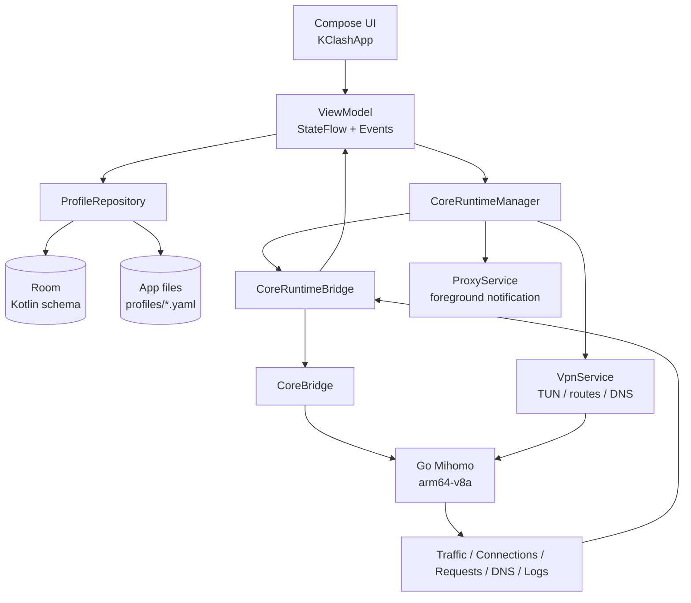
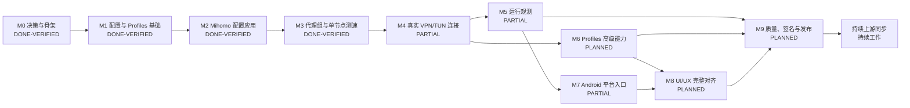

# KClash Kotlin 重写路线图

> 文档类型：产品迁移路线图、功能矩阵、依赖图和验收门槛
>
> 最后核对：2026-10-29（北京时间）
>
> 当前基线：`kotlin` 分支；首页/配置/代理/连接/观测导航、Profiles ViewModel、Profile 排序、Scripts 本地资源管理、远程脚本导入/手动同步、Profile 绑定与 JavaScript 执行边界、内存 Room、WebDAV Keystore 凭据/手动备份、认证/离线反馈、Always-on VPN 系统设置引导、Compose instrumentation 和 Redmi 真机验收均已完成首轮切片

这份路线图描述 KClash 从 Flutter 参考实现迁移为 Android 原生 Kotlin 应用的完整路径。它同时记录当前实现边界、功能完成度、前置依赖、验收证据和后续工作顺序。

路线图不把“代码存在”“单元测试通过”“真机产品可用”混为一谈。每个功能必须分别经过代码完成、自动化验证和真实设备验收，才能进入已完成状态。

## 1. 固定产品边界

| 项目 | 已确认决策 |
| --- | --- |
| 产品显示名称 | `KClash` |
| Android 包名 | `com.lonnnnnng.flclash` |
| Kotlin 主线 | Git 分支 `kotlin`，长期主分支 |
| Flutter 参考 | `main` / `upstream/main`，只用于行为和视觉参考 |
| 上游仓库 | `chen08209/FlClash` |
| 个人 fork | `lonnnnnng/FlClash` |
| 数据迁移 | 不做 Flutter/Drift 数据迁移；这是全新应用 |
| Android 范围 | Android 手机，首发覆盖竖屏和横屏 |
| 不纳入首发 | Android TV、平板、车机、桌面托盘和桌面 Helper |
| Android 最低版本 | API 24 |
| 编译与目标版本 | compile/target SDK 37，需随工具链和发布要求复核 |
| ABI | 只构建、测试和发布 `arm64-v8a` |
| 验收设备 | Redmi Note 8 Pro，serial 每次操作前重新读取 |
| 当前验收设备 | `wsvwypiz7xwslvl7`，Android 16 / API 36 |
| 真机验收订阅 | 只使用当前工作区根目录 `AGENTS.md` 中列出的两条用户授权测试路径 |
| 发布签名 | 发布阶段创建新的独立 keystore，不复用 Flutter 签名 |
| 核心 | Go Mihomo，Android 应用通过 Kotlin Bridge 使用 |

## 2. 状态定义

| 状态 | 含义 |
| --- | --- |
| `DONE-VERIFIED` | 代码完成，自动化检查通过，并有真机或端到端证据 |
| `DONE-UNIT` | 代码完成，单元测试或构建通过，但真实设备链路尚未覆盖 |
| `PARTIAL` | 已有基础代码或局部行为，尚未达到 Flutter Android 功能闭环 |
| `PLANNED` | 已明确范围和验收方式，尚未开始实现 |
| `BLOCKED` | 存在明确外部阻塞条件；当前没有将普通未实现项标为阻塞 |
| `DEFERRED` | 明确不进入当前 Android 手机首发范围 |

## 3. 当前快照

| 维度 | 当前状态 |
| --- | --- |
| 当前分支 | `kotlin` |
| 远端关系 | `kotlin` 是长期主线，`origin/kotlin` 与当前本地切片保持同步；Flutter 变更继续由 `upstream` 追踪 |
| 当前版本 | `versionName 0.1.0`，`versionCode 1` |
| Gradle 工程 | 根目录 Wrapper + `app` / `core` / `service` / `common` |
| UI 技术 | Jetpack Compose + Material 3 |
| 状态管理 | ViewModel + StateFlow + 单向事件流 |
| 数据 | Room 新 schema + 应用独立文件目录 |
| 依赖注入 | Hilt |
| 核心生命周期 | `CoreRuntimeManager` 已接入启动、停止、配置应用、代理组读取、节点切换和测速 |
| 单元测试 | 220 项通过，失败 0，错误 0，跳过 0 |
| Instrumentation | 既有 87 项稳定全量基线；本轮新增真实 MainActivity 观测页空态/三页签导航、Profiles Rules/Proxies/Proxy Groups/Providers/DNS/Dialers 高级编辑七个定向用例，以及观测页六状态截图基线定向用例通过；随后 MainActivity 类级复验受 `com.duanju.player` 抢占前台和测试收集不完整影响，未替换稳定基线；设备为 Redmi Note 8 Pro（Android 16/API 36） |
| Debug 构建 | `./gradlew test :app:assembleDebug :app:lintDebug --no-daemon` 已通过 |
| Debug APK | `android/app/build/outputs/apk/debug/app-debug.apk` |
| Debug 原生库 | APK SHA-256 为 `0607455c385ab0cd173863786c9fb95f5543e625c5271952e5f8a7f9411b0b39`；APK 内原生库全部位于 `lib/arm64-v8a/`，包含 Mihomo `libclash.so` |
| Release 构建 | `./gradlew :app:assembleRelease :app:lintRelease --no-daemon` 已通过；当前输出为未签名预发布 APK，尚未创建独立 release keystore |
| 最近真机证据 | 订阅启动、TUN/前台服务、代理组读取、真实 Mihomo 代理切换与核心重启后的选择保持、进程重建后的选择 UI 恢复、Selector 状态、代理选择 ViewModel 面板切换/持久化/失败回滚、代理选择 Activity 页面宿主选择与自动恢复、主 Activity 顶层导航与观测页签跨页面/重建状态保持、观测页 Requests/DNS/Logs 停止态空态与三页签真实宿主回归、观测页六状态组件截图基线、运行统计卡片、真实请求诊断、诊断会话证据包导出、运行诊断历史详情与导出、核心/网络/DNS 运行事件记录、活动连接/Requests/DNS/日志非空记录、观测详情搜索与日志级别筛选、Deep Link 订阅导入、进程重建恢复及首页 `CORE_RESTARTED` 历史展示、通知栏 STOP、桌面快捷入口、Quick Settings Tile、事件流健康摘要 Compose 断言、Always-on VPN 系统设置引导卡片、Access 页面级剪贴板导入/导出 E2E、Access 直接选择保存后 Room 重建恢复、Access 无结果搜索后列表恢复、Access 当前结果全选/清除及放弃修改真实宿主 E2E、Access 关闭态/脏状态截图基线、横屏重排、1.5/2.0 倍字体可达性、系统字体 1.3/2.0 回归、Access 顶栏脏状态保存、菜单层级和完整搜索态定向回归、停止清理和本地 SAF 备份/恢复均已在 `wsvwypiz7xwslvl7` 验证 |

## 4. 目标架构图

架构目标是让 `CoreRuntimeManager` 成为唯一的核心生命周期事实来源。页面、`ProxyService` 和 `VpnService` 不各自创建或销毁 Mihomo 实例。当前代理组和测速已经遵循这条边界；VPN/TUN 仍处于基础设施存在但业务链路未完全接入的过渡状态。

## 5. 里程碑总图

## 6. 已完成里程碑

### M0：决策、仓库和原生工程骨架 — `DONE-VERIFIED`

已完成内容：

- 建立 `kotlin` 长期主线，保留 `upstream` 作为 Flutter 追踪来源。
- 确定 KClash 产品名、包名、API 下限、ARM64-only、真机验收边界和独立签名边界。
- 根目录建立 Android Gradle 工程和 Wrapper。
- 建立 `app`、`core`、`service`、`common` 模块。
- 接入 Compose、Material 3、Hilt、Room、StateFlow 和基础 ViewModel。
- gomobile 只生成 `android-arm64` / `arm64-v8a` 核心库。
- 建立 `AGENTS.md`、`.agents/`、`CONTEXT.md`、ADR 和上游同步规则。

完成证据：

- 根目录 `./gradlew` 可用。
- Debug APK 已安装到 Redmi 真机。
- APK 内原生库只包含 `lib/arm64-v8a/libclash.so`。

### M1：Profiles 与本地配置基础 — `DONE-VERIFIED`

已完成内容：

- Room `profiles` 表和应用偏好表。
- 当前配置选择和重启后恢复。
- 远程订阅 URL 导入。
- 订阅响应下载和 `subscription-userinfo` 用量解析。
- 重复订阅检测。
- 本地 YAML 文件导入。
- 自定义配置创建。
- 本地配置删除。
- 配置文件原子替换写入。
- 本地配置内容读取和基础 YAML 编辑器。
- 远程订阅手动同步。
- 核心运行期间阻止配置选择和编辑，避免运行输入与用户编辑内容分裂。

未纳入 M1 完成定义的内容：高级分区编辑；本地备份/恢复已完成首片，WebDAV 手动备份协议、Keystore 凭据、配置 UI、ZIP 仓库接入、认证失败/离线反馈和本地回环真机回归已完成；外部 WebDAV 服务验收、云端同步和完整页面级 E2E 仍待后续。订阅自动更新已完成代码、自动化验证、调度证据和当前两条授权路径的真实导入/同步回归，但周期任务等待到期后的真实自动下载仍未验证。Deep Link 基础导入及本轮冷启动、重复导入和错误反馈回归已完成。二维码图片导入已完成代码、单元测试和当前两条授权路径真机验收。

### M2：Mihomo 配置校验与应用 — `DONE-VERIFIED`

已完成内容：

- `initClash` Bridge。
- 配置文件复制到 Mihomo 独立目录。
- 原子 staging，避免核心读取半写入文件。
- `validateConfig` 独立校验。
- 只有校验成功后才调用 `setupConfig`。
- 核心启动、停止、初始化失败状态。
- 运行状态 `STOPPED / STARTING / RUNNING / STOPPING / FAILED`。
- 启停、配置应用和代理操作共用 `CoreRuntimeManager.transitionLock`。
- 失败时不伪造“核心已运行”。

真机已验证：启动核心、前台通知出现、代理组可读取、核心停止后服务退出。

### M3：代理组、Selector 切换与单节点测速 — `DONE-VERIFIED`

已完成内容：

- `getProxies` Bridge 和类型安全的代理组模型。
- 保留核心返回的代理组顺序。
- 读取 `name`、`type`、`now`、`all`、`hidden`、`testUrl`。
- Selector 节点切换。
- 切换后重新读取核心状态，不以本地点击结果冒充核心确认。
- `asyncTestDelay` Bridge。
- 使用代理组 `testUrl`，未配置时使用 Mihomo 默认测试地址。
- 延迟结果按代理组、节点和测试 URL 隔离。
- 正数延迟、超时、失败、空结果和测速中状态。
- Selector 对话框内逐节点测速按钮。
- 嵌套代理组按平面列表展示，摘要沿当前选择递归解析到最终叶子节点，并对自循环/环路做保护。

真机已验证：

- 读取真实 `GLOBAL`、`Atom`、`Auto`。
- `DIRECT` 返回 `160 ms`。
- 不可用节点显示“失败”。
- `DIRECT → FR-1-01` 切换成功。

当前明确未纳入 M3：URLTest/Fallback 全部 Flutter 选择语义、延迟结果持久化、Tab/List 双布局和 Flutter 节点列表完整交互。

## 7. 进行中和未完成的功能矩阵

### 7.1 真实连接链路

状态：`PARTIAL`，代码启动链、TUN 生命周期、后台恢复、系统撤销 VPN、Wi‑Fi 断开恢复、进程重建和两条授权路径的真实请求诊断已打通；Wi‑Fi↔移动网络切换仍需具备蜂窝网络条件后补齐。

当前已有：

- Android `VpnService` 基础实现。
- TUN 地址、路由、DNS、IPv6 和访问控制参数模型。
- `Core.startTun` / `Core.stopTun` 调用。
- 网络观察和 DNS 更新基础设施。
- `NetworkObserver` 已纳入 `ProxyService`/`VpnService` 的模块生命周期；停止服务时注销 Connectivity 回调、清空 DNS/网络缓存并重置 Mihomo 网络连接。
- 前台 `ProxyService` 通知模块。
- `ServiceConfig` 发布 `STOPPED / STARTING / CONNECTED / FAILED` VPN 状态和失败原因。
- `VpnService.onStartCommand()` 已进入真实 `start()`，成功建立 TUN 后才发布 `CONNECTED`。
- `DefaultVpnOptionsProvider` 已提供 Android 手机首阶段默认 TUN 配置，并由 `CoreRuntimeManager` 注入。
- `AndroidProxyServiceController` 已统一启动 ProxyService、VpnService，并等待 VPN 状态或 15 秒超时。
- `MainActivity` 已接入 `VpnService.prepare()` 和 Activity Result 授权回调。
- 启动失败会停止服务、清理监听器，管理器不会把失败报告为 `RUNNING`。
- 停止时向绑定中的 `VpnService` 发送显式 stop action，再停止服务组件，避免系统绑定导致 TUN 残留。
- `RuntimeResumeStore` 将“用户希望核心保持运行”的意图持久化到 Room；启动成功前写入，显式停止、系统撤销和启动失败时清除。
- `KClashApplication` 在进程创建时检查恢复意图和 VPN 授权，授权有效时复用 `CoreRuntimeManager.startProxy()` 自动恢复核心。
- `ProxyService` 与 `VpnService` 对系统重建传入的 `null Intent` 返回 `START_NOT_STICKY`，让 Application 先恢复进程内 `VpnOptions` 后再显式启动，避免 `START_STICKY` 服务抢跑。
- 服务层和管理器新增失败回滚、系统撤销和撤销后重启测试；当前总计 98 项 Kotlin 单元测试通过。

本轮真机验收记录（2026-10-25，设备 `wsvwypiz7xwslvl7`，Android 16 / API 36）：

- 使用当时可用的远程订阅启动成功，UI 显示“核心运行中”；该历史地址已从当前真机验收清单移除，后续只使用当前工作区根目录 `AGENTS.md` 列出的两条授权路径。
- `dumpsys activity services` 观察到 `VpnService` 和 `ProxyService` 均为前台服务。
- `ip route` 观察到 `198.18.0.0/30 dev tun0`，Mihomo 日志出现从 `198.18.0.1` 发出的 TCP/UDP TUN 流量。
- 设备内 `curl -I http://1.1.1.1` 返回 `HTTP/1.1 301 Moved Permanently`，证明启用 TUN 时设备网络请求仍可完成；尚未将该请求与选定代理节点做可归因的端到端关联。
- 点击停止后 UI 显示“核心已停止”，服务记录、`tun0`、`198.18.0.0/30` 路由均消失；`dumpsys connectivity` 未留下 KClash VPN 网络。
- 临时将 `ACTIVATE_VPN` 设为 deny 后重新启动，系统显示 KClash VPN 授权对话框；点击“取消”后 UI 回到“核心已停止”，显示“VPN 权限未授予”，且未留下前台服务、`tun0` 或 VPN 路由；随后已恢复 `ACTIVATE_VPN: allow`。
- 旧本地测试配置曾被核心拒绝，错误为 `proxy DIRECT is the duplicate name`；该失败状态正确回显，未作为成功证据。
- 使用第二条当前授权路径启动后，通过系统“设置 → VPN → KClash → 断开连接”触发真实系统撤销；`VpnService.onRevoke()` 清理 TUN 并通知应用内 `ServiceBroadcastReceiver`，首页回到“核心启动失败”。
- 系统撤销后 `VpnService`、`ProxyService`、`tun0`、`198.18.0.0/30` 路由和 KClash VPN 网络均消失；同一 Profile 再次点击“启动核心”成功恢复运行，随后停止并删除 Profile，设备回到“还没有配置”空态。
- 使用第一条当前授权路径启动后按 Home 进入后台 10 秒，`VpnService`、`ProxyService`、`tun0` 和 `198.18.0.0/30` 路由持续存在；重新打开 KClash 首页仍显示“核心运行中”，DNS 事件继续到达，随后停止并删除 Profile。
- 使用第一条当前授权路径启动后关闭 Wi‑Fi，等待 7 秒确认底层 Wi‑Fi 网络消失；VPN 网络的 `UnderlyingNetworks` 变为空，但 `VpnService`、`ProxyService`、`tun0` 和 `198.18.0.0/30` 路由仍保持，应用进程未退出。重新开启 Wi‑Fi 后，底层接口恢复并绑定新的网络句柄，VPN、服务和路由保持；通过 TUN 发起的 `ping 1.1.1.1` 成功，Mihomo 日志出现 DNS 更新。
- 本轮设备蜂窝数据未注册且不可用，因此没有把 Wi‑Fi↔移动网络切换写成完成证据；测试 Profile 已通过应用内删除，设备回到“还没有配置”空态。
- 进程重建验收：使用第二条当前授权路径启动后，记录旧 PID `16207`；通过 `cmd activity crash com.lonnnnnng.flclash` 触发进程退出，4 秒后出现新 PID `16637`。20 秒后两个前台服务、`tun0` 和 `198.18.0.0/30` 路由均保持，重新打开首页仍显示“核心运行中”；停止后服务和路由清理完成，Profile 通过应用内删除并恢复“还没有配置”空态。

当前缺失：

- `ServiceConfig.vpnOptions` 仍是首阶段默认配置，尚未从 Mihomo 配置/Android 设置真实映射 mixed-port、tun stack 和路由覆盖项。
- 首次安装或清除数据后的 VPN 授权弹窗尚未在本轮干净状态中重测；临时拒绝授权后的失败回滚路径和运行期间系统撤销 VPN 的路径已验证。
- 已完成“当前代理组/节点 → 受控真实请求 → HTTP 状态、代理链、规则、Requests、DNS、Logs 和累计流量”的首轮真机归因闭环；活动连接在第二条授权路径的 7.4 秒请求中捕获到 1 条。
- Wi‑Fi 断开/恢复和进程重建已完成真机验证；尚未覆盖真实 Wi‑Fi↔移动网络切换，当前设备蜂窝网络未注册。

完成门槛：

1. 首次启动能解释并申请 VPN 权限。
2. 用户授权后能建立 TUN，拒绝时保持失败状态并给出可理解原因。
3. 真实网络请求经过 Mihomo，代理组选择对请求生效。
4. 停止后 TUN、前台服务和核心全部释放。
5. 真机重启应用、切换 Wi-Fi/移动网络、切后台再恢复和进程重建均不会产生悬挂隧道；其中后台恢复、Wi‑Fi 断开恢复和进程重建已完成，Wi‑Fi↔移动网络切换仍待验证。

### 7.2 连接、流量和运行观测

状态：`PARTIAL`，流量、连接数、活动连接、Requests、DNS 和核心日志的基础观测与真实请求归因已验证，详情级交互已支持搜索、筛选、自动跟随和脱敏导出，事件流已具备有界背压和健康统计，运行诊断历史已接入 Room、在进程重建后直接展示恢复事件，并支持完整详情查看和独立脱敏导出；稳定故障归因、建议文案、脱敏原始详情和诊断导出元数据已完成，真实 `MainActivity` 的非空 Requests/DNS/Logs 详情入口、搜索、日志级别筛选和关闭回归已完成，仍需补齐跨设备和完整页面级端到端覆盖。

当前已有：

- `CoreBridge` 已映射 Mihomo `getTraffic`、`getTotalTraffic` 和 `getConnectionCount`，并对负数计数做边界归一化。
- `CoreRuntimeManager` 只在核心运行状态下读取三类统计，避免停止状态访问已释放的核心。
- `MainViewModel` 只在核心运行且首页 Activity 可见时每秒轮询统计；页面进入后台会取消收集，停止或进入错误时清理/回显状态。
- Compose 首页已提供运行统计卡片，展示上传、下载、连接数和累计流量，并覆盖停止态、加载态和错误态。
- `CoreBridge`、`CoreRuntimeManager` 和 `MainViewModel` 已接入 Mihomo `getConnections`，首页显示活动连接数量、目标、进程、代理链、规则和上下行计数。
- `CoreBridge` 已接入 `updateEventListener()`，解析 Go 核心的 `message.arguments` 批次，并将 `request`、`requestTraffic` 事件转换为 Kotlin 领域事件。
- `CoreBridge` 已将 `dns`、`log` 事件转换为稳定的 Kotlin `CoreDnsQuery` 和 `CoreEvent.Log`，并覆盖 DNS 字段、日志级别和损坏事件丢弃测试。
- `CoreRuntimeManager` 在核心运行期间安装事件监听器和 Mihomo 日志泵，停止或启动失败时成对释放；事件流不经过 Compose 或 gomobile 生成类型。
- `MainViewModel` 已维护最近 2000 条 Requests 历史，并按连接 ID 合并上下行流量更新；首页提供请求空态、最近记录和完整记录对话框。
- `MainViewModel` 已维护最近 1000 条 DNS 查询和核心日志，停止核心时清空运行观测，并提供用户主动清空入口。
- Compose 首页已提供 DNS 查询和核心日志卡片、最近记录和完整记录对话框，覆盖停止态、空态和错误日志颜色提示。
- 核心日志详情和首页卡片提供系统文件导出；导出前遮蔽 URL 查询参数、JSON 凭据字段和常见 token/key/secret/password/url 值。
- `CoreBridge.probe`、`CoreRuntimeManager.probe` 和首页“真实请求诊断”卡片已接入；结果包含 HTTP 状态、耗时、最终 URL、代理链、规则和核心路由版本，且不保留响应正文。

仍需补齐的 Bridge / Repository / UI：

- 跨设备和完整页面级端到端断言，以及更细的诊断筛选和导出体验；当前真实 `MainActivity` 已补齐观测页停止态空态、Requests/DNS/Logs 三页签导航、非空详情入口、无结果搜索、日志级别筛选和关闭回归。

本轮自动化与真机证据（2026-10-25，设备 `wsvwypiz7xwslvl7`）：

- `./gradlew test :app:assembleDebug --no-daemon` 通过；98 项 Kotlin 单元测试通过，失败 0，错误 0，跳过 0。
- Debug APK 安装成功；启动核心后首页实际收到 DNS 查询（4 条）和核心日志（3 条），卡片出现“查看全部/清空”操作；停止态观测卡片恢复启动核心提示。
- 停止后 `tun0`、`198.18.0.0/30` 路由和 KClash 前台服务均已清理。
- 本轮只使用当前工作区根目录 `AGENTS.md` 列出的两条用户授权路径；第一条诊断返回 HTTP 403 / 1.6 秒，第二条诊断返回 HTTP 200 / 7.4 秒。
- 第一条路径 UI 显示真实代理链和 `Match` 规则，请求记录达到 10 条、累计流量非零；第二条路径 UI 捕获活动连接 1 条、请求记录 17 条、DNS 查询 26 条、核心日志 31 条、累计流量非零。
- 两条路径均在停止后清理 `tun0`、`198.18.0.0/30` 路由和 KClash 前台服务；测试 Profile 均通过应用内删除，设备恢复空配置状态。
- Deep Link 切片真机导入使用当前授权清单中的第一条路径；该次导入成功并显示订阅用量，测试 Profile 已在验收后删除。

本轮观测详情交互切片（2026-10-26，设备 `wsvwypiz7xwslvl7`）：

- Requests 详情对话框支持按目标、进程、代理链和规则大小写不敏感搜索，并显示过滤后数量；DNS 详情对话框支持按域名、上游、答案和错误搜索。
- 核心日志详情对话框支持内容搜索和“全部/错误/警告”级别筛选；筛选无匹配时显示明确空态，不隐藏原始记录总数。
- 三类详情列表共用自动跟随最新事件的滚动行为；用户向上翻阅历史后保持当前位置，改变筛选条件时回到最新匹配项。
- 新增 3 项筛选语义和 1 项日志导出脱敏单元测试；`./gradlew :app:testDebugUnitTest :app:compileDebugKotlin --no-daemon` 通过，工程总计 102 项 Kotlin 单元测试通过。
- 安装 Debug APK 后启动第一条当前授权路径，首页捕获活动连接 1 条、请求 4 条、DNS 查询 13 条和核心日志 8 条；打开三类详情对话框分别看到搜索框，其中日志点击“错误”后显示 `0/8` 和“没有匹配的核心日志”。
- 核心日志详情和首页卡片新增系统文件导出；导出文件使用 UTF‑8 表格文本格式，URL 查询参数、JSON 凭据字段和常见 token/key/secret/password/url 值统一替换为 `[REDACTED_SECRET]`。
- 真机通过 Android `DocumentsUI` 保存 `kclash-logs-*.txt` 到 `Download/kclash-qr`；文件大小 1634 bytes、17 行，前两行为导出标题和列名，设备侧检查到 61 个脱敏标记，未把原始凭据写入导出文件。
- 通过 `adb -s wsvwypiz7xwslvl7 shell am start -a com.lonnnnnng.flclash.action.STOP` 停止核心，确认 `VpnService`、`ProxyService`、`tun0` 和 `198.18.0.0/30` 路由清理；随后应用内删除测试 Profile，首页恢复“还没有配置”，未发现 `FATAL EXCEPTION`。

完成门槛：

- 每个页面都有 loading、空数据、刷新、错误和停止核心状态。
- 观测数据不会阻塞启停和代理切换。
- 真机能看到一条实际请求从连接、请求、DNS 和日志侧的可追踪证据。

### 7.3 Profiles 高级能力

状态：`PARTIAL`，基础能力已完成，完整 Flutter parity 未开始。

已完成本轮切片：

- `clash://install-config`、`clashmeta://install-config`、`flclash://install-config` 和 `kclash://install-config` 的 Android 入口声明。
- Deep Link `url` 参数 URL 解码、HTTP/HTTPS 校验和可选名称解析。
- Deep Link 导入复用 `ProfilesViewModel.addRemote`，不在 Activity 中重复下载或写入 Profile。
- 无效 Scheme、Host、目标协议或缺失参数会通过现有 Snackbar 错误流提示，不能创建半成品 Profile。
- 二维码图片选择、QR 格式识别和配置链接解析已接入添加 Profile 对话框；直接 HTTP(S) 链接和四种 KClash Deep Link 统一复用同一解析器及远程订阅写入链路。
- 核心运行期间阻止 Profile 删除；Compose 入口与 `ProfilesViewModel` 共享运行态守卫，避免当前核心继续持有已删除或被切换的配置文件。
- 自定义 Profile 新增 Rules 分区快速编辑入口；编辑器逐行校验规则类型和动作，拒绝 `SUB-RULE`，保存时只替换顶层 `rules` 区块，不改写其他 YAML 字段。
- 自定义 Profile 新增 Proxies 分区快速编辑入口；编辑器按 YAML 列表校验代理名称和类型，拒绝重复名称和非列表结构，保存时只替换顶层 `proxies` 区块，不改写其他 YAML 字段。
- 自定义 Profile 新增 Proxy Groups 分区快速编辑入口；编辑器按 YAML 列表校验代理组名称和 Flutter 支持的类型，拒绝 `relay`、重复名称和非列表结构，保存时只替换顶层 `proxy-groups` 区块并保留边界注释与其他 YAML 字段。
- 自定义 Profile 新增 Providers 分区快速编辑入口；分别编辑顶层 `proxy-providers`/`rule-providers` map，校验嵌套 map、非空字段和唯一名称，保存时局部替换并保留边界注释与其他 YAML 字段。
- 自定义 Profile 的代理 Provider 新增字段化覆盖表单；支持健康检查 URL、间隔、超时、lazy、期望状态、名称前缀/后缀、UDP、跳过证书校验和 IP 版本，并将覆盖按 Provider 名称持久化到 Kotlin 自有 `overridesJson`。
- Provider 覆盖只作用于核心启动时生成的暂存 YAML，原始 Profile 文件保持不变；已有 `health-check`/`override` 子字段会局部合并并保留未覆盖字段，避免编辑覆盖后丢失用户配置。
- 自定义 Profile 新增 DNS Overrides 字段化编辑；支持布尔开关、监听地址、增强模式、Fake-IP 地址段、各类 DNS 列表和 Fake-IP 过滤器，DNS 覆盖与 Provider 覆盖共存于同一份 `overridesJson`。
- DNS Overrides 只作用于核心启动时的暂存 YAML；局部替换顶层 `dns` 区块时保留未知字段、原始 Profile 文件和 URL 中的冒号内容，核心运行期间禁止打开或保存。
- 自定义 Profile 新增 Dialers 编辑入口；以“代理名 -> 出站目标”文本维护映射，保存到 Kotlin 自有 `overridesJson`，支持显式空映射清除原有 `dialer-proxy`。
- Dialers 核心应用只修改启动暂存 YAML：清理旧 `dialer-proxy` 后写入当前映射，校验代理和目标存在性，并拒绝经过代理组或代理链形成的循环依赖；原始 Profile 文件保持不变。
- Provider、DNS 和 Dialers 覆盖保存互相保留，避免编辑一个高级分区时丢失其他分区；自定义 Profile 运行期间仍统一禁止修改。
- Profile 列表新增排序入口；排序弹窗先维护内存草稿，保存后才通过 ViewModel 和 Room 事务写回 `orderIndex`，核心运行期间禁止排序。
- 自定义 Profile 新增脚本库入口；脚本元数据保存到 Room，正文保存到 `filesDir/scripts/<id>.js`，支持新建、读取、编辑、删除和排序，写入采用原子替换。
- Profile 卡片新增脚本绑定入口；绑定和解绑只写入 Kotlin 自有 `profiles.scriptId`，核心运行期间拒绝修改，脚本删除时在同一 Room 事务内清除关联 Profile，避免留下孤立引用。
- 脚本库与编辑器在核心运行期间禁止修改；Profile 绑定脚本会在核心启动的暂存配置阶段执行，失败时阻止配置校验和 Mihomo 启动。

### 2026-10-27：Profile DNS Overrides 切片

- `ProfileDnsOverrides` 增加 `enable`、`listen`、`ipv6`、`respect-rules`、`prefer-h3`、hosts、增强模式、Fake-IP 和五类 DNS 列表字段；JSON 往返保留 null 的“未覆盖”语义。
- `ProfileDnsOverrideApplier` 只合并暂存 YAML 的顶层 `dns` 区块；缺少区块时追加，已有区块时局部替换，未知 DNS 字段、Provider 覆盖和其他顶层配置均保留。
- DNS 列表按块序列写回，URL 中的 `:` 不会被误加引号或拆成 YAML map；原始 Profile YAML 不会被覆盖。
- 配置页 Profile 卡片新增 DNS 入口和字段化对话框；核心运行期间入口、保存和 ViewModel 写入均受保护。
- 新增 DNS JSON/YAML 合并、ViewModel 运行态保护、Compose 表单回调和真实 Room/Repository 共存测试。
- `./gradlew test :app:assembleDebug :app:lintDebug --no-daemon`：通过；全工程 168 项 JVM 单元测试失败 0、错误 0、跳过 0，Lint 错误 0。
- `ANDROID_SERIAL=wsvwypiz7xwslvl7 ./gradlew :app:connectedDebugAndroidTest --no-daemon`：首次发现 1 项测试未滚动到 LazyColumn 内字段，修复测试定位后重跑通过；最终 40 项 instrumentation 失败 0、错误 0、跳过 0，其中 Room 6 项、Compose 30 项、WebView JavaScript 4 项。
- Debug APK SHA-256：`2ee8c4bdd81fffd2018f1595fe64b95cd7d3022a4f25f9149b5ae901b5bafd9e`；APK 原生库全部位于 `lib/arm64-v8a/`。本轮未访问真实订阅、VPN 或核心启动。

本轮自动化与真机证据（2026-10-25，设备 `wsvwypiz7xwslvl7`）：

- `:app:testDebugUnitTest` 通过，新增 Deep Link 解析用例覆盖编码 URL、四种协议、非法 Host、非 HTTP(S) 目标和缺失参数。
- `:app:assembleDebug` 通过，APK 只包含 `arm64-v8a` 的原生库。
- 通过 `kclash://install-config` 触发当前授权订阅导入，设备 UI 显示远程订阅及用量信息；随后删除该测试 Profile，恢复空配置状态。
- 强制停止应用后再通过 `kclash://install-config` 冷启动导入成功；再次发送同一链接显示“该订阅已经添加”，没有创建重复 Profile。
- 二维码解析分支已通过 JVM 单元测试和 Debug 构建；两条当前授权路径均已通过二维码图片在真机导入，第一条显示订阅用量，第二条显示 `clash-1220f4ac` 远程订阅。
- 第二条路径首次暴露 HTTP 301 跨协议重定向缺口，已限制放行 `clash.tkbond.us` 的明文入口并由订阅客户端手动跟随 HTTP/HTTPS 重定向；新增本地 301→200 回归测试。
- 第二条二维码重复导入显示“该订阅已经添加”；验收结束后两个测试 Profile 均通过应用内删除，设备恢复“还没有配置”空态。

### 2026-10-27：Profile 排序切片

- 配置页新增“排序”入口和排序弹窗；每行提供“上移/下移”，保存前只修改内存草稿，取消或返回不会持久化中间顺序。
- `ProfilesViewModel.reorder` 复用核心运行态修改保护，并将弹窗顺序与最新 Profile 列表合并，避免排序期间新增配置被遗漏。
- `ProfileRepository.reorder` 在 Room 事务内过滤未知/重复 ID、补齐遗漏 Profile 并重新编号 `orderIndex`，当前选中 Profile 只跟随 ID 不因排序改变。
- 新增 2 项 `ProfilesViewModel` JVM 测试、1 项排序 Compose 测试和 1 项真实 Repository/Room 排序持久化测试。
- `./gradlew test :app:assembleDebug :app:lintDebug --no-daemon`：通过；全工程 152 项 Kotlin 单元测试失败 0、错误 0、跳过 0，Lint 错误 0、Warning 32、Hint 2。
- `ANDROID_SERIAL=wsvwypiz7xwslvl7 ./gradlew :app:connectedDebugAndroidTest --no-daemon`：通过；26 项 instrumentation 测试失败 0、错误 0、跳过 0；设备为 Redmi Note 8 Pro（Android 16/API 36）。
- Debug APK `android/app/build/outputs/apk/debug/app-debug.apk` SHA-256 为 `d1f4098ea916501f595988ca9e398397defb4286d409b37fbd98366be160465e`，APK 原生库仅包含 `lib/arm64-v8a/`；本轮未访问当前 `AGENTS.md` 列出的两条真实订阅路径、VPN 或核心启动。

### 2026-10-27：Scripts 本地资源管理基础切片

- 新增 `ScriptEntity`/`Script`、Room `scripts` 表和 `MIGRATION_3_4`；脚本正文独立保存到应用私有 `filesDir/scripts/<id>.js`，不读取或迁移 Flutter/Drift 数据。
- `ScriptRepository` 支持新建、读取、编辑、删除和排序；名称去重、空内容拒绝、文件原子替换、Room 元数据与正文失败回滚均在 Repository 层处理。
- 配置页新增“脚本”入口、脚本库和编辑器；ViewModel 通过不可变 `StateFlow` 暴露列表和编辑状态，核心运行期间拒绝修改并保留错误反馈。
- UI 文案明确当前只完成本地资源管理，Profile 绑定、远程同步和 Mihomo JavaScript 执行留待后续切片，避免用户误以为脚本已生效。
- 新增 3 项 `ScriptsViewModelTest`、2 项 `ScriptsUiInstrumentedTest`、1 项 `ScriptsRepositoryInstrumentedTest`，并新增 Room 3→4 migration 覆盖；全工程测试计数为 155 项 JVM、30 项 instrumentation。
- `./gradlew test :app:assembleDebug :app:lintDebug --no-daemon`：通过；JVM 单元测试 155 项失败 0、错误 0、跳过 0，Lint 错误 0、Warning 32、Hint 2。
- `ANDROID_SERIAL=wsvwypiz7xwslvl7 ./gradlew :app:connectedDebugAndroidTest --no-daemon`：通过；30 项 instrumentation 失败 0、错误 0、跳过 0，其中 Room 5 项、Compose 25 项；设备为 Redmi Note 8 Pro（Android 16/API 36）。
- Debug APK SHA-256 为 `b3f1e148bbe18e7a23db29cb689104678b8bd8ef73bd15cccc715c0fdfd5ff97`，APK 原生库全部位于 `lib/arm64-v8a/`；本轮未访问当前 `AGENTS.md` 列出的两条真实订阅路径、VPN 或核心启动。

### 2026-10-27：Scripts Profile 绑定切片

- `ProfileRepository.updateProfileScript` 校验目标脚本存在后持久化 `profiles.scriptId`；支持绑定和解绑，不读取或迁移 Flutter/Drift 数据。
- 配置页 Profile 卡片新增脚本绑定弹窗，显示当前绑定、解绑入口和脚本库跳转；核心运行期间由 `ProfilesViewModel` 与 Compose 入口共同拒绝变更。
- 删除脚本时在 Room 事务内清除所有 Profile 的 `scriptId`，再删除脚本元数据和应用私有正文文件，避免后续执行链读取失效引用。
- 新增 2 项 `ProfilesViewModel` JVM 测试、1 项脚本绑定 Compose 测试、1 项真实 Repository/Room 持久化测试，并扩展脚本删除测试验证绑定清理。
- `./gradlew :app:testDebugUnitTest --no-daemon --rerun-tasks`：通过；全工程 157 项 Kotlin 单元测试失败 0、错误 0、跳过 0。
- `./gradlew test :app:assembleDebug :app:lintDebug --no-daemon`：通过；Lint 错误 0、Warning 32、Hint 2。
- `ANDROID_SERIAL=wsvwypiz7xwslvl7 ./gradlew :app:connectedDebugAndroidTest --no-daemon`：通过；32 项 instrumentation 失败 0、错误 0、跳过 0，其中 Room 6 项、Compose 26 项；设备为 Redmi Note 8 Pro（Android 16/API 36）。
- Debug APK SHA-256 为 `4dfa7e1632017ec276b4a68df2d7ba878d50f3ee2dd8894bbca1c356f5bb5150`，APK 原生库仅包含 `lib/arm64-v8a/`；本轮未访问当前 `AGENTS.md` 列出的两条真实订阅路径、VPN、核心启动或 JavaScript 执行。

待完成：

- YAML 编辑器语法体验、搜索、定位、错误行提示和大文件性能。
- 完整页面级 E2E；本地 SAF 备份恢复首片和 WebDAV 手动备份（含凭据、UI、仓库、认证/离线反馈和本地回环真机回归）已完成，外部服务回归和云端同步仍待后续。
- 真实在线订阅更新回归；自动更新调度、失败重试、失败摘要和通知已完成代码与自动化验证。
- Profile 级别的代理组展开状态和其他 Flutter 行为数据。

完成门槛：

- 远程订阅、文件、手工配置、二维码、Deep Link 五种入口的行为一致。
- 编辑内容通过 Mihomo 校验后才能应用。
- 订阅更新失败不会破坏上一份可运行配置。

### 7.4 代理组完整交互

状态：`PARTIAL`。

待完成：

- URLTest/Fallback 的完整递归选择和自动选择语义仍待补齐；当前节点/自动恢复基础交互已完成。
- 代理组选择的完整递归 UI 导航、展开状态和 Tab/List 双布局。
- 超时节点隐藏和失败节点回滚策略。
- 展开、折叠、滚动定位。
- 延迟结果的跨进程持久化缓存。

完成门槛：

- Selector、URLTest、Fallback、LoadBalance 都能按照 Flutter Android 行为展示。
- 切换、测速、刷新并发时不会覆盖其他操作的状态。
- 所有失败都保留核心错误，不使用历史成功状态掩盖失败。

### 7.5 Android 平台入口

状态：`PARTIAL`。

已完成：

- 前台通知保留 STOP 操作；通知动作通过受保护的 `QuickActionActivity` 进入 `CoreRuntimeManager.stop()`。
- Android 13+ 首次进入 `MainActivity` 时申请 `POST_NOTIFICATIONS`，避免用户看不到前台服务和停止入口。
- 桌面静态快捷方式提供启动、停止、切换三个入口；三个入口均通过同一个 `QuickActionActivity` 进入 `CoreRuntimeManager`。
- Quick Settings Tile 提供启动/停止切换入口；Tile 状态由 `CoreRuntimeManager.state` 映射，点击通过 `QuickActionActivity` 折叠系统面板并复用 `TOGGLE`。
- 外部 Action 提供 `com.lonnnnnng.flclash.action.START/STOP/TOGGLE`；公开入口只接受固定 action，拒绝 URI 和 extras，再转发到内部 `QuickActionActivity`。
- 首页提供电池优化状态卡片和系统设置引导；状态由 `PowerManager.isIgnoringBatteryOptimizations()` 读取，不能以 UI 点击结果代替系统授权。
- `QuickActionActivity` 使用 `VpnService.prepare()` 处理启动入口的系统授权边界；自身不导出，快捷入口使用显式组件调用。
- AndroidManifest、快捷方式 Intent 和组件导出边界已完成基础安全核对。
- 按应用代理首片已接入 Room 全局设置、已安装启动器应用列表、应用名/包名搜索、白名单/黑名单选择、批量选择和核心运行中编辑锁定；启动 VPN 时由 `DefaultVpnOptionsProvider` 读取并清洗包名列表，最终由 `VpnService.Builder.addAllowedApplication/addDisallowedApplication` 应用。
- 按应用代理真实核心流量回归已完成：使用工作区根目录 `1.yaml` 启动真实 Mihomo，在 Redmi 真机上用第二条授权路径发起同一受控请求；黑名单选中 `com.mmbox.xbrowser` 时该 UID 只有 `wlan0` 统计、没有 `tun0` 记录，白名单选中同一包名时出现 `tun0` 统计（UID `10785`，约 15 KB 入站、7.8 KB 出站），对照证明 Android 包过滤边界已实际作用于 TUN。

本轮验收证据（2026-10-26，设备 `wsvwypiz7xwslvl7`，Android 16 / API 36）：

- `./gradlew test :app:assembleDebug --no-daemon`：通过；工程 Kotlin 单元测试 98 项，失败 0、错误 0、跳过 0；APK 仅包含 `arm64-v8a` 原生库。
- 安装 Debug APK 后，系统 `cmd shortcut get-shortcuts` 返回 `start`、`stop`、`toggle` 三个静态快捷方式；启动器长按 KClash 图标显示“启动 KClash 核心”“停止 KClash 核心”“切换 KClash 核心运行状态”。
- 从启动器点击“启动 KClash 核心”后，`VpnService`、`ProxyService`、`tun0` 和 `198.18.0.0/30` 路由出现；点击“停止 KClash 核心”后服务和路由均清理。
- 从启动器两次点击“切换 KClash 核心运行状态”，分别验证启动和停止；停止后设备恢复无 KClash 服务、无 `tun0` 的状态。
- 通过 `adb -s wsvwypiz7xwslvl7 shell cmd statusbar add-tile com.lonnnnnng.flclash/.KClashTileService` 将 Tile 加入系统快捷设置；点击后启动核心，系统面板无障碍描述为“`KClash：核心运行中`”。再次点击后服务、`tun0` 和路由清理，面板描述变为“`KClash：核心已停止`”。
- 通过 ADB 隐式 Action 验证 `START`、`STOP`、`TOGGLE`：启动/停止服务与 `tun0` 状态均正确切换；携带额外参数的 Action 被公开入口拒绝，未启动服务。
- 首页“后台运行”卡片显示真实未忽略状态；点击“打开电池优化设置”进入系统 `RequestIgnoreBatteryOptimizations` 页面，返回后状态仍由系统值刷新，本轮未替用户点击“允许”。
- 验收 Profile 已通过应用内删除，首页恢复“还没有配置”。

待完成：

- Tasker/MacroDroid 实际应用回归（当前已完成 ADB/Intent 契约验证）。
- 完整 Flutter Access 页面 parity（选择器、持久化、服务参数、真实核心流量回归、关闭状态遮罩/一键开启、排序和系统/无网络过滤、智能选择、剪贴板导入/导出首片、Access 卡片顶栏搜索/全选入口、窄屏 FlowRow、横屏重排、1.5/2.0 倍字体可达性、系统字体 1.3/2.0 回归、保存后重建恢复、顶栏脏状态保存/菜单层级、完整搜索态、无结果搜索恢复、当前结果全选/清除与放弃修改真实宿主 E2E、默认卡片截图基线、关闭态/脏状态截图基线、1.3/1.5/1.8/2.0 字体截图矩阵和竖屏/横屏截图矩阵首片已完成；更多系统字体档位、跨设备截图矩阵和全量设备稳定回归仍待补齐）。
- Always-on VPN 的完整配置和系统设置兼容。
- Android 组件导出、Intent 和权限的完整自动化审计。

完成门槛：

- 外部入口和页面入口进入同一个 `CoreRuntimeManager`，不产生第二套启停逻辑。
- 被系统拒绝或权限缺失时可见地失败。
- 所有导出的组件都有明确的最小权限边界。

### 7.6 UI/UX 完整对齐

状态：`PARTIAL`。

当前已有：

- Compose + Material 3 基础主题。
- 首页、配置、代理、连接、观测五个手机目的地；观测页包含 Requests、DNS、Logs 三个页签，核心状态和代理组交互。
- Edge-to-edge 基础设置。
- Access 卡片首轮响应式收敛：标题/状态/排序/筛选区域可换行，已完成横屏重排、1.5/2.0 倍字体 Compose 可达性回归、系统字体 1.3/2.0 宿主回归、Redmi 默认卡片 PNG 哈希基线、1.3/1.5/1.8/2.0 字体截图矩阵和竖屏/横屏截图矩阵首片；真实宿主保存后重建可恢复 Room 设置；脏状态下提供标题栏保存、Flutter 风格主菜单/设置/操作层级和标题栏完整搜索态，正文操作入口保留为小屏备用。

待完成：

- Flutter 页面信息架构和 Android 手机导航结构对齐。
- Dashboard、Profiles、Proxy、Connection、Observations 页面及其 Requests、DNS、Logs 页签的完整交互对齐。
- Material You 动态颜色、浅色/深色主题。
- Flutter 连续圆角、底部面板、弹层和交互节奏。
- 横屏布局和小屏滚动策略的全页面覆盖。
- 无障碍语义、内容描述、触控区域和系统动态字体矩阵的全页面覆盖。
- 截图基线和 Compose screenshot regression；当前已完成 Redmi 单设备观测页 Requests/DNS/Logs 六状态组件基线，完整页面和跨设备矩阵仍待补齐。

完成门槛：

- 关键用户流程在 Flutter 参考和 KClash Android 上逐屏比对。
- 旋转、恢复、进程重建后状态不丢失。
- UI 不直接调用 Core、gomobile 或数据库。

### 7.7 测试、发布和运维

状态：`PARTIAL`。

当前已有：

- 220 项 JVM 单元测试，失败 0、错误 0。
- Debug APK 构建和 arm64 产物检查。
- `:app:lintDebug` 已通过；当前有 36 条非阻断 Warning、2 条 Hint，错误为 0。
- 既有 87 项 instrumentation 稳定基线；本轮新增真实 MainActivity 无结果搜索恢复、观测页停止态空态用例和观测页六状态截图基线用例，定向用例均通过。随后 MainActivity 类级复验受 `com.duanju.player` 抢占前台影响，出现既有宿主失败；停用干扰应用后的复跑 XML 为 `tests=0`，未形成有效类级证据，因此不替换稳定基线。
- Redmi 真机启动、停止、代理组和测速验证。
- Redmi 真机已验证 DNS/日志观测卡片的停止态和空态展示，以及两条授权路径的真实请求归因。

待完成：

- 完整页面级 Compose/Instrumentation 测试，当前已新增 Access 真实宿主直接选择→保存→重建恢复、无结果搜索恢复、横屏重排、1.5/2.0 倍大字号可达性、系统字体 1.3/2.0 回归、顶栏保存/菜单层级、完整搜索态、默认卡片截图哈希基线、1.3/1.5/1.8/2.0 字体截图矩阵回归、观测页停止态空态/三页签真实宿主回归、观测页 Requests/DNS/Logs 六状态组件截图基线、观测非空详情入口/搜索/日志级别筛选/关闭回归，以及 Profiles Rules 高级编辑真实宿主回归；停用前台干扰应用后已有 87 项稳定全量基线，观测页面级和跨设备截图、Profiles 其他高级分区和代理组仍需继续补齐。
- VPN 权限、TUN 停止清理、后台恢复、系统撤销 VPN、Wi‑Fi 断开恢复、进程重建和 `dumpsys connectivity` 真机测试已有证据；Wi‑Fi↔移动网络切换仍待完成。
- 连接、请求、DNS、日志端到端测试的自动化脚本和稳定断言。
- R8、Release 构建和 APK 签名检查。
- 新 release keystore。
- GitHub Actions arm64 构建。
- Release 页面、更新日志、SHA-256 和回滚材料。
- 上游变更后的功能矩阵和回归记录。

完成门槛：

- Debug 和 Release 都能从干净环境构建。
- 发布 APK 只有 `arm64-v8a`。
- 签名、版本、包名、产物哈希和远端 Release 资产都能复核。
- 真机验收记录包含设备 serial、步骤、结果和关键日志。

## 8. 推荐推进顺序

### N1：建立真实连接状态和 VPN 权限链

目标：让“启动核心”升级为“启动可用代理连接”。

当前进度：VPN 授权、TUN 生命周期、后台恢复、系统撤销、Wi‑Fi 断开恢复和进程重建已经完成真机闭环；下一项只剩在具备蜂窝网络条件的设备上验证 Wi‑Fi↔移动网络切换。

收尾范围：

1. 在具备已注册蜂窝数据的设备上验证 Wi‑Fi↔移动网络切换。
2. 记录切换期间 `UnderlyingNetworks`、TUN、路由、前台服务和真实请求的连续性。
3. 若切换失败，保留失败 Run，修复网络绑定或服务收口后再复验。

不在 N1 混入：Connections、Requests、DNS 页面和 UI 大改版。

### N2：真实流量和核心观测

目标：用户能确认代理正在工作，并能解释网络行为。

当前进度：Bridge、运行统计、活动连接、Requests、DNS、基础日志和“真实请求诊断”已完成首轮真机闭环；观测详情入口、非空记录、搜索、日志级别筛选、关闭、自动跟随、诊断会话证据包、有界运行诊断事件历史、事件流背压统计、诊断卡片事件流健康摘要、稳定故障归因、异步事件停止边界、页面退出轮询收敛、真实高负载压力验收、观测目的地页签导航和事件流摘要 Compose instrumentation 断言已完成代码、自动化测试和 Redmi 真机闭环，仍需补齐跨设备和完整页面级交互端到端覆盖。

建议范围：

1. Bridge 流量和连接 API。
2. Dashboard 流量卡片。
3. Connections 页面。
4. Requests 页面。
5. 基础日志流。

### N3：DNS、日志和故障诊断

目标：让真机问题可以在应用内定位，而不是只能依赖 logcat。

当前进度：DNS/日志 Bridge、列表、清空、内容筛选、日志级别筛选、脱敏导出、诊断会话证据包、运行诊断历史详情/导出、诊断卡片事件流健康摘要、稳定故障归因和核心/网络/DNS 运行诊断记录已完成代码、单元测试和 Redmi 真机闭环；观测页的 Requests、DNS、Logs 三个页签已接入主导航，非空详情入口、无结果搜索、日志级别筛选和关闭已完成真实 `MainActivity` 验证，Room 持久化、迁移、生命周期锚点、异步网络事件停止边界、页面退出轮询收敛和进程重建后的首页历史展示均已完成自动化与真机验证，仍需补齐跨设备和完整页面级交互端到端覆盖。

建议范围：

1. DNS 查询 Bridge 和列表。
2. 日志导出、过滤、清空和更细的故障诊断边界。
3. 统一错误码和用户可见错误文案。
4. 网络切换、DNS 变化和核心重启的诊断记录。

### 2026-10-26：诊断会话证据包切片

- `./gradlew test :app:assembleDebug :app:lintDebug --no-daemon` 通过；工程共 105 项 Kotlin 单元测试，失败 0、错误 0、跳过 0。
- Debug APK 安装到 `wsvwypiz7xwslvl7`（Redmi Note 8 Pro，Android 16/API 36）；APK 内原生库仅包含 `arm64-v8a`。
- 使用当前工作区根目录 `AGENTS.md` 中的第一条授权路径导入远程 Profile；启动后首页显示“核心运行中”，`VpnService`/`ProxyService`、`tun0` 和 `198.18.0.0/30` 路由均存在。
- 点击“测试当前路由”后，首页显示“诊断会话：通过 · 请求 11 · DNS 6 · 日志 12”，断言为“HTTP 状态、代理链和核心归因均有效”，本次 HTTP 状态为 403。
- 通过 Android `DocumentsUI` 导出 `kclash-diagnostic-1.txt`；设备侧确认文件约 3 KB、41 行，包含表头和 `[requests]`/`[dns]`/`[logs]` 分区，存在脱敏标记，未命中测试秘密值。
- 通过外部 STOP Action 停止核心后，前台服务、`tun0` 和 `198.18.0.0/30` 路由均清理；应用内删除测试 Profile 后回到“还没有配置”，未发现 `FATAL EXCEPTION`。

### 2026-10-26：运行诊断事件记录切片

- 新增固定上限 200 条的运行诊断历史，记录核心启动、重启、停止、失败、VPN 撤销、底层网络可用/即将丢失/丢失/切换和 DNS 服务器变化；诊断证据包新增 `[runtime]` 分区。
- 新增 4 项单元测试，覆盖运行历史有界清理、清空、核心启动/停止/重启顺序和会话只在运行期间收集运行事件；全工程共 109 项测试通过。
- Redmi 真机使用第二条当前授权路径成功 probe：HTTP 200，UI 显示“诊断会话：通过 · 运行 3 · 请求 2 · DNS 8 · 日志 2”。
- 在核心保持运行期间关闭 Wi‑Fi 8 秒后重新开启，TUN、前台服务和 `198.18.0.0/30` 路由保持；恢复后再次 probe 成功，UI 显示“诊断会话：通过 · 运行 8 · 请求 2 · DNS 8 · 日志 2”。
- 新导出的诊断文件约 2 KB、33 行，包含 `CORE_STARTED`、`DNS_UPDATED`、`NETWORK_LOST`、`NETWORK_AVAILABLE`、`NETWORK_SWITCHED` 和三个观测分区，未命中测试秘密值。
- 第一条路径在 Wi‑Fi 恢复后的两次 probe 返回 EOF，UI 均标记诊断失败并保留运行事件；该失败没有被历史成功记录覆盖，随后切换到第二条授权路径完成成功复验。
- 停止核心并通过应用内删除两个测试 Profile 后，设备恢复“还没有配置”，服务、TUN、路由均清理，未发现 `FATAL EXCEPTION`。

### 2026-10-26：事件流背压与长期运行治理切片

- `CoreBridge` 将核心事件改为固定 256 条容量、`replay=0` 的有界共享流；回调线程只使用非阻塞 `tryEmit`，缓冲满时丢弃最新事件，不阻塞 Mihomo 回调线程。
- 单个 Go `message.arguments` 批次最多解析 512 条事件，`requestTraffic` 单批最多保留 256 条更新；超出部分不会继续在 Kotlin 堆中累积。
- 新增 `CoreEventFlowStats`，按一次核心运行会话统计解析批次、解析事件、成功投递、丢弃、批次截断和最近事件时间；`CoreRuntimeBridge`/`CoreRuntimeManager` 将健康状态暴露给诊断会话。
- 诊断证据包新增 `[event_flow]` 分区，记录上述统计，能够区分“没有事件”“事件已投递”和“事件因背压丢弃”。
- 新增事件批次上限、无订阅者丢弃、活动订阅者成功投递、背压丢弃和诊断导出统计测试；`./gradlew test :app:assembleDebug :app:lintDebug --no-daemon` 通过，工程总计 113 项 Kotlin 单元测试通过。
- 最终 Debug APK 安装到 `wsvwypiz7xwslvl7`（Redmi Note 8 Pro，Android 16/API 36），仅包含 `arm64-v8a`，SHA-256 为 `a5fa9f91db26b3fd5a7e1c1e930f17774f5da19939b1d6b6db297a4f51870ab4`。
- 使用第二条当前授权路径启动后首次 probe 出现一次真实网络失败；停止并重启核心后重试返回 HTTP 200，UI 显示“诊断会话：通过 · 运行 7 · 请求 2 · DNS 6 · 日志 2”。最终导出证据中的 `[event_flow]` 为 `parsed_batches=14`、`parsed_events=17`、`emitted_events=17`、`dropped_events=0`、`truncated_events=0`。
- 核心持续运行 40 秒后，PID `26899`、两个前台服务、`tun0` 和 `198.18.0.0/30` 路由保持，未发现应用 `FATAL EXCEPTION`。停止核心后服务和路由清理，测试 Profile 已删除并恢复“还没有配置”。
- 本切片已完成有界事件流和证据统计；真实高负载压力、页面退出轮询生命周期和进程重建后的完整诊断历史关联仍列为后续工作。

### 2026-10-26：运行诊断 Room 持久化边界切片

- `KClashDatabase` 升至 version 3，新增 `runtime_diagnostic_events` 表和 `MIGRATION_2_3`；`RoomRuntimeDiagnosticStore` 接入 `RuntimeDiagnosticHistory`，应用进程启动时先恢复有界历史，再决定是否把下一次核心启动标记为 `CORE_RESTARTED`。
- DAO trim 改为按自增 ID 保留最新 200 条，修复原实现插入 201 条时会多保留 1 条的边界错误；核心启动、停止和 VPN 撤销的生命周期锚点在方法返回前等待持久化，失败路径也会等待队列清空。
- 新增 JVM 断言，验证诊断历史与持久化存储的顺序一致，以及恢复历史后下一次自动启动记录为重启；`./gradlew test :app:assembleDebug :app:lintDebug --no-daemon` 通过，115 项 Kotlin 单元测试通过，失败 0、错误 0、跳过 0。
- 新增 Android instrumentation DAO 测试，使用当前连接的 Redmi Note 8 Pro（serial `wsvwypiz7xwslvl7`，Android 16/API 36）内存 Room 数据库插入 201 条并验证只保留最新 200 条、恢复顺序和 version 2→3 迁移表/索引；`:app:connectedDebugAndroidTest` 通过，3 项测试通过。
- Debug APK 构建通过，原生库仍仅包含 `arm64-v8a`，SHA-256 为 `dbcede6b6262d353b049309decc6e076f549980f5c7d9346d6bc13249d52590e`。
- 本切片仍未完成：应用被系统杀死后的端到端 UI 诊断历史关联、长时间/高负载下异步网络事件的最终落盘保证，以及页面退出后的轮询收敛。

### 2026-10-26：进程重建诊断历史 UI 关联切片

- `MainViewModel` 新增独立的 `diagnosticHistory` 状态流；核心停止时只清理本次运行的统计、连接、Requests、DNS、日志和 probe session，不再清空已恢复的运行诊断历史。
- 首页“真实请求诊断”卡片在未执行 probe 的 IDLE 状态也展示最近 3 条运行事件；`CORE_RESTARTED` 使用“核心重启（CORE_RESTARTED）”明确标识，用户打开首页即可判断历史是否已经恢复。
- 新增 JVM 断言覆盖恢复历史按最新事件倒序展示和重启标签；`./gradlew test :app:compileDebugKotlin :app:lintDebug --no-daemon` 通过，116 项 Kotlin 单元测试通过，失败 0、错误 0、跳过 0。
- 真机使用当前授权清单第一条路径导入 Profile 并启动核心；旧 PID `29928` 经 `cmd activity crash` 终止后，新 PID `30201` 恢复，两个前台服务、`tun0` 和 `198.18.0.0/30` 路由保持；重新打开首页直接看到“恢复历史：6 条”和“核心重启（CORE_RESTARTED）”，未再次执行 probe。
- 通过外部 STOP Action 后服务、TUN 和路由清理完成；临时 Profile 已在应用内删除，首页回到“还没有配置”，未发现 `FATAL EXCEPTION`。
- Debug APK 构建并安装到 `wsvwypiz7xwslvl7`，原生库仍仅包含 `arm64-v8a`，SHA-256 为 `ab620d45610151ba7a0a635e2a84125fcd11fc3a25652affac71805fafdfc4c9`。
- 本切片当时遗留：诊断历史在长时间/高负载异步网络事件下的最终落盘保证和页面退出后的轮询收敛；历史详情/导出入口已在后续切片完成。

### 2026-10-26：运行诊断历史详情与导出切片

- 首页诊断卡片在有恢复历史时提供“查看全部”和“导出”入口；详情弹窗按最新事件优先展示完整历史，并同时显示中文标签、原始 `RuntimeDiagnosticKind`、详情和相对时间。
- `MainActivity` 新增独立的运行诊断历史 `CreateDocument` 导出流程；导出前冻结事件快照，文件使用 UTF-8 表格文本，保留时间线、事件计数和原始枚举值，并复用 `[REDACTED_SECRET]` 脱敏规则。
- 新增 JVM 断言覆盖历史导出事件顺序、事件计数、原始枚举值和 URL/密码脱敏；`./gradlew :app:testDebugUnitTest :app:compileDebugKotlin :app:lintDebug --no-daemon` 通过，全工程 117 项 Kotlin 单元测试通过，失败 0、错误 0、跳过 0。
- `./gradlew test :app:assembleDebug :app:lintDebug --no-daemon` 和 `ANDROID_SERIAL=wsvwypiz7xwslvl7 ./gradlew :app:connectedDebugAndroidTest --no-daemon` 均通过；Room instrumentation 3 项测试通过，失败 0、错误 0、跳过 0。
- Debug APK 构建并安装到 `wsvwypiz7xwslvl7`（Redmi Note 8 Pro，Android 16/API 36），APK 内原生库仍仅包含 `arm64-v8a`。
- 使用当前授权清单第一条路径启动核心，首页显示“恢复历史：3 条”；点击“查看全部”打开“运行诊断历史（3）”弹窗，看到 `DNS_UPDATED`、`CORE_STARTED` 和 `NETWORK_AVAILABLE` 详情；点击“导出”后通过 Android `DocumentsUI` 保存运行诊断历史文件，设备侧文件大小 224 bytes，包含 `event_count=3` 和三类事件记录。
- 通过外部 STOP Action 停止核心后，服务和 TUN 路由清理；应用内删除测试 Profile，首页恢复“还没有配置”，未发现 `FATAL EXCEPTION`。
- 本切片已完成；真实高负载异步网络事件最终落盘和页面退出后的轮询收敛仍列为后续工作。

### 2026-10-26：异步网络诊断事件最终落盘切片

- `NetworkObserver` 的网络回调、延迟 DNS 任务和停止动作现在共享生命周期锁；停止时先关闭回调闸门并取消延迟任务，尾部网络事件不会在核心停止后重新进入诊断历史。
- `RuntimeDiagnosticHistory.flush()` 改为等待持久化尾任务，并在尾任务稳定且没有活动写入后才返回；重复 STOP、失败回滚和正常停止都等待诊断尾巴落盘。
- 新增受控挂起存储单元测试，验证异步 append 尚未完成时 `flush()` 不会提前返回；`./gradlew test :app:assembleDebug :app:lintDebug --no-daemon` 通过，工程总计 118 项 Kotlin 单元测试通过，失败 0、错误 0、跳过 0。
- `ANDROID_SERIAL=wsvwypiz7xwslvl7 ./gradlew :app:connectedDebugAndroidTest --no-daemon` 通过，Room instrumentation 3 项测试通过；Debug APK 安装到 `wsvwypiz7xwslvl7`（Redmi Note 8 Pro，Android 16/API 36），原生库仅包含 `arm64-v8a`，APK SHA-256 为 `776ea193dd29817e80b05397c5b3642c271a7f936767c1b0cc2bf8404b5636ef`。
- 使用当前工作区根目录 `AGENTS.md` 第一条授权路径启动核心；执行 Wi‑Fi 关闭 8 秒、恢复后等待 10 秒并立即发送 STOP，期间 TUN、前台服务和 `198.18.0.0/30` 路由保持，首页历史显示 9 条并包含 `NETWORK_LOST`、`NETWORK_AVAILABLE`、`DNS_UPDATED`、`NETWORK_SWITCHED` 和 `CORE_STOPPED`。
- 强制停止并重新打开应用后首页仍显示“恢复历史：9 条”；通过“查看全部”核对事件详情未丢失。测试 Profile 已通过应用内删除，设备恢复“还没有配置”，停止后服务、TUN 和路由均清理，未发现应用 `FATAL EXCEPTION`。
- 本切片已完成；真实高负载压力验收和页面退出后的轮询收敛仍列为后续工作。

### 2026-10-26：页面退出后的轮询收敛切片

- `MainViewModel` 新增页面可见性闸门，统计和活动连接轮询只有在核心为 `RUNNING` 且首页 Activity 处于 `onStart` 到 `onStop` 区间时运行；Activity 进入后台会取消当前 `collectLatest`，回到前台立即恢复轮询。
- `MainActivity` 在 `onStart`/`onStop` 显式通知 ViewModel，避免核心继续后台运行时 UI 轮询持有无意义的 JNI 和生命周期锁。
- 新增状态组合单元测试，覆盖核心运行/停止/失败与页面可见/不可见组合；`./gradlew test :app:assembleDebug :app:lintDebug --no-daemon` 通过，工程总计 119 项 Kotlin 单元测试通过，失败 0、错误 0、跳过 0。
- `ANDROID_SERIAL=wsvwypiz7xwslvl7 ./gradlew :app:connectedDebugAndroidTest --no-daemon` 通过，Room instrumentation 3 项测试通过；Debug APK SHA-256 为 `1aacd5dc99d8a580e3bf0ba8c1c23ad27791e789b64046d50b478abb2e2009ce`，native 库全部位于 `arm64-v8a`。
- Redmi 真机使用当前工作区根目录 `AGENTS.md` 第一条授权路径启动核心；按 Home 键进入后台 7 秒时前台应用切换到系统启动器，但 `VpnService`、`ProxyService`、`tun0` 和 `198.18.0.0/30` 路由保持。重新打开 KClash 后仍显示“核心运行中”，运行统计卡片恢复，未发现 `FATAL EXCEPTION`。
- 验收结束后通过外部 STOP Action 停止核心并在应用内删除测试 Profile，首页恢复“还没有配置”，服务、TUN 和路由均清理。
- 本切片已完成；真实高负载压力验收仍列为后续工作。

### 2026-10-26：真实高负载事件流压力验收

- 真机使用当前工作区根目录 `AGENTS.md` 第一条授权路径导入远程 Profile 并启动核心；为确保压力流量进入 Mihomo 事件管线，设备侧请求通过核心本地 mixed port `127.0.0.1:7890` 发出，未使用未授权真实路径。
- 先执行 1 轮、再追加 3 轮，每轮 64 个并发 HTTP 请求，共 256 个压力请求；首页在首轮后显示 `请求记录（74）` 和 `DNS 查询（133）`，运行累计流量约为 `↑ 198.2 KB · ↓ 4.2 MB`。
- 最新诊断证据包的 `[event_flow]` 记录为 `parsed_batches=79`、`parsed_events=1525`、`emitted_events=1525`、`dropped_events=0`、`truncated_events=0`；事件流在高负载下没有丢弃或截断。
- 压力期间应用进程保持存活，首页仍显示“核心运行中”；`VpnService`、`ProxyService` 均保持前台状态，`tun0` 和 `198.18.0.0/30` 路由持续存在，未发现 KClash `FATAL EXCEPTION`。
- 通过外部 STOP Action 停止核心后，服务、TUN 和路由均清理；测试 Profile 已在应用内删除，首页恢复“还没有配置”。
- 本项已完成；下一步转入观测功能的自动化端到端断言和更细故障诊断交互。

### 2026-10-26：诊断卡片事件流健康摘要切片

- `DiagnosticSessionUiState` 的事件流统计新增页面摘要格式化函数，诊断卡片直接显示解析、投递、丢弃和截断数量；只要存在丢弃或截断，页面会显示“诊断证据可能不完整”的错误提示。
- 新增 JVM 测试覆盖健康计数和丢弃/截断边界；`./gradlew test :app:assembleDebug :app:lintDebug --no-daemon` 通过，工程总计 120 项 Kotlin 单元测试通过，失败 0、错误 0、跳过 0。
- Debug APK 安装到 `wsvwypiz7xwslvl7`（Redmi Note 8 Pro，Android 16/API 36）后，使用当前工作区根目录 `AGENTS.md` 第一条授权路径启动核心并通过本地 mixed port 产生压力请求；首页诊断卡片显示 `事件流：解析 170 · 投递 170 · 丢弃 0 · 截断 0`，未出现不完整提示。
- 压力回归期间 `VpnService`、`ProxyService`、`tun0` 和 `198.18.0.0/30` 路由保持；通过 STOP Action 停止后服务和路由清理，Profile 删除后首页恢复“还没有配置”。
- 本切片已完成；下一步转入观测功能的自动化端到端断言和更细故障诊断交互。

### 2026-10-27：诊断卡片事件流摘要 Compose instrumentation 切片

- `DiagnosticEventFlowSummary` 对外开放给 AndroidTest 源集；新增健康计数和丢弃/截断警告的 Compose UI 断言，分别覆盖 `解析 170 · 投递 170 · 丢弃 0 · 截断 0` 与不完整证据提示。
- 修复 AndroidTest 协程 ServiceLoader 边界：Debug 应用合并 Android/测试协程服务条目，AndroidTest 显式使用 `kotlinx-coroutines-android`，避免测试运行时找不到异常处理器；该测试依赖只进入 Debug，不进入 Release。
- Android 16/API 36 移除了 Espresso 旧版反射使用的 `InputManager.getInstance()`；AndroidTest 固定 `espresso-core:3.7.0`，改用 `Context.getSystemService()` 路径，并将 Compose 测试迁移到 `junit4.v2.createComposeRule`。
- `./gradlew test :app:assembleDebug :app:lintDebug --no-daemon` 通过：120 项 Kotlin 单元测试失败 0、错误 0、跳过 0；Lint 错误 0，保留 31 条 Warning。
- `ANDROID_SERIAL=wsvwypiz7xwslvl7 ./gradlew :app:connectedDebugAndroidTest --no-daemon` 通过：5 项 instrumentation 测试失败 0、错误 0、跳过 0，其中 Room 3 项、Compose 2 项；设备为 `wsvwypiz7xwslvl7`（Redmi Note 8 Pro，Android 16/API 36）。
- Debug APK `android/app/build/outputs/apk/debug/app-debug.apk` SHA-256 为 `b30f2e8bb91605c8a87b2294c4c98e2f741c2ebab65a28dc12aa62b54a90cb44`，仅包含 `arm64-v8a` 原生库。
- 本切片已完成；下一步进入稳定故障归因和更完整的页面级端到端覆盖。

### 2026-10-27：稳定诊断故障归因切片

- `MainViewModel` 新增稳定 `DiagnosticFindingCode`，统一区分 HTTP 响应、核心错误、无结果、无 HTTP 状态、无代理链和事件证据丢失；核心错误优先于 HTTP 状态，HTTP 403/200 在存在代理链时均保留为可归因的 `HTTP_RESPONSE`。
- 首页诊断卡片新增“诊断归因”和“下一步建议”，支持展开脱敏原始详情；诊断导出新增开始/结束时间、归因码、标题、建议和脱敏详情，避免把核心原始错误直接当成用户可执行结论。
- 事件流在“解析为 0 但已有丢弃/截断”时仍显示不完整证据警告，防止空结果掩盖管线丢失。
- 新增 JVM 断言和 2 项 Compose instrumentation 断言；`./gradlew test :app:assembleDebug :app:lintDebug --no-daemon` 通过：121 项 Kotlin 单元测试失败 0、错误 0、跳过 0，Lint 错误 0、Warning 31。
- `ANDROID_SERIAL=wsvwypiz7xwslvl7 ./gradlew :app:connectedDebugAndroidTest --no-daemon` 通过：7 项 instrumentation 测试失败 0、错误 0、跳过 0，其中 Room 3 项、Compose 4 项。
- Redmi Note 8 Pro（Android 16/API 36）真机只使用当前工作区根目录 `AGENTS.md` 中的两条授权路径：第一条真实返回 HTTP 403，UI 归因为 `HTTP_RESPONSE` 并明确说明这是目标服务业务状态；第二条真实返回 HTTP 200，同样归因为 `HTTP_RESPONSE`。两次事件流分别为解析/投递 64/64 和 50/50，丢弃与截断均为 0。
- 真机诊断卡片、原始详情展开、导出字段和停止清理均完成复验；两个测试 Profile 通过应用内删除，设备恢复“还没有配置”，未发现 `FATAL EXCEPTION`。
- Debug APK `android/app/build/outputs/apk/debug/app-debug.apk` SHA-256 为 `c60e7ac24dd9a34d8275998bb6c95486146f95d7bad50774fe389f5d76704561`，仅包含 `arm64-v8a` 原生库。
- 本切片已完成；下一步转入完整页面级端到端断言、N1 蜂窝网络切换补测和 N4 Profiles 高级能力。

### 2026-10-27：运行期间 Profile 变更保护切片

- `ProfilesViewModel.delete` 现在与切换、编辑、保存使用同一运行态边界；核心运行期间拒绝删除 Profile，并通过统一错误事件提示“核心运行中，请先停止核心后再修改配置”。
- Compose Profile 卡片和删除确认按钮在核心运行期间直接禁用，避免用户进入会改变当前核心文件或选择的操作；ViewModel 仍保留守卫，防止其他入口绕过 UI。
- 新增 `isProfileMutationBlocked` 单元测试，覆盖 `STOPPED`、`STARTING`、`RUNNING` 和 `FAILED` 状态；`./gradlew test :app:assembleDebug :app:lintDebug --no-daemon` 通过：122 项 Kotlin 单元测试失败 0、错误 0、跳过 0，Lint 错误 0、Warning 31。
- `ANDROID_SERIAL=wsvwypiz7xwslvl7 ./gradlew :app:connectedDebugAndroidTest --no-daemon` 通过：7 项 instrumentation 测试失败 0、错误 0、跳过 0；设备为 Redmi Note 8 Pro（Android 16/API 36）。
- 本切片完成了代码和自动化验证；运行中删除 Profile 的真实 UI 流程纳入下一条页面级 Compose/Instrumentation E2E 切片，当前未将其标记为真机完成。
- 下一步进入 Profiles 自定义配置创建→列表展示→编辑保存的页面级 E2E 测试隔离，随后继续 N4 高级配置能力。

### 2026-10-27：Profiles 组件级 Compose 回归切片

- 将 `ProfileCard`、`ProfileEditorDialog` 和 `AddProfileDialog` 暴露为 AndroidTest 可验证的内部 Compose 入口，保持业务操作仍由 ViewModel 回调承载。
- 新增 3 项 Compose instrumentation：自定义配置模式切换并触发保存回调、编辑对话框展示配置名称并保存初始 YAML、核心运行期间编辑/删除按钮禁用。
- `./gradlew test :app:assembleDebug :app:lintDebug --no-daemon` 通过：122 项 Kotlin 单元测试失败 0、错误 0、跳过 0，Lint 错误 0、Warning 31。
- `ANDROID_SERIAL=wsvwypiz7xwslvl7 ./gradlew :app:connectedDebugAndroidTest --no-daemon` 通过：10 项 instrumentation 测试失败 0、错误 0、跳过 0，其中 Room 3 项、Compose 7 项。
- Debug APK SHA-256 为 `6c49a2fda426abead03c433e6f3c2d09e3c3bdba5c2bf31de938f497e82ef485`，仅包含 `lib/arm64-v8a/libclash.so`；本切片未使用真实订阅路径。
- 本切片完成了 Profiles 关键组件的稳定 Compose 回归；下一步仍需建立隔离的 Repository/ViewModel 测试宿主，覆盖自定义 Profile 创建→列表→编辑保存的真实状态流，以及删除确认流程。

### 2026-10-27：Profiles Repository/ViewModel 隔离测试边界切片

- 新增 `ProfileStore` 接口，`ProfileRepository` 继续负责 Room、文件和订阅实现；`ProfilesViewModel` 只依赖该稳定数据源边界。
- 新增 `CoreRuntimeStatusProvider`，`ProfilesViewModel` 只订阅核心运行态，不依赖完整 `CoreRuntimeManager`，便于在不启动 Mihomo 的情况下验证配置变更策略。
- Hilt 通过 `AppModule` 将现有 Repository 和 Runtime Manager 绑定到两个接口，生产运行时依旧使用同一实现，不改变核心生命周期所有权。
- 新增 2 项 `ProfilesViewModel` 单元测试：运行中删除只发出阻止错误且不调用 Repository；停止后删除正常委托到 Repository。
- `./gradlew :app:testDebugUnitTest :app:assembleDebug :app:lintDebug --no-daemon` 通过：124 项 Kotlin 单元测试失败 0、错误 0、跳过 0，Lint 错误 0、Warning 31。
- `ANDROID_SERIAL=wsvwypiz7xwslvl7 ./gradlew :app:connectedDebugAndroidTest --no-daemon` 通过：10 项 instrumentation 测试失败 0、错误 0、跳过 0。
- Debug APK SHA-256 为 `f643a0893d3c56cab68ac045e167f3def0422ad71c3a8273ab69742090e354b4`，仅包含 `lib/arm64-v8a/libclash.so`。
- 本切片完成了隔离测试边界；下一步把 fake Store 接入 Profiles 页面宿主，覆盖创建→列表刷新→编辑保存→删除确认的组合状态流。

### 2026-10-27：Profiles 页面宿主组合状态流切片

- 新增 `ProfilesPanel` Compose 宿主，将配置标题、空态、添加配置弹窗、Profile 列表、删除确认和编辑器状态统一收口；文件选择器、二维码选择器和真实 `ProfilesViewModel` 回调仍由 `KClashApp` 持有。
- 新增 `ProfilesPanelInstrumentedTest` 4 项 Compose instrumentation，覆盖自定义配置创建后列表刷新、编辑保存关闭并回传 YAML、删除确认取消/确认，以及核心运行期间编辑和删除入口禁用。
- `./gradlew test :app:assembleDebug :app:lintDebug --no-daemon` 通过：124 项 Kotlin 单元测试失败 0、错误 0、跳过 0；Lint 错误 0、Warning 31。
- `ANDROID_SERIAL=wsvwypiz7xwslvl7 ./gradlew :app:connectedDebugAndroidTest --no-daemon` 通过：14 项 instrumentation 测试失败 0、错误 0、跳过 0，其中 Room 3 项、Compose 11 项；设备为 Redmi Note 8 Pro（Android 16/API 36）。本轮未访问真实订阅路径。
- Debug APK SHA-256 为 `7a06c6032100a848c2aefe79fecaad909ee6744cd1f94fb843b19be42680854a`，仅包含 `lib/arm64-v8a` 原生库。
- 本切片完成页面宿主的组合状态回归，但仍未声称真实 Repository/ViewModel 页面 E2E 已完成；下一步建立 fake Store 驱动的真实 `ProfilesViewModel` 宿主，随后继续 N4 的高级配置编辑、排序、备份恢复和订阅自动更新。

### 2026-10-27：ProfilesViewModel 页面状态流切片

- 新增 `ProfilesViewModelPanelInstrumentedTest`，通过真实 `ProfilesViewModel`、fake `ProfileStore` 和 fake `CoreRuntimeStatusProvider` 驱动 `ProfilesPanel`，不启动 Room、网络订阅或 VPN 核心。
- 真机 Compose 流程已覆盖：创建自定义 Profile → StateFlow 刷新列表 → 异步读取 YAML → 保存编辑内容 → 删除确认并回到空态；fake Store 断言保存内容为 `mixed-port: 7890`，删除后 Profile 和当前选择均为空。
- `./gradlew test :app:assembleDebug :app:lintDebug --no-daemon` 通过：124 项 Kotlin 单元测试失败 0、错误 0、跳过 0；Lint 错误 0、Warning 31。
- `ANDROID_SERIAL=wsvwypiz7xwslvl7 ./gradlew :app:connectedDebugAndroidTest --no-daemon` 通过：15 项 instrumentation 测试失败 0、错误 0、跳过 0，其中 Room 3 项、Compose 12 项；设备为 Redmi Note 8 Pro（Android 16/API 36）。本轮未访问真实订阅路径。
- Debug APK SHA-256 为 `7a06c6032100a848c2aefe79fecaad909ee6744cd1f94fb843b19be42680854a`，仅包含 `lib/arm64-v8a` 原生库。
- 本切片完成真实 ViewModel 状态流的无网络页面回归；仍需后续补真实 `ProfileRepository`/Room 页面 E2E 和 Android 主页面导航覆盖，再进入高级配置分区编辑。

### 2026-10-27：ProfilesRepository/Room 页面状态流切片

- 新增 `ProfilesRepositoryPanelInstrumentedTest`，使用真实 `ProfileRepository`、内存 `KClashDatabase` 和应用文件目录，通过真实 `ProfilesViewModel` 驱动 `ProfilesPanel`；订阅客户端仅提供未调用的失败桩，本轮未访问网络。
- Redmi 真机 Compose 流程已覆盖：创建自定义 Profile 后真实 Room 记录和当前选择出现；编辑器输入 `mixed-port: 7890` 后真实 Profile 文件可读回相同内容；删除确认后 Room 记录、当前选择和 Profile 文件全部清理，页面回到空态。
- `./gradlew test :app:assembleDebug :app:lintDebug --no-daemon` 通过：124 项 Kotlin 单元测试失败 0、错误 0、跳过 0；Lint 错误 0、Warning 31。
- `ANDROID_SERIAL=wsvwypiz7xwslvl7 ./gradlew :app:connectedDebugAndroidTest --no-daemon` 通过：16 项 instrumentation 测试失败 0、错误 0、跳过 0，其中 Room 3 项、Compose 13 项；设备为 Redmi Note 8 Pro（Android 16/API 36）。本轮未访问真实订阅路径。
- Debug APK SHA-256 为 `7a06c6032100a848c2aefe79fecaad909ee6744cd1f94fb843b19be42680854a`，仅包含 `lib/arm64-v8a` 原生库。
- Profiles 的真实 Repository/Room 状态流已具备页面回归证据；下一步补 Android 主页面导航/Activity 宿主覆盖，再进入 N4 高级配置分区编辑。

### 2026-10-27：MainActivity 宿主入口 Compose instrumentation 切片

- 新增 `MainActivityInstrumentedTest`，从真实 `MainActivity` 进入首页，验证 Hilt、ViewModel、Material 主题和 Compose 根页面已经连接到可交互宿主。
- 真机测试授予 `POST_NOTIFICATIONS` 权限后，断言首页显示 `KClash`、`核心状态`、`启动核心` 和 `添加配置` 入口；测试不触发订阅网络、VPN 授权或核心启动。
- `androidTestImplementation` 新增 `androidx.test:rules:1.7.0`，仅用于 AndroidTest 的通知权限授予，不进入发布 APK。
- `./gradlew test :app:assembleDebug :app:lintDebug --no-daemon` 通过：124 项 Kotlin 单元测试失败 0、错误 0、跳过 0；Lint 错误 0、Warning 31。
- `ANDROID_SERIAL=wsvwypiz7xwslvl7 ./gradlew :app:connectedDebugAndroidTest --no-daemon` 通过：17 项 instrumentation 测试失败 0、错误 0、跳过 0，其中 Room 3 项、Compose 14 项；设备为 Redmi Note 8 Pro（Android 16/API 36）。本轮未访问真实订阅路径。
- Debug APK SHA-256 为 `7a06c6032100a848c2aefe79fecaad909ee6744cd1f94fb843b19be42680854a`，仅包含 `lib/arm64-v8a` 原生库。
- 本切片完成真实 Activity 宿主入口回归；下一步进入完整页面导航覆盖和 N4 高级配置分区编辑。

### 2026-10-27：首页与配置页导航切片

- 在现有单 Activity/Compose 结构上增加轻量目的地状态和 Material 3 `NavigationBar`，先建立“首页”和“配置”两个稳定手机入口。
- 首页承载运行状态、统计和诊断卡片；配置页承载现有 Profiles 宿主；代理、连接和观测分别承载代理组、活动连接以及 Requests/DNS/Logs 页签，核心生命周期和 ViewModel 数据源不变。
- 悬浮“添加配置”入口会先切换到配置页再打开弹窗，离开配置页时关闭添加弹窗，避免跨页面残留 UI 状态。
- 新增真实 `MainActivity` 导航回归：首页 → 配置 → 首页，并使用页面测试标记断言目的地切换；本轮未访问真实订阅路径、VPN 或核心启动。
- `./gradlew :app:testDebugUnitTest :app:assembleDebug :app:lintDebug --no-daemon` 通过；Kotlin 单元测试 124 项通过，Lint 错误 0、Warning 31。
- `ANDROID_SERIAL=wsvwypiz7xwslvl7 ./gradlew :app:connectedDebugAndroidTest --no-daemon` 通过：18 项 instrumentation 测试失败 0、错误 0、跳过 0，其中 Room 3 项、Compose 15 项；设备为 Redmi Note 8 Pro（Android 16/API 36）。
- Debug APK SHA-256 为 `b63bb174641fd1cc5f4d9bf034090362f58be66db85cdade15f029832d0895ba`，仅包含 `lib/arm64-v8a` 原生库。
- 本切片完成 Dashboard/Profiles 的第一阶段可达导航；下一步扩展 Requests、DNS、Logs、Connections 和 Proxy 的独立页面入口，再进入 N4 高级配置分区编辑。

### 2026-10-27：代理与连接独立页面导航切片

- 扩展 `MainDestination`，新增“代理”和“连接”两个手机目的地；代理组卡片只在代理页展示，活动连接卡片只在连接页展示。
- 本切片完成时首页仍保留运行状态、统计、诊断、请求、DNS 和日志卡片，未改变 `MainViewModel`、`ProxyGroupsViewModel` 或 `CoreRuntimeManager` 的状态边界；后续观测切片将三类观测内容收口到独立页签。
- `MainActivityInstrumentedTest` 增加真实宿主断言：首页 → 配置 → 首页 → 代理 → 连接 → 首页，并验证代理组与活动连接页面内容可见；本轮未访问真实订阅路径、VPN 或核心启动。
- `./gradlew :app:testDebugUnitTest :app:assembleDebug :app:lintDebug --no-daemon` 通过；Kotlin 单元测试 124 项通过，Lint 错误 0、Warning 31。
- `ANDROID_SERIAL=wsvwypiz7xwslvl7 ./gradlew :app:connectedDebugAndroidTest --no-daemon` 通过：18 项 instrumentation 测试失败 0、错误 0、跳过 0，其中 Room 3 项、Compose 15 项；设备为 Redmi Note 8 Pro（Android 16/API 36）。
- Debug APK SHA-256 为 `ea2d5d51753a1ca78b2bed38da70e892491d6703dcbae7b0e7f5e62d51444b6c`，仅包含 `lib/arm64-v8a` 原生库。
- 本切片完成代理与连接两个独立页面入口；下一步拆分 Requests、DNS、Logs 观测页面，再进入 N4 高级配置分区编辑。

### 2026-10-27：观测目的地与 Requests/DNS/Logs 页签导航切片

- 新增 `MainDestination.OBSERVATIONS`“观测”顶层手机目的地，使用 Material 3 `PrimaryTabRow` 提供“请求”“DNS”“日志”三个页签；首页移除重复的 Requests、DNS、Logs 卡片，避免底部导航与首页内容重复。
- 观测页继续复用 `MainViewModel` 已有的 Requests、DNS、Logs `StateFlow`、筛选详情对话框、清空和日志导出回调；本切片不改变 `CoreRuntimeManager`、Bridge 或数据边界。
- `MainActivityInstrumentedTest` 更名为 `mainActivityNavigatesAcrossPrimaryAndObservationDestinations`，真实宿主覆盖首页 → 配置 → 首页 → 代理 → 连接 → 首页 → 观测 → DNS → 日志 → 首页，并断言观测页及三个页签内容可见。
- `./gradlew :app:testDebugUnitTest :app:assembleDebug :app:lintDebug --no-daemon`：通过；124 项 Kotlin 单元测试失败 0、错误 0、跳过 0，Lint 错误 0、Warning 32（另有 2 条 Hint）。
- `ANDROID_SERIAL=wsvwypiz7xwslvl7 ./gradlew :app:connectedDebugAndroidTest --no-daemon`：通过；18 项 instrumentation 测试失败 0、错误 0、跳过 0，其中 Room 3 项、Compose 15 项；设备为 Redmi Note 8 Pro（Android 16/API 36），报告 `tests=18 failures=0 errors=0 skipped=0`。
- Debug APK SHA-256 为 `831e4a42211ac80d58195a1cc85461ef2147b554d7530a54ae114bda87e27247`，仅包含 `lib/arm64-v8a/libclash.so`。
- 本轮只验证本地导航和现有状态渲染，未访问当前 `AGENTS.md` 授权订阅路径、VPN 或核心启动；下一步进入 N4 Profiles 高级配置分区编辑，同时继续补齐观测页交互 E2E。

### 2026-10-27：自定义 Profile Rules 分区编辑切片

- 新增 `ProfileRulesEditor` 纯 Kotlin 规则分区处理器：从自定义 Profile 原始 YAML 提取顶层 `rules`，保存时只替换该区块；没有 `rules` 时追加区块，其他端口、DNS 和代理字段保持原文。
- 自定义 Profile 卡片新增“高级”入口和规则编辑对话框；每行编辑一条 Clash 规则，校验匹配类型与动作，拒绝 `SUB-RULE`，远程订阅 Profile 不开放该入口。
- `ProfilesViewModel` 新增规则编辑 `StateFlow`、打开/关闭/保存事件；核心运行期间与整份 YAML 编辑使用同一运行态保护，非法规则保存失败时保留编辑内容和对话框。
- 新增 3 项 `ProfileRulesEditor` 单元测试、2 项 `ProfilesViewModel` 单元测试和 1 项 Compose 规则编辑测试；真实 Repository/Room Compose 流程覆盖规则写回文件。
- `./gradlew test :app:assembleDebug :app:lintDebug --no-daemon`：通过；全工程 129 项 Kotlin 单元测试失败 0、错误 0、跳过 0，Lint 错误 0、Warning 32、Hint 2。
- `ANDROID_SERIAL=wsvwypiz7xwslvl7 ./gradlew :app:connectedDebugAndroidTest --no-daemon`：通过；19 项 instrumentation 测试失败 0、错误 0、跳过 0，其中 Room 3 项、Compose 16 项；设备为 Redmi Note 8 Pro（Android 16/API 36）。
- Debug APK SHA-256 为 `f7398958c0e01e6a6e3d1ee736cdc2e0928c77e85b6b5303dd2de328a0ae628c`，仅包含 `lib/arm64-v8a/libclash.so`。
- 本轮未访问当前 `AGENTS.md` 授权订阅路径、VPN 或核心启动；下一步继续实现 Proxy Groups/Proxies 分区，随后补 Providers、Scripts、Overrides 和完整页面级 E2E。

### 2026-10-27：自定义 Profile Proxies 分区编辑切片

- 新增 `ProfileProxiesEditor` 纯 Kotlin 代理分区处理器：从自定义 Profile 原始 YAML 提取顶层 `proxies` 列表，保存时只替换该区块；没有区块时追加，空编辑内容写为 `proxies: []`，其他端口、规则和 DNS 字段保持原文。
- 自定义 Profile 卡片新增“代理”入口和代理 YAML 编辑对话框；支持粘贴带 `proxies:` 包装的列表，校验每个条目的非空 `name`、`type`，拒绝重复名称和非列表结构，远程订阅 Profile 不开放该入口。
- `ProfilesViewModel` 新增代理编辑 `StateFlow`、打开/关闭/保存事件；核心运行期间与整份 YAML、Rules 编辑使用同一运行态保护，非法代理保存失败时保留编辑内容和对话框。
- 新增 3 项 `ProfileProxiesEditor` 单元测试、2 项 `ProfilesViewModel` 单元测试和 1 项 Compose 代理编辑测试；真实 Repository/Room Compose 流程覆盖 Rules 与 Proxies 连续写回文件。
- `./gradlew test :app:assembleDebug :app:lintDebug --no-daemon`：通过；全工程 134 项 Kotlin 单元测试失败 0、错误 0、跳过 0，Lint 错误 0、Warning 32、Hint 2。
- `ANDROID_SERIAL=wsvwypiz7xwslvl7 ./gradlew :app:connectedDebugAndroidTest --no-daemon`：通过；20 项 instrumentation 测试失败 0、错误 0、跳过 0，其中 Room 3 项、Compose 17 项；设备为 Redmi Note 8 Pro（Android 16/API 36）。
- Debug APK SHA-256 为 `194a18d914f28ba340a3feb3a37dbfcc970ad34a06c63279c406173f0e7a8f74`，仅包含 `lib/arm64-v8a/libclash.so`。
- 本轮未访问当前 `AGENTS.md` 授权订阅路径、VPN 或核心启动；下一步补 Providers、Scripts、Dialers 和完整页面级 E2E。

### 2026-10-27：自定义 Profile Proxy Groups 分区编辑切片

- 新增 `ProfileProxyGroupsEditor` 纯 Kotlin 代理组分区处理器：从自定义 Profile 原始 YAML 提取顶层 `proxy-groups` 列表，保存时只替换该区块；没有区块时追加，空编辑内容写为 `proxy-groups: []`，其他端口、代理、规则和 DNS 字段保持原文。
- 自定义 Profile 卡片新增“代理组”入口和代理组 YAML 编辑对话框；与 Flutter schema 对齐支持 `select`、`url-test`、`fallback`、`load-balance`，拒绝核心不支持的 `relay`，支持带 `proxy-groups:` 包装的粘贴内容。
- 代理组名称和类型校验支持引号与行尾注释；区块替换保留下一个顶层字段前的空白和注释，避免局部编辑吞掉原始 YAML 边界内容。
- `ProfilesViewModel` 新增代理组编辑 `StateFlow`、打开/关闭/保存事件；核心运行期间与整份 YAML、Rules、Proxies 编辑使用同一运行态保护，非法代理组保存失败时保留编辑内容和对话框。
- 新增 4 项 `ProfileProxyGroupsEditor` 单元测试、2 项 `ProfilesViewModel` 单元测试和 1 项 Compose 代理组编辑测试；覆盖提取/替换、追加/包装、空列表、重复名称、非法类型、引号/行尾注释和边界注释保留。
- `./gradlew test :app:assembleDebug :app:lintDebug --no-daemon`：通过；全工程 140 项 Kotlin 单元测试失败 0、错误 0、跳过 0，Lint 错误 0、Warning 32、Hint 2。
- `ANDROID_SERIAL=wsvwypiz7xwslvl7 ./gradlew :app:connectedDebugAndroidTest --no-daemon`：通过；21 项 instrumentation 测试失败 0、错误 0、跳过 0，其中 Room 3 项、Compose 18 项；设备为 Redmi Note 8 Pro（Android 16/API 36）。
- Debug APK SHA-256 为 `0117572215f4a96342cd70c0c962eb67897b8f2756409de5378ffa5fcb241e41`，仅包含 `lib/arm64-v8a` 原生库。
- 本轮未访问当前 `AGENTS.md` 列出的两条真实订阅路径、VPN 或核心启动；7.4 的 URLTest/Fallback 运行时语义、批量测速、搜索和缓存仍未完成。下一步进入 Dialers 分区，并继续补 Profile 排序、备份恢复、订阅自动更新和完整页面级 E2E。

### 2026-10-27：自定义 Profile Providers 分区编辑切片

- 新增 `ProfileProvidersEditor` 纯 Kotlin Provider map 处理器：分别提取和替换顶层 `proxy-providers`、`rule-providers`，没有区块时追加，空编辑内容写为 `{}`，其他端口、代理组、规则和 DNS 字段保持原文。
- 自定义 Profile 卡片新增“Provider”入口和双 map YAML 编辑对话框；支持带 `proxy-providers:`/`rule-providers:` 包装的粘贴内容，校验嵌套 map、非空配置、重复名称和错误的 scalar 条目，远程订阅 Profile 不开放该入口。
- `ProfilesViewModel` 新增 Provider 编辑 `StateFlow`、打开/关闭/保存事件；核心运行期间与其他高级分区编辑使用同一运行态保护，非法 Provider 保存失败时保留编辑内容和对话框。
- 新增 4 项 `ProfileProvidersEditor` 单元测试、2 项 `ProfilesViewModel` 单元测试和 1 项 Compose Provider 编辑测试；覆盖双 map 提取/替换、包装粘贴、空 map、边界注释和非法结构。
- `./gradlew test :app:assembleDebug :app:lintDebug --no-daemon`：通过；全工程 146 项 Kotlin 单元测试失败 0、错误 0、跳过 0，Lint 错误 0、Warning 32、Hint 2。
- `ANDROID_SERIAL=wsvwypiz7xwslvl7 ./gradlew :app:connectedDebugAndroidTest --no-daemon`：通过；22 项 instrumentation 测试失败 0、错误 0、跳过 0，其中 Room 3 项、Compose 19 项；设备为 Redmi Note 8 Pro（Android 16/API 36）。
- Debug APK SHA-256 为 `bb581765f3e47ca991d4187ef5da79501ef8a2c36bf2bdd5d302e6360f32f4a5`，仅包含 `lib/arm64-v8a` 原生库。
- 本轮未访问当前 `AGENTS.md` 列出的两条真实订阅路径、VPN 或核心启动；本切片之后仍需推进 Dialers 和页面级 E2E。

### 2026-10-27：Provider 字段化覆盖与核心应用切片

- 新增 `ProxyProviderOverride` 和 `ProfileProviderOverrides` 类型，覆盖健康检查 URL、interval、timeout、lazy、expected-status、additional-prefix/suffix、UDP、skip-cert-verify 和 ip-version；使用 Gson JSON 保存在 Profile 自有 `overridesJson`，不读取或迁移 Flutter 数据。
- 自定义 Provider 编辑器在 YAML map 下方展示字段化代理 Provider 列表；每个 Provider 使用独立对话框编辑上述字段，布尔项保留“未设置/显式 true 或 false”，IP 版本支持未设置、IPv4、IPv6 和双栈。
- `ProfileRepository.activeProfile()` 将覆盖 JSON 传给 `CoreRuntimeManager`；核心启动前在暂存 `config.yaml` 合并匹配 Provider 的 `health-check` 和 `override` 子区块，原始 Profile 文件不被覆盖。
- 新增 3 项服务层单元测试、1 项 ViewModel 单元测试、1 项 Compose instrumentation 测试和 1 项 Room instrumentation 测试；覆盖 JSON 往返、局部 YAML 合并、未知字段保留、启动暂存配置、字段表单保存和数据库持久化。
- `./gradlew test :app:assembleDebug :app:lintDebug --no-daemon`：通过；全工程 150 项 Kotlin 单元测试失败 0、错误 0、跳过 0，Lint 错误 0、Warning 32、Hint 2。
- `ANDROID_SERIAL=wsvwypiz7xwslvl7 ./gradlew :app:connectedDebugAndroidTest --no-daemon`：通过；24 项 instrumentation 测试失败 0、错误 0、跳过 0，其中 Room 4 项、Compose 20 项；设备为 Redmi Note 8 Pro（Android 16/API 36）。
- Debug APK SHA-256 为 `d7204a8f51af8eddb376d7152a0bfed0dcafb65c2497d4ecea8c4fee4fffb0fd`，仅包含 `lib/arm64-v8a` 原生库；本轮未访问当前 `AGENTS.md` 列出的两条真实订阅路径、VPN 或核心启动。
- 本切片完成 Providers 字段化 override 的持久化、UI 和核心应用闭环；下一步进入 Dialers，再补备份恢复和订阅自动更新，并继续补完整页面级 E2E。

### 2026-10-27：Scripts 远程导入与手动同步切片

- 脚本库新增远程脚本导入对话框和远程脚本“同步”入口；Repository 只接受 HTTP/HTTPS，限制重定向次数和 2 MiB 正文大小，下载后保存到应用私有脚本目录。
- 远程导入支持从 `Content-Disposition` 或 URL 推导名称，URL 与名称去重；手动同步先下载并原子替换正文，再更新 Room 的 `lastUpdateAt`，下载失败时保留上一份可读正文。
- `ScriptClient` 通过 Hilt 注入，UI 仍只通过 `ScriptsViewModel` 事件进入 Repository；本切片只完成远程资源管理，不执行 JavaScript，也不把任何真实订阅路径写入代码或测试。
- 新增 `ScriptsViewModelTest` 远程导入/同步委托、`ScriptsRepositoryInstrumentedTest` 原子导入/同步和 `ScriptsUiInstrumentedTest` 远程对话框回调覆盖；测试清理等待 Room StateFlow 收敛，避免关闭内存库时 collector 仍访问连接池。
- `./gradlew test :app:assembleDebug :app:lintDebug --no-daemon`：通过；全工程 158 项 Kotlin 单元测试失败 0、错误 0、跳过 0，Lint 错误 0、Warning 32、Hint 2。
- `ANDROID_SERIAL=wsvwypiz7xwslvl7 ./gradlew :app:connectedDebugAndroidTest --no-daemon`：首次运行发现新增 Repository 测试的 Room 清理竞态，修复后完整重跑通过；34 项 instrumentation 测试失败 0、错误 0、跳过 0，其中 Room 6 项、Compose 28 项；设备为 Redmi Note 8 Pro（Android 16/API 36）。
- Debug APK SHA-256 为 `5410232c37fd920234021ca3eb98fdcf6ea96cb9c75a0ecd39cb1141a338a385`，APK 仅包含 `lib/arm64-v8a/libclash.so`。
- 本轮未访问当前工作区 `AGENTS.md` 列出的两条真实订阅路径、VPN 或核心启动；下一步推进 Dialers 高级配置，并继续备份恢复、订阅自动更新和完整页面级 E2E。

### 2026-10-27：Scripts JavaScript 执行边界切片

- 服务层新增 `ProfileScriptEvaluator` 契约和 `ProfileScriptApplier`；绑定脚本在核心启动时读取应用私有正文，将 YAML 安全解析为 JSON，执行 `main(config)`，再把返回对象序列化回暂存 YAML。
- Android App 使用系统 WebView/V8 执行现代 JavaScript；每次执行创建独立 WebView，关闭网络、文件和内容访问，支持顶层 `const main`、对象展开、可选链、`Map`/`Set` 和 Promise。
- 执行边界与 Flutter 契约对齐：`undefined`/`null` 回退原配置，缺少 `main`、语法/运行时异常、非对象返回、未收敛 Promise 和超时均失败闭环；脚本正文限制 2 MiB，配置转换限制 8 MiB。
- `ProfileRepository.activeProfile()` 将绑定脚本正文路径传给服务层；脚本文件缺失不会静默跳过，`CoreRuntimeManager` 在 `validateConfig` 和 `setupConfig` 前阻止启动，原始 Profile YAML 不被改写。
- 新增 `ProfileScriptTest`、CoreRuntimeManager 脚本成功/失败测试，以及真机 WebView instrumentation，覆盖现代语法、Promise rejection、缺少入口和 10 秒未收敛边界。
- `./gradlew test :app:assembleDebug :app:lintDebug --no-daemon`：通过；全工程 164 项 Kotlin 单元测试失败 0、错误 0、跳过 0，Lint 错误 0、Warning 保持原有非阻断级别。
- `ANDROID_SERIAL=wsvwypiz7xwslvl7 ./gradlew :app:connectedDebugAndroidTest --no-daemon`：通过；38 项 instrumentation 失败 0、错误 0、跳过 0，其中 Room 6 项、Compose 28 项、WebView JavaScript 4 项；设备为 Redmi Note 8 Pro（Android 16/API 36）。
- Debug APK SHA-256：`701e61753fedc0978697adccf28812e11f2496bfb84f3f0476e070ee549e95e6`；APK 原生库仅包含 `arm64-v8a`，未访问真实订阅路径、VPN 或核心启动。

### 2026-10-27：自定义 Profile Dialers 配置切片

- 新增 `ProfileDialerEditor`，支持 `代理名 -> 目标名` 和 `代理名 = 目标名` 两种输入，忽略整行/行尾注释，读取原始 YAML 中已有的 `dialer-proxy` 映射，并拒绝空值、重复代理和格式错误。
- `ProfileProviderOverrides` 新增可区分“未设置”和“明确清空”的 Dialers map；与 Provider/DNS 覆盖共用 Kotlin 自有 `overridesJson`，保存任一高级分区时保留其他分区。
- `ProfileDialerOverrideApplier` 在核心启动暂存阶段移除旧 `dialer-proxy` 并写入当前映射，校验代理、代理组目标和循环依赖；缺少 `proxies` 时只允许空覆盖，原始 Profile YAML 不被改写。
- 配置页 Profile 卡片新增 Dialers 对话框；核心运行中入口和保存均受现有运行态保护，保存失败会保留编辑内容和错误反馈。
- 新增 Dialers 解析/提取/错误测试、服务层 YAML 应用测试、核心暂存配置测试、ProfilesViewModel 保存/错误/覆盖共存测试、Compose 对话框回调测试和真实 Room 持久化测试。
- `./gradlew test :app:assembleDebug :app:lintDebug --no-daemon`：通过；全工程 179 项 JVM 单元测试失败 0、错误 0、跳过 0，Lint 错误 0、Warning 34、Hint 2。
- `ANDROID_SERIAL=wsvwypiz7xwslvl7 ./gradlew :app:connectedDebugAndroidTest --no-daemon`：通过；42 项 instrumentation 失败 0、错误 0、跳过 0，其中 Room 7 项、Compose 31 项、WebView JavaScript 4 项；设备为 Redmi Note 8 Pro（Android 16/API 36）。
- 增补带引号 inline `proxy-groups.proxies` 的循环依赖测试，确认 `ProfileDialerOverrideApplier` 在 `proxies: ["node-b"]` 语法下仍能识别循环并拒绝启动配置。
- Debug APK SHA-256 为 `32d4c5a4c982d7d164998b873f2ea0b533d9f5ebc68621ee41e6b91bf74e910d`，APK 内原生库全部位于 `lib/arm64-v8a/`；本切片只使用自定义 Profile 和本地 Room 流程，未访问当前 `AGENTS.md` 列出的两条真实订阅路径。
- 本切片完成 Dialers 的配置编辑、持久化、核心暂存应用和 ARM64 真机页面/Room 验证；7.4 的 URLTest/Fallback 运行时语义、批量测速、搜索缓存、订阅自动更新和备份恢复仍未完成。

### 2026-10-27：URLTest/Fallback computed 组交互与自动测速事件切片

- `ProxyGroupInfo` 新增 `isComputed`/`isSelectable`，将 `URLTest` 和 `Fallback` 与手动 `Selector` 区分；computed 组可以打开选择对话框，点击当前节点会向 Mihomo 发送空目标以恢复自动选择。
- `CoreBridge` 解析 Mihomo `delay` 事件为 `CoreEvent.Delay`；`ProxyGroupsViewModel` 按代理组、叶子节点和测试 URL 隔离延迟结果，并在代理组刷新后清理已经失效的结果。
- computed 组 UI 使用“选择”文案，显示“点击当前节点可恢复自动选择”，单节点延迟结果继续沿用当前测试入口；未把自动测速结果错误地当成 Selector 的手动切换状态。
- 新增 Core Bridge `delay` 事件解析、computed 选择目标、延迟结果隔离和 Compose computed 组交互测试。
- `./gradlew test :app:assembleDebug :app:lintDebug --no-daemon`：通过；全工程 183 项 JVM 测试失败 0、错误 0、跳过 0，Lint 通过。
- `ANDROID_SERIAL=wsvwypiz7xwslvl7 ./gradlew :app:connectedDebugAndroidTest --no-daemon`：通过；43 项 instrumentation 测试失败 0、错误 0、跳过 0，设备为 Redmi Note 8 Pro（Android 16/API 36）。
- Debug APK SHA-256 为 `df54e264fc42c3a1071871fddb4eae20b7ea8acbc2b408a38ec8812768ac2b83`，APK 仅包含 `lib/arm64-v8a/` 原生库。
- 已按真机约束把工作区 `1.yaml` 送入设备文件选择器并确认文件可见，但设备在交互期间被无关前台应用反复抢占，未形成可信的 KClash 核心启动、代理页 computed 组展示、自动测速结果或 VPN/TUN 清理证据；本轮未访问两条授权真实在线路径。
- 当前切片只完成 computed 组基础交互和事件映射；完整递归选择、组级批量测速、搜索过滤、结果缓存失效、订阅自动更新和备份恢复仍未完成。

### 2026-10-27：代理组搜索与延迟结果缓存失效切片

- 代理组选择对话框新增大小写不敏感的节点搜索；搜索只过滤当前组成员，不改变组顺序，空结果显示明确空态。
- 延迟结果增加 45 秒 TTL；读取和代理组刷新时清理过期或已失效的结果，按组名、节点名和测试 URL 继续隔离，避免旧测速结果覆盖新状态。
- 新增 2 项 `ProxyGroupsViewModel` JVM 测试和 1 项 Compose instrumentation 测试，覆盖搜索过滤、空白搜索、TTL 边界和 computed 组搜索展示。
- `./gradlew :app:testDebugUnitTest :app:connectedDebugAndroidTest --no-daemon`：通过；185 项 JVM 单元测试失败 0、错误 0、跳过 0；43 项 instrumentation 测试失败 0、错误 0、跳过 0，设备为 Redmi Note 8 Pro（Android 16/API 36）。
- `./gradlew :app:lintDebug --no-daemon`：通过；Lint 错误 0、Warning 34、Hint 2，均为既有非阻断问题。
- Debug APK SHA-256 为 `e96bbeb58bcd272646e1c82dc2fe9bdd7d4c35192a6335736c12fd46abbe4f4d`，APK 内原生库仅位于 `lib/arm64-v8a/`。
- 本轮未访问当前 `AGENTS.md` 列出的两条真实订阅路径、VPN 或核心启动；单组批量测速、完整递归选择、跨进程缓存持久化、订阅自动更新和备份恢复仍未完成。

### 2026-10-28：代理组批量测速代码切片

- `CoreRuntimeManager.testDelayBatch()` 在核心生命周期锁内执行受控并发测速，默认并发上限为 32；单个节点的成功、异常失败、超时结果和 Mihomo 空结果分别保留，不因单节点失败中断整批请求。
- `ProxyGroupsViewModel` 新增代理组批量测速状态、嵌套代理组递归展开、循环依赖保护、节点与测试 URL 去重，以及批量期间的切换/刷新互斥；代理组卡片新增“批量测速”入口。
- 批量测速的协程取消异常会继续向上传播，停止核心或 ViewModel 生命周期结束时不会把取消误记为节点失败；新增 JVM 回归测试覆盖逐项失败和取消传播。
- `./gradlew test --no-daemon`：通过；App 77 项、Service 64 项、Core 16 项、Common 30 项，共 187 项 JVM 测试失败 0、错误 0、跳过 0。
- `./gradlew :app:lintDebug --no-daemon`：通过，Lint 错误 0。
- `ANDROID_SERIAL=wsvwypiz7xwslvl7 ./gradlew :app:connectedDebugAndroidTest --no-daemon`：通过；43 项 instrumentation 测试失败 0、错误 0、跳过 0，设备为 Redmi Note 8 Pro（Android 16/API 36）。
- Debug APK SHA-256 为 `b45853f58175a89a089e886bca3a51dbc301ee51d8b7c5bd07bdf193c8354d37`，APK 原生库仅包含 `lib/arm64-v8a/`。
- 按当前真机约束导入工作区 `1.yaml` 并选中 Profile；首次启动已通过 VPN 授权，但等待约 1 分钟后 UI 进入“核心启动失败”，运行诊断记录为 `CoreBridgeException`。本轮没有观察到 `VpnService`、`ProxyService`、`tun0` 或 `198.18.0.0/30` 路由，因此没有形成代理页批量测速结果或停止清理证据；两条授权真实在线路径均未访问。
- 当前状态：批量测速代码和自动化验证为 `DONE-UNIT`，真机验收为 `BLOCKED`。下一步先定位 `1.yaml` 在设备上的 Mihomo 配置应用失败原始错误，再复验核心启动、代理组展示、批量测速和停止清理；完整递归选择、跨进程缓存持久化、订阅自动更新和备份恢复继续保持未完成。

### 2026-10-28：Geo 数据离线资源修复与真机批量测速收口

- 根因已确认：`1.yaml` 启用 `geodata-mode`/`geo-auto-update`，首次启动时 Mihomo 尝试下载 GeoIP 数据；在 Android VPN 尚未建立网络前下载超时，导致配置应用失败。运行诊断现在保留脱敏后的 Mihomo 错误码和原文。
- APK 已内置 `ASN.mmdb`、`GEOIP.dat`、`GEOIP.metadb` 和 `GEOSITE.dat`，核心初始化前原子复制到应用私有 `files/mihomo` 目录；后续启动复用完整资源。
- `./gradlew :core:testDebugUnitTest --no-daemon`、`./gradlew :service:testDebugUnitTest :app:testDebugUnitTest :app:assembleDebug --no-daemon`：通过；Debug APK 已确认仅包含 `arm64-v8a` 原生库。
- 收口验证 `./gradlew test :app:lintDebug :app:assembleDebug --no-daemon`：通过；`ANDROID_SERIAL=wsvwypiz7xwslvl7 ./gradlew :app:connectedDebugAndroidTest --no-daemon`：通过，43 项 instrumentation 测试失败 0、错误 0、跳过 0；最终 Debug APK SHA-256 为 `ac8c1c856ac7b0cfcfd5a750ab48152dd3112eeb2f7ed88edfc932a9a01e01dc`。
- 真机 `wsvwypiz7xwslvl7`（Redmi Note 8 Pro，Android 16/API 36）使用工作区 `1.yaml` 启动后，代理页显示 `GLOBAL`、`节点选择`、`URLTest` 等代理组；在 `GLOBAL` 执行“批量测速”后，选择弹窗显示多个成功毫秒值（如 254–359 ms），同时保留未完成节点的“测速”状态。
- 随后点击“停止核心”，UI 显示“核心已停止”；`VpnService`、`ProxyService`、`tun0` 以及 `198.18.0.0/30` 路由均已清理。
- 本轮没有访问两条授权真实在线路径；真机只使用工作区根目录 `1.yaml`。
- 当前批量测速切片状态：`DONE-VERIFIED`。剩余工作转入完整递归选择、订阅自动更新、备份恢复及 N1/N5/N6 平台与发布收尾。

### 2026-10-28：代理组递归选择语义切片

- `ProxyGroupInfo`/Bridge 现在保留 Mihomo URLTest/Fallback 返回的 `fixed` 字段；computed 组 UI 选择状态按“用户固定值 → fixed → 核心自动 now”解析，避免把自动测速结果误当成用户固定选择。
- 新增带 `visited` 环路保护的递归选择解析器，支持三层嵌套代理组、叶子节点解析、自循环和多组环路终止；当前递归只负责选择语义，批量测速仍使用既有独立解析器。
- computed 组点击语义与 Flutter 对齐：没有用户固定值时点击当前自动节点会固定该节点；再次点击已固定节点发送空目标恢复自动选择；Selector 仍按当前选择拒绝无意义的重复切换。
- 代理页卡片和选择对话框改为显示有效选择，补充 `fixed` 解析、三层递归、环路保护、computed pin/auto toggle 和失效选择回退的 JVM 测试。
- `./gradlew :core:testDebugUnitTest :app:testDebugUnitTest :app:assembleDebug --no-daemon --rerun-tasks`：通过；Core/App JVM 测试失败 0、错误 0。
- 当前切片状态：`DONE-UNIT`。递归选择语义已完成；嵌套代理组 UI 导航/展开、Tab/List 布局和跨进程延迟缓存仍未完成，下一步继续补订阅自动更新。

### 2026-10-28：代理组选择持久化闭环切片

- Profile 新增稳定的 `selectedMapJson` 编解码边界：只保留“代理组名 → 节点名”非空映射，损坏 JSON 回退空映射，写入时按键排序保证结果稳定。
- `ProfileStore`/`ProfileRepository` 新增选择映射更新接口；`activeProfile()` 将解析后的 `selectedMap` 传入服务层，Room 重建后仍能恢复当前 Profile 的代理组选择。
- `ActiveProfile`、`CoreRuntimeManager` 和 `CoreRuntimeBridge` 贯通选择映射；核心启动在校验配置后调用 `setupConfig(selectedMap)`，Mihomo 可在启动阶段恢复用户固定选择。
- `ProxyGroupsViewModel` 读取当前 Profile 的持久化映射；代理切换成功后写回 Room，核心切换失败时不修改旧映射；通过 `ProxyGroupsRuntime` 契约隔离 ViewModel，便于验证成功/失败状态收敛。
- 新增选择映射 JSON 单元测试、Runtime 启动参数测试、ViewModel 成功写回/失败保留测试，以及真实 Room/Repository `activeProfile()` 恢复测试。
- `./gradlew test --no-daemon`：通过；App 84 项、Service 68 项、Core 18 项、Common 30 项，共 200 项 JVM 测试失败 0、错误 0、跳过 0。
- `./gradlew :app:assembleDebug :app:lintDebug --no-daemon`：通过；Lint 错误 0，Debug APK SHA-256 为 `cc424209df0cf562d30a7746bde2596a74eb5b4352d940f85ed2ef81f3aa8dce`，原生库仅包含 `lib/arm64-v8a/`。
- `ANDROID_SERIAL=wsvwypiz7xwslvl7 ./gradlew connectedDebugAndroidTest --no-daemon`：通过；Redmi Note 8 Pro（Android 16/API 36）44 项 instrumentation 测试失败 0、错误 0、跳过 0，其中包含真实 Room 选择映射和 `activeProfile()` 恢复流程。
- 本轮未访问两条授权真实在线路径，未进行真实核心代理组点击和进程重建后的页面级选择回归，因此切片状态保持 `DONE-UNIT`；下一步推进订阅自动更新，再补代理选择真机 E2E、嵌套代理组 UI 导航和备份恢复。

### 2026-10-28：订阅自动更新闭环切片

- 接入 WorkManager 2.10.1，应用启动时注册唯一周期任务 `kclash-subscription-auto-update`；任务每 20 分钟检查一次，使用网络和非低电量约束，并采用初始 30 分钟的指数退避。
- `RemoteProfileUpdater` 按 Profile 的 `autoUpdate` 和 `autoUpdateIntervalMillis` 筛选到期远程 Profile，默认最小间隔为 15 分钟；单次最多重试 3 次，取消异常继续向上传播，不把任务取消误记为失败。
- 订阅下载完成后先通过 `YamlProfileConfigValidator` 和安全 YAML 编解码校验，校验成功后才原子替换 Profile 文件；失败时保留旧 YAML，并把最多 240 字符的失败摘要写入 `lastUpdateError`。
- Room schema 升级到 v5，新增 `profiles.lastUpdateError` 和 `MIGRATION_4_5`；自动更新成功会清除失败摘要。
- 配置页远程 Profile 新增“自动更新”开关和最近一次自动更新失败原因，`ProfilesViewModel.setAutoUpdate()` 已接入，Worker 通过 Hilt EntryPoint 获取更新器。
- 新增自动更新调度、到期筛选、YAML 校验、旧文件保留、失败摘要和取消传播测试；`./gradlew test --no-daemon` 通过，全工程 204 项 JVM 单元测试失败 0、错误 0、跳过 0。
- `./gradlew :app:assembleDebug :app:lintDebug --no-daemon` 通过，Lint 错误 0；Debug APK SHA-256 为 `89a4f6641ac608406b989bfe9337e597e484beda24260dacd0ad26312c6ca56f`，APK 内原生库仅位于 `lib/arm64-v8a/`。
- `ANDROID_SERIAL=wsvwypiz7xwslvl7 ./gradlew connectedDebugAndroidTest --no-daemon` 通过；Redmi Note 8 Pro（Android 16/API 36）48 项 instrumentation 失败 0、错误 0、跳过 0，包含远程 Profile 自动更新开关页面回归。
- 设备 `dumpsys jobscheduler` 已确认唯一 WorkManager 任务存在，包含网络、`BATTERY_NOT_LOW` 和 30 分钟指数退避约束。
- 真机真实在线回归已完成：第二条授权路径完成 Deep Link 导入、HTTP→HTTPS 重定向和手动同步；第一条授权路径完成 Deep Link 导入、订阅用量展示和手动同步；两个远程 Profile 的自动更新开关均完成 `on → off → on` 回归。验收期间未记录 URL、Token 或订阅正文，结束后两个测试 Profile 均已删除，设备恢复空配置状态。
- 由于新导入 Profile 的更新时间尚未达到 24 小时自动更新间隔，本轮验证的是真实下载链路、手动同步、开关持久化和 WorkManager 调度，未等待周期任务自动下载。当前切片状态：`DONE-VERIFIED`；下一步进入本地备份/恢复。

### 2026-10-28：本地备份/恢复首片

- 新增本地 SAF ZIP 导出/导入；归档包含 `manifest.json`、Profile/脚本 Room 元数据、当前 Profile 选择，以及 `profiles/<id>.yaml`、`scripts/<id>.js` 正文文件。
- 恢复支持“仅恢复配置文件 / 恢复全部数据”和“兼容 / 覆盖”两种维度；仅恢复配置文件时清除脚本绑定，避免归档不含脚本却留下悬挂引用；覆盖恢复会清理归档未包含的旧文件。
- Repository 在写入前执行版本、未知条目、重复条目、路径穿越、条目大小、行记录和文件完整性校验，并通过 staging、快照和回滚保护 Room 与应用私有文件的一致性。
- 不备份 `runtime_should_resume`、运行诊断历史、Mihomo 临时目录、缓存和 Geo 数据；本切片只支持 Android 本地 SAF，不接 WebDAV 或云端同步。
- 新增 `BackupRepositoryInstrumentedTest` 3 项，覆盖全部数据往返、兼容恢复、配置文件恢复清除脚本绑定、非法路径和未知版本拒绝；Profiles Compose 测试覆盖备份/恢复入口与选项对话框。
- `./gradlew test :app:assembleDebug :app:lintDebug --no-daemon`：通过；App 88 项、Service 68 项、Core 18 项、Common 30 项，共 204 项 JVM 单元测试失败 0、错误 0、跳过 0；Lint 错误 0。
- `ANDROID_SERIAL=wsvwypiz7xwslvl7 ./gradlew connectedDebugAndroidTest --no-daemon`：通过；Redmi Note 8 Pro（Android 16/API 36）52 项 instrumentation 失败 0、错误 0、跳过 0。
- 真机已创建自定义 Profile，通过 DocumentsUI 将 ZIP 导出到 Download；随后使用“恢复全部数据 + 兼容”和“恢复全部数据 + 覆盖”分别导入，均显示“备份恢复完成”，Profile 仍可见；最后删除测试 Profile，配置页恢复“还没有配置”。
- Debug APK SHA-256 为 `06fb04e98b7d21fecb4bc2aa2511138b16b11a12944ee07fb93ee9953d17eac4`，APK 内原生库仍仅位于 `lib/arm64-v8a/`；当前切片状态：`DONE-VERIFIED`。

### 2026-10-28：代理选择 ViewModel 页面状态流真机切片

- `ProxyGroupsCard` 为代理组卡片、搜索框、选择节点、单节点测速、批量测速和关闭入口补充稳定 Compose `testTag`；节点 tag 只挂在可点击的 `RadioButton`，避免父 Row 与子控件产生重复匹配。
- 新增 `ProxyGroupsViewModelPanelInstrumentedTest`，使用真实 `ProxyGroupsViewModel`、fake `ProfileStore` 和 fake `ProxyGroupsRuntime`，覆盖 computed 组固定节点、点击当前节点恢复自动选择、成功后持久化选择映射，以及切换失败保留旧映射。
- 定向真机测试通过；全量 `ANDROID_SERIAL=wsvwypiz7xwslvl7 ./gradlew :app:connectedDebugAndroidTest --no-daemon` 通过，54 项 instrumentation 失败 0、错误 0、跳过 0。
- `./gradlew test :app:assembleDebug :app:lintDebug --no-daemon` 通过；Debug APK SHA-256 为 `e9650d902f59269a39dfd388056ab6867251f2480871444d436895b7b536197a`，原生库仅包含 `arm64-v8a`。
- 本轮未访问真实订阅路径、未启动真实核心；当前切片状态：`DONE-VERIFIED`（真实设备 Compose 状态流）。完整主 Activity + 真实 Mihomo 代理切换、嵌套代理组的平面 parity 和跨进程选择回归仍待后续切片。

### 2026-10-28：嵌套代理组交互范围校准

- 对照 Flutter `ProxyGroupView` 和 `_ProxyDesc` 行为后确认：嵌套代理组沿用平面分组列表，不进入子组、不建立返回栈；组成员为子组时只展示递归解析后的当前叶子节点。
- Kotlin 已具备三层递归、选择优先级和环路保护；后续只补平面列表中的有效叶子展示与真实 Mihomo 选择回归，不新增与 Flutter 不一致的 drill-down 导航。

### 2026-10-28：真实核心代理选择与重启保持回归

- 使用工作区根目录 `1.yaml` 通过 Android 文件选择器导入本地 Profile；未访问真实在线订阅路径。
- Redmi Note 8 Pro（`wsvwypiz7xwslvl7`，Android 16/API 36）启动 KClash 后，`VpnService`、`ProxyService`、`tun0` 和 `198.18.0.0/30` 路由均出现，代理页读取到真实 `GLOBAL`、Selector、URLTest 等代理组。
- 在真实“节点选择”组中将当前节点从自动选择切换为 `DIRECT`；UI 显示 `Selector · 当前：DIRECT`，重新读取核心后仍保持 `DIRECT`。
- 停止核心并再次启动后，代理页继续显示 `Selector · 当前：DIRECT`，证明选择映射在核心停止/启动之间保持；本轮未进行应用进程被杀后的页面恢复断言。
- 最终停止核心，确认前台服务、`tun0` 和 `198.18.0.0/30` 路由清理；删除测试 Profile 后配置页恢复“还没有配置”，未发现 KClash `FATAL EXCEPTION`。
- 当前切片状态：`DONE-VERIFIED`；剩余工作为嵌套组平面有效叶子展示和更完整的 Activity 端到端覆盖。

### 2026-10-28：进程重建后的代理选择 UI 恢复

- 使用工作区根目录 `1.yaml` 导入 Profile，启动真实 Mihomo 后将“节点选择”组固定为 `DIRECT`。
- 记录旧应用 PID 后执行 `adb -s wsvwypiz7xwslvl7 shell cmd activity crash com.lonnnnnng.flclash`；设备出现新 PID，`VpnService`、`ProxyService`、`tun0` 和 `198.18.0.0/30` 路由持续存在。
- 重新打开 KClash 的代理页后，`GLOBAL` 和“节点选择”均显示 `Selector · 当前：DIRECT`；未发现 KClash `FATAL EXCEPTION`。
- 最终停止核心、确认服务和路由清理，并删除测试 Profile，配置页恢复“还没有配置”；当前切片状态：`DONE-VERIFIED`。

### 2026-10-28：嵌套代理组平面叶子展示回归

- `ProxyGroupsCard` 的代理组摘要现在复用 `resolveSelectedProxy()`，沿三层嵌套组递归解析当前选择并展示最终叶子节点；解析失败时回退到当前组可用名称。
- `ProxyGroupsViewModelPanelInstrumentedTest` 新增三层 `Outer → Middle → Leaf → node-c` Compose 断言，确认平面列表显示 `URLTest · 当前：node-c`；测试继续使用真实 `ProxyGroupsViewModel`、fake `ProfileStore` 和 fake `ProxyGroupsRuntime`。
- `./gradlew test :app:assembleDebug :app:lintDebug --no-daemon`：通过；App 88 项、Service 68 项、Core 18 项、Common 30 项，共 204 项 JVM 单元测试失败 0、错误 0、跳过 0，Lint 错误 0。
- 定向 `ProxyGroupsViewModelPanelInstrumentedTest` 通过；全量 `ANDROID_SERIAL=wsvwypiz7xwslvl7 ./gradlew :app:connectedDebugAndroidTest --no-daemon` 通过，55 项 instrumentation 失败 0、错误 0、跳过 0。
- Debug APK SHA-256 为 `5261eb708a63d992a4fac1680221705a2ae58d49aba637461bfb2eaf23c814e9`，原生库仅包含 `lib/arm64-v8a/`；本轮未访问真实在线路径，也未启动真实 Mihomo 核心。
- 当前切片状态：`DONE-VERIFIED`；嵌套组平面叶子展示已完成，后续转入完整主 Activity 页面级 E2E、WebDAV/云端备份评估和发布收尾。

### 2026-10-28：主 Activity 配置生命周期 E2E 首片

- `MainActivityInstrumentedTest` 新增真实 Activity 流程：从配置页创建自定义 Profile，编辑 YAML 写入 `mixed-port: 7890`，打开删除确认并删除 Profile，最后返回首页。
- 测试使用真实 Hilt、Room、`ProfilesViewModel` 和应用私有文件目录，不访问在线订阅、VPN 或 Mihomo 核心；测试结束后设备恢复“还没有配置”空态。
- 定向 `MainActivityInstrumentedTest` 通过；全量 `ANDROID_SERIAL=wsvwypiz7xwslvl7 ./gradlew :app:connectedDebugAndroidTest --no-daemon` 通过，56 项 instrumentation 失败 0、错误 0、跳过 0。
- `./gradlew test :app:assembleDebug :app:lintDebug --no-daemon`：通过；App 88 项、Service 68 项、Core 18 项、Common 30 项，共 204 项 JVM 单元测试失败 0、错误 0、跳过 0，Lint 错误 0。
- Debug APK SHA-256 仍为 `5261eb708a63d992a4fac1680221705a2ae58d49aba637461bfb2eaf23c814e9`，原生库仅包含 `lib/arm64-v8a/`。
- 当前切片状态：`DONE-VERIFIED`；这是主 Activity 配置入口的首个真实状态流闭环，后续继续补代理选择、Requests/DNS/Logs 详情和完整页面级导航交互。

### 2026-10-28：观测详情页签交互回归

- `ObservationDetailsInstrumentedTest` 通过真实 `ObservationPage` 宿主打开 Requests、DNS、Logs 三个详情对话框，分别验证网络字段搜索、DNS 字段搜索、日志级别筛选和关闭回调。
- `ObservationPage`、`RequestsDialog`、`DnsDialog`、`LogsDialog` 收敛为模块内可测试入口，生产 UI 行为和状态来源不变；测试使用固定内存状态，不访问在线路径、VPN 或 Mihomo 核心。
- 定向观测详情测试通过；全量 `ANDROID_SERIAL=wsvwypiz7xwslvl7 ./gradlew :app:connectedDebugAndroidTest --no-daemon` 通过，57 项 instrumentation 失败 0、错误 0、跳过 0。
- `./gradlew test :app:assembleDebug :app:lintDebug --no-daemon`：通过；App 88 项、Service 68 项、Core 18 项、Common 30 项，共 204 项 JVM 单元测试失败 0、错误 0、跳过 0，Lint 错误 0。
- Debug APK SHA-256 为 `37087d7cd5016bf952439d8ea07f55c7fd6e4e653767c70a9eac2349f7e5bb71`，原生库仅包含 `lib/arm64-v8a/`。
- 当前切片状态：`DONE-VERIFIED`；Requests/DNS/Logs 详情筛选已具备页面宿主回归，后续继续补代理选择 Activity E2E 和完整页面导航状态保持。

### 2026-10-28：代理选择 Activity E2E 首片

- 新增 Debug-only `ProxyGroupsTestActivity` 宿主，将真实 `ProxyGroupsViewModel`、`ProxyGroupsCard`、`ProfileStore` 和 `ProxyGroupsRuntime` 状态流放入 Activity 生命周期；Release 构建不包含该测试入口。
- 新增 `ProxyGroupsActivityInstrumentedTest`，覆盖代理组页面加载、搜索节点、选择 `node-b` 后的核心切换目标与 Profile 选择映射持久化，以及再次点击当前节点恢复 computed 组自动选择。
- 定向 `ProxyGroupsActivityInstrumentedTest` 真机测试通过 1 项；全量 `ANDROID_SERIAL=wsvwypiz7xwslvl7 ./gradlew :app:connectedDebugAndroidTest --no-daemon` 通过，58 项 instrumentation 失败 0、错误 0、跳过 0。
- `./gradlew test :app:assembleDebug :app:lintDebug --no-daemon` 通过；工程共 204 项 JVM 单元测试失败 0、错误 0、跳过 0，Lint 错误 0。
- 设备为 Redmi Note 8 Pro（Android 16/API 36，serial `wsvwypiz7xwslvl7`）；本轮使用 Debug fake 核心状态，不访问两条真实订阅路径、不启动真实 Mihomo 或 VPN。
- Debug APK SHA-256 为 `cef37ba37eede00c9c0581a0da9d98ea224900dc3c01d51a1cf93c270dd60871`，APK 内原生库仅包含 `lib/arm64-v8a/`。
- 当前切片状态：`DONE-VERIFIED`；代理选择已具备 Activity 生命周期状态流证据，下一步补完整页面导航状态保持，再处理 WebDAV/云端备份评估和发布收尾。

### 2026-10-28：主 Activity 页面导航状态保持

- 将观测页当前页签从 `ObservationPage` 内部状态提升到 `KClashApp` 的 `rememberSaveable`，确保从观测页切换到其他顶层页面后返回仍保持 Requests、DNS 或 Logs 页签。
- 新增 `MainActivityInstrumentedTest.mainActivityRetainsObservationTabAcrossPrimaryNavigationAndRecreation`，真实 `MainActivity` 覆盖切换到 DNS、离开到代理页、返回观测以及 Activity 重建后的页签恢复。
- 定向 `MainActivityInstrumentedTest` 通过 4 项；全量 `ANDROID_SERIAL=wsvwypiz7xwslvl7 ./gradlew :app:connectedDebugAndroidTest --no-daemon` 通过，59 项 instrumentation 失败 0、错误 0、跳过 0。
- `./gradlew test :app:assembleDebug :app:lintDebug --no-daemon` 通过；工程共 204 项 JVM 单元测试失败 0、错误 0、跳过 0，Lint 错误 0。
- 设备为 Redmi Note 8 Pro（Android 16/API 36，serial `wsvwypiz7xwslvl7`）；本轮未访问两条真实订阅路径、未启动真实 Mihomo 或 VPN。
- Debug APK SHA-256 为 `f4a7d7b22471313b10464c99d2665226967f7c4741544c041505d7df8345e747`，APK 内原生库仅包含 `lib/arm64-v8a/`。
- 当前切片状态：`DONE-VERIFIED`；主 Activity 的顶层导航与观测页签状态保持已有真实 Activity 证据，下一步进入 WebDAV/云端备份评估或发布收尾。

### 2026-10-28：Release R8 与签名边界收紧

- `release` 构建在没有独立签名身份时不再回退到 debug 签名，改为生成未签名 APK；这样预发布构建可以验证 R8、资源收缩、Manifest、版本和 ABI，同时不会把 debug 信任链误当正式发布身份。
- R8 首次暴露 SnakeYAML 对 Android 不提供的 `java.beans.*` 类型引用；新增仅针对该不可达 JavaBean introspector 路径的 `-dontwarn java.beans.**`，KClash 运行时仍使用 `SafeConstructor`。
- `./gradlew :app:assembleRelease :app:lintRelease --no-daemon` 通过；`apkanalyzer` 核对 applicationId 为 `com.lonnnnnng.flclash`、versionCode `1`、versionName `0.1.0`。
- Release APK 为 `android/app/build/outputs/apk/release/app-release-unsigned.apk`，SHA-256 为 `bf48e0d631f56ff9a8392ff7b00db2636bd14c030ee267b24eb1908911efc57c`，APK 内原生库仅包含 `lib/arm64-v8a/`；`apksigner verify` 按预期拒绝未签名包。
- 本轮未创建或保存 keystore，未安装未签名 Release APK 到真机；正式发布仍需独立签名、CI Kotlin Release 产物和签名后真机验收。
- 当前切片状态：`DONE-UNIT`；R8/Release 预发布构建已验证，签名和远端发布流程仍保持未完成。

### 2026-10-28：Kotlin 主线 Android CI 验证入口

- 新增 `.github/workflows/kotlin-android.yml`，仅对 `kotlin` 分支的 push、Pull Request 和手动触发执行，不改变 Flutter 参考分支的既有发布 workflow。
- CI 使用仓库根目录 Gradle Wrapper、Java 17、Go 1.27.1、Android API 37、Build Tools 36.0.0 和 NDK 28.2.13676358，执行 JVM 测试、Debug/Release 构建、R8、Debug/Release Lint，并固定 `-Ptarget-platform=android-arm64`。
- CI 对未签名 Release APK 检查包存在、原生库 ABI 只有 `arm64-v8a`，并上传 APK 与 SHA-256 文件；没有签名 Secret 时不会伪造正式发布资产。
- 本地 `actionlint .github/workflows/kotlin-android.yml` 通过；本轮未触发远端 GitHub Actions，远端 runner 的 SDK/NDK 下载和构建结果待 push 后观察。
- 当前切片状态：`DONE-UNIT`；Kotlin 主线已有独立可审计的 Android CI 入口，正式签名、Release 页面和远端发布资产仍待发布阶段。

### N4：Profiles 和代理组 parity

目标：补齐 Flutter Android 用户已经拥有的配置和代理组工作流。

建议范围：

1. 二维码导入回归和体验完善。
2. 高级配置分区编辑。
3. URLTest/Fallback 完整语义。
4. 批量测速、搜索、缓存和结果失效。
5. 订阅自动更新和本地 SAF 备份恢复（已完成；WebDAV 手动备份的协议、凭据存储、配置 UI、ZIP 仓库接入、认证/离线反馈和本地回环真机回归已完成，外部授权服务回归仅在具备授权条件时执行，自动云端同步明确延期且不进入首发范围）。

本轮已完成 Profile 排序、Profile 名称重命名、Scripts 本地资源管理、远程导入/手动同步、Profile 绑定、JavaScript 执行边界、DNS Overrides、Dialers、URLTest/Fallback computed 组基础交互和自动测速事件映射、代理组搜索和延迟结果基础失效、组级批量测速真机闭环、递归选择语义、嵌套组平面叶子展示、选择映射的 Room/Runtime/ViewModel 持久化闭环、代理选择 ViewModel 页面状态流真机回归、真实 Mihomo 代理选择与核心重启保持、进程重建后的选择 UI 恢复、代理选择 Activity E2E 首片、主 Activity 配置生命周期 E2E 首片、顶层导航与观测页签状态保持、Requests/DNS/Logs 详情交互回归、订阅自动更新代码/设备调度/两条授权路径真实导入同步回归、本地 SAF 备份恢复首片、WebDAV 手动备份协议层以及 WebDAV Keystore 凭据、配置 UI、ZIP 仓库接入、认证/离线反馈和本地回环真机回归、Kotlin arm64 Tag/手动未签名预发布构建入口；外部授权 WebDAV 服务回归仅在具备授权条件时执行，自动云端同步明确延期，随后进入正式发布收尾。

### N5：平台入口和系统集成

目标：让 KClash 在 Android 系统层面可持续运行。

收尾范围：

1. Tasker/MacroDroid 实际应用回归。
2. 完整 Flutter Access 页面 parity（选择器、持久化、服务参数、真实核心流量回归、关闭状态遮罩/一键开启、排序和系统/无网络过滤、智能选择、剪贴板导入/导出首片、安装应用空状态、返回未保存确认、Access 卡片顶栏搜索/全选入口、无结果搜索恢复、当前结果全选/清除和放弃修改真实宿主 E2E 首片已完成；完整视觉交互仍待补齐）。
3. Always-on VPN 系统设置引导首片已完成；由于普通应用无法通过当前公开 Android SDK 稳定回读 OEM 的 Always-on/lockdown 勾选状态，完整状态识别、兼容性矩阵和系统行为回归仍待补齐。
4. Android 组件导出、Intent 和权限的完整自动化审计（已完成；仍需保留 Tasker/MacroDroid 真实第三方应用回归作为独立收尾项）。

### N6：UI/UX 收敛和发布

目标：从“功能骨架”达到可长期使用和发布的 KClash 产品。

建议范围：

1. 完成 Design System 和导航。
2. Flutter 参考截图对齐。
3. UI、Instrumented 和端到端测试。
4. Release 签名、R8、CI、版本和 Release 资产。
5. 以独立 KClash 身份发布第一个 arm64 Android 版本。

## 9. 每个功能切片的统一验收门槛

### 代码层

- Bridge 不向 UI 暴露原始 Mihomo method 字符串。
- ViewModel 只暴露不可变 StateFlow。
- 启停、配置应用、VPN 和代理切换经过 `CoreRuntimeManager`。
- 关键业务逻辑附近有中文注释并标记作者 `long`。
- 不引入 Flutter 数据兼容或迁移逻辑。

### 自动化层

- 相关模块单元测试通过。
- 错误、空数据、取消、超时和重复调用有测试。
- `git diff --check` 通过。
- 受影响模块和 Debug APK 构建通过。
- 需要时增加 Compose UI 或 Instrumented 测试。

### 真机层

- 执行前重新检查 `adb devices -l`、型号、API 和 serial。
- 安装、启动、停止和日志命令显式使用 `adb -s <serial>`。
- 记录成功和失败的关键输出。
- 不能用历史成功记录覆盖本轮失败。
- 停止测试后确认服务、VPN 和核心状态已清理。

### 发布层

- 包名、显示名称、版本号、ABI 和签名一致。
- Release APK 只包含 `arm64-v8a`。
- 私钥、Token、订阅 URL 和真实凭据不进入仓库或日志。
- 发布前重新计算 APK SHA-256，并复核远端资产。

## 10. 上游同步路线

Kotlin 主线不直接合并 Flutter 提交。每次同步按照以下顺序：

1. `git fetch --prune upstream`，记录上游目标 SHA。
2. 阅读上游变更涉及的 Flutter 页面、Provider、Core method 和 Android 行为。
3. 更新本路线图的功能矩阵，标记手机适用、桌面专属、暂缓或需要重新设计。
4. 为 Android 行为建立 Kotlin 领域模型、Bridge、Repository、ViewModel 和 Compose 入口。
5. 先补自动化测试，再用 Redmi 真机完成真实网络/权限/生命周期验收。
6. 更新 `CONTEXT.md`、`.agents/project.md`、`.agents/testing.md` 或新增 ADR。
7. 使用中文提交说明；推送 `origin/kotlin` 前检查分支、差异、产物和凭据边界。

## 11. 当前主要风险

| 风险 | 影响 | 处理顺序 |
| --- | --- | --- |
| Wi‑Fi↔移动网络切换尚未完成 | Wi‑Fi 断开恢复、真实请求归因、后台恢复、进程重建和系统撤销清理已验证，但蜂窝切换仍可能留下悬挂隧道 | N1 真机切片 |
| 平台入口仍有系统级收尾项 | Quick Settings、通知、桌面快捷方式和固定外部 Action 已统一进入 Runtime Manager；Tasker/MacroDroid 真实第三方回归、完整 Flutter Access 页面 parity 的视觉收敛/E2E 和 Always-on VPN 状态回读/兼容性仍未完成 | N5 |
| UI 已具备多个手机目的地，但仍是基础骨架 | 与 Flutter 完整体验差距大 | M4 后按页面和组件继续收敛 |
| 观测治理仍有后续缺口 | 搜索过滤、详情、自动跟随、脱敏导出、有界背压、事件流健康统计、运行诊断历史详情/导出、稳定故障归因、异步事件停止边界、页面退出轮询收敛和真实高负载压力已验证，但完整页面级端到端断言仍不足 | N2/N3 |
| 高级配置仍未形成完整闭环 | Scripts、Provider Overrides、DNS Overrides 和 Dialers 已完成首轮切片；WebDAV 协议、Keystore 凭据、手动配置 UI、ZIP 仓库接入、覆盖/恢复策略、认证/离线反馈和本地回环真机回归已完成，外部授权服务回归受授权条件约束；自动云端同步已明确延期 | M6/N4 |
| UI/Instrumented 覆盖仍有限 | 当前已覆盖主导航、观测页签、事件流摘要和 Room，但完整页面交互、配置编辑、代理组和端到端回归仍不足 | M9/N6 前继续扩展 |
| 没有 release keystore | 已可做未签名 R8/Release 预发布验证，但不能安装或发布正式包 | 发布前创建，不提前提交秘密 |
| CI 仍以 Flutter 发布流水线为主 | Kotlin 主线已有独立验证 workflow，并已接入 `kclash-v*` Tag/手动未签名 arm64 构建；现有 Flutter Tag 流程仍不会产出 Kotlin 正式签名 APK | 发布前接入签名、Release 页面和资产上传流程 |
| 上游持续变化 | Flutter 行为会继续漂移 | 每次同步更新矩阵和验收记录 |

### 2026-10-28：真机验收路径约束更新

- 真实在线验收范围收敛为工作区根目录 `AGENTS.md` 中维护的两条用户授权路径；旧的第 2、3 条路径已移除，不再用于真机回归。
- 本地配置验收固定使用工作区根目录 `1.yaml`，禁止随机生成或替换测试 YAML。
- 路线图不重复记录真实订阅 URL 或 Token；执行验收前以根目录 `AGENTS.md` 的当前内容为唯一准入清单。

### 2026-10-28：WebDAV 手动备份协议层首片

- 新增 `WebDavEndpoint`、`WebDavClient` 和 `HttpWebDavClient`，覆盖 OPTIONS 探测、MKCOL 目录创建/已存在容错、PUT 上传和 GET 下载。
- 使用 OkHttp 发送真实 WebDAV 方法；客户端关闭自动重定向并手动限制最多 5 次同源重定向，跨 scheme、host 或 port 的重定向直接失败，避免把 Basic 凭据转发到第三方。
- 协议层拒绝 URL 内嵌账号、查询参数和片段；文件名只允许字母、数字、点、下划线和短横线；上传和下载均限制 64 MiB；Basic Auth 通过 OkHttp `Credentials.basic` 生成，兼容 minSdk 24。
- 新增 4 项 `WebDavClientTest`，使用本地 `HttpServer` 验证 Basic Auth 上传/下载、同源重定向、跨站重定向拦截和非法文件名拒绝；未访问真实 WebDAV 服务，也未访问两条真实订阅路径。
- `./gradlew test :app:assembleDebug :app:lintDebug --no-daemon` 通过；全工程 208 项 JVM 单元测试失败 0、错误 0、跳过 0，Lint 错误 0。
- Debug APK SHA-256 为 `71fcfc556f77c82eb12a7287ef13998828fdb8ddc833c3eef9a53fc032bbef85`，APK 内原生库仅包含 `lib/arm64-v8a/`。
- 当前切片状态：`DONE-UNIT`。后续必须接入安全凭据存储、WebDAV 配置 UI、现有 ZIP 备份/恢复仓库、认证失败/冲突/离线状态反馈，并用本地或授权 WebDAV 服务完成真机回归；暂不实现自动云端同步。

### 2026-10-28：WebDAV 凭据、配置 UI 与备份仓库接入首片

- 新增 `AndroidWebDavCredentialStore`：使用 Android Keystore 生成 AES-GCM 密钥，凭据密文独立写入偏好文件；`toString()`、日志和备份归档均不包含密码明文。
- 新增 `WebDavBackupRepository`，复用现有 `BackupRepository` 生成和恢复 ZIP；上传通过同名 PUT 明确覆盖远程文件，下载先完整获取归档再按现有“兼容/覆盖”策略恢复，网络或归档失败不会自动改写本地数据。
- 配置页新增 WebDAV 手动入口、地址/账号/密码/文件名表单、连接测试、上传覆盖确认、下载恢复策略和清除凭据操作；核心运行时禁止上传和恢复，避免修改正在使用的配置数据。
- 新增 `WebDavCredentialStoreInstrumentedTest`、`WebDavBackupRepositoryInstrumentedTest` 和 `WebDavUiInstrumentedTest`；真机覆盖 Keystore 密文落盘、Room/文件 ZIP 往返、上传覆盖确认和下载恢复策略。
- `./gradlew test :app:assembleDebug :app:lintDebug --no-daemon`：通过；`ANDROID_SERIAL=wsvwypiz7xwslvl7 ./gradlew :app:connectedDebugAndroidTest --no-daemon`：通过，Redmi Note 8 Pro（Android 16/API 36）63 项 instrumentation 失败 0、错误 0、跳过 0。
- Debug APK SHA-256：`eec8512c7e5a81f2373bb7d76401256738d416285f53ca454aeff5c708d0e3a9`，APK 内原生库仅包含 `lib/arm64-v8a/`。
- 本轮未使用真实 WebDAV 账号或外部 WebDAV 服务；已有 JVM `WebDavClientTest` 继续覆盖本地 HTTP 服务的 Basic Auth、同源重定向和跨站拦截。当前切片状态：`DONE-UNIT`；下一步补授权/本地 WebDAV 服务的真实设备回归、认证失败/离线反馈，再评估是否需要云端同步。

### 2026-10-28：WebDAV 认证、离线反馈与真机回环回归

- `HttpWebDavClient` 新增 `WebDavFailureKind`/`WebDavException`，将 401、403、404、服务端错误、连接拒绝/未知主机和 socket 超时转换为可执行的中文提示；提示不包含账号、密码或底层地址细节，原始异常只保留在 cause 中。
- `MainActivity` 的 WebDAV 探测、上传和下载恢复均在网络操作及本地恢复成功后才写入 Keystore；认证失败、远端归档损坏或离线时保留原有可用凭据。
- `WebDavClientTest` 扩展为 6 项，覆盖 401/403、连接拒绝和超时映射；新增 Debug-only `localhost` 明文网络安全配置，Release 仍使用生产网络安全边界。
- 新增 `WebDavNetworkInstrumentedTest`，在 Redmi 真机测试进程内启动临时 WebDAV 服务，真实完成 `OPTIONS → MKCOL → PUT → GET` 往返、错误密码认证失败和关闭服务后的离线反馈；未访问外部 WebDAV 或真实订阅路径。
- `./gradlew test :app:assembleDebug :app:lintDebug --no-daemon`：通过；全工程 210 项 JVM 测试失败 0、错误 0、跳过 0，Lint 错误 0。
- `ANDROID_SERIAL=wsvwypiz7xwslvl7 ./gradlew :app:connectedDebugAndroidTest --no-daemon`：通过；Redmi Note 8 Pro（Android 16/API 36）64 项 instrumentation 失败 0、错误 0、跳过 0；定向 WebDAV 回环测试 1 项通过。
- Debug APK SHA-256：`9fb9fd03ab640f0b06b2a65a3aa0a22d25af9add7c90759e401bc826bb097bc0`；Release 未签名 APK SHA-256：`56b8004fdd2ddc9723ba149d95a76a03c30c97598757c38ce238a9322e9bb836`；APK 原生库均仅包含 `lib/arm64-v8a/`。
- 当前切片状态：`DONE-VERIFIED`。本地 WebDAV 服务、认证失败和离线反馈已具备真机证据；外部授权 WebDAV 服务回归和云端同步仍待后续评估，暂不实现自动云端同步。

### 2026-10-28：Kotlin arm64 Tag/手动预发布构建入口

- `.github/workflows/kotlin-android.yml` 新增 `kclash-v*` Tag 触发和手动 `version_name`/`version_code` 输入；旧 Flutter `v*` Tag 流程不被该入口接管，避免把 Kotlin 未签名 APK 混入 Flutter 发布资产。
- Tag 使用 `kclash-vMAJOR.MINOR.PATCH`；工作流把 Tag 版本名注入 Gradle，并按 `major * 1000000 + minor * 1000 + patch` 生成默认 `versionCode`，手动构建可显式覆盖两个版本字段。
- Release 构建继续保持无签名身份时只产出未签名 APK；工作流核对包名 `com.lonnnnnng.flclash`、版本字段和 `lib/arm64-v8a/` 唯一 ABI，再上传带版本名的 APK/SHA-256 artifact。
- `actionlint .github/workflows/kotlin-android.yml` 通过；本地 `./gradlew test :app:assembleDebug :app:assembleRelease :app:lintDebug :app:lintRelease --no-daemon -Ptarget-platform=android-arm64 -PkclashVersionName=0.1.0 -PkclashVersionCode=1000` 通过。
- 本地未签名 Release APK 为 `android/app/build/outputs/apk/release/app-release-unsigned.apk`，`apkanalyzer` 核对版本名 `0.1.0`、版本号 `1000`，SHA-256 为 `a186c2bff429696a562c97ebe17f47867630328a4e7fd2fbe873954d1b389c61`；本轮未创建签名身份、未安装未签名 Release、未访问外部 WebDAV 或真实订阅路径，远端 GitHub Actions 尚未触发观察。
- 当前切片状态：`DONE-UNIT`。下一步是正式发布收尾：创建独立 release keystore、接入加密 CI Secret、签名后真机验收，并复核 GitHub Release 资产；自动云端同步保持 `DEFERRED`。

### 2026-10-28：Profile 名称重命名闭环

- `ProfileRepository.updateProfileLabel` 对名称执行裁剪、非空和 64 字符上限校验，只更新 Room 元数据，不改写 YAML；`ProfilesViewModel.rename` 在核心运行期间拒绝改名，并复用统一错误提示。
- 配置卡片新增“重命名”入口和 Compose 对话框；保存后通过 Repository 的 `StateFlow` 刷新卡片标题，运行中的 Profile 禁用入口。
- `./gradlew :app:testDebugUnitTest :app:assembleDebug :app:lintDebug --no-daemon -Ptarget-platform=android-arm64`：通过；当前 JVM 单元测试 212 项，失败 0、错误 0，Lint 错误 0。
- `ANDROID_SERIAL=wsvwypiz7xwslvl7 ./gradlew :app:connectedDebugAndroidTest --no-daemon -Pandroid.testInstrumentationRunnerArguments.class=com.lonnnnnng.flclash.ui.ProfilesPanelInstrumentedTest`：通过，9 项 instrumentation 失败 0；`ProfilesRepositoryPanelInstrumentedTest`：通过，10 项失败 0，覆盖 Compose 页面回写和真实 Room 持久化。
- Redmi Note 8 Pro（Android 16/API 36，serial `wsvwypiz7xwslvl7`）仅用于本地页面和 Room 验收；本轮未访问外部 WebDAV、真实订阅路径、VPN 或 Mihomo 核心。Debug APK SHA-256：`81c32daebc44d7ef888acbe60b71114e00d2cb481c8da209743b782d513281f4`，原生库仅包含 `lib/arm64-v8a/`。
- 当前切片状态：`DONE-VERIFIED`；Profile 名称已经形成 Repository、ViewModel、Compose 和真机 Room/页面证据闭环，下一步继续补完整页面级 E2E 或进入正式签名收尾。

### 2026-10-28：外部 Action 契约和组件导出自动化审计

- 新增 `ExternalActionContract` 纯协议校验，只接受 `START`、`STOP`、`TOGGLE` 三个固定 Action，并拒绝 URI、Extras、空 Action 和未知 Action；`ExternalActionActivity` 继续只把合法调用转交给 `CoreRuntimeManager`。
- 新增 `ComponentContractInstrumentedTest`，通过打包后的 `PackageManager` 审计 `ExternalActionActivity`、`QuickActionActivity` 和 `KClashTileService` 的 `exported` 边界、Quick Settings 绑定权限、三个外部 Action filter 以及 MainActivity shortcuts metadata。
- `EnumsTest` 新增合法/非法 Action 协议测试；本轮不访问真实订阅路径、不启动 VPN、不启动 Mihomo 核心，也不执行 Tasker/MacroDroid 实际应用回归。
- `./gradlew :common:testDebugUnitTest :app:testDebugUnitTest :app:assembleDebug :app:lintDebug --no-daemon -Ptarget-platform=android-arm64`：通过；Debug APK SHA-256 为 `0c1061785b952493cc7919e4cfaa389ce77361aaf284e87cd7f6b6d3ae0a7f10`，原生库仅包含 `lib/arm64-v8a/`。
- `ANDROID_SERIAL=wsvwypiz7xwslvl7 ./gradlew :app:connectedDebugAndroidTest --no-daemon -Pandroid.testInstrumentationRunnerArguments.class=com.lonnnnnng.flclash.ComponentContractInstrumentedTest`：通过，1 项 instrumentation 失败 0；设备为 Redmi Note 8 Pro（Android 16/API 36）。
- 真机真实在线验收仍严格只允许工作区根目录 `AGENTS.md` 中维护的两条用户授权路径；本切片未访问任何真实在线路径。当前切片状态：`DONE-VERIFIED`；Tasker/MacroDroid 实际第三方应用回归、按应用代理和 Always-on VPN 仍列为 N5 后续工作。

### 2026-10-28：按应用代理选择器和包名过滤首片

- 新增 `RoomAccessControlSettingsStore`，把按应用代理设置独立保存到 `app_preferences`，不改写 Profile YAML；`DefaultVpnOptionsProvider` 启动时读取并清洗包名列表，`VpnService` 继续使用 Android 原生允许/拒绝包名 API 建立 TUN 过滤边界。
- 首页新增按应用代理卡片：可启用/停用、切换白名单/黑名单、按应用名或包名搜索、全选/清除当前结果、勾选应用并保存；核心运行中禁止修改，避免已建立 TUN 的包过滤边界发生漂移。
- 新增 `AccessControlPanelInstrumentedTest` 2 项 Compose 测试、`AccessControlSettingsStoreInstrumentedTest` 1 项 Room 真机测试和 `DefaultVpnOptionsProviderTest` 1 项 JVM 测试；Manifest 仅声明启动器应用查询，不申请 `QUERY_ALL_PACKAGES`。
- `./gradlew :service:testDebugUnitTest :app:testDebugUnitTest :app:assembleDebug :app:lintDebug --no-daemon -Ptarget-platform=android-arm64`：通过；Debug APK 原生库仅包含 `lib/arm64-v8a/`。
- `ANDROID_SERIAL=wsvwypiz7xwslvl7 ./gradlew :app:connectedDebugAndroidTest --no-daemon -Ptarget-platform=android-arm64 -Pandroid.testInstrumentationRunnerArguments.class=com.lonnnnnng.flclash.ui.AccessControlPanelInstrumentedTest`：通过，2 项 instrumentation 失败 0。
- `ANDROID_SERIAL=wsvwypiz7xwslvl7 ./gradlew :app:connectedDebugAndroidTest --no-daemon -Ptarget-platform=android-arm64 -Pandroid.testInstrumentationRunnerArguments.class=com.lonnnnnng.flclash.data.AccessControlSettingsStoreInstrumentedTest`：通过，1 项 instrumentation 失败 0。
- Redmi Note 8 Pro（Android 16/API 36，serial `wsvwypiz7xwslvl7`）页面验收实际启用黑名单并选择一个已安装应用，点击保存后强制重启 KClash，首页仍显示“代理除选中应用外的其他应用 · 已选 1 个”；本轮未启动 VPN、未访问真实订阅路径，也未把真实应用流量归因到过滤结果。
- 当前切片状态：`DONE-VERIFIED`（选择器、持久化和服务参数首片）；完整 Flutter Access 页面 parity、Tasker/MacroDroid 和 Always-on VPN 仍保持 N5 后续工作。

### 2026-10-28：按应用代理真实核心流量过滤回归

- 使用工作区根目录 `1.yaml` 导入并启动真实 Mihomo；真机为 Redmi Note 8 Pro（Android 16/API 36，serial `wsvwypiz7xwslvl7`，ABI `arm64-v8a`），本轮只使用第二条用户授权路径发起受控请求。
- 停止核心后启用按应用代理黑名单，选择 `com.mmbox.xbrowser`，保存并启动 VPN；受控请求完成后，Android `dumpsys netstats --uid 10785` 只有 `wlan0` 的该 UID 记录，没有该 UID 的 `tun0` 记录。
- 停止核心后切换为白名单并重新选择 `com.mmbox.xbrowser`，再次启动 VPN 发起同一受控请求；`dumpsys netstats --uid 10785` 出现 `tun0` 记录（约 15 KB 入站、7.8 KB 出站），证明白名单应用真实进入 TUN。
- 两次运行均观察到 `VpnService`、`ProxyService`、`tun0` 和 `198.18.0.0/30`；通过外部 STOP Action 停止后服务、TUN 和路由均清理。验收结束已把按应用代理恢复为停用状态。
- Debug APK SHA-256 为 `6ef4a706396aed8272f69afea2cbf2d28c1497c2c1591c43188e3dbf7531a387`，原生库仅包含 `lib/arm64-v8a/`。
- 当前切片状态：`DONE-VERIFIED`（真实核心流量过滤首片）；完整 Flutter Access 页面 parity、Tasker/MacroDroid 实际第三方回归和 Always-on VPN 仍保持 N5 后续工作。

### 2026-10-28：Access 页面关闭状态与一键开启 parity 首片

- `AccessControlCard` 对齐 Flutter Access 页面的关闭状态：显示“应用访问控制已关闭”状态栏，并提供“开启”按钮；开启后显示白名单/黑名单语义说明和已选数量。
- 按应用代理关闭时保留已有选择内容，应用列表区域增加视觉遮罩，模式切换、搜索、全选/清除、应用勾选和保存均禁用；核心运行中的既有锁定规则继续优先于一键开启。
- `AccessControlPanelInstrumentedTest` 新增关闭→一键开启回归，断言关闭状态控件禁用、开启按钮可用以及开启后编辑入口恢复；定向测试 4 项通过。
- `ANDROID_SERIAL=wsvwypiz7xwslvl7 ./gradlew :app:connectedDebugAndroidTest --no-daemon -Ptarget-platform=android-arm64`：通过；Redmi Note 8 Pro（Android 16/API 36）全量 instrumentation 71 项，失败 0、错误 0、跳过 0。
- `./gradlew test :app:assembleDebug :app:lintDebug --no-daemon -Ptarget-platform=android-arm64`：通过；JVM 测试失败 0、错误 0，Lint 错误 0；本轮未访问真实订阅路径、未启动 VPN 或 Mihomo 核心。
- 当前切片状态：`DONE-VERIFIED`（Access 关闭状态交互首片）；完整 Flutter Access 页面 parity 仍需智能选择、剪贴板导入导出、完整视觉收敛和页面级 E2E。

### 2026-10-28：Access 应用排序与来源过滤 parity 首片

- `AccessControlProps` 新增 `sort`、`isFilterSystemApp` 和 `isFilterNonInternetApp`，通过 Room JSON 持久化；旧版四字段 JSON 在读取时补齐默认排序和过滤值，不影响已有包名选择。
- `InstalledAppInfo` 增加系统应用标记、`INTERNET` 权限标记和 `lastUpdateTime`；应用清单仍限定为 Launcher 可见应用，不申请 `QUERY_ALL_PACKAGES`。
- Access 列表按 Flutter 语义先应用来源过滤，再按“已选置顶 + 默认/名称/更新时间”排序；新增排序按钮和系统/无网络过滤开关，关闭按应用代理或核心运行时继续锁定这些控件。
- 新增 `AccessControlViewModelTest` 2 项列表过滤/排序单元测试；`AccessControlPanelInstrumentedTest` 覆盖新增控件的关闭状态禁用；`AccessControlSettingsStoreInstrumentedTest` 覆盖旧 JSON 默认值兼容。
- `./gradlew :common:testDebugUnitTest :service:testDebugUnitTest :app:testDebugUnitTest :app:assembleDebug :app:lintDebug --no-daemon -Ptarget-platform=android-arm64`：通过；JVM 测试 216 项失败 0、错误 0，Lint 错误 0。
- `ANDROID_SERIAL=wsvwypiz7xwslvl7 ./gradlew :app:connectedDebugAndroidTest --no-daemon -Ptarget-platform=android-arm64`：通过；Redmi Note 8 Pro（Android 16/API 36）72 项 instrumentation 失败 0、错误 0、跳过 0。
- Debug APK SHA-256 为 `b97a47829c3e13ba6d956d14d6595e963eb379d0bd9457e3636c705b854c6caa`，原生库仅包含 `lib/arm64-v8a/`；本轮未访问真实在线路径、未使用 `1.yaml`、未启动 VPN 或 Mihomo 核心。
- 当前切片状态：`DONE-VERIFIED`（Access 排序和来源过滤首片）；仍待智能选择、剪贴板导入导出、完整 Flutter 视觉交互和页面级 E2E。

### 2026-10-28：Always-on VPN 系统设置引导首片

- 新增 `AlwaysOnVpn` 平台边界封装和首页“系统 Always-on VPN”卡片；卡片展示当前可确认边界，并通过 `Settings.ACTION_VPN_SETTINGS` 引导用户进入系统 VPN 设置。
- 当前 Android SDK 对普通应用没有稳定公开的 OEM Always-on/lockdown 状态回读能力，`AlwaysOnVpn.state()` 保守返回 `UNKNOWN`；不把 KClash 进程存活、VPN 已连接或 TUN 存在误报成 Always-on 已开启。
- `MainActivityInstrumentedTest` 增加 Always-on 卡片存在断言；定向主 Activity 测试通过，4 项失败 0、错误 0、跳过 0。
- `./gradlew :app:testDebugUnitTest :app:assembleDebug :app:lintDebug --no-daemon -Ptarget-platform=android-arm64`：通过；JVM 单元测试 216 项失败 0、错误 0，Lint 错误 0。
- `ANDROID_SERIAL=wsvwypiz7xwslvl7 ./gradlew :app:connectedDebugAndroidTest --no-daemon -Ptarget-platform=android-arm64 -Pandroid.testInstrumentationRunnerArguments.class=com.lonnnnnng.flclash.MainActivityInstrumentedTest`：通过；全量 `connectedDebugAndroidTest` 同样通过，72 项失败 0、错误 0、跳过 0。
- 设备为 Redmi Note 8 Pro（Android 16/API 36，serial `wsvwypiz7xwslvl7`，ABI `arm64-v8a`）；本轮未访问两条真实在线路径、未使用工作区 `1.yaml`、未启动 VPN 或 Mihomo 核心。
- Debug APK SHA-256 为 `3d03f836f80e752c0cb3c13fb5a6f388be4c84e4bf5eb078c27c05d1d37a7fec`，APK 内原生库仅包含 `lib/arm64-v8a/`。
- 当前切片状态：`DONE-VERIFIED`（系统设置引导首片）；Always-on 状态识别、OEM 兼容性和完整系统行为回归仍列为 N5 后续工作。

### 2026-10-28：Access 智能选择首片

- 新增 `ChinaPackageMatcher`，沿用 Flutter 的国内应用/SDK 包名前缀和排除列表；当前 Kotlin 只对已加载的启动器应用执行分类，不申请 `QUERY_ALL_PACKAGES`，不扫描用户不可见的安装包。
- Access 卡片新增“智能选择”入口；执行期间放到 `Dispatchers.Default`，锁定其他编辑入口并显示进度，完成后同时生成国内应用黑名单和其余应用白名单，保留 Flutter 的双列表语义。
- `AccessControlViewModelTest` 新增国内包识别、排除包和白/黑名单拆分断言；`AccessControlPanelInstrumentedTest` 验证按钮在启用状态可用、关闭状态禁用。
- `./gradlew :app:testDebugUnitTest :app:assembleDebug :app:lintDebug --no-daemon -Ptarget-platform=android-arm64`：通过；JVM 单元测试 216 项失败 0、错误 0，Lint 错误 0。
- `ANDROID_SERIAL=wsvwypiz7xwslvl7 ./gradlew :app:connectedDebugAndroidTest --no-daemon -Ptarget-platform=android-arm64 -Pandroid.testInstrumentationRunnerArguments.class=com.lonnnnnng.flclash.ui.AccessControlPanelInstrumentedTest`：通过，3 项失败 0、错误 0；全量 `connectedDebugAndroidTest` 同样通过，72 项失败 0、错误 0、跳过 0。
- Redmi Note 8 Pro（Android 16/API 36，serial `wsvwypiz7xwslvl7`，ABI `arm64-v8a`）完成页面和控件验收；本轮未访问两条真实在线路径、未使用工作区 `1.yaml`、未启动 VPN 或 Mihomo 核心。
- Debug APK SHA-256 为 `a872797f40816bab48c78d2f49de7c65d88faa0e8dba96f8864a2244f86c3ea0`，APK 内原生库仅包含 `lib/arm64-v8a/`。
- 当前切片状态：`DONE-VERIFIED`（Access 智能选择首片）；剪贴板导入/导出、完整 Flutter 视觉交互和页面级 E2E 仍待后续。

### 2026-10-28：Access 剪贴板导入/导出首片

- 新增 `ClipboardGateway` 和 Android 系统剪贴板适配器；不申请额外权限，ViewModel 不直接持有 `ClipboardManager`，便于 JVM fake 和页面测试隔离平台依赖。
- 导出严格沿用 Flutter 语义：只导出当前白名单/黑名单列表，以换行连接为纯文本；导入读取 `text/plain`，按换行拆分并按首次出现顺序去重，只替换当前模式，另一模式保持不变，空剪贴板不修改状态。
- 导入结果只写入页面内的 StateFlow，用户仍需点击“保存按应用代理”才会持久化；操作菜单在 Access 关闭时仍可用，核心运行、读取中、保存中或智能选择期间锁定，失败通过现有错误/ Snackbar 通道反馈。
- `AccessControlViewModelTest` 新增当前模式序列化、换行解析、重复项去重和另一模式保留断言；`AccessControlPanelInstrumentedTest` 新增 Compose 菜单导入/导出回调和关闭状态入口断言。
- `./gradlew test --no-daemon -Ptarget-platform=android-arm64`：通过；工程 JVM 测试 219 项失败 0、错误 0、跳过 0。
- `./gradlew :app:testDebugUnitTest :app:assembleDebug :app:lintDebug --no-daemon -Ptarget-platform=android-arm64`：通过；Lint 错误 0。
- `ANDROID_SERIAL=wsvwypiz7xwslvl7 ./gradlew :app:connectedDebugAndroidTest --no-daemon -Ptarget-platform=android-arm64 -Pandroid.testInstrumentationRunnerArguments.class=com.lonnnnnng.flclash.ui.AccessControlPanelInstrumentedTest`：通过，定向 4 项失败 0、错误 0；随后全量 instrumentation 73 项失败 0、错误 0、跳过 0。
- Redmi Note 8 Pro（Android 16/API 36，serial `wsvwypiz7xwslvl7`，ABI `arm64-v8a`）完成剪贴板菜单页面验收；本轮未访问两条真实在线路径、未使用工作区 `1.yaml`、未启动 VPN 或 Mihomo 核心。
- Debug APK SHA-256 为 `a27e7c52a5727b7bea79c4a48b3f8a5502e96eb3d36bbba8e28d79b5f25530f9`，APK 内原生库仅包含 `lib/arm64-v8a/`。
- 当前切片状态：`DONE-VERIFIED`（Access 剪贴板导入/导出首片）；完整 Flutter 视觉交互和页面级 E2E 仍待后续。

### 2026-10-28：Access 安装应用空状态首片

- `AccessControlCard` 现在区分“设备没有可识别启动器应用”和“当前排序、来源过滤或搜索没有匹配结果”，分别展示可行动的空状态文案或无匹配提示，不再渲染无解释的空 `LazyColumn`。
- 无应用或无匹配结果时，`全选当前结果`、`清除当前结果` 和 `智能选择` 均禁用；剪贴板菜单和保存入口仍遵循原有状态边界，避免空状态阻断用户恢复已有配置。
- 新增 `AccessControlPanelInstrumentedTest.emptyInstalledAppListShowsActionableStatusAndDisablesBatchSelection`，断言空状态文案、批量入口禁用和列表节点不存在。
- `./gradlew :app:compileDebugKotlin :app:compileDebugAndroidTestKotlin :app:testDebugUnitTest --no-daemon -Ptarget-platform=android-arm64`：通过；JVM 测试 219 项失败 0、错误 0、跳过 0。
- `ANDROID_SERIAL=wsvwypiz7xwslvl7 ./gradlew :app:connectedDebugAndroidTest --no-daemon -Ptarget-platform=android-arm64`：通过；Redmi Note 8 Pro（Android 16/API 36）75 项 instrumentation 失败 0、错误 0、跳过 0。
- `./gradlew :app:assembleDebug :app:lintDebug --no-daemon -Ptarget-platform=android-arm64`：通过；Debug APK SHA-256 为 `e63b5a3637f53dcef5fb5bf59f01d942e679c06a1de31ade4082db0a28f8f4d8`，APK 内原生库仅包含 `lib/arm64-v8a/`。
- 本轮未访问两条真实在线路径、未使用工作区 `1.yaml`、未启动 VPN 或 Mihomo 核心；当前切片状态：`DONE-VERIFIED`。下一步补 Access 顶栏搜索/全选入口和整体视觉收敛。

### 2026-10-28：Access 返回未保存变更确认首片

- `AccessControlUiState` 新增已保存设置基线和 `hasUnsavedChanges`；搜索文本不计入脏状态，设置修改、剪贴板导入和智能选择均会触发脏状态，保存成功或放弃更改后回到基线。
- `KClashApp` 在 Access 脏状态下拦截系统返回和首页底部导航离开，弹出“取消 / 放弃更改 / 保存并退出”；取消保留当前编辑，放弃恢复已保存设置，保存成功后继续原本的导航或结束 Activity。
- `AccessControlPanelInstrumentedTest` 验证三按钮对话框的取消和放弃状态闭环；`MainActivityInstrumentedTest` 从真实 MainActivity 滚动到 Access 卡片，实际切换设置后验证底部导航离开和系统返回均被拦截，并恢复原状态。
- `./gradlew test :app:assembleDebug :app:lintDebug --no-daemon -Ptarget-platform=android-arm64`：通过；JVM 单元测试 220 项失败 0、错误 0、跳过 0，Lint 错误 0。
- `ANDROID_SERIAL=wsvwypiz7xwslvl7 ./gradlew :app:connectedDebugAndroidTest --no-daemon -Ptarget-platform=android-arm64`：通过；Redmi Note 8 Pro（Android 16/API 36）77 项 instrumentation 失败 0、错误 0、跳过 0。
- Debug APK SHA-256 为 `738a2bbdb9e717d85a0106397ea6742bd65777da472758fd0d2b7bad39790395`，APK 内原生库仅包含 `lib/arm64-v8a/`。
- 本轮未访问两条真实在线路径、未使用工作区 `1.yaml`、未启动 VPN 或 Mihomo 核心；当前切片状态：`DONE-VERIFIED`。下一步补 Access 顶栏搜索/全选入口和整体视觉收敛。

### 2026-10-29：Access 卡片顶栏搜索与全选入口

- Access 卡片标题栏新增搜索入口和“全选当前结果 / 取消全选当前结果”入口；全选只作用于当前排序、来源过滤和搜索后的可见应用，保持 Flutter 的页面顶栏语义。
- 搜索入口展开后显示应用名/包名输入框；关闭按应用代理时仍允许搜索和查看已保留选择，模式、筛选、应用勾选、批量操作和保存继续由关闭状态遮罩锁定。
- `AccessControlUiState` 新增 `allVisibleAppsSelected`，`AccessControlViewModel.toggleVisibleApps()` 复用当前可见列表执行全选/取消全选；旧的正文批量按钮仍保留，作为无障碍和小屏备用入口。
- `AccessControlPanelInstrumentedTest` 新增顶栏全选/取消全选闭环，并覆盖关闭状态下搜索入口可用、展开后搜索框可编辑；现有搜索、剪贴板、空态和未保存确认测试同步到入口展开语义。
- `./gradlew :app:testDebugUnitTest :app:compileDebugAndroidTestKotlin :app:assembleDebug :app:lintDebug --no-daemon -Ptarget-platform=android-arm64`：通过；JVM 单元测试 220 项失败 0、错误 0、跳过 0，Lint 错误 0。
- `adb devices -l` 与设备属性确认 Redmi Note 8 Pro（Android 16/API 36，serial `wsvwypiz7xwslvl7`，设备 ABI 列表包含 `arm64-v8a`）；`ANDROID_SERIAL=wsvwypiz7xwslvl7 ./gradlew :app:connectedDebugAndroidTest --no-daemon -Ptarget-platform=android-arm64`：通过，78 项失败 0、错误 0、跳过 0。
- Debug APK SHA-256 为 `f29442a76b6e4fee0e96a29374bbc6a135ffd1aadc11db3f45100b8554efa125`，APK 内原生库仅包含 `lib/arm64-v8a/`。
- 本轮未访问两条真实在线路径、未使用工作区根目录 `1.yaml`、未启动 VPN 或 Mihomo 核心；当前切片状态：`DONE-VERIFIED`。下一步进入 Access 完整视觉收敛和页面级 E2E，或转入 N1 蜂窝网络条件具备后的切换补测。

### 2026-10-29：Access 顶栏图标和无障碍视觉收敛

- 搜索、全选/取消全选和关闭搜索改用 Material 3 矢量图标，移除 Unicode 字符作为结构性图标；图标按钮保持 Android 至少 48dp 触控区域，并通过 `contentDescription`、`stateDescription` 和 Button role 暴露当前动作与选中状态。
- 搜索框使用 `AnimatedVisibility` 展开/收起，保持页面空间连续；正文批量按钮继续保留，作为小屏和无障碍备用入口。
- UI/UX 依据：图标控制必须有明确可访问名称，移动端触控目标至少 48dp，邻近控件保留 8dp 间距；本轮未改变业务状态边界。
- `AccessControlPanelInstrumentedTest` 新增搜索关闭、全选/取消全选的可访问描述断言；定向 Access 测试和全量 instrumentation 均通过。
- `./gradlew :app:testDebugUnitTest :app:compileDebugAndroidTestKotlin :app:assembleDebug :app:lintDebug --no-daemon -Ptarget-platform=android-arm64`：通过；JVM 单元测试 220 项失败 0、错误 0、跳过 0，Lint 错误 0。
- `adb devices -l` 确认 Redmi Note 8 Pro（Android 16/API 36，serial `wsvwypiz7xwslvl7`）；定向 `AccessControlPanelInstrumentedTest` 通过；全量 `ANDROID_SERIAL=wsvwypiz7xwslvl7 ./gradlew :app:connectedDebugAndroidTest --no-daemon -Ptarget-platform=android-arm64`：通过，78 项失败 0、错误 0、跳过 0。
- Debug APK SHA-256 为 `0b2f79ab4046962228463336411a050a52c14fab8900d9666367faf0b2a62c0c`，APK 内原生库仅包含 `lib/arm64-v8a/`。
- 本轮未访问两条真实在线路径、未使用工作区根目录 `1.yaml`、未启动 VPN 或 Mihomo 核心；当前切片状态：`DONE-VERIFIED`。Access 完整页面视觉交互、动态字体/横竖屏专项验收和页面级 E2E 仍待后续切片。

### 2026-10-29：Access 操作区窄屏响应式收敛

- Access 标题栏将搜索、全选和开关控件放入带 8dp 间距的稳定操作组；正文“智能选择 / 更多操作 / 全选当前结果 / 清除当前结果”改用 `FlowRow`，窄屏或大字号时允许按行换行，不再依赖单行横向空间。
- 该调整只改变布局，不改变按应用代理状态、核心运行锁定、关闭状态遮罩或批量操作语义；小屏仍保留正文文字入口，避免只依赖图标操作。
- `./gradlew :app:testDebugUnitTest :app:compileDebugAndroidTestKotlin :app:assembleDebug :app:lintDebug --no-daemon -Ptarget-platform=android-arm64`：通过；JVM 单元测试 220 项失败 0、错误 0、跳过 0，Lint 错误 0。
- `adb devices -l` 确认 Redmi Note 8 Pro（Android 16/API 36，serial `wsvwypiz7xwslvl7`）；全量 `ANDROID_SERIAL=wsvwypiz7xwslvl7 ./gradlew :app:connectedDebugAndroidTest --no-daemon -Ptarget-platform=android-arm64`：通过，78 项失败 0、错误 0、跳过 0。Gradle 结束时 logcat reader 报告 stream closed，但 XML 结果仍为成功且无失败/错误。
- Debug APK SHA-256 为 `037ee1ee15296c6de91c8255e40cd1dec0f3ec69af789777cd68f255b3691904`，APK 内原生库仅包含 `lib/arm64-v8a/`。
- 本轮未访问两条真实在线路径、未使用工作区根目录 `1.yaml`、未启动 VPN 或 Mihomo 核心；当前切片状态：`DONE-VERIFIED`。下一步补动态字体/横竖屏专项验收和 Access 页面级 E2E。

### 2026-10-29：Access 动态字体、横屏与真实宿主重建验收

- Access 标题、状态说明、排序和系统/无网络筛选行改为可换行布局；状态说明限制为两行并使用省略号，避免大字号把选中数量或开启入口挤出卡片。
- `AccessControlPanelInstrumentedTest.largeFontScaleKeepsAccessControlActionsReachable` 在 `LocalDensity(fontScale = 1.5f)` 下确认搜索、更多操作、批量入口、保存和应用选择节点仍存在。
- `MainActivityInstrumentedTest.mainActivityPersistsDirectAccessSelectionAcrossRecreation` 从真实 MainActivity 选择设备上的非系统网络应用，保存后重建 Activity，重新读取 Room 设置并断言选择状态保持；测试结束恢复原始剪贴板和按应用代理状态。
- `MainActivityInstrumentedTest.mainActivityReflowsAccessCardAfterRotation` 在 Redmi 真机切换横屏并恢复竖屏，确认 Access 卡片、搜索入口和开关仍可见；Manifest 的 `configChanges` 保持同一 Activity 生命周期。
- 设备系统字体临时设置为 `1.3` 后运行 `MainActivityInstrumentedTest`：8 项失败 0、错误 0、跳过 0；验收结束已恢复系统字体 `1.0`，未留下设备设置副作用。
- `./gradlew :app:testDebugUnitTest :app:compileDebugAndroidTestKotlin :app:assembleDebug :app:lintDebug --no-daemon -Ptarget-platform=android-arm64`：通过；JVM 单元测试 220 项失败 0、错误 0，Lint 错误 0。
- `ANDROID_SERIAL=wsvwypiz7xwslvl7 ./gradlew :app:connectedDebugAndroidTest --no-daemon -Ptarget-platform=android-arm64`：通过；Redmi Note 8 Pro（Android 16/API 36）81 项失败 0、错误 0、跳过 0。XML 结果文件为 `android/app/build/outputs/androidTest-results/connected/debug/TEST-Redmi Note 8 Pro - 16.xml`。
- Debug APK SHA-256 为 `fd85cf82d0447e5c92ccd02d59a54441938339c97025a28ccb1c8572741c9142`；APK 原生库仅包含 `lib/arm64-v8a/`。
- 本轮未访问两条真实在线路径、未使用工作区根目录 `1.yaml`、未启动 VPN 或 Mihomo 核心；当前切片状态：`DONE-VERIFIED`。下一步收敛 Flutter 顶栏保存/菜单层级、更多系统字体档位和截图级视觉回归。

### 2026-10-29：Access Flutter 顶栏菜单层级首片

- 顶栏“更多操作”按 Flutter 结构拆为主菜单、设置层和操作层：主菜单提供开启/关闭、设置和操作；设置层提供白名单/黑名单、默认/名称/更新时间排序及系统/无网络应用显示开关；操作层提供智能选择、剪贴板导入和导出。
- 正文“更多操作”保留为直接进入操作层的文字入口，保证小屏和无障碍路径不依赖顶栏图标；所有菜单项沿用核心运行、读取中、保存中和智能选择中的既有锁定边界。
- `AccessControlPanelInstrumentedTest.topBarMenuMatchesFlutterAccessControlHierarchy` 覆盖主菜单进入设置/操作层、模式切换、排序、来源显示开关、智能选择和关闭入口；定向 Access 类 10 项失败 0、错误 0、跳过 0。
- `./gradlew :app:testDebugUnitTest :app:compileDebugAndroidTestKotlin --no-daemon -Ptarget-platform=android-arm64`：通过；JVM 单元测试 220 项失败 0、错误 0。
- `./gradlew :app:assembleDebug :app:lintDebug --no-daemon -Ptarget-platform=android-arm64`：通过；Lint 错误 0。
- `adb devices -l` 确认 Redmi Note 8 Pro（Android 16/API 36，serial `wsvwypiz7xwslvl7`，ABI `arm64-v8a`）；定向 `connectedDebugAndroidTest` 复跑通过，10 项失败 0、错误 0、跳过 0。
- 全量 instrumentation 两次重跑均未通过：83 项中分别出现 2 项和 4 项 `No compose hierarchies found in the app`；logcat 显示设备测试期间前台被外部应用 `com.duanju.player` 抢占，导致 Activity 被暂停/销毁。该结果按设备前台干扰记录，不作为本轮代码失败证据；全量回归需在设备前台稳定后重跑。
- Debug APK SHA-256 为 `acaf5a9dee122262c41e901976e50608cbcfe4fb71a471072f766bc9d2b249a2`；APK 原生库仅包含 `lib/arm64-v8a/`。
- 本轮未访问两条真实在线路径、未使用工作区 `1.yaml`、未启动 VPN 或 Mihomo 核心；当前切片状态：`DONE-VERIFIED`（定向真机证据），全量回归待设备稳定后补验。下一步进入更多系统字体档位和截图级视觉回归。

### 2026-10-29：Access Flutter `searchInBar` 完整搜索态首片

- 搜索框从正文排序区域移到 Access 卡片标题栏，进入搜索后占据标题区域并保留全选、保存、更多操作和开关入口；关闭搜索时清空查询，遵循 Flutter `searchInBar` 的返回语义。
- 搜索框仍使用应用名/包名过滤 `visibleApps`，关闭按应用代理时可搜索和查看已保留选择，模式、筛选、勾选和保存锁定边界不变。
- `AccessControlPanelInstrumentedTest.searchAndSelectPackageUpdatesBlacklist` 增加标题栏搜索框存在、输入、关闭后移除并清空查询的回归断言；定向 Access 类 10 项失败 0、错误 0、跳过 0。
- `./gradlew :app:testDebugUnitTest :app:compileDebugAndroidTestKotlin :app:assembleDebug :app:lintDebug --no-daemon -Ptarget-platform=android-arm64`：通过；JVM 单元测试 220 项失败 0、错误 0，Lint 错误 0。
- `adb devices -l` 确认 Redmi Note 8 Pro（Android 16/API 36，serial `wsvwypiz7xwslvl7`，ABI `arm64-v8a`）；定向 `connectedDebugAndroidTest` 通过，10 项失败 0、错误 0、跳过 0。
- Debug APK SHA-256 为 `da60abdeff1d1fe4ab5c5911ef85f06e41a7dc44e4c81aeec0bfacd998a4d537`；APK 原生库仅包含 `lib/arm64-v8a/`。
- 本轮未访问两条真实在线路径、未使用工作区 `1.yaml`、未启动 VPN 或 Mihomo 核心；当前切片状态：`DONE-VERIFIED`（定向真机证据）。下一步进入更多系统字体档位和截图级视觉回归。

### 2026-10-29：Access 2.0 字体档位可达性与宿主回归

- 新增 `AccessControlPanelInstrumentedTest.extraLargeFontScaleKeepsAccessControlActionsReachable`，在 `LocalDensity(fontScale = 2.0f)` 下确认标题栏搜索、更多操作、批量入口、保存和应用选择节点仍可达；与既有 1.5 倍 Compose 档位形成双档位回归。
- Redmi Note 8 Pro 真机临时设置系统 `font_scale=2.0`，运行 `MainActivityInstrumentedTest.mainActivityReflowsAccessCardAfterRotation`，确认横屏重排宿主通过；验收结束恢复系统 `font_scale=1.0`。
- 2.0 字体真机测试期间临时停用自动抢占前台的 `com.duanju.player`，测试完成后已恢复启用；该包导致的全量回归干扰不计为 KClash 代码失败。
- `./gradlew :app:testDebugUnitTest :app:assembleDebug :app:lintDebug --no-daemon -Ptarget-platform=android-arm64`：通过；App JVM 单元测试 102 项失败 0、错误 0，Lint 错误 0。
- `ANDROID_SERIAL=wsvwypiz7xwslvl7 ./gradlew :app:connectedDebugAndroidTest --no-daemon -Ptarget-platform=android-arm64 -Pandroid.testInstrumentationRunnerArguments.class=com.lonnnnnng.flclash.ui.AccessControlPanelInstrumentedTest#extraLargeFontScaleKeepsAccessControlActionsReachable`：通过，1 项失败 0、错误 0；系统字体 2.0 的 MainActivity 定向测试通过，Gradle 仅报告 logcat reader `Stream closed` 警告。
- 本轮两次全量 83 项仍因 `com.duanju.player` 自动抢占前台而未形成稳定全量基线；logcat 明确记录 KClash Activity `PAUSED/DESTROYED` 后出现 `No compose hierarchies found`。该边界保持记录，待设备前台稳定后重跑。
- Debug APK SHA-256 仍为 `da60abdeff1d1fe4ab5c5911ef85f06e41a7dc44e4c81aeec0bfacd998a4d537`，APK 原生库仅包含 `lib/arm64-v8a/`；本轮未访问两条真实在线路径、未使用 `1.yaml`、未启动 VPN 或 Mihomo 核心。当前切片状态：`DONE-VERIFIED`（定向和系统字体真机证据）。下一步进入更多系统字体档位与截图级视觉回归。

### 2026-10-29：Access 默认卡片截图基线首片

- `AccessControlPanelInstrumentedTest.defaultAccessControlCardMatchesScreenshotBaseline` 使用 Compose `captureToImage()` 捕获固定默认状态的 Access 卡片 PNG，并对 PNG 字节计算 SHA-256；布局、主题或默认文案发生像素变化时测试会直接失败。
- Redmi Note 8 Pro（Android 16/API 36，serial `wsvwypiz7xwslvl7`，系统字体 `1.0`）基线哈希为 `74d0dc07b35597f6e6f19905ae4047108290ae8bb6c8a5275c7976237e8236e3`，记录在 `docs/visual-baselines/access-control-card-default-redmi-api36.sha256`。
- `ANDROID_SERIAL=wsvwypiz7xwslvl7 ./gradlew :app:connectedDebugAndroidTest --no-daemon -Ptarget-platform=android-arm64 -Pandroid.testInstrumentationRunnerArguments.class=com.lonnnnnng.flclash.ui.AccessControlPanelInstrumentedTest#defaultAccessControlCardMatchesScreenshotBaseline`：通过，1 项失败 0、错误 0；为保证前台稳定，测试期间临时停用 `com.duanju.player`，完成后已恢复启用。
- `./gradlew :app:compileDebugAndroidTestKotlin --no-daemon -Ptarget-platform=android-arm64`：通过；未访问真实在线路径、未使用 `1.yaml`、未启动 VPN 或 Mihomo 核心。
- 当前切片状态：`DONE-VERIFIED`（单设备截图基线首片）。下一步补齐更多字体档位和横竖屏截图矩阵，再处理跨设备差异。

### 2026-10-29：Access 1.5/2.0 字体截图矩阵首片

- `AccessControlPanelInstrumentedTest.accessControlCardFontScaleScreenshotMatrixMatchesBaseline` 在同一 Compose 内容树内切换 `LocalDensity.fontScale`，覆盖 `1.5` 和 `2.0` 两个档位，避免重复 `setContent` 破坏测试宿主。
- Redmi Note 8 Pro（Android 16/API 36，serial `wsvwypiz7xwslvl7`，系统字体 `1.0`）PNG SHA-256：`fontScale=1.5` 为 `8f13a4b9e236f2ea6997f4828486d06d532766f4dfcd751cf791866adf85b0c8`，`fontScale=2.0` 为 `e4ab4b4d3136c0dd017f4e47030a1b8aef8448c71e8df92953373329a5a3b0f5`；基线记录在 `docs/visual-baselines/access-control-card-font-scale-redmi-api36.sha256`。
- `./gradlew :app:testDebugUnitTest :app:assembleDebug :app:lintDebug --no-daemon -Ptarget-platform=android-arm64`：通过；JVM 单元测试失败 0、错误 0，Lint 错误 0。
- `adb devices -l` 确认目标真机；`ANDROID_SERIAL=wsvwypiz7xwslvl7 ./gradlew :app:connectedDebugAndroidTest --no-daemon -Ptarget-platform=android-arm64 -Pandroid.testInstrumentationRunnerArguments.class=com.lonnnnnng.flclash.ui.AccessControlPanelInstrumentedTest#accessControlCardFontScaleScreenshotMatrixMatchesBaseline`：通过，1 项失败 0、错误 0、跳过 0。
- Debug APK SHA-256：`da60abdeff1d1fe4ab5c5911ef85f06e41a7dc44e4c81aeec0bfacd998a4d537`；APK 原生库仅包含 `lib/arm64-v8a/`。验收后系统字体为 `1.0`，`com.duanju.player` 为 `enabled=1`。
- 本轮未访问两条真实在线路径、未使用工作区根目录 `1.yaml`、未启动 VPN 或 Mihomo 核心；当前切片状态：`DONE-VERIFIED`（单设备 1.5/2.0 字体截图矩阵首片）。下一步补齐横竖屏截图矩阵、更多系统字体档位和跨设备差异。

### 2026-10-29：Access 竖屏/横屏截图矩阵首片

- 新增 Debug 专用 `AccessControlTestActivity`，固定 Access 初始状态和示例应用清单；横竖屏测试不读取 Room、系统安装包、网络、VPN 或 Mihomo 核心，避免设备状态污染截图基线。
- 新增 `AccessControlOrientationInstrumentedTest.accessControlCardOrientationScreenshotMatrixMatchesBaseline`，在同一 Activity 中切换 `SCREEN_ORIENTATION_PORTRAIT` 与 `SCREEN_ORIENTATION_LANDSCAPE`，等待真实 `Configuration` 方向后捕获 `access_control_card` PNG。
- Redmi Note 8 Pro（Android 16/API 36，serial `wsvwypiz7xwslvl7`，系统字体 `1.0`）PNG SHA-256：竖屏 `74d0dc07b35597f6e6f19905ae4047108290ae8bb6c8a5275c7976237e8236e3`，横屏 `72e489740b2ed9e114257b0adbd9732a83acbff0348a801fe7dc8147a52c8318`；基线记录在 `docs/visual-baselines/access-control-card-orientation-redmi-api36.sha256`。
- `./gradlew :app:compileDebugAndroidTestKotlin --no-daemon -Ptarget-platform=android-arm64`：通过；占位哈希首次运行按预期失败并输出实际两档哈希，替换基线后定向测试通过。
- `./gradlew :app:testDebugUnitTest :app:assembleDebug :app:lintDebug --no-daemon -Ptarget-platform=android-arm64`：通过；JVM 单元测试失败 0、错误 0，Lint 错误 0。
- `ANDROID_SERIAL=wsvwypiz7xwslvl7 ./gradlew :app:connectedDebugAndroidTest --no-daemon -Ptarget-platform=android-arm64 -Pandroid.testInstrumentationRunnerArguments.class=com.lonnnnnng.flclash.ui.AccessControlOrientationInstrumentedTest#accessControlCardOrientationScreenshotMatrixMatchesBaseline`：通过，1 项失败 0、错误 0、跳过 0。
- Debug APK SHA-256：`0607455c385ab0cd173863786c9fb95f5543e625c5271952e5f8a7f9411b0b39`；验收后系统字体为 `1.0`、设备恢复竖屏、`com.duanju.player` 为 `enabled=1`。
- 本轮未访问两条真实在线路径、未使用工作区根目录 `1.yaml`、未启动 VPN 或 Mihomo 核心；当前切片状态：`DONE-VERIFIED`（单设备竖屏/横屏截图矩阵首片）。下一步补齐更多系统字体档位和跨设备截图差异。

### 2026-10-29：Access 1.3/1.8 字体截图档位扩展

- 扩展 `AccessControlPanelInstrumentedTest.accessControlCardFontScaleScreenshotMatrixMatchesBaseline`，在同一 Compose 内容树中覆盖 `1.3`、`1.5`、`1.8`、`2.0` 四个 `LocalDensity.fontScale` 档位；既有 `1.5/2.0` 基线继续保持不变。
- Redmi Note 8 Pro（Android 16/API 36，serial `wsvwypiz7xwslvl7`，系统字体 `1.0`）新增 PNG SHA-256：`fontScale=1.3` 为 `7e230a41dc0e03e5220a47c5df55a90d8668fed02fbd0359e55a308849b2fc71`，`fontScale=1.8` 为 `3e18033ee22e687cf7cf39a2f945f4fb7bb97c9fbb54745fe1590a574cfa15d7`；基线已追加到 `docs/visual-baselines/access-control-card-font-scale-redmi-api36.sha256`。
- `./gradlew :app:testDebugUnitTest :app:assembleDebug :app:lintDebug --no-daemon -Ptarget-platform=android-arm64`：通过；JVM 单元测试失败 0、错误 0，Lint 错误 0。
- `ANDROID_SERIAL=wsvwypiz7xwslvl7 ./gradlew :app:connectedDebugAndroidTest --no-daemon -Ptarget-platform=android-arm64 -Pandroid.testInstrumentationRunnerArguments.class=com.lonnnnnng.flclash.ui.AccessControlPanelInstrumentedTest#accessControlCardFontScaleScreenshotMatrixMatchesBaseline`：通过，1 项失败 0、错误 0、跳过 0。
- Debug APK SHA-256：`0607455c385ab0cd173863786c9fb95f5543e625c5271952e5f8a7f9411b0b39`；验收后系统字体为 `1.0`，设备保持竖屏，`com.duanju.player` 为 `enabled=1`。
- 本轮未访问两条真实在线路径、未使用工作区根目录 `1.yaml`、未启动 VPN 或 Mihomo 核心；当前切片状态：`DONE-VERIFIED`（单设备四档字体截图矩阵）。下一步补齐跨设备截图差异和完整页面级视觉回归。

### 2026-10-29：全量 instrumentation 稳定复验

- 为排除已知前台抢占干扰，测试前临时停用 `com.duanju.player`；`ANDROID_SERIAL=wsvwypiz7xwslvl7 ./gradlew :app:connectedDebugAndroidTest --no-daemon -Ptarget-platform=android-arm64` 全量通过，87 项失败 0、错误 0、跳过 0。
- XML 结果文件为 `android/app/build/outputs/androidTest-results/connected/debug/TEST-Redmi Note 8 Pro - 16.xml`；设备为 Redmi Note 8 Pro（Android 16/API 36，serial `wsvwypiz7xwslvl7`）。
- Debug APK SHA-256：`0607455c385ab0cd173863786c9fb95f5543e625c5271952e5f8a7f9411b0b39`；验收后系统字体为 `1.0`、设备保持竖屏，`com.duanju.player` 已恢复 `enabled=1`。
- 本轮未访问两条真实在线路径、未使用工作区根目录 `1.yaml`、未启动 VPN 或 Mihomo 核心；当前切片状态：`DONE-VERIFIED`（全量真机 instrumentation 稳定基线）。

### 2026-10-29：Access 真实宿主无结果搜索恢复 E2E

- `MainActivityInstrumentedTest.mainActivityRestoresAccessListAfterSearchNoResults` 从真实 `MainActivity` 进入按应用代理卡片，输入不存在的搜索词 `__flclash_no_match__`，断言显示 `access_control_no_results`、应用列表消失且“全选当前结果/清除当前结果”不可用；关闭标题栏搜索后断言查询清空、空结果提示消失、应用列表恢复。
- 该流程只改变页面内搜索状态，不写入 Room、不启动 VPN、不访问订阅或 Mihomo 核心，结束时没有留下按应用代理设置污染。
- `./gradlew :app:compileDebugAndroidTestKotlin --no-daemon -Ptarget-platform=android-arm64`：通过。
- `ANDROID_SERIAL=wsvwypiz7xwslvl7 ./gradlew :app:connectedDebugAndroidTest --no-daemon -Ptarget-platform=android-arm64 -Pandroid.testInstrumentationRunnerArguments.class=com.lonnnnnng.flclash.MainActivityInstrumentedTest#mainActivityRestoresAccessListAfterSearchNoResults`：通过，1 项失败 0、错误 0、跳过 0。
- `./gradlew test :app:assembleDebug :app:lintDebug --no-daemon -Ptarget-platform=android-arm64`：通过；JVM 单元测试 220 项失败 0、错误 0，Lint 错误 0；Debug APK SHA-256 为 `0607455c385ab0cd173863786c9fb95f5543e625c5271952e5f8a7f9411b0b39`，原生库仅包含 `lib/arm64-v8a/`。
- 随后尝试全量 instrumentation 时，设备报告 45 项中 2 项既有用例失败：`runningCoreLocksAccessControlEdits` 出现 `No compose hierarchies found in the app`，`findingSummaryShowsHttp403GuidanceAndRedactedDetails` 产生空 failure 节点；两项单独定向复跑均通过，未把这次不完整运行计入全量基线。此前稳定全量基线仍为 87 项通过；`com.duanju.player` 已恢复启用。
- 当前切片状态：`DONE-VERIFIED`（真实 MainActivity 无结果搜索恢复）；下一步补真实宿主的顶栏全选/清除边界和保存/放弃组合流程，再处理跨设备截图差异。

### 2026-10-29：Access 真实宿主当前结果批量操作 E2E

- 新增 `MainActivityInstrumentedTest.mainActivityTogglesOnlyVisibleAccessResultsAndDiscardsChanges`；测试从真实 `MainActivity` 搜索设备上的可选网络应用，验证顶栏“全选当前结果”切换为“取消全选当前结果”，正文“清除当前结果”和“全选当前结果”只改变当前搜索结果，并再次验证顶栏取消分支。
- 测试随后关闭搜索，导航到观测页触发真实“按应用代理有未保存的修改”对话框，点击“放弃更改”，返回首页重新搜索同一应用，确认 `enable` 状态和应用勾选状态恢复到进入测试前的持久化基线；流程不写入 Room、不启动 VPN、不访问订阅或 Mihomo 核心。
- `./gradlew :app:compileDebugAndroidTestKotlin --no-daemon -Ptarget-platform=android-arm64`：通过。
- `ANDROID_SERIAL=wsvwypiz7xwslvl7 ./gradlew :app:connectedDebugAndroidTest --no-daemon -Ptarget-platform=android-arm64 -Pandroid.testInstrumentationRunnerArguments.class=com.lonnnnnng.flclash.MainActivityInstrumentedTest#mainActivityTogglesOnlyVisibleAccessResultsAndDiscardsChanges`：通过，1 项失败 0、错误 0、跳过 0。
- 同一设备上完整 `MainActivityInstrumentedTest` 类复跑通过；标准 `./gradlew test :app:assembleDebug :app:lintDebug --no-daemon -Ptarget-platform=android-arm64` 通过，JVM 单元测试 220 项失败 0、错误 0，Lint 错误 0；Debug APK SHA-256 仍为 `0607455c385ab0cd173863786c9fb95f5543e625c5271952e5f8a7f9411b0b39`，原生库仅包含 `lib/arm64-v8a/`。
- 真机为 Redmi Note 8 Pro（Android 16/API 36，serial `wsvwypiz7xwslvl7`）；测试期间临时停用 `com.duanju.player`，完成后已恢复启用。未访问两条真实在线路径、未使用工作区根目录 `1.yaml`、未启动 VPN 或 Mihomo 核心。
- 当前切片状态：`DONE-VERIFIED`（真实宿主当前结果批量操作与放弃修改）；下一步补跨设备截图差异和完整页面级视觉回归，再处理剩余 Access 交互缺口。

### 2026-10-29：Access 关闭态与脏状态截图基线

- `AccessControlPanelInstrumentedTest.accessControlCardStateScreenshotMatrixMatchesBaseline` 在同一 Compose 内容树中捕获 Access 关闭态和脏状态的 PNG，并锁定 SHA-256；关闭态覆盖“应用访问控制已关闭”和一键开启入口，脏状态覆盖选中数量、顶栏保存入口和未保存视觉状态。
- 新增基线文件 `docs/visual-baselines/access-control-card-states-redmi-api36.sha256`：关闭态 `697332c4f518d575e67b342a1535b1a74be9ff6fffdbb0b99a072fce859ae90c`，脏状态 `303caf72a6bfb85694a64981e0246f324a14f0637fb063b424a4f29f6aa88193`。
- `./gradlew :app:compileDebugAndroidTestKotlin --no-daemon -Ptarget-platform=android-arm64`：通过；首轮按预期输出实际哈希，写入基线后复跑通过。
- `ANDROID_SERIAL=wsvwypiz7xwslvl7 ./gradlew :app:connectedDebugAndroidTest --no-daemon -Ptarget-platform=android-arm64 -Pandroid.testInstrumentationRunnerArguments.class=com.lonnnnnng.flclash.ui.AccessControlPanelInstrumentedTest#accessControlCardStateScreenshotMatrixMatchesBaseline`：通过，1 项失败 0、错误 0、跳过 0。
- 同一设备完整 `AccessControlPanelInstrumentedTest` 通过，14 项失败 0、错误 0、跳过 0；标准 `./gradlew test :app:assembleDebug :app:lintDebug --no-daemon -Ptarget-platform=android-arm64` 通过，JVM 单元测试 220 项失败 0、错误 0，Lint 错误 0；Debug APK SHA-256 仍为 `0607455c385ab0cd173863786c9fb95f5543e625c5271952e5f8a7f9411b0b39`，原生库仅包含 `lib/arm64-v8a/`。
- 真机为 Redmi Note 8 Pro（Android 16/API 36，serial `wsvwypiz7xwslvl7`）；测试期间临时停用 `com.duanju.player`，完成后已恢复启用。截图测试不读取 Room、系统安装包、网络、VPN 或 Mihomo 核心。
- 当前切片状态：`DONE-VERIFIED`（Access 关键交互状态视觉基线）；下一步继续补跨设备条件可用时的截图差异，并扩展 Dashboard/Profiles/观测页面的真实宿主视觉与交互回归。

### 2026-10-29：MainActivity 观测页停止态空态与页签回归

- 新增 `MainActivityInstrumentedTest.mainActivityRendersObservationEmptyStatesFromEachTab`，从真实 `MainActivity` 进入“观测”，依次切换 Requests、DNS、Logs 三个页签，断言页面标签、停止态空态文案和返回首页导航均可用。
- 该用例只验证本地 Compose 导航和停止态渲染，不启动核心、VPN 或网络，不访问两条授权在线路径，也不读取或替换工作区根目录 `1.yaml`。
- `./gradlew :app:compileDebugAndroidTestKotlin --no-daemon -Ptarget-platform=android-arm64`：通过。
- `adb devices -l` 确认 Redmi Note 8 Pro（Android 16/API 36，serial `wsvwypiz7xwslvl7`）；定向执行：
  `ANDROID_SERIAL=wsvwypiz7xwslvl7 ./gradlew :app:connectedDebugAndroidTest --no-daemon -Ptarget-platform=android-arm64 -Pandroid.testInstrumentationRunnerArguments.class=com.lonnnnnng.flclash.MainActivityInstrumentedTest#mainActivityRendersObservationEmptyStatesFromEachTab`，1 项失败 0、错误 0、跳过 0。
- 本轮 `./gradlew test :app:assembleDebug :app:lintDebug --no-daemon -Ptarget-platform=android-arm64`：通过；JVM 单元测试失败 0、错误 0，Lint 错误 0；Debug APK SHA-256 为 `0607455c385ab0cd173863786c9fb95f5543e625c5271952e5f8a7f9411b0b39`，原生库仅包含 `lib/arm64-v8a/`。
- MainActivity 类级复验期间 `com.duanju.player` 自动抢占前台，造成既有用例失败；临时停用干扰应用后的 Gradle 结果 XML 为 `tests=0`，没有形成有效类级通过证据，稳定的 87 项全量基线保持不变。测试结束已恢复 `com.duanju.player` 为 `enabled=1` 并停止其进程，未改变核心、VPN 或订阅状态。
- 当前切片状态：`DONE-VERIFIED`（观测页停止态和三页签真实宿主定向证据）；下一步补 Requests/DNS/Logs 非空详情在真实 `MainActivity` 中的入口、筛选和关闭回归，再继续 Profiles 高级编辑页面级 E2E。

### 2026-10-29：MainActivity Profiles Rules 高级编辑 E2E

- 新增 `MainActivityInstrumentedTest.mainActivityPersistsCustomProfileRulesThroughRealViewModels`，从真实 `MainActivity` 创建自定义 Profile，先保存基础 YAML，再打开“高级”Rules 编辑器输入 `DOMAIN-SUFFIX,example.com,DIRECT`，保存后重新打开确认规则内容已回读，最后删除测试 Profile 清理 Room 和本地文件。
- 该流程覆盖真实 Hilt、`ProfilesViewModel`、`ProfileRepository`、Room 和 Profile 文件写回；不访问订阅路径，不启动 VPN 或 Mihomo 核心，不使用或替换工作区根目录 `1.yaml`。
- `./gradlew :app:compileDebugAndroidTestKotlin --no-daemon -Ptarget-platform=android-arm64`：通过。
- `adb devices -l` 确认 Redmi Note 8 Pro（Android 16/API 36，serial `wsvwypiz7xwslvl7`）；定向执行：
  `ANDROID_SERIAL=wsvwypiz7xwslvl7 ./gradlew :app:connectedDebugAndroidTest --no-daemon -Ptarget-platform=android-arm64 -Pandroid.testInstrumentationRunnerArguments.class=com.lonnnnnng.flclash.MainActivityInstrumentedTest#mainActivityPersistsCustomProfileRulesThroughRealViewModels`，1 项失败 0、错误 0、跳过 0。
- 测试期间临时停用 `com.duanju.player` 以避免前台抢占，结束后恢复 `enabled=1`；未改变核心、VPN 或订阅状态。
- 本轮 `./gradlew test :app:assembleDebug :app:lintDebug --no-daemon -Ptarget-platform=android-arm64`：通过；JVM 单元测试失败 0、错误 0，Lint 错误 0；Debug APK SHA-256 为 `0607455c385ab0cd173863786c9fb95f5543e625c5271952e5f8a7f9411b0b39`，原生库仅包含 `lib/arm64-v8a/`。
- 当前切片状态：`DONE-VERIFIED`（Rules 高级编辑真实宿主和持久化回读）；下一步补 Proxies/Proxy Groups/Providers/DNS/Dialers 的真实 `MainActivity` 高级编辑回归，再处理观测非空详情入口和筛选关闭流程。

### 2026-10-29：MainActivity Profiles Proxies 高级编辑 E2E

- 新增 `MainActivityInstrumentedTest.mainActivityPersistsCustomProfileProxiesThroughRealViewModels`，从真实 `MainActivity` 创建自定义 Profile，先保存基础 YAML，再打开“代理”编辑器输入 `DIRECT-TEST` 最小代理条目，保存后重新打开确认代理片段已从真实 Profile 文件回读，最后删除测试 Profile 清理 Room 和本地文件。
- 测试显式选择配置卡片内的“代理”按钮，避免它与底部导航同名造成宿主语义歧义；该流程覆盖真实 Hilt、`ProfilesViewModel`、`ProfileRepository`、Room 和 Profile 文件写回。
- `./gradlew :app:compileDebugAndroidTestKotlin --no-daemon -Ptarget-platform=android-arm64`：通过。
- `adb devices -l` 确认 Redmi Note 8 Pro（Android 16/API 36，serial `wsvwypiz7xwslvl7`）；定向执行：
  `ANDROID_SERIAL=wsvwypiz7xwslvl7 ./gradlew :app:connectedDebugAndroidTest --no-daemon -Ptarget-platform=android-arm64 -Pandroid.testInstrumentationRunnerArguments.class=com.lonnnnnng.flclash.MainActivityInstrumentedTest#mainActivityPersistsCustomProfileProxiesThroughRealViewModels`，1 项失败 0、错误 0、跳过 0。
- `./gradlew test :app:assembleDebug :app:lintDebug --no-daemon -Ptarget-platform=android-arm64`：通过；四个 Kotlin 模块合计 220 项 JVM 单元测试失败 0、错误 0、跳过 0；Lint 0 errors、36 warnings、2 hints；Debug APK SHA-256 为 `0607455c385ab0cd173863786c9fb95f5543e625c5271952e5f8a7f9411b0b39`，原生库仅包含 `lib/arm64-v8a/`。
- 本轮未访问两条真实在线路径、未使用工作区根目录 `1.yaml`、未启动 VPN 或 Mihomo 核心；测试结束后设备没有留下测试 Profile 或本地文件。
- 当前切片状态：`DONE-VERIFIED`（Proxies 高级编辑真实宿主和持久化回读）；下一步补 Proxy Groups/Providers/DNS/Dialers 的真实 `MainActivity` 高级编辑回归，再处理观测非空详情入口和筛选关闭流程。

### 2026-10-29：MainActivity Profiles Proxy Groups 高级编辑 E2E

- 新增 `MainActivityInstrumentedTest.mainActivityPersistsCustomProfileProxyGroupsThroughRealViewModels`，从真实 `MainActivity` 创建自定义 Profile，先保存基础 YAML，再打开“代理组”编辑器输入 `AUTO-TEST` 的 select 组和节点列表，保存后重新打开确认代理组片段已从真实 Profile 文件回读，最后删除测试 Profile 清理 Room 和本地文件。
- 该流程覆盖真实 Hilt、`ProfilesViewModel`、`ProfileRepository`、Room 和 Profile 文件写回；未启动核心，因此不会把代理组 YAML 写回误当成 Mihomo 运行时选择证据。
- `./gradlew :app:compileDebugAndroidTestKotlin --no-daemon -Ptarget-platform=android-arm64`：通过。
- `adb devices -l` 确认 Redmi Note 8 Pro（Android 16/API 36，serial `wsvwypiz7xwslvl7`）；定向执行：
  `ANDROID_SERIAL=wsvwypiz7xwslvl7 ./gradlew :app:connectedDebugAndroidTest --no-daemon -Ptarget-platform=android-arm64 -Pandroid.testInstrumentationRunnerArguments.class=com.lonnnnnng.flclash.MainActivityInstrumentedTest#mainActivityPersistsCustomProfileProxyGroupsThroughRealViewModels`，1 项失败 0、错误 0、跳过 0。
- `./gradlew test :app:assembleDebug :app:lintDebug --no-daemon -Ptarget-platform=android-arm64`：通过；四个 Kotlin 模块合计 220 项 JVM 单元测试失败 0、错误 0、跳过 0；Lint 0 errors、36 warnings、2 hints；Debug APK SHA-256 为 `0607455c385ab0cd173863786c9fb95f5543e625c5271952e5f8a7f9411b0b39`，原生库仅包含 `lib/arm64-v8a/`。
- 本轮未访问两条真实在线路径、未使用工作区根目录 `1.yaml`、未启动 VPN 或 Mihomo 核心；测试结束后设备没有留下测试 Profile 或本地文件。
- 当前切片状态：`DONE-VERIFIED`（Proxy Groups 高级编辑真实宿主和持久化回读）；下一步补 Providers/DNS/Dialers 的真实 `MainActivity` 高级编辑回归，再处理观测非空详情入口和筛选关闭流程。

### 2026-10-29：MainActivity Profiles Providers 高级编辑 E2E

- 新增 `MainActivityInstrumentedTest.mainActivityPersistsCustomProfileProvidersThroughRealViewModels`，从真实 `MainActivity` 创建自定义 Profile，先保存基础 YAML，再打开“Provider”编辑器输入本地 `file` Provider，保存后重新打开确认 `proxy-providers` 片段已从真实 Profile 文件回读，最后删除测试 Profile 清理 Room 和本地文件。
- 测试使用 `test: type: file` 和应用私有相对路径，不访问在线订阅、不引入真实 URL；该流程覆盖真实 Hilt、`ProfilesViewModel`、`ProfileRepository`、Room 和 Profile 文件写回。
- `./gradlew :app:compileDebugAndroidTestKotlin --no-daemon -Ptarget-platform=android-arm64`：通过。
- `adb devices -l` 确认 Redmi Note 8 Pro（Android 16/API 36，serial `wsvwypiz7xwslvl7`）；定向执行：
  `ANDROID_SERIAL=wsvwypiz7xwslvl7 ./gradlew :app:connectedDebugAndroidTest --no-daemon -Ptarget-platform=android-arm64 -Pandroid.testInstrumentationRunnerArguments.class=com.lonnnnnng.flclash.MainActivityInstrumentedTest#mainActivityPersistsCustomProfileProvidersThroughRealViewModels`，1 项失败 0、错误 0、跳过 0。
- `./gradlew test :app:assembleDebug :app:lintDebug --no-daemon -Ptarget-platform=android-arm64`：通过；四个 Kotlin 模块合计 220 项 JVM 单元测试失败 0、错误 0、跳过 0；Lint 0 errors、36 warnings、2 hints；Debug APK SHA-256 为 `0607455c385ab0cd173863786c9fb95f5543e625c5271952e5f8a7f9411b0b39`，原生库仅包含 `lib/arm64-v8a/`。
- 本轮未访问两条真实在线路径、未使用工作区根目录 `1.yaml`、未启动 VPN 或 Mihomo 核心；测试结束后设备没有留下测试 Profile 或本地文件。
- 当前切片状态：`DONE-VERIFIED`（Providers 高级编辑真实宿主和持久化回读）；下一步补 DNS/Dialers 的真实 `MainActivity` 高级编辑回归，再处理观测非空详情入口和筛选关闭流程。

### 2026-10-29：MainActivity Profiles DNS 覆盖高级编辑 E2E

- 新增 `MainActivityInstrumentedTest.mainActivityPersistsCustomProfileDnsOverridesThroughRealViewModels`，从真实 `MainActivity` 创建自定义 Profile，打开“DNS”覆盖表单，滚动到 Nameserver 字段写入保留地址 `198.18.0.2`，保存后重新打开确认覆盖值从真实 Room 元数据回读，最后删除测试 Profile 清理 Room 和本地文件。
- DNS 覆盖属于 Profile 元数据，不改写原始 YAML；该流程验证真实 Hilt、`ProfilesViewModel`、`ProfileRepository`、Room、可滚动 Compose 表单和保存/回读边界，不启动核心或网络。
- `./gradlew :app:compileDebugAndroidTestKotlin --no-daemon -Ptarget-platform=android-arm64`：通过。
- `adb devices -l` 确认 Redmi Note 8 Pro（Android 16/API 36，serial `wsvwypiz7xwslvl7`）；定向执行：
  `ANDROID_SERIAL=wsvwypiz7xwslvl7 ./gradlew :app:connectedDebugAndroidTest --no-daemon -Ptarget-platform=android-arm64 -Pandroid.testInstrumentationRunnerArguments.class=com.lonnnnnng.flclash.MainActivityInstrumentedTest#mainActivityPersistsCustomProfileDnsOverridesThroughRealViewModels`，1 项失败 0、错误 0、跳过 0。
- `./gradlew test :app:assembleDebug :app:lintDebug --no-daemon -Ptarget-platform=android-arm64`：通过；四个 Kotlin 模块合计 220 项 JVM 单元测试失败 0、错误 0、跳过 0；Lint 0 errors、36 warnings、2 hints；Debug APK SHA-256 为 `0607455c385ab0cd173863786c9fb95f5543e625c5271952e5f8a7f9411b0b39`，原生库仅包含 `lib/arm64-v8a/`。
- 本轮未访问两条真实在线路径、未使用工作区根目录 `1.yaml`、未启动 VPN 或 Mihomo 核心；测试结束后设备没有留下测试 Profile 或本地文件。
- 当前切片状态：`DONE-VERIFIED`（DNS 覆盖高级编辑真实宿主和 Room 持久化回读）；下一步补 Dialers 的真实 `MainActivity` 高级编辑回归，再处理观测非空详情入口和筛选关闭流程。

### 2026-10-29：MainActivity Profiles Dialers 高级编辑 E2E

- 新增 `MainActivityInstrumentedTest.mainActivityPersistsCustomProfileDialersThroughRealViewModels`，从真实 `MainActivity` 创建自定义 Profile，打开“Dialers”编辑器输入 `DIRECT-TEST -> AUTO-TEST` 映射，保存后重新打开确认映射从真实 Room 元数据回读，最后删除测试 Profile 清理 Room 和本地文件。
- Dialers 映射属于 Profile 覆盖元数据，核心启动时才注入暂存 YAML；本轮只验证真实 Hilt、`ProfilesViewModel`、`ProfileRepository`、Room 和 Compose 编辑/回读，不启动核心或网络。
- `./gradlew :app:compileDebugAndroidTestKotlin --no-daemon -Ptarget-platform=android-arm64`：通过。
- `adb devices -l` 确认 Redmi Note 8 Pro（Android 16/API 36，serial `wsvwypiz7xwslvl7`）；定向执行：
  `ANDROID_SERIAL=wsvwypiz7xwslvl7 ./gradlew :app:connectedDebugAndroidTest --no-daemon -Ptarget-platform=android-arm64 -Pandroid.testInstrumentationRunnerArguments.class=com.lonnnnnng.flclash.MainActivityInstrumentedTest#mainActivityPersistsCustomProfileDialersThroughRealViewModels`，1 项失败 0、错误 0、跳过 0。
- `./gradlew test :app:assembleDebug :app:lintDebug --no-daemon -Ptarget-platform=android-arm64`：通过；四个 Kotlin 模块合计 220 项 JVM 单元测试失败 0、错误 0、跳过 0；Lint 0 errors、36 warnings、2 hints；Debug APK SHA-256 为 `0607455c385ab0cd173863786c9fb95f5543e625c5271952e5f8a7f9411b0b39`，原生库仅包含 `lib/arm64-v8a/`。
- 本轮未访问两条真实在线路径、未使用工作区根目录 `1.yaml`、未启动 VPN 或 Mihomo 核心；测试结束后设备没有留下测试 Profile 或本地文件。
- 当前切片状态：`DONE-VERIFIED`（Dialers 高级编辑真实宿主和 Room 持久化回读）；下一步转入观测非空详情入口、筛选和关闭的真实 `MainActivity` 回归，再补跨设备截图差异。

### 2026-10-29：MainActivity 观测非空详情入口与筛选关闭回归

- 使用工作区根目录 `1.yaml` 在 Redmi Note 8 Pro（`wsvwypiz7xwslvl7`，Android 16/API 36）启动真实 Mihomo；首页随后累计显示 Requests `269`、DNS `454`、核心日志 `274` 条非空记录。
- 从真实 `MainActivity` 进入“观测”页，Requests、DNS、Logs 三个页签的“查看全部”入口均成功打开详情对话框。
- Requests 详情搜索随机哨兵文本后显示 `0/269` 和“没有匹配的请求记录”；DNS 详情搜索同一哨兵文本后显示 `0/454` 和“没有匹配的 DNS 查询”。
- Logs 详情从“全部”切换到“错误”后显示 `0/274` 和“没有匹配的核心日志”，确认日志级别筛选状态实际生效，即使当前运行批次没有 ERROR 级别记录也不会伪造结果。
- 三个详情对话框均通过真实关闭入口退出；随后停止核心并删除测试 Profile，首页/配置页恢复“还没有配置”，未留下 KClash 前台服务或测试 Profile。
- 本轮只读取已授权的工作区 `1.yaml`，未把配置正文、令牌、密码、UUID 或订阅链接写入路线图；未新增在线地址。
- 当前切片状态：`DONE-VERIFIED`（真实 MainActivity 非空观测详情入口、搜索、日志级别筛选和关闭回归）；下一步转入跨设备/完整页面级覆盖和 UI 截图差异收敛。

### 2026-10-29：观测页 Requests/DNS/Logs 六状态截图基线首片

- `ObservationDetailsInstrumentedTest.observationPageScreenshotMatrixMatchesBaseline` 固定观测页三页签的停止态空卡片和运行态单条记录，捕获包含页签栏与卡片的 `observation_page` PNG，并对六个状态分别计算 SHA-256。
- 为避免相对时间文案随测试运行时钟漂移，运行态日志使用固定历史时间戳 `0L`；该视觉测试不读取 Room、系统安装包、网络、VPN、Mihomo 核心或工作区 `1.yaml`。
- Redmi Note 8 Pro（Android 16/API 36，serial `wsvwypiz7xwslvl7`，系统字体 `1.0`、深色模式）六个基线记录在 `docs/visual-baselines/observation-page-states-redmi-api36.sha256`：Requests 停止态 `2c301cde81cb2132e7460d041ed0ec81df0d28812fe0b418ebc99eafc9bbef41`、Requests 运行态 `51acd93dd9bca5e9a3998ba377acbfc017d8a0ccc3b2750c8e083a96bba23540`、DNS 停止态 `f181db667a12f9db0c1cf764816b7c56b139d96792d08d80695ee5b158fdf7e4`、DNS 运行态 `3a544d24ed1a6924f9c902f1cbb85be8fa7415bee5610b990951ffff40abce44`、Logs 停止态 `8ef07b0b6abd266258b74000eafa2b252426a5b999af49a5cf704866ea1624d3`、Logs 运行态 `c5094b6641af25dcf7aac38c1c4d6461321ea7d2a0dbe568daab5fb06f87f495`。
- `ObservationPage` 新增稳定页面级 `testTag("observation_page")`；组件截图定向命令：
  `ANDROID_SERIAL=wsvwypiz7xwslvl7 ./gradlew :app:connectedDebugAndroidTest --no-daemon -Ptarget-platform=android-arm64 -Pandroid.testInstrumentationRunnerArguments.class=com.lonnnnnng.flclash.ui.ObservationDetailsInstrumentedTest#observationPageScreenshotMatrixMatchesBaseline`，通过，1 项失败 0、错误 0、跳过 0。
- 本轮只建立单设备组件视觉证据，不能替代完整 `MainActivity` 页面级截图或跨设备差异回归；当前切片状态：`DONE-VERIFIED`（Redmi 单设备观测页六状态截图基线首片）。下一步扩展 Dashboard、Profiles、Proxy、Connections 的页面级截图/交互矩阵，再处理跨设备基线策略。

## 12. 路线图维护规则

- 每次功能状态、验收证据、范围或优先级发生变化，都必须同步更新本文件，并与对应代码或文档在同一轮提交。
- 功能完成必须同时更新状态、证据和验收门槛。
- 只实现了 Bridge 或底层模型时标记 `PARTIAL`，不能标记 `DONE-VERIFIED`。
- 只通过构建而没有真机证据时，最多标记 `DONE-UNIT`。
- 新增上游能力先更新矩阵，再决定是否进入 Android 手机范围。
- 任何改变核心生命周期、数据边界、包名、ABI、签名或发布策略的决定，都要同步到 ADR。
- 本文件记录路线和证据，不替代具体代码注释、测试用例或发布清单。
